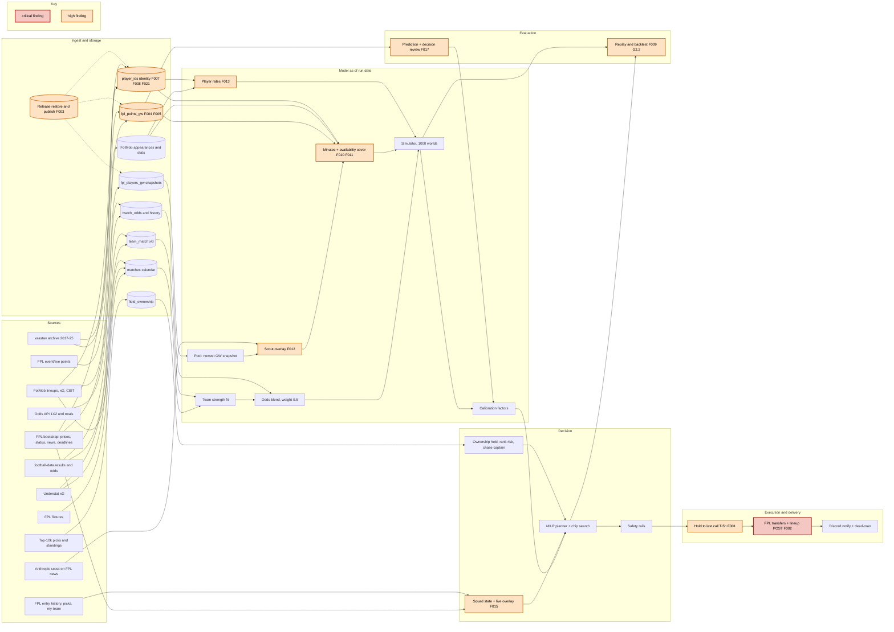

fpl-ai-agent · fixed code 436aa86 · production still runs b3cacf0 · 2026-10-18

# FPL Input Flow Audit

Every input the agent reads at a deadline was traced from its source to the decision on the fixed code, with read-only checks against today's production database, FPL's public API and the production run logs. The data matches its sources, and today's GW8 plan rebuilds exactly. The weak points are how some of it is loaded and linked, what parts of the model do with it, and the live write path, which production already uses. 35 of the 112 confirmed findings are in code our fixes added.

Companion pages: [FPL Agent Fixes](https://claude.ai/artifact/UMSRCk5e4BtMkE8xy14FR7) (what we changed, now marked where this audit qualifies it) · [FPL Agent Audit](https://claude.ai/artifact/JLedXnpkT54z6p2s83DCHX) (the 15 October audit of the received code)

Confirmed findings

112

1 critical · 15 high · 49 medium · 47 low

From our fixes

35

2 high · 19 medium · 14 low; the other 77 were in the received code

Accuracy vs received

Level

GW6–7 Δ MSE +0.004 (SE 0.054), with less bias

Pipeline stages

2 broken

of 21: 9 need work, 9 minor issues, 1 sound

A finding counts as confirmed when its verifiers could not refute it. Each one first rated critical or high had three independent verifiers, and each of the rest had one skeptic. The accuracy figure compares the fixed and received code on the same real GW6–7 outcomes: no detectable difference in squared error, and total GW6 points closer to the real 899 (891 against 855).

## Before the GW8 deadline: Friday 23 October, 17:30 UTC

Production still runs the code we received, in live mode. Three confirmed findings meet on deadline day:

- [F002](#f-F002) **Critical.** FPL carries out the transfer request that the bot sends as a preview. The confirm request that follows fails with HTTP 400, so the run skips the lineup and captain and ends as failed. Both live transfer runs in the logs did this (9 and 10 October, both in a Wildcard week).
- [F001](#f-F001) **High.** Moves wait until 5 hours before the deadline, and runs closer than 45 minutes are dropped. GitHub ran the 2-hourly schedule about 4 times a day, so at 28–37% of deadlines no run lands in that window. The week's moves, lineup and captain are then lost, and no alarm fires.
- [F015](#f-F015) **High.** An active Bench Boost or Triple Captain is read as used, so later runs plan without it.

For GW8 the plan is Truffert to Konsa, with Palmer as captain. A run between 12:30 and 16:45 UTC will probably make the transfer and leave the captain on Haaland from GW7, about 0.6 xP lower on today's plan, unless another run follows in that window. If no run lands in the window, nothing is done.

**These are your call; nothing has been changed.**

- **Check by hand.** No bot run can act after 16:45 UTC, so check the team in the FPL app then, and set the captain and lineup yourself if needed. This works whatever else you choose.
- **Go dry for the week.** Set AGENT_MODE to dry before 12:30 UTC and make the transfer yourself from the plan message.
- **Fix it first.** Get a fix for F002 onto master before Friday. That needs write access to the repository; I can write it on the branch.

## The flow, end to end

Sources on the left; the decision and the write to FPL on the right. Red marks the stage with the critical finding, orange the stages with high ones, and the labels carry finding IDs. On a narrow screen, scroll the map sideways.

## Stage by stage

21 stages in pipeline order. "Sound" means no confirmed finding; "broken" means the stage does not do its job today.

### Ingest: FPL players and snapshots

sound

The newest snapshot equals the live bootstrap for 667/667 players on price, club and position. Planner, rails, minutes model and scout all handle a NULL chance the same way. Every snapshot labelled GW N predates the GW N deadline. Identities are one-to-one, and the 6h stale-snapshot rail and the fail-closed paths work. The only gap, no 2026 snapshots before GW6, is listed under features (F023).

No confirmed finding

### Ingest: FPL fixtures and calendar

minor issues

All 380 2026 fixtures match FPL on gameweek, clubs and scores, and on UTC kickoff for GW1-9. FotMob rounds no longer overwrite FPL gameweeks, and every archive match carries an FPL gameweek. Understat and FotMob still overwrite FPL kickoffs, so 52 future fixtures differ by up to 53h. An unscheduled, unlinked fixture could take FotMob's round.

Findings [F060](#f-F060) [F061](#f-F061)

### Ingest: FPL official points

needs work

Stored GW1-6 points equal FPL's live feed exactly and reconcile with season totals. Four problems remain. A blank-gameweek placeholder row (fixture 0, 0 minutes) would cut nailed starters' P(start) from 0.853 to 0.430. Points load only on Tuesdays, so the plans after midweek GW13 and GW18 miss that gameweek. An empty settle feed can wipe a stored gameweek. The points-vs-rules check examines 0 rows.

Findings [F004](#f-F004) [F005](#f-F005) [F018](#f-F018) [F046](#f-F046) [F062](#f-F062) [F063](#f-F063)

### Ingest: FPL entry and squad state

minor issues

Bank 2, squad value, all 15 selling prices, free transfers (GW8 = 1), chips left and transfers already made all match FPL. The live overlay reads my-team correctly in production. Entry replies are not schema-checked, and late-entry price fallbacks can overstate selling prices (dry mode only).

Findings [F065](#f-F065) [F066](#f-F066)

### Ingest: FotMob

minor issues

FotMob DefCon proxies, xG/xA and minutes agree with FPL (CBIT MAE 0.01, xG r 0.997, 0 start mismatches), and every finished 2026 match up to this morning's run is stored. One malformed page aborts its whole competition-season every night, leaving 944 matches stuck. Missing defensive stats are stored as 0, which inflates the SCO1/ENG3/BEL1 translation factors by 10-26%.

Findings [F019](#f-F019) [F020](#f-F020)

### Ingest: Understat, football-data, clubs

minor issues

ENG1/ENG2 match and club identity is clean, and goals agree across sources. 18 foreign clubs are stored twice, so about 2,700 fixtures enter the strength fit twice. football-data's 2026 xG is a copy of FotMob's, Understat rows are not validated, and the score check compares only home goals. Each moves PL goal rates by under 1% today.

Findings [F022](#f-F022) [F064](#f-F064) [F070](#f-F070) [F085](#f-F085)

### Ingest: Odds API

minor issues

Production fetches land before deadlines, match fixtures one-to-one, de-vig cleanly and exclude closing prices. Every fetch is now kept in match_odds_history. Stored prices are still blended when the run says 'odds skipped', credit use is under-counted 4x, and master overwrote 590 of the 620 prices its runs used.

Findings [F072](#f-F072) [F067](#f-F067) [G4.3](#f-G4-3)

### Identity linking (FotMob, archive, clubs)

needs work

FPL keys are stable and one-to-one. In a dry run the new club-aware linker made 79 links, all confirmed by FPL minutes, but it has never run on this database. 53 of 324 regulars (B. Fernandes, Joao Pedro, Raya, Konsa) project from position priors, and 364 legacy multi-id records block the linker. Other people's history sits on 8 current players. Archive players are linked by name only, which splits renamed players and makes fits non-deterministic. New signings stay on priors until after their debut.

Findings [F006](#f-F006) [F007](#f-F007) [F008](#f-F008) [F021](#f-F021) [G2.1](#f-G2-1) [G2.3](#f-G2-3)

### Features and point-in-time cuts (live)

minor issues

Live reads are point-in-time: snapshots come from before the deadline, FotMob, strength and translation are cut at as_of, calibration uses only past gameweeks, and the live stub row matches the training features. 2026 GW1-5 have no snapshot, so 3,216 history rows lack club, position and price, and BPS noise is fitted on one gameweek. days_rest, congestion and loan spells are only approximated.

Findings [F023](#f-F023) [F068](#f-F068) [F069](#f-F069) [G2.4](#f-G2-4)

### Minutes model and availability overlay

needs work

Each club has exactly one expected starting keeper, ruled-out players are at 0, and club starter sums are closer to 11 (error 0.837 down to 0.353). Without the cold start, the fixed model beats the received one (GW6 log loss 0.2481 vs 0.2570). With the new cold-start blend it is worse than received (0.2648). P(start) is compressed, so nailed starters are about 10% low (Haaland 0.83). The cover gave Danns 3.4 xP although they played 0 minutes, and gave Hull and Coventry 12.4-12.6 starters. Stated return dates are ignored, and the 2022 start labels are mixed with proxy labels.

Findings [F010](#f-F010) [F011](#f-F011) [F024](#f-F024) [F025](#f-F025) [F026](#f-F026) [F027](#f-F027) [G1.1](#f-G1-1)

### Team strength and odds blend

minor issues

The fit is point-in-time, its analytic gradient matches the numeric one, and it agrees with bookmakers (goal-difference correlation 0.934; draw rate 0.235 vs 0.241). Live and evaluation use the same blend weight. One home advantage pooled over all leagues overstates the PL home edge by about 2%. The prior for an unseen club is far too weak (not reached today). Nothing records or alerts on the model-market gap, which persists by team.

Findings [F032](#f-F032) [F071](#f-F071) [G4.2](#f-G4-2)

### Player rates (xG, xA, DefCon, set pieces)

needs work

FotMob shares, the xG coverage fill and the within-player DefCon dispersion fix check out. The xA prior reuses the xG prior, so prior-source forwards gain 0.3-0.5 xP a gameweek. Priors are measured by FotMob position but applied by FPL position, and DefCon favours midfielders over defenders. Penalty xG is counted twice, and that bonus alone decides this week's Palmer-over-Mbeumo captain margin.

Findings [F013](#f-F013) [F030](#f-F030) [F031](#f-F031) [G3.1](#f-G3-1) [G3.2](#f-G3-2)

### Points simulation and calibration

minor issues

The rules engine matches FPL on all 3,883 2026 rows, team goals are conserved, saves and minutes averages match FPL, and calibration now learns from raw projections. Haaland's 4.6 follows from its inputs and is not a regression. The simulator gives assists on 75% of goals vs FPL's 89-95%, so about 18% of assist points are missing. The starter cap shrinks nailed players at deep clubs, one minutes shape serves every position, and a calibration factor below 1 removes 10-point hauls from the haul chance.

Findings [F033](#f-F033) [F034](#f-F034) [F073](#f-F073) [F074](#f-F074) [G1.3](#f-G1-3)

### Soft input: scout

broken

Its bounds hold and the prompt-injection risk is small. But in all 10 live production runs checked, the scout adjusted 0 players and logged no failure, while every run paid for the call. 12-15 of its 40 slots go to players it may not change, and its answers are not cached and cannot be reproduced.

Findings [F012](#f-F012) [F028](#f-F028) [F029](#f-F029)

### Ownership, rank target and captain

needs work

The top-10k sample is fresh and well formed (n=200, 15.0 players per manager), and today's chase captain costs 0.000 xP. The rank-risk term plus the ownership hold is an undisclosed tax: it changes this week's sale (pure xP would sell De Cuyper, not Truffert) and costs 9.6-12.4 xP over 8 gameweeks. A failed standings read silently switches the captain to Haaland (-0.6 xP). EO counts last week's chips, and the Free Hit squad ignores the hold.

Findings [F014](#f-F014) [F035](#f-F035) [F036](#f-F036) [F076](#f-F076) [F079](#f-F079) [F083](#f-F083) [G5.3](#f-G5-3)

### Decision: planner and chip search

needs work

Today's decision rebuilds exactly (Truffert to Konsa, captain Palmer, vice Mbeumo), and budget, 3-per-club, formation, bench order, free-transfer banking, chip windows and hit caps all hold. But an active Bench Boost or Triple Captain is treated as used, and an executed Free Hit as hand transfers. Two must-use chips on a shared last week are picked by YAML file order, which throws away a 9.1-point Bench Boost for a 4.8-point Free Hit. The Wildcard lock forbids buy-backs FPL accepts. Chip bars mix discounted and undiscounted gains, and solves that hit the time limit are accepted silently.

Findings [F015](#f-F015) [G5.4](#f-G5-4) [G5.1](#f-G5-1) [G5.5](#f-G5-5) [F037](#f-F037) [F038](#f-F038) [F039](#f-F039) [F075](#f-F075) [F077](#f-F077) [F078](#f-F078) [F080](#f-F080) [F081](#f-F081)

### Deadline timing and live execution

broken

Dry mode makes no requests and a failed sign-in sends nothing. FPL accepts the lineup payload and the position-paired transfers, and the new read-back checks squad, XI, captain and chip. But FPL carries out the confirmed=false 'preview' POST, so live transfer runs make the moves, then fail, skip the lineup and never check bank or hit cost. Held moves need a run 0.75-5h before the deadline, which GitHub cron misses at 28-37% of deadlines. The price-change model assumes the wrong update time.

Findings [F002](#f-F002) [F001](#f-F001) [G5.2](#f-G5-2) [F040](#f-F040) [F050](#f-F050)

### Notify, alerting and health

needs work

Delivery records, retries, throttling and alert ordering work, and the quality gate passes. But the dead-man alarm fails together with the plan job, and blocked runs exit 0 silently. After moves are made, the next run reports 'transfers now: none', and every lineup-only run re-sends the whole plan. Late changes are compared with the stored plan rather than the delivered one. The data-currency line shows fixtures '166h old', and odds fresh when none were fetched.

Findings [F016](#f-F016) [F044](#f-F044) [F041](#f-F041) [F042](#f-F042) [F043](#f-F043) [F045](#f-F045) [F047](#f-F047) [F084](#f-F084) [F086](#f-F086)

### Ops: restore, publish, scheduling, credentials

needs work

Restore works on the real legacy asset, the first publish passes the shrink guard, bad data never publishes, publishers are serialised and no secrets reach logs. But restore would prefer any re-uploaded legacy archive over the verified dated copies, and quarantine can delete ledger rows. The weekly job gains a \~68-minute check inside a 90-minute limit. Retention covers only about 8-18 hours, and credentials reach every job step.

Findings [F003](#f-F003) [F049](#f-F049) [F048](#f-F048) [F089](#f-F089) [F087](#f-F087) [F088](#f-F088)

### Evaluation: review, backtest, replay

needs work

Closing prices are gone, paired statistics and calibration are correct, and replay is deterministic (master's identical replays differed by up to 75 points). But the decision review scores the newest plan row, not the team FPL fielded (GW6: 47 vs FPL's 41). Archive seasons are 0-68% linked to FotMob, and identity has no known-at time. Replay omits the ownership layer and recent hits, cuts at the kickoff date instead of the deadline, and prices all 8 horizon weeks with later prices. It also applies 2026 rules to 2024/25 and misreports its odds parity, and trial ledgers are lost in CI.

Findings [F017](#f-F017) [F009](#f-F009) [G2.2](#f-G2-2) [F051](#f-F051) [F052](#f-F052) [F053](#f-F053) [F054](#f-F054) [F055](#f-F055) [F056](#f-F056) [F057](#f-F057) [F058](#f-F058) [F059](#f-F059) [F090](#f-F090) [F091](#f-F091) [F092](#f-F092) [F093](#f-F093) [G1.2](#f-G1-2) [G4.1](#f-G4-1)

### Tests and CI

minor issues

None of the 20 fix commits has run in CI, but all 86 tests that never ran on HEAD pass locally, as do ruff and the CI smoke step, and about 200 tests were added. Missing tests: one pinning the new cover weight, one for the DGW, chip-hold and plan-change wiring, and one for the new ledger and pipeline wiring.

Findings [G6.1](#f-G6-1) [G6.2](#f-G6-2) [G6.3](#f-G6-3)

## Fix order

The audit's order: the live write path and chips first, then data that could be lost or is corrupted, then the model, then messages, evaluation and hygiene. Effort is the audit's estimate.

1. ### Send live transfers once and verify bank, cost and lineup

   medium effort

   Critical, and already live on master. FPL carries out the confirmed=false 'preview' POST, so every live transfer week makes the moves, then fails on the confirm POST. The run then skips the XI and captain and never checks bank or hit cost (runs 37996069114, 38034976732).

   [F002](#f-F002)
2. ### Guarantee a last-call run and set the lineup on held runs

   medium effort

   At 28-37% of deadlines no run lands 0.75-5h before the deadline, so held transfers, the Wildcard or Free Hit, and the lineup and captain are silently lost. A crowded must-use Free Hit can be lost for good. Blocked runs exit 0, and the dead-man fails together with the plan job.

   [F001](#f-F001) [G5.2](#f-G5-2) [F044](#f-F044) [F016](#f-F016)
3. ### Carry active chips through re-plans

   medium effort

   An active Bench Boost or Triple Captain is treated as used, so later runs plan without it, re-send the lineup with chip null, or plan a second chip. An executed Free Hit reads as hand transfers, and the Wildcard lock blocks buy-backs FPL accepted. All of this happens in the highest-value weeks.

   [F015](#f-F015) [G5.4](#f-G5-4) [F037](#f-F037)
4. ### Stop restore preferring the legacy archive; never delete ledger rows

   small effort

   A re-uploaded legacy football-db.tar.zst would replace the verified dated copies and still pass the shrink check (a simulation lost decision and odds-history rows), so live plans could run on lost history. Quarantine can delete point-in-time odds rows, and only about 8-18h of copies are kept.

   [F003](#f-F003) [F049](#f-F049) [F089](#f-F089)
5. ### Clean the points history the minutes model trains on

   medium effort

   These are corrupted training inputs. One blank-gameweek row cuts nailed starters' P(start) from 0.853 to 0.430 in chip weeks. Plans after midweek GW13 and GW18 miss that gameweek, and an empty settle feed can wipe stored points. GW1-5 lack snapshots, so BPS noise rests on one gameweek, and the scoring check examines 0 rows.

   [F004](#f-F004) [F005](#f-F005) [F018](#f-F018) [F023](#f-F023) [F046](#f-F046) [F062](#f-F062) [F063](#f-F063)
6. ### Repair player identity and link before every plan

   large effort

   53 of 324 regulars project from priors: Bruno Fernandes runs about 0.7 pts a gameweek low and teammate Mbeumo about 0.4 high. Other people's history sits on 8 current players, and renamed archive players lose their history. Tied merged rows make fits non-deterministic, and new signings stay on priors until after their debut.

   [F006](#f-F006) [F007](#f-F007) [F008](#f-F008) [F021](#f-F021) [G2.1](#f-G2-1) [G2.3](#f-G2-3)
7. ### Fix the minutes layer: drop the cold-start blend, calibrate P(start), bound the cover

   medium effort

   The shipped minutes layer is worse than the received code (GW6 log loss 0.2648 vs 0.2570; 0.2481 without the blend). Nailed starters run about 10% low, the main reason Haaland shows 4.6. The cover gave Danns 3.4 xP and Hull and Coventry 12.4-12.6 starters. Return dates and ban lengths are ignored.

   [F010](#f-F010) [F011](#f-F011) [G1.1](#f-G1-1) [F024](#f-F024) [F026](#f-F026) [F025](#f-F025) [F034](#f-F034) [F027](#f-F027) [G2.4](#f-G2-4) [F068](#f-F068) [F069](#f-F069)
8. ### Make the scout fail loudly and spend its slots on real news

   small effort

   Zero adjustments in all 10 live runs checked, with no failure logged, while every run pays for the call. 12-15 of its 40 slots go to players it may not change, and its answers are not cached and cannot be reproduced.

   [F012](#f-F012) [F028](#f-F028) [F029](#f-F029)
9. ### Correct player-rate priors, penalties and assists

   medium effort

   Prior-source forwards get 2.6x a forward's real assist share (+0.3-0.5 xP a gameweek), and priors use the wrong position. DefCon favours midfielders over defenders. Penalty xG is counted twice, and that alone decides this week's Palmer-over-Mbeumo captaincy. About 18% of assist points are missing.

   [F013](#f-F013) [F030](#f-F030) [F031](#f-F031) [G3.1](#f-G3-1) [G3.2](#f-G3-2) [F033](#f-F033)
10. ### Make the ownership layer visible and stable

    small effort

    Rank risk plus the hold changes this week's transfer and costs 9.6-12.4 xP over 8 gameweeks, and the report never shows it. A failed standings read silently switches the captain to Haaland (-0.6 xP). EO counts last week's Triple Captains, and Free Hit squads drop the players the report says are held.

    [F014](#f-F014) [F036](#f-F036) [F035](#f-F035) [G5.3](#f-G5-3) [F076](#f-F076) [F079](#f-F079) [F083](#f-F083)
11. ### Fix chip choice and solver reporting

    small effort

    Two must-use chips on a shared last week are picked by YAML file order, which loses a 9.1-point Bench Boost for a 4.8-point Free Hit. Chip bars mix discounted and undiscounted gains, and solves that hit the time limit pass silently. Reported xp uses the planner's captain, not the captain sent (+0.6 today).

    [G5.1](#f-G5-1) [G5.5](#f-G5-5) [F038](#f-F038) [F039](#f-F039) [F081](#f-F081) [F075](#f-F075) [F077](#f-F077) [F078](#f-F078) [F080](#f-F080)
12. ### Re-time price-change pressure

    small effort

    The model assumes a 01:30 UTC price update (observed about 23:00) and predicts changes with 9.7% precision. FPL's own price_change_percent separated rises (17/17) and falls (69/70) cleanly. Wrong timing costs either team news or 0.1m of value.

    [F040](#f-F040)
13. ### One odds-horizon rule, labelled and monitored

    small effort

    Stored prices are blended with no age limit while the report says 'odds skipped' (GW8 goal rates moved by up to 9.8%). Live runs price 1-2 of the 8 horizon weeks, but replay prices all 8, using prices collected later. Model-market gaps are not recorded, and credit use is under-counted 4x.

    [F072](#f-F072) [G4.1](#f-G4-1) [G4.2](#f-G4-2) [G4.3](#f-G4-3) [F067](#f-F067)
14. ### Make messages and freshness notes tell the truth

    medium effort

    After moves are made the next run says 'transfers now: none', and every lineup-only run re-sends the plan. A change made before team news is never sent, and transfer lines are paired by list order (Haaland to Raya). The freshness line shows fixtures 166h old and odds fresh when none were fetched. One ENG3 error silently drops a whole weekly update.

    [F041](#f-F041) [F042](#f-F042) [F043](#f-F043) [F045](#f-F045) [F084](#f-F084) [F047](#f-F047) [F086](#f-F086)
15. ### Make evaluation measure the model and policy that play

    large effort

    The review scores the newest plan row (GW6: 47 vs FPL's 41). Replay lacks the ownership layer, recent hits, identity known-at time and deadline cuts, uses 2026 rules for 2024/25, and loses its ledgers in CI. This does not change this week's points, but every tuning decision rests on it.

    [F017](#f-F017) [F009](#f-F009) [G2.2](#f-G2-2) [F056](#f-F056) [G1.2](#f-G1-2) [F051](#f-F051) [F053](#f-F053) [F054](#f-F054) [F055](#f-F055) [F052](#f-F052) [F057](#f-F057) [F058](#f-F058) [F059](#f-F059) [F090](#f-F090) [F091](#f-F091) [F092](#f-F092) [F093](#f-F093) [G1.3](#f-G1-3)
16. ### Harden ingest boundaries

    medium effort

    A malformed FotMob page aborts a whole competition-season (944 matches stuck), and missing CBIT is stored as 0 (translation +10-26%). 18 clubs are stored twice, Understat and entry replies are not validated, and FPL kickoffs are overwritten for 52 future fixtures. The PL effect is small today.

    [F019](#f-F019) [F020](#f-F020) [F022](#f-F022) [F064](#f-F064) [F065](#f-F065) [F060](#f-F060) [F061](#f-F061) [F070](#f-F070) [F085](#f-F085) [F066](#f-F066)
17. ### Ops and credential hygiene

    small effort

    The weekly job gains a \~68-minute check inside its 90-minute limit. Two runs can spend the same single-use FPL token. A failed secret write-back throws away a valid token, and credentials reach every step, including third-party actions.

    [F048](#f-F048) [F050](#f-F050) [F087](#f-F087) [F088](#f-F088)
18. ### Low-impact model refinements

    small effort

    These are small systematic biases. The pooled home advantage puts PL home rates about 2% high. The prior for an unseen club sits far below the PL's weakest clubs. One minutes shape serves every position, and penalty misses happen about 3x too often. Calibration below 1 removes 10-point hauls.

    [F032](#f-F032) [F071](#f-F071) [F073](#f-F073) [F074](#f-F074)
19. ### Pin the fixes with tests and run CI on the branch

    small effort

    None of the 20 fix commits has run in CI. The new cover weight, the DGW, chip-hold and plan-change wiring, and the ledger wiring have no test that would catch a regression.

    [G6.1](#f-G6-1) [G6.2](#f-G6-2) [G6.3](#f-G6-3)

## All 112 findings

Each entry names the file and line and gives the impact and the fix. "Evidence and verification" opens what the code does, what real data showed and each verifier's reasoning. "Received code" means the problem was already in b3cacf0; "our fixes" means it is in code the 20 fix commits added.

Severity

[x] Critical 1 [x] High 15 [x] Medium 49 [x] Low 47

Origin

Stage

Search

Showing 112 of 112

critical · 1

[F002](#f-F002)criticalreceived code3 verifiers: 2 confirmed, 1 partly

### FPL executes the 'preview' transfers POST (confirmed=false): live transfer runs make the moves, then report failure or 'blocked' and skip the lineup and captain

src/fpl_agent/execution/execute.py:153 · execution (live transfers write)

Impact

Bank and hit cost are never checked before the move (readback_diff ignores cost); every live transfer week reports failure while the moves are made, relies on a later run to set XI/captain, and can freeze Wildcard refinement.

Fix

Send POST /api/transfers/ once (FPL has no non-binding preview); check bank, free transfers and cost against the GET my-team already made (execute.py:146) beforehand; on 2xx set the lineup, record live-done and verify squad, bank and transfers.cost in the read-back; on 4xx re-read my-team and treat the move as applied only if the planned squad is there; make FakeFPL apply transfers on the first POST.

Evidence and verification

Input

FPL POST /api/transfers/ (confirmed=false then confirmed=true); live squad after execution

In the code

execute.py:153-169 posts confirmed=False as a 'preview', compares the reply (skipped when empty), then posts confirmed=True; a differing reply only appends 'blocked'. readback expects the old squad when transfers_done is False (:69-76), and the lineup is skipped when the XI needs incoming players (:174). FakeFPL (tests/test_execution.py) applies transfers only on confirmed=True, a contract production disproves; master b3cacf0 (run 39045123319) has the same sequence.

On real data

Run 37996069114 (preview-only code d434245) logged 'preview differs from plan ... preview \[\]' at 21:56:26.97Z, yet GET entry/8700026/transfers/ shows all 13 planned element_in for event 6 at 21:56:24.16Z and history shows the Wildcard at 21:56:24.157827Z. Run 38034976732 (two-POST code 3f30ec4): FPL logged its 6 planned swaps at 2026-10-10T07:37:22.98Z, then the run got 'HTTP 400 POST /api/transfers/: Element in is already picked / Element out is not a current pick' at 07:37:25.31Z, 'lineup not set', exit 2. Both were Wildcard-week payloads; a non-chip week was not observed (gh run view \<id> --log).

How it goes wrong

A GW8 last-call run plans Truffert->Konsa: POST#1 makes the move (and would play any Wildcard/Free Hit in the payload); then either 'blocked by rails' (no transfers echo) or POST#2 returns 400. XI and captain are not set, the run exits 2, no live-done row is written, and the next run may log the bot's own move as a hand edit, clearing wildcard_active. On 436aa86 Discord gets only 'PLAN RUN FAILURE'; production master sends nothing.

Code check · confirmed · rates it critical

The code does what the finding says, and FPL's public data shows that the confirmed=false "preview" POST really makes the transfers.

Code on 436aa86, execute.py:151-169. POST #1 sends transfers_payload(..., False, ...). If the reply is non-empty and differs from the plan, the run only appends "preview differs from plan" to blocked. If not, it sends POST #2 with confirmed=True. An HTTPError on #2 only appends "transfers failed ... trying the lineup" (:172-173) and transfers_done stays False. The lineup at :174 is then skipped whenever the XI needs incoming players. \_expected_squad (:69-73) gives the read-back the old squad when transfers_done is False, so the read-back reports a mismatch against the squad FPL now holds. Nothing re-reads my-team after the 400 to see whether the moves landed.

preview_matches (fpl_writer.py:70-84) checks bank and points cost only from the POST #1 reply, which arrives after the move. readback_diff (:86ff) checks squad, lineup and chip, never bank or cost. So nothing checks cost before the move is made.

The test double encodes the wrong contract: tests/test_execution.py:205 applies transfers only when body confirmed is True.

The same sequence is in b3cacf0's execute.py (grep shows preview_matches and the preview/confirm lines at :129-133), and 3f30ec4 is an ancestor of b3cacf0, so the origin is pre-existing.

The only guard is the held-players check at :146-150. It lets a later run see the incoming players already held, skip the transfer POST and set the lineup. That limits the damage to "the run that makes the move never sets XI/captain and reports failure". If that run is the last call before the deadline, the XI and captain stay unset for the week.

Overstated or unverified parts (they do not change the verdict):

- "The next run may log the bot's own move as a hand edit, clearing wildcard_active": not shown. Run 38034976732 instead logged "your Wildcard is active ... re-planning the whole squad".
- "Discord gets only PLAN RUN FAILURE": not measured.
- Behaviour in a non-chip week: not observed, as the finding itself says.

Reproduction · confirmed · rates it critical

I could not refute the core claim, and I reproduced it.\
(1) In production, FPL carries out the confirmed=false POST. In run 37996069114 (code d434245), a "preview differs" result meant the confirm call was never sent: execute.py at d434245 only posts confirmed=True in the else branch, and the log shows "blocked by rails: preview differs from plan ... preview \[\]". Even so, the public FPL transfers endpoint records all 13 planned element_in for event 6 at 21:56:24.16Z, and history shows the Wildcard played at 21:56:24.157827Z. No other plan run overlapped: the previous one ended at 21:37 and the next started at 22:18.\
(2) Two-POST code (run 38034976732, 3f30ec4): FPL recorded 6 swaps at 07:37:22.98Z, then the run logged HTTP 400 "Element in is already picked / Element out is not a current pick", then "lineup not set", then exit 2. That pattern only fits the first POST having been binding.\
(3) HEAD 436aa86 sends the same sequence. Lines 152-169 post confirmed=False, then post confirmed=True only when the reply matches, otherwise they mark it 'blocked'. Line 174 skips the lineup unless transfers_done is set, and line 72 expects the old squad when transfers_done is False. The diff from b3cacf0 only adds notes and a fuller read-back, so the defect is pre-existing.\
(4) Synthetic repro against HEAD's execute(): I used a FakeFPL subclass where the first transfers POST is binding and any later one gets a 400, on a non-chip plan with 1 transfer. All three reply shapes (echo, a dict with no transfers, empty) gave: FPL squad moved = True, lineup posted = False, ok = False, done = \[\]. Each also gave either "transfers failed (HTTP 400 ...)" or "preview differs ... blocked", plus "read-back does not match the plan: owned players differ". The repo's FakeFPL (tests/test_execution.py:205) applies moves only when confirmed is True, so the shipped tests cannot catch this.\
Caveats that soften but do not refute it:

- The read-back does flag an error, so the failure is not silent in the outcome.
- A later live run recovers: read_live rebuilds the state from FPL's current squad, and the "already in place" branch then sets the XI and captain. That only helps if another run happens before the deadline. Moves are made only within LAST_CALL = 5h of the deadline, and the observed gaps between scheduled cron runs were 3-6h, so the transferring run can be the last one.
- The plan's budget and hit counts are still checked by the safety rails on the live state. What the preview check cannot do is block anything, because by the time it runs FPL has already carried out the moves, including any Wildcard or Free Hit chip in the payload.
- Not observed: a non-chip week in production (the GW7 transfers on 10-15 at 09:19-09:20 do not line up with any bot run's time window).
- Not verified: the Discord 'PLAN RUN FAILURE' detail and the wildcard_active-clearing path.

Impact check · partly · rates it high

The core mechanism is real and pre-existing. FPL's POST /api/transfers/ with confirmed=false is binding. On 436aa86 (and b3cacf0), every live transfer run makes the moves on the first POST. It then either blocks ("preview differs", when the reply has no transfers list) or sends a second POST that fails with 400 (when the reply is empty). Either way transfers_done stays False, so the lineup, captain and any Bench Boost or Triple Captain are skipped (execute.py:174). The read-back expects the old squad (execute.py:72-73), the run exits 2 and no live-done row is written (agent.py:359).

Where the finding overstates things:\
(1) The moves themselves are not wrong. They are exactly the planned moves: in run 1 the recorded element_in list matched the plan's 13 ids one for one. The harm is what gets left out (lineup, captain, BB/TC) plus a false failure every transfer week. It is not "wrong live actions or corrupted decisions every week", so it is not critical.\
(2) "Bank and hit cost are never checked before the move" is too strong. safety.check rejects bank_after\<0 and enforces hit caps on the plan before anything is sent (safety.py:183-201). What is illusory is only the FPL-side cross-check of cost and bank.\
(3) Later code limits the damage. A later run in the 0.75-5h window plans from the live team, which already holds the incoming player. With no live-done row, manual_changes returns \[\], so that run sets the lineup and captain normally. The "logged as a hand edit / Wildcard frozen" path only happens when an earlier live-done row exists for that gameweek.

The impact is real, though. Held runs (more than 5h out) never set the lineup either (agent.py hold branch). Scheduled runs come irregularly: on 10-17 they started at 00:19, 06:51, 12:07, 15:27 and 18:23 even though the cron is every 2h. The GW8 deadline is 2026-10-23T17:30Z. So the only lineup-setting run in that window may be the one that makes the transfer. Then the captain stays at the previous setting (Haaland, set in GW7) and the GW8 lineup or a planned BB/TC is not applied. On today's local plan that costs roughly 0.6 expected points (Palmer 5.2 vs Haaland 4.6, computed without odds). A chip week could lose more. Every transfer week also reports a false failure, which hides real ones.

Re-grade: high. It reliably breaks lineup/captain/chip setting and the fail-closed verification in transfer weeks, with variable but usually small points impact, and the planned moves themselves are made correctly.

high · 15

[F004](#f-F004)highreceived code3 verifiers: 3 confirmed

### Blank-gameweek placeholder rows (fixture 0, 0 minutes) enter the minutes model as missed matches; the archive it trains on has none

src/fpl_agent/db/ingest_fpl.py:183 · ingest: points -> minutes features

Impact

Large, silent under-projection of blanking clubs' starters for 1-5 GWs after each blank, exactly when chips are timed.

Fix

Do not write rows for elements with an empty explain list (match the archive), or store them flagged as blanks and drop fixture_id=0 rows in player_gw_frame; add a quality check that every fpl_points_gw row has a real fixture and kickoff, and a test that a blank leaves P(start) unchanged.

Evidence and verification

Input

FPL event/live explain lists -> fpl_points_gw rows with fixture_id 0

In the code

load_live sets 'fixtures = list(explain) or \[0\]', storing fixture 0, minutes 0 and a NULL kickoff for every element without a fixture (unchanged from b3cacf0). player_gw_frame (features.py:38-59) and minutes_features keep the row: zero_streak+1, last_minutes 0, s3/s5/m3 and last_started lowered, days_rest NaN. The vaastav archive has 0 fixture-0 rows in 2017-2025 despite 2-9 blank GWs per season (e.g. 2025 GW31 has 8 fixtures, GW34 has 7), so training never sees them.

On real data

No 2026 blank yet; GET event/7/live shows all 667 elements carrying an explain entry for their scheduled fixture before kickoff, so a club without a fixture would get an empty list. Production minutes model fitted read-only to 2026 GW6 on the 111 players who started all six GWs: mean next-GW P(start) 0.853 without vs 0.430 with one blank row appended (mean -0.42; all 111 drop by more than 0.10); controls: no blank, forecasting GW8 0.844; a blank row with a kickoff 0.389, so the 0-minute row causes the drop (fpl-points blank_effect.py, q10.sql). minutes phantom.py: one placeholder row before the GW8 stub drops 76 nailed available players from 0.879 to 0.468.

How it goes wrong

After an FA Cup blank (usually 4-8 clubs) every player of those clubs gets a 0-minute row. The next plan, usually a DGW for the same clubs, projects their regulars at about half their start probability for both fixtures, so the planner sells or benches them, and Bench Boost, Free Hit, Triple Captain and transfers around BGW/DGW are mis-valued. Replays cannot show it, and the log shows nothing.

Code check · confirmed · rates it high

I tried to refute this and could not. Every link in the chain is present on 436aa86. Nothing between ingest and the minutes model catches it.

1\. Ingest. src/fpl_agent/db/ingest_fpl.py:183 has `fixtures = list(explain) or [0]`. When an element's explain list is empty, this writes one row with fixture_id 0. Because len(fixtures)==1, minutes and points come from the GW-total stats, which are 0 for a blank. The kickoff is `kickoffs.get(0)`, which is NULL. The same line is at line 118 of b3cacf0, so the origin is pre-existing. pipeline.py:121-139 is the only caller (the live points loop). Its contract, contracts.fpl_live (contracts.py:50-59), only checks for the keys id, stats and explain on the first element, so an empty explain list passes.

2\. No filter downstream. The query in features.player_gw_frame (features.py:38-59) only filters `f.player_id IS NOT NULL`. minutes_features (features.py:98-131) has no fixture or kickoff guard. MinutesModel.fit/training_rows and forecast (minutes.py:130-240) add the player's next-GW stub after all of their history rows, including a placeholder row. project.py:223-226 builds history from player_gw_frame without filtering. I grepped src/ for fixture_id 0 or blank guards and found only the captain_blank rail (safety.py:214) and comments. quality.py:80 checks only for a NULL player_id. coherent_starts does not compensate. It moves starts only away from players marked unavailable, so a whole squad lowered together stays lowered.

3\. The training data has no such rows. A read-only query of fpl_points_gw found 0 rows with fixture_id 0 and 0 with a NULL kickoff in every season from 2017 to 2026. The archive's blank GWs simply have fewer rows: 2025 GW31 has 664 rows over 8 fixtures and GW34 has 582 rows over 7; 2024 GW29 has 639 rows over 8. The model therefore never learns from a 0-minute row that stands for a blank.

4\. Live feed. A public GET of event/7/live returned 667 elements, 0 of them with an empty explain list. That fits the claim that only a club with no fixture would produce an empty list, but no 2026 blank has happened yet, so I could not observe FPL's blank-GW payload directly. That is the one part I could not test. It is also the standard behaviour of the endpoint, and the code was written to handle exactly that case with `or [0]`.

5\. Size of the effect, reproduced independently. I fitted MinutesModel.fit on the production frame (234,094 rows; 2026 holds GW1-6) and took the 111 players who started all six 2026 GWs. With no blank, their mean next-GW P(start) is 0.845. With one appended placeholder row (fixture 0, 0 minutes, starts 0, NULL kickoff) it is 0.408. All 111 players drop by more than 0.10. A control blank row that has a kickoff gives 0.387, so the 0-minute, 0-start row causes the drop, not the NULL kickoff. This matches the finding's 0.853, 0.430 and 0.389 closely.

The failure scenario follows directly. After a blank (for example an FA Cup quarter-final round), every player of the blanking clubs is projected at about half their start probability at horizon 1. That is usually the following DGW, when chips are played. Later horizons decay toward base_rate, which the extra row only nudges, so the damage is concentrated in the next plan. Nothing logs it.

Severity stays high rather than critical because it only fires in the GWs after a blank (a few times a season), not every week. In those GWs it materially biases transfers, captaincy and chip decisions. Origin: pre-existing (unchanged from b3cacf0). Side note, outside this finding: fpl_points_gw holds 2026 GW1-6 only, even though GW7 is played.

Reproduction · confirmed · rates it high

I reproduced the defect from start to finish. ingest_fpl.load_live (src/fpl_agent/db/ingest_fpl.py:183, `fixtures = list(explain) or [0]`) writes a row with fixture_id 0, 0 minutes, starts 0 and a NULL kickoff for any element whose explain list is empty. Nothing downstream removes these rows. player_gw_frame (features.py:31-59) filters only on `player_id IS NOT NULL`, minutes_features treats the row as a missed match, and quality.py has no check for fixture-0 rows or NULL kickoffs. The training archive has no such rows: every season from 2017 to 2026 has 0 fixture-0 rows and 0 NULL kickoffs, even though blank gameweeks exist (2024 GW15/29/34 and 2025 GW31/34 each have 7-9 distinct fixtures). Blank-club players are simply missing from the archive, while the live path stores them as 0-minute appearances.

Using the production minutes model fitted read-only on the full real frame, one blank row cuts the 111 players who started every 2026 GW from a mean next-GW P(start) of 0.843 to 0.430. 110 of the 111 drop by more than 0.10; the smallest drop is 0.0996, so the finding's "all 111" is off by one player, which does not matter. The control that just skips a gameweek with no row stays at 0.843. A blank row given a real kickoff gives 0.389, so the 0-minute row causes the drop, not the NaT kickoff.

The defect is pre-existing: the same line is at line 118 in b3cacf0, along with the same player_gw_frame filter.

One link I could not check: no 2026 gameweek has blanked yet, so I could not confirm against a real blank gameweek that FPL's event/live returns blank-club elements with `explain: []` rather than leaving them out. Every 2026 element so far has had an explain entry (0 fixture-0 rows in 2026). If FPL did leave them out, the bug would not trigger.

High severity stands. The bias is large and silent, and it hits the gameweek right after a blank, usually a DGW for the same clubs, which is exactly when chips are timed. It is not critical because it only applies around blank gameweeks, not every week.

Impact check · confirmed · rates it high

The finding holds, and it understates the damage. load_live (src/fpl_agent/db/ingest_fpl.py:183, `fixtures = list(explain) or [0]`) writes one row with fixture 0 and the live feed's zeroed stats for every element whose explain list is empty. Kickoff stays NULL because kickoffs.get(0) returns nothing. The same line is in b3cacf0 at ingest_fpl.py:118, so it is pre-existing.

Nothing downstream removes these rows:

- player_gw_frame (features.py:38-59) keeps every row with a player_id.
- started_label marks the row not-started, because 2026 is an official-starts season and the zeroed stats give starts=0.
- minutes_features turns the row into zero_streak +1, last_minutes 0 and lower rolling start rates. days_rest becomes NaN both on the blank row and on the next row, since the next kickoff minus NaT is NaN.
- availability_factor does not help: these players are still flagged 'a', which gives 1.0.
- None of the checks in quality.py look at fixture 0 or NULL kickoff.

The archive the model trains on has no such rows. My query of fpl_points_gw found 0 fixture-0 rows and 0 NULL-kickoff rows in every season 2017-2026, so this input pattern is new to the model.

Production fits the minutes model in project.py:234 (`MinutesModel.fit(history)`) on history that already contains the blank rows. In my realistic simulation that refit makes the effect much worse than the finding says. The model seems to learn that an in-season NaN days_rest means "did not start", and the forecast stub after a blank carries exactly that NaN.

Impact for this season: it hits every club that blanks (FA Cup or League Cup clashes) or, very likely, has a fixture postponed out of its gameweek. Their regular starters would be projected at roughly 10-40% P(start) for the next 1-5 gameweeks. That is exactly the BGW/DGW stretch where Bench Boost, Free Hit, Triple Captain and transfers are decided. Backtests and replays run on the archive cannot show it, and nothing logs it.

Severity: it does not fire every week, only after each blank or postponement. When it fires, decisions are badly biased with no warning. That fits high, not critical.

Not verified: that FPL's event/{gw}/live really returns an empty explain list for a club without a fixture. There has been no 2026 blank yet to check against. The `or [0]` branch exists to handle exactly that case.

Side note, not part of this finding: fpl_points_gw holds only 2026 GW1-6, although the brief says GW1-7 are played. GW7 points may not have been loaded yet. I did not investigate this.

[F005](#f-F005)highreceived code3 verifiers: 2 confirmed, 1 partly

### Official points load only on Tuesdays, so plans after a midweek gameweek (GW14 and GW19 in 2026/27) run without that gameweek's starts and minutes

.github/workflows/plan.yml:93 · history freshness (fpl_points_gw at plan time)

Impact

Stale P(start) and form (the main xPts driver) in the most congested rotation weeks, silently; the replay overstates live performance there.

Fix

Pass --points to the plan workflow's db-update (points_gws_to_load only re-reads missing or unsettled GWs and is idempotent); warn or fail closed when the bootstrap's last finished event has no fpl_points_gw rows; add 'history through GWn' to the data-currency line.

Evidence and verification

Input

fpl_points_gw (minutes/starts history, cards, BPS)

In the code

plan.yml:91-94 runs 'db-update --football-data E0' without --points; run_update loads points only if opts.points (pipeline.py:117); points come only from data.yml weekly (cron '0 9 * * 2') and review.yml (Tue 10:30). build_projection uses history gw \< first (project.py:224-226) and nothing (agent.py, health.py, safety.py) checks that the last finished event has rows. Replay/backtest always have every earlier gameweek (replay.py:369-371, backtest.py:69-71).

On real data

2026/27 calendar (FPL, fetched 2026-10-17): GW14 deadline Sat 2026-12-05 13:30, GW13 ends Wed 12-02 20:00 (points first loaded 12-08); GW19 deadline 2027-01-01 18:30, GW18 ends 12-30 20:00/20:15 (loaded 01-05): 2 of 37 GWs. Past seasons with deadline \~ first kickoff - 90 min (features-pit q4.py, q6.py): 2025/26 6 of 37 (GW15,20,27,34,37,38), 2024/25 11, 2023/24 10, 2022/23 15, 2021/22 16, 2020/21 13. Sensitivity (p4.py B): GW7 2026 P(start) with vs without GW6 rows mean |d| 0.066 over 667 players, 0.119 over 246 likely starters, max 0.52, 141 moved > 0.10 (overstates a 3-day gap). GitHub delays crons: the 01:15Z backfill started 05:34-07:40Z on 10-12..10-17; the data run of 2026-10-13 started 16:48 UTC (5-8h). Script fpl-points midweek.py.

How it goes wrong

Every GW14 run plans from history ending at GW12: a player rotated out midweek keeps their starter features, days_rest is \~8 days instead of 3, and transfers/captain are chosen on stale minutes with no warning, while a replay of the same week has GW13's rows. Reviews and calibration for those weeks lag by a week.

Code check · confirmed · rates it high

I tried to refute this and could not. Every link in the claimed chain holds on 436aa86.

1\. Official points load only when `--points` is passed. In `pipeline.py`, `run_update` reads `fpl_points_gw` only under `if opts.points:` (around line 117). `UpdateOptions.points` defaults to False (pipeline.py:44), and the cli flag is `store_true` (cli.py:483).\
2\. The plan workflow never passes `--points`. `plan.yml` runs every 2 hours (cron "10 \*/2 * * \*") and its refresh step is `db-update ... --football-data E0` with no `--points` (plan.yml:93-94). The b3cacf0 version of that step is the same, so the gap is pre-existing.\
3\. Points do get loaded in three places, none of them before a midweek-to-weekend deadline:

- `data.yml` in weekly mode (cron "0 9 * * 2", Tuesday). Its daily "30 6 * * \*" mode has no `--points`.
- `review.yml` (Tuesday 10:30).
- A manual dispatch.

`backfill.yml` passes no points option. Its `--sources` default is football-data, understat, fotmob and vaastav, and vaastav covers archive seasons.\
4\. The minutes, P(start) and form history comes only from `fpl_points_gw`. `features.player_gw_frame` selects `FROM fpl_points_gw`, and `build_projection` filters that history to `gw < first`, then fits `MinutesModel` and `fit_player_rates` on it (project.py:224-237).\
5\. Nothing fails closed or warns when the last finished gameweek has no rows:

- `health.data_currency` reports only player-snapshot, fixtures and odds ages (health.py:168-177).
- The `safety.check` data rails are `stale_data` (bootstrap next GW differs from the plan's GW), `stale_snapshot`, `missing_projections` and `xp_out_of_bounds`.
- A grep of src for `fpl_points_gw` finds no history-freshness check in `agent.py`, `health.py` or `safety.py`.

6\. Replay and backtest filter the same frame to `gw < gw` with every earlier gameweek present (replay.py \~369, backtest.py \~69). So their history differs from live in exactly these weeks, which breaks train = serve.\
7\. The real calendar matches the finding. I fetched FPL bootstrap and fixtures and found exactly two gameweeks this season whose deadline falls before the next Tuesday 09:00 after the previous gameweek's last kickoff:

- GW14: deadline 2026-12-05 13:30Z, previous last kickoff 12-02 20:00Z.
- GW19: deadline 2027-01-01 18:30Z, previous last kickoff 12-30 20:15Z.

GW8 (deadline 10-23 Fri) is not affected.

Why high rather than critical: it hits 2 of 37 gameweeks this season, not every week. The finder's own P(start) sensitivity used a one-week gap, so it overstates the 3-day case. But the stale history is silent, falls in the most rotation-heavy weeks, and skews replay against live, which fits the high definition. I did not re-measure the past-season counts (6 to 16 per season) or the sensitivity numbers.

The proposed fix is sound: `points_gws_to_load` only re-reads gameweeks that are missing, not `data_checked`, or within the 3-day settle window, and `load_live` deletes then upserts per gameweek, so it is idempotent.

Reproduction · confirmed · rates it high

I reproduced every part of the finding and could not refute any of it.

1\) The plan never loads official points. At HEAD 436aa86, plan.yml:91-94 runs `db-update ... --football-data E0` with no `--points`. Only two workflows pass `--points` (git grep): data.yml:52, which is the weekly branch only, and review.yml:30. The daily data mode (06:30) runs `--football-data E0,E1` without points. The data run is on cron '0 9 * * 2' and the review run on '30 10 * * 2', so both run only on Tuesdays. The backfill (pipeline.py:355-440) loads vaastav only for `season < opts.end`, so it never touches current-season fpl_points_gw. pipeline.py:117 gates the live-points load on opts.points. Nothing else in the plan path calls live_raw: retro.py and gw_summary.py are separate CLI commands.

2\) The plan uses fpl_points_gw as its history and nothing checks it. features.player_gw_frame (features.py:31-45) reads FROM fpl_points_gw. build_projection (project.py:224-226) keeps rows with gw \< first, and the MinutesModel is fitted on that same history (project.py:234). A grep for fpl_points_gw finds no use in agent.py, health.py or safety.py. The data-currency line covers only players, fixtures and odds (health.py:163). Replay builds every earlier GW from the full table (replay.py:344-347, 369-371), so live and replay see different history in these weeks. That breaks train = serve.

3\) The calendar matches the claim (public FPL GETs today). For each GW g I found the first Tuesday 09:00 UTC after GW g-1's last kickoff plus 2h. In 2/37 GWs that load lands after GW g's deadline:

- GW14: GW13 ends 2026-12-02 20:00, deadline 2026-12-05 13:30, points first loaded 2026-12-08.
- GW19: GW18 ends 2026-12-30 20:15, deadline 2027-01-01 18:30, points first loaded 2027-01-05.

The live DB agrees: season 2026 fpl_points_gw holds GW1-6 only. ingest_log shows gw6 loaded on 2026-10-13 17:47, a Tuesday run that started late, which fits the reported cron delay.

4\) Impact (my own run). I fitted MinutesModel once on history through GW5 of 2026 and forecast GW6 twice: with the GW5 rows, and with GW5 removed to simulate the missing gameweek. Over 667 players the mean |dP(start)| was 0.059 and the max 0.766; 120 players moved by more than 0.10. Over the 224 likely starters (p>0.5) the mean |d| was 0.096. The Brier score against actual GW6 starts was 0.0724 with GW5 and 0.0875 without. This agrees in size with the finding's own sensitivity (0.066 mean, 141 players moved more than 0.10).

Caveats:

- My GW5 to GW6 gap is an international break, not a 3-day midweek turnaround, so the size of the effect is only indicative.
- The daily bootstrap refresh still updates status and chance, so injuries picked up in the midweek game are partly covered by the availability overlay. Rotation and minutes-load signals are not.
- Frequency is low this season (2/37 GWs) but higher in other seasons, per the finding's historical counts, which I did not re-measure.

Origin: pre-existing. b3cacf0's plan.yml has the same db-update line without --points. The fixes changed these workflows but did not touch this.

Severity: high stands. The failure is silent, falls in the most congested rotation weeks, and creates a live-vs-replay mismatch. The suggested fix is sound: points_gws_to_load (ingest_fpl.py:124-143) only re-reads finished GWs that are missing, not yet data_checked, or within 3 days of their last kickoff, so adding --points to the plan run is idempotent and cheap.

Impact check · partly · rates it medium

The mechanism is real and pre-existing, and I could not refute it. The plan workflow refreshes without --points. Official points (fpl_points_gw) load only in the weekly data run (Tue 09:00) and in review.yml (Tue 10:30). build_projection takes all of its minutes and starts history from fpl_points_gw (features.player_gw_frame), for gameweeks below the first planned one. Nothing at plan time checks whether the last finished gameweek has rows. FPL's live calendar confirms the two exposed weeks this season. GW13 is all on Wed 2026-12-02 20:00 and GW14's deadline is Sat 12-05 13:30, so the next Tuesday load is 12-08. GW18 is Tue/Wed 12-29/30 and GW19's deadline is Fri 2027-01-01 18:30, so the next load is 01-05. Both GW14 and GW19 plans would run with one gameweek missing. The days_rest feature is computed from the previous kickoff in history (minutes.py:121), so it would read about 6 days instead of about 3 (the finding's "\~8 days" is overstated). Replay has every earlier gameweek, so train and serve differ in exactly these weeks.

Why it is overstated as high:\
(1) Only 2 of 38 live decisions this season are fully exposed. GW18 and GW20 have Tuesday 18:00 deadlines, and their early or provisional Monday plans also lack the previous gameweek. Their later Tuesday plans would pick it up if the delayed Tuesday run finishes in time. GitHub delays are real: the weekly run of 10-13 started at 16:48Z and failed.\
(2) Injuries and suspensions are still mitigated. The availability overlay uses FPL status and chance from the daily snapshot. In production the scout reads the news. What is lost is the rotation signal from one game, not the injury flags.\
(3) The fix alone would not make history fully current. Understat and FotMob, the source of match_frame used for player rates, also load only weekly, so xG rates lag that week as well.\
(4) The claim that reviews and calibration lag a week is not a defect. Review runs on its normal Tuesday cadence after the gameweek settles.

The P(start) sensitivity (mean |d| 0.119 over likely starters) comes from the finding's own script on a 3-week international-break gap, and I did not re-measure it. The finding admits it overstates a 3-day gap, so the size of the effect on this season is not measured. The defect is a silent but limited bias in congested weeks, and it should be fixed cheaply: add --points to plan.yml, which is idempotent through points_gws_to_load, and add a check that history runs through the last finished gameweek. It fits medium: an edge case affecting a few weeks, not a weekly material bias.

[F007](#f-F007)highreceived code3 verifiers: 3 confirmed

### Legacy multi-FotMob-id merges are never repaired and block the new linker even with an override: Bruno Fernandes, Joao Pedro, Cunha, E. Martinez, Josh King and Igor Jesus stay on position priors

src/fpl_agent/db/identity.py:226 · identity: FotMob\<->FPL linking

Impact

Man Utd's main creator is under-projected by \~0.7 pts/GW and teammates such as Mbeumo over-projected by \~0.4 pts/GW; captain, vice and transfer rankings shift for premium, highly owned players.

Fix

Store fotmob_player_id on appearances, player_match_stats and shots; repair the 364 multi-id records (split per FotMob id, delete their FotMob rows and ingest_state marks, re-fetch); in the linker treat rows sharing a canonical id as one candidate, take the latest club from minutes>0 rows of that FotMob id, apply overrides before the ambiguity and latest-club filters, and report merged records as merged.

Evidence and verification

Input

FotMob player history (xG/xA/DefCon rates)

In the code

identity.py:223-232 drops any (club, name) group with more than one FotMob row as 'ambiguous', so a legacy merged record (one row per FotMob id) is always ambiguous, and this happens before overrides are read (234-248); \_fotmob_candidates takes the latest club from any row, including 0-minute bench rows (285-286); FPL players already holding a FotMob id are never revisited (214-220); fact rows carry only the canonical id (schema.py:43-54) and pages stay marked done, so a merge cannot be split; ingest_fotmob.py:86-91 prevents new merges but repairs none. Repro (override_test.py): with an override row 422685 -> Bruno the result is still '1 ambiguous left unlinked: Bruno Fernandes (2 FotMob players in one club)'.

On real data

364 canonical players hold 2+ FotMob ids (max 13), 10 of them FPL-coded. The linker dry run (sim_link.py) leaves 9 regulars: 'ambiguous' Bruno Fernandes (ids 422685 + 1797866, a Sheffield Wed youth), Josh King (8718) and Igor Jesus (8173); never candidates Joao Pedro (2168: 13 ids, latest Gremio bench 2026-10-11), Cunha (1373, Internacional 10-16) and E. Martinez (1475, Palmeiras 10-11). B.Fernandes prior xG/xA share 0.085/0.085 vs own 0.181/0.159; Joao Pedro 0.217/0.217 vs 0.287/0.073. Own-club re-projection (stage6/7.py): Bruno GW8 4.86->5.54 (fotmob run 4.76->5.49), GW8-15 33.64->38.64; Cunha GW8 4.19->4.46; teammate Mbeumo (vice) 5.15->4.68, GW8-15 35.14->31.90; captain order becomes Palmer 5.21, Haaland 4.77, Mbeumo 4.68 (plan: Palmer 5.2, Mbeumo 5.2, Haaland 4.6).

How it goes wrong

After deploy the linker fixes 44 of the 53 prior regulars, but these six keep the position prior every week; prior share reads 2.8%, below the 10% alarm, and adding the obvious override row changes nothing.

Code check · confirmed · rates it high

I read the code at 436aa86 and it does what the finding says. I found no guard elsewhere on the branch that stops it.

How the linker behaves (src/fpl_agent/db/identity.py):

- `_fotmob_candidates` (277-295) returns one row per FotMob id. For a legacy merged record, every row carries the same canonical pid, and the same latest club, which is taken per canonical player_id from any appearance in the season.
- `link_fotmob_players` (223-232) groups the candidates by (club, normalised name). Any group with more than one row goes into `report.ambiguous` and never reaches `todo`.
- Overrides are only built afterwards (234-239) and only feed the queries made from `todo` (244-248). So an override row for 422685 can never rescue Bruno.
- FPL players already holding a FotMob id are left out as targets (214-220).
- `merge_players` (119-139) moves every row by canonical player_id. Fact tables have no FotMob-id column (schema.py:44-54), so a merged record cannot be split per FotMob id.
- `FotMobIngestor.player` reuses an existing fotmob source_id and the name index excludes players that already have ids, so new merges are prevented but old ones are not repaired.

On the live DB, reading the identity tables and replaying the linker's candidate step (opened read-only):

- 364 canonical players hold 2 or more FotMob ids (max 13); 10 of them carry an fpl-code.
- The replay finds exactly 3 ambiguous groups, all of them one canonical pid listed twice: Bruno Fernandes (1326, Man Utd), Igor Jesus (8173), Joshua King (8718).
- João Pedro (2168), Cunha (1373) and E. Martinez (1475) are never candidates, because the latest row of their merged record is at a Brazilian club (Grêmio, Internacional, team 228).
- The FPL records for B.Fernandes (518), Cunha (520), João Pedro (185), King (308), Igor Jesus (593) and Martinez (161) have no FotMob id, so these players stay on the position prior.
- `prior_share` today is 53 of 324 = 16.4% (alarm threshold 0.10). If the linker fixes 44 of the 53, that leaves 9 of 324 = 2.8%, below the alarm, which matches the finding's failure scenario.

Small corrections:\
1\. The "0-minute bench rows" mechanism only applies to João Pedro (Grêmio, 0'). Cunha's latest row is Internacional with 15', and Martinez's is team 228 with 21'. So filtering to minutes > 0 would not be enough; the latest club has to be worked out per FotMob id, which the proposed fix does include.\
2\. Origin is mixed. The merged records are pre-existing, but identity.py did not exist in b3cacf0 (the diff adds all 333 lines). So the override-after-ambiguity ordering and the failure to treat a merged record as a single player are gaps in the new code. In b3cacf0 these players were on the prior anyway.

Not measured: I did not re-run the projection deltas (Bruno 4.86 to 5.54, Mbeumo 5.15 to 4.68, and so on), the reported prior xG/xA shares, or the override_test repro. The override result follows from the code order above. High severity stands on the measured facts: premium, widely owned players (Bruno, João Pedro, Cunha) sit permanently on position priors, adding an override cannot fix it, and the prior-share alarm would read green.

Reproduction · confirmed · rates it high

I could not refute the mechanism, and I reproduced it end to end on the live database opened read-only.

1\. Legacy merged records exist. 364 canonical players hold two or more FotMob ids (max 13), and 10 of them carry an fpl-code. The six named records are pid 1326 Bruno Fernandes (422685, 1797866), 2168 Joao Pedro (13 ids), 1373 Cunha (2), 1475 E. Martinez (2), 8718 Joshua King (2) and 8173 Igor Jesus (2). None of their FPL counterparts holds a FotMob id: B.Fernandes 518, Joao Pedro 185, Cunha 520, Martinez 161, Igor Jesus 593, King 308.

2\. The ambiguity drop happens before overrides are applied. In identity.py, lines 223-232 send any (club, normalised name) group with more than one FotMob row to `report.ambiguous`. Overrides are built only at lines 234-239 and only reach the queries that survived. A merged record yields one candidate row per FotMob id: `_fotmob_candidates` joins `player_ids` to a per-canonical-pid `latest` row. Bruno, Igor Jesus and King each appear twice with the same pid, team and minutes, so they can never pass.

3\. Latest club is taken from any row, including 0-minute rows. The `latest` query (285-286) picks the newest appearance of the canonical pid whatever its minutes. Joao Pedro's latest is Gremio on 2026-10-11 with 0 minutes, Cunha's is Internacional on 10-16 (15 minutes), Martinez's is Palmeiras on 10-11 (21 minutes). Their PL clubs are not in that set, so they are never candidates.

4\. An override does not help. I ran `link_fotmob_players(db, 2026, ...)` read-only, with `merge_players`, `transaction` and `log` stubbed so nothing was written. Default: 79 linked, ambiguous = Joshua King, Igor Jesus, Bruno Fernandes. With an override CSV adding 422685->141746 (Bruno) and 863098->430871 (Cunha): still 79 linked, the same three ambiguous, and no merge touched pids 518/185/520/161/593 or 1326/2168/1373/1475/8718/8173. The shipped override file is empty. `prior_share` today is 53 of 324 regulars (16.4%).

5\. Nothing in the code repairs the merges. `appearances`, `player_match_stats` and `shots` key only on the canonical `player_id` (schema.py 43-54). The new `ingest_fotmob.py` stops further name merges, but nothing splits the existing ones.

Impact: I did not re-run the projection. I re-read the original auditor's pickles (proj_linked vs proj_correct, n=1000 simulations) and they match the finding:

- B.Fernandes GW8 4.84 -> 5.54, GW8-15 33.57 -> 38.64
- Mbeumo GW8 5.06 -> 4.68, GW8-15 34.70 -> 31.90
- Cunha GW8 4.13 -> 4.46
- Two clarifications: under the corrected identity Bruno ranks 2nd overall for GW8 (5.54, behind Saka). The other three named players barely move: Joao Pedro goes slightly down (3.56 -> 3.46), Martinez 0.87 -> 0.91, King 3.05 -> 2.96. Igor Jesus is projected 0 for GW8 either way.
- So the material bias is on Bruno, Mbeumo and Cunha, not all six. That still fits high: premium, highly owned players, with captain, vice and transfer order affected.

The 2.8% post-deploy prior share and the "44 of 53" figure are not measured. The linker links 79 players in total, but I did not count how many of those are regulars.

Origin: the merges are pre-existing. b3cacf0's `ingest_fotmob` used a global name index (`_by_name[normalise(name)]`), and `identity.py` did not exist in b3cacf0. The linker that cannot repair them is new code, so this is an incomplete fix, not a regression. These players were on the prior in b3cacf0 too.

Impact check · confirmed · rates it high

The mechanism holds as described, and I reproduced it on the live DB with the fixed code.

1\. identity.py:226-232 drops any (club, normalised name) group with more than one FotMob row as ambiguous. That happens before overrides are read (234-239). build_id_map only gets queries built from `todo`, so an override for an ambiguous or never-offered FotMob id can never take effect.\
2\. In \_fotmob_candidates (identity.py:277-295), `latest` is the latest appearance of the canonical player_id in the season, with no minutes filter. A merged record whose namesake last played (often 0 minutes on the bench) for a Brazilian club therefore falls outside the PL clubs and is never a candidate.\
3\. Fact tables carry only the canonical player_id (schema.py:43-54), so a merge cannot be split from stored data.\
4\. ingest_fotmob.py stops new merges, but the diff against b3cacf0 shows it repairs none. The old code appended every FotMob-created pid to the name index, which is how these merges arose. So this is pre-existing, and production on master keeps creating such merges until this branch is deployed.

Impact: all six (B.Fernandes, Joao Pedro, Cunha, E. Martinez as GK, Josh King, Igor Jesus) currently have 0 FotMob appearances on their FPL canonical ids and stay on the position prior after the linker runs, with or without overrides.

The bias is real and material for Bruno:

- MID prior xg_share/xa_share is 0.085/0.085. Their merged FotMob record fits to 0.180/0.161 (source 'pl', 34,954 evidence minutes).
- The simulator hands out team goals in proportion to xg_share\*finish (simulate.py:150-152), so an under-shared Bruno pushes Man Utd's goals onto teammates such as Mbeumo, who is in the user's squad and is the plan's vice-captain.

The severity is right:

- It hits a premium, highly owned player every week.
- The prior-share check stays green: 9 of 324 regulars is 2.8%, under the 10% alarm. LinkReport does list the ambiguous names in text, but the source result is OK.
- The captain itself (Palmer) does not change in the finding's own re-projection. Only the vice and the rankings shift, which keeps this at high rather than critical.

Two nuances the finding understates:

- (a) Several merged records are badly contaminated, so linking them as-is would also be wrong. Joao Pedro's canonical 2168 holds 13 FotMob ids and 51,570 evidence minutes, including 768 BRA1 minutes in 2026 against 432 ENG1 minutes. Cunha's holds 632 Internacional minutes in 2026. Josh King's merges in an older 'Joshua King' who has vaastav 2017-2023 ids. Only the proposed split fix is safe; for Bruno the contamination is small (14 minutes for Sheffield Wed).
- (b) For forwards on the prior, xa_share is set to the xG-share prior (players.py:167, xa_s = base_share = 0.217). So prior FWDs such as Joao Pedro and Igor Jesus are over-credited for assists: own fitted xa_share is 0.061-0.063. The bias direction therefore varies by player.

I did not re-measure the GW8 xPts figures quoted (Bruno 4.86->5.54, Mbeumo 5.15->4.68).

[F008](#f-F008)highreceived code3 verifiers: 2 confirmed, 1 partly

### Namesake merges put another person's history on current FPL players (Reece James, Ben Davies, Matheus Nunes and others), and the quality gate only warns

src/fpl_agent/db/quality.py:56 · identity: quality gate -> player rates and translation

Impact

Wrong minutes, start and rate inputs for 8 current FPL players and contaminated league-translation factors; small this week (largest -0.74 pts over 8 GWs) because the most mixed players are injured or benched, but latent for whoever regains a role.

Fix

Repair as in F007; make the check (or 'one canonical player at two clubs within 3 days') an error for current FPL players, or split off the second FotMob id automatically; alert on new or growing warnings; until repaired, exclude the other person's spells (impostor.py rules) from match_frame.

Evidence and verification

Input

player_ids (fotmob -> canonical player), FotMob appearances, xG, xA, CBIT/CBIRT

In the code

The old ingest (b3cacf0 ingest_fotmob.player) kept a linked player in the name index, so later same-name FotMob ids joined them. player_id_not_one_to_one is only 'warn' (quality.py:56-59), and pipeline.\_finish alerts only on failed sources or non-OK exits (pipeline.py:445), so it shows only as '\[warn\] player_id_not_one_to_one: 364' in the Actions log. Fact rows carry no FotMob id; rows were attributed to the other person by club, position and season plausibility (impostor.py).

On real data

364 multi-id records (also in data_cache/export/player_ids.parquet), 10 current FPL players; 153 (same date) to 183 (within 3 days) appear for two clubs, incl. 8 FPL players: Reece James (Chelsea/Rotherham, 245 pairs), Ben Davies (Spurs/Rangers, 318), Adam Smith (108), Cameron Humphreys (131), Matheus Nunes (Wolves/Santa Clara, 74), Tom Watson (40), Abdoul Ouattara (13), Callum Wilson (6). quantify.py (other person's share of recency-weighted minutes; rate mixed vs clean): Reece James 58%, xg_share 0.0266 vs 0.0395, cbit_mu 6.64 vs 5.45; Ben Davies 62%, 0.0303 vs 0.0431, 8.28 vs 7.01; Humphreys 61%, xa 0.0529 vs 0.0887, cbit 11.59 vs 9.47; Nunes 28%, 0.0303 vs 0.0255, 6.27 vs 5.45; Ouattara 11%, xg 0.0721 vs 0.0584; Adam Smith 1%; four others no rate change. Mixed minus clean over GW8-15: Ouattara -0.74 (-5.1%), Nunes +0.40, Reece James -0.18 (injured), Adam Smith +0.09. Translation (sim_movers.py): 6/60 BRA1 and 9/67 POR1 movers are multi-id; without them the BRA1 xG-share factor changes 26.6% and POR1 17.0% (xA 14.4%).

How it goes wrong

Every update passes the gate. Once fit, Reece James's DefCon rate is 22% too high and their xG share 33% too low; Ouattara carries a Belgian forward's xG; Ben Davies's recent evidence is mostly Bolton's Ben Davies; replays read the same mixed history, and Brazilian/Portuguese newcomers get inflated translated xG shares.

Code check · confirmed · rates it high

The finding holds as stated.

1\. Old code made the merges. In b3cacf0, ingest_fotmob.FotMobIngestor.player kept the linked player in the name index. It also appended every unlinked new pid to the index. So a second FotMob player with the same name found exactly one candidate and was linked to the first. On 436aa86 (ingest_fotmob.py:86-107) the index leaves out anyone holding a fotmob, fpl-code or fpl id, unlinked pids are no longer appended, and a linked pid is removed from the index. New merges are prevented. The origin is pre-existing, and the fixes did not cause it.

2\. Nothing on the branch splits the merges already stored. I searched src for a repair or split: identity.py only has merge_players and migrate_legacy_fpl_ids. link_fotmob_players skips any FPL player who already has a FotMob id, so it leaves the merged players as they are.

3\. The gate only warns. The check at quality.py:56-59 is severity "warn". pipeline.py:215 sets code = BAD_DATA only when there are errors, and \_finish (pipeline.py:445) alerts only on report.failed or code != OK. So every update passes, exports, and sends no alert.

4\. The model has no way to tell the two people apart. The appearances and player_match_stats primary keys (schema.py:43-49) carry no FotMob id. features.match_frame (features.py:145-167) has no club filter. players.fit_player_rates uses every competition through translation factors. project.py:236, backtest.py:59, replay.py:349 and pipeline.py:242 (the translation refit) all read the same mixed frame. So live projections, replays and league-translation movers are all contaminated: a Chelsea/Rotherham namesake pair looks like a cross-league mover.

One small inaccuracy: for Ben Davies the evidence names "Spurs/Rangers". The DB shows the other person mainly at Birmingham (2024), Oxford (2025) and Bolton (2026); Rangers is a single 60-minute match. The finding's conclusion that their recent evidence is mostly Bolton's Ben Davies is correct.

I did not re-run quantify.py or sim_movers.py, so the rate deltas, the -0.74 points figure and the translation-factor shifts were not measured by me. The finding itself reports a small measured impact this week. High still fits because the failure is silent, recurs every week, and breaks the binding one-to-one identity rule across live, replay and translation.

Reproduction · confirmed · rates it high

I could not refute any part of the mechanism. Every count I re-ran on the live read-only database matches the finding.

1\) The quality gate only warns. quality.py:56-59 registers player_id_not_one_to_one with severity "warn". At pipeline.py:216, `code = BAD_DATA if errors(issues) else OK`, so a warn leaves code OK. pipeline.py:445 calls `_alert` only `if alert and (report.failed or code != OK)`, so the warning never sends an alert, and the export still runs (line 447).

2\) The merges are pre-existing. In b3cacf0, `ingest_fotmob.player()` only appended to `_by_name` when `link is None`. A player who got linked stayed in the name index, so a later FotMob id with the same name linked to them again. In 436aa86 (ingest_fotmob.py:106-107) the linked pid is removed from the index (`self._by_name[key].remove(link)`), so new merges of this kind are prevented. But nothing repairs the merges already stored. I searched src for a split/unmerge/repair routine and found none; the only reference to one-to-one is the warn check.

3\) The fact rows are mixed into model inputs. features.match_frame (features.py:145-167) selects appearances and player_match_stats by player_id with source='fotmob'. Fact rows carry no FotMob source id, so both people's matches feed the same canonical player.

4\) Real data: 364 canonical players hold two or more FotMob ids, and the gate query also returns 364. 10 of them hold an fpl-code: Callum Wilson, Ben Davies, Jack Taylor, Reece James, Cameron Humphreys, Tom Watson, Abdoul Ouattara, Tom King, Matheus Nunes, Adam Smith. Multi-id players who appear for two different clubs: 153 on the same date and 183 within 3 days, counting all appearance rows. With a minutes>0 filter the counts are 109 and 133. Since 2024-07-01, Reece James (pid 167) has 6683 FotMob minutes for Rotherham and 540 for Sheffield Weds against 4289 for Chelsea. Ben Davies (pid 615) has Birmingham 2959, Oxford 644 and Bolton 487 against Spurs 2125. Matheus Nunes has Santa Clara 3541 against Man City 5941. Abdoul Ouattara has Strasbourg 2780 and Ipswich 221, plus Cercle Brugge 468 running to 2026-10-10.

Small corrections: the Nunes clubs that overlap Santa Clara in the data are mainly Man City (38 pairs within 3 days) and Wolves (18), not only Wolves. Per-pair counts differ with the filter used, but the totals of 153 and 183 match.

Not reproduced (not measured by me): the quantify.py rate deltas (Reece James xg_share 0.0266 vs 0.0395, cbit 6.64 vs 5.45, and so on), the GW8-15 point deltas, and the translation-factor shifts of 26.6% for BRA1 and 17.0% for POR1. The minute shares I measured are consistent with large contamination.

Severity stays high. This is a silent, gate-passing identity corruption that biases rates and minutes for current FPL players and feeds the translation fits. Measured this-week point impact (from the finding, not re-measured) is small, so this is not critical. Origin: pre-existing. The fixed code stops new merges of this kind but does not repair the stored ones.

Impact check · partly · rates it medium

The facts in F008 hold. The impact is smaller than "high". I re-grade it to medium.

What is real:\
1\. Old merge mechanism (pre-existing). In b3cacf0, FotMobIngestor.player appended a pid to the name index only when no link was made (`if link is None: self._by_name[key].append(pid)`). An already linked player stayed in the index, so a later FotMob id with the same name joined them.\
2\. Fixed code (src/fpl_agent/db/ingest_fotmob.py:84-108) prevents new merges. It leaves out players who already hold fotmob, fpl-code or legacy ids, and removes the linked pid from the index.\
3\. Nothing repairs merges that are already stored. quality.repair (quality.py:195-198) only migrates legacy FPL ids, runs the split-season/Dundee repair once and merges split teams. Production still runs master, so new merges keep being created until this branch ships.\
4\. The gate never alerts. player_id_not_one_to_one is "warn" (quality.py:56-59). The code becomes BAD_DATA only on errors (pipeline.py:214-215), and \_finish alerts only on `report.failed or code != OK` (pipeline.py:445).\
5\. Two-club contamination is concrete: Reece James, Ben Davies, Cameron Humphreys, Matheus Nunes and Abdoul Ouattara (minutes in the evidence field).

Why it is overstated (impact lens):\
1\. Projection deltas for the ten players over GW8-15 are small. They come from the identity auditor's full-vs-clean pickles, which I re-read rather than re-ran. Ouattara -0.744 (expected minutes 386 vs 418) is the only one clearly above Monte Carlo noise. Nunes +0.401, James -0.179 and Adam Smith +0.094 are within the noise: other players' per-row deltas reach 0.341.\
2\. Status and selection limit the effect. Reece James is 'i' with chance 0; Humphreys and Watson are 'u'. Nunes is 'd' at 75%, ranked 39 of 217 defenders by 8-GW xpts. Ouattara is a 4.0 Ipswich defender ranked 90 of 217. None of the ten is in the user's squad.\
3\. The translation shift is real but bounded:

- Dropping the multi-id movers moves the BRA1 xG factor by 26.6% and POR1 by 17%. Dropping the same number of random non-multi movers moves them by a median 2-3% (max 8-11%), so the multi-id movers really are outliers.
- It is an upper bound. The dropped set includes genuine same-person duplicates who are legitimate movers: Bruno Fernandes (Sporting to Man Utd) and Igor Jesus (Botafogo to Forest).
- No current FPL player has 450+ BRA1 minutes in 2024-26, so the BRA1 shift touches nobody yet.
- Seven current pool players have 450+ POR1 minutes in 2024-26 (Omar Richards, the eighth with 450+, was not in this run). With uncontaminated factors their xG share falls by 0-11.5%. That is 5 pool players above 5%; the largest decision-relevant one is Gyokeres (7.1 FWD) at +7.1% xG share. Points impact not measured.

A green log is not health and the defect is pre-existing and latent: Reece James carries 540 Sheffield Wednesday minutes this season for when they return. That justifies medium rather than low.

Related but probably not part of F008: the same old merges block the new club-aware linker. The FotMob-only canonicals "Joao Pedro" (2168, 13 FotMob ids, latest club Gremio) and "Matheus Cunha" (1373, latest club Internacional) are never offered. So the FPL Joao Pedro (185, 72.3% owned) and FPL Cunha (520) have 0 FotMob appearances and run on position priors. 53 of 324 FPL players with 90+ minutes have no FotMob id. This looks like F007's scope, so it is not counted here, but it is the larger consequence of the same root cause.

[F021](#f-F021)highraised from mediumreceived code1 verifier: 1 partly

### Archive (vaastav) players are linked by full name only: renamed returning players lose their FPL history, same-season namesakes are merged into one id, and the merged rows make model fits non-deterministic

src/fpl_agent/db/ingest_vaastav.py:86 · identity: FPL archive (vaastav) -> minutes history

Impact

Wrong P(start) and discipline rates for renamed regulars each season, contaminated training rows, and run-to-run non-determinism that breaks paired comparisons, verification of stored projections and the replay determinism claim.

Fix

Key vaastav elements on players_raw `code` and merge onto the fpl-code id (merge_players) after each bootstrap load and backfill; link at most one element per canonical player per season; skip AM rows; add fpl_id as the final sort key and an ORDER BY; one-off: merge 1172 into 51 and 13512 into 632, move Liverpool Ben Davies's elements off 615; extend the one-to-one check to vaastav sources and to codes under more than one id.

Evidence and verification

Input

player_id resolution for fpl_players_gw / fpl_points_gw archive rows

In the code

load_csv links an element when its normalised full name matches exactly one player (ingest_vaastav.py:77-90), with no code, club or same-season check; a linked player stays one index entry (only unlinked players are appended, 90-91), so a second same-season element with that name links to them too. players_raw.csv and every snapshot carry FPL's stable `code`, read only for positions; load_bootstrap creates fpl-code players without link_to (ingest_fpl.py:55) and nothing re-links them. POS maps 'AM' to 'MID' (:20). player_id_not_one_to_one (quality.py:56-59) ignores vaastav sources and cannot see one person split across two ids. The player_gw_frame sort key (player_id, season, gw, kickoff, fixture_id; features.py:58) ties on merged rows and the SQL has no ORDER BY.

On real data

Renamed (players_raw code of vaastav 2025-26 vs the newest 2026 snapshot): 5 of 480 returning players are split: Joao Gomes (pid 51 vs vaastav-only 1172 holding 9,099 min of 2022-25), Mateus Fernandes (632 vs 13512, 5,928 min), Dan Bentley, Julio Enciso, Kostas Tsimikas. Reassigned (stage8.py): Gomes GW8 2.73->3.15 (exp. minutes 59.9->72.2, GW8-15 19.85->22.44), Fernandes 1.65->1.84 (15.03->16.07). Merged: pid 615 'Ben Davies' holds Spurs and Liverpool elements in 2020-22 (14/32/35 GWs with both; 93 extra zero-minute rows); 3203 'Alvaro Fernandez' holds a GKP and a DEF in 2021; 5 duplicate (season, gw, player, fixture) keys (q3.sql, q5.sql, q6.py); 2024 has 20 assistant managers stored as MID (322 rows, 1,861 points). Determinism: two identical frame loads swap tied rows, so refits differ by up to 0.06 P(start) and xP by up to 0.137 at one seed (n=20,000); with the ties removed fits are bit-identical; stored run f8c5280675a9 could not be reproduced exactly (determinism.py, det2.py, det3.py).

How it goes wrong

When FPL shortens a name between seasons, the next archive load cuts the player off: Joao Gomes' minutes model sees 6 FPL rows instead of \~44, the cold-start term cannot recover PL lineups (ENG1 is excluded from outside evidence) and their card rate falls to the position mean. Every fit (live plan, backtest, replay) depends on DuckDB's scan order of tied rows, so the same code and data give different projections and near-tie decisions can flip.

Skeptic · partly · rates it high

Every concrete claim I checked holds. If anything the finding understates the problem, so I confirm it and raise the severity from medium to high. Origin is pre-existing: ingest_vaastav.py has no diff between b3cacf0 and 436aa86, and the features.py sort key and the HGB settings are the same in b3cacf0.

Code truth:

- ingest_vaastav.py:84-91 links an archive element only when its normalised full name matches exactly one existing player. Neither the stable FPL `code` nor the club is used.
- A linked player is never appended to the name index. So a second element with the same name in the same season links to the same id (merge). The other path works too: once a name has two or more candidates, every later season load creates a fresh id.
- POS maps 'AM' to 'MID' (line 20).
- ingest_fpl.py:55 keys on fpl-code without link_to. The old code (b3cacf0) also had no link_to: it used `db.player_id("fpl", e["id"], ...)`.
- quality.py player_id_not_one_to_one only looks at the 'fpl-code' and 'fotmob' sources.
- features.py:38-58 runs SQL with no ORDER BY, then a stable sort on (player_id, season, gw, kickoff, fixture_id). Rows of two merged people in the same fixture tie on that key.

Reproduced:\
(1) The renamed-player splits for Gomes and Fernandes are real.\
(2) The Ben Davies and Alvaro Fernandez merges are real, and there are exactly 5 tied groups.\
(3) Non-determinism is real. Six identical frame loads alternated between two row orders, with two different frame hashes. Swapping only the 10 tied rows and refitting MinutesModel moves the 2026 predictions:

- p_start by up to 0.068 (306 of 3,883 rows move by more than 0.01)
- p_long by up to 0.097
- p_cameo by up to 0.041

Refitting the same frame twice gives a difference of 0.0, so the fit itself is deterministic. The swing comes from the row order, which is enough to change HistGradientBoosting's results (I did not isolate exactly which step reacts). That makes live, backtest, replay and paired comparisons depend on DuckDB scan order, silently and every run.\
(4) A gap in the finding: the "two or more candidates means a new id" rule snowballs. Konstantinos Tsimikas has a separate canonical id for every archive season 2020-2025, plus a FotMob id and a "Kostas Tsimikas" fpl-code id. Daniel Bentley has one per season 2022-2025, plus "Dan Bentley".

- Across the archive, 444 accent-stripped lowercase names map to 1,577 canonical ids. Those ids hold 55,855 of 230,211 archive rows and 1.43M of 6.74M minutes. Some of these are genuine namesakes; I did not separate them out.
- Each split resets that player's history features at every season boundary, which contaminates the pooled training rows.
- No current 2026 player has a same-name split; they are hit only through renames (Gomes, Fernandes, Bentley, Enciso, Tsimikas).

Why high rather than medium: the hidden run-to-run P(start) swing of up to about 0.07 on live rows breaks the determinism and paired-evaluation requirements of the standard. On top of that come the wrong histories for renamed regulars and the roughly 24% of archive rows held by split names. Not measured by me: the "5 of 480" split count via players_raw codes (needs the GitHub players_raw files), the assistant-manager row counts, and the downstream xP deltas the auditor reported for Gomes and Fernandes.

[F010](#f-F010)highour fixes3 verifiers: 2 confirmed, 1 partly

### Cold-start blend overrides new players' own Premier League rows and makes the minutes forecast worse than the code as received

src/fpl_agent/model/minutes.py:198 · minutes model: cold start (outside_starts -> forecast -> coherent_starts)

Impact

About 100 players' P(start) is off by up to 0.45 each week, concentrated at promoted clubs and on keepers; the minutes layer is measurably worse than the received code.

Fix

Switch the outside blend off until it passes a paired pseudo-live test; then use a proper update in which FPL rows (incl. zero-start rows) count, e.g. a Beta prior from the outside rate whose strength decays with n_pl, updated by FPL starts; never raise a player whose recent FPL rows show them benched; do not hand on unavailable players' cold-start share in coherent_starts; add a forecast-level pseudo-live evaluation (minutes.evaluate only scores predict()).

Evidence and verification

Input

FotMob lineups in other competitions (outside_starts) and the FPL row count per player

In the code

\_outside_evidence computes n_eff = n_out\*clip(1 - n_pl/8), weight = n_eff/(n_eff+5), rate = 0.85\*starts_out/n_out; forecast blends near = (1-w)\*GBM + w\*rate and long_run the same way (l.232-235). The weight depends only on how many FPL rows exist, never on what they show, so 3-6 bench rows barely lower it. coherent_starts (l.105-120) then hands the cold-start share of injured or departed players to teammates.

On real data

GW8 (decompose.py, cold_phantom.py): 108 players get outside weight, +9.39 starts league-wide (5.64 direct, 3.75 handed on from 'i'/'u'/'d' players); 35 of the 36 moves >=0.15 are up, mostly from GBM \<0.1 (Gboho 0.027->0.553, Bard 0.079->0.506, backup GK Zetterer 0.006->0.428), while first-choice keepers who started 6/6 drop (Trafford 0.883->0.670, Petrovic 0.935->0.795, Donnarumma 0.953->0.797); departed loanee Kitching gets 0.26; Hull/Coventry reach 12.53/12.42 starts (outfield scaled x0.867/0.876). Pseudo-live log loss, shipped vs no outside evidence vs b3cacf0: 2026 GW6 (667 rows) 0.2648/0.2481/0.2570, its 106 cold-start rows 0.3314/0.2467/0.2538; 2025/26 GW2-12 (8,128 rows) 0.2570/0.2466/0.2475, its 831 cold-start rows 0.3853/0.2905/0.2900 (gw6_eval.py, pseudo_live_2025.py). GW x club bootstrap: shipped minus no-cold +0.0105 per row (95% CI +0.0070 to +0.0138); shipped minus b3cacf0 +0.0095 (+0.0060 to +0.0129).

How it goes wrong

A summer signing who started abroad but sat on the bench in their first 4 PL games (GBM 0.006) is projected to start 43% of the time; if they are a keeper, the first-choice keeper who started every game drops from 0.88 to 0.67 with their clean-sheet and save points; a departed loanee's phantom starts are handed to defenders.

Code check · confirmed · rates it high

The code does what the finding says, and nothing on the branch stops it. The fixes added the whole mechanism: `git grep` finds no `outside_starts` or `outside=` in b3cacf0, and the diff b3cacf0..436aa86 adds `_outside_evidence`, the blend in `forecast`, `coherent_starts` and `_cover_group`. So the origin is introduced-by-fixes.

1\. In minutes.py `_outside_evidence` (l.186-201), the weight is n_eff/(n_eff+5) with n_eff = n_out\*clip(1 - n_pl/8). It uses only the count of FPL history rows, never their content. In `forecast` (l.232-235) it mixes `near` and `long_run` toward 0.85\*starts_out/n_out. FPL rows showing a player benched (0 minutes, 0 starts) only lower the weight through the row count.\
2\. The only caller is project.py:254-255, which passes `outside` straight in. There is no filter, no check on what the player's FPL rows show, and no flag to turn it off.\
3\. Downstream makes it worse. In `coherent_starts`, a keeper group is normalised to sum to 1 (pre/pre.sum()), so a raised backup keeper pulls the first choice down. `_cover_group` takes lost = pre - pre\*avail, so the cold-start share of a 'u'/'i' player is handed to teammates. In simulate.py:91-93, outfield p_start is scaled by 10/sum when the sum is above 10, which cuts every regular at a club whose total was inflated.

I re-checked the numbers from the auditor's saved CSVs, not re-derived them:

- \*\*GW8 forecast (`decomp_gw8_15.csv`):\*\*
- Zetterer (Leeds): 4 FPL rows, all 0 starts, weight 0.5, rate 0.85. GBM 0.006 → 0.428 before the keeper normalisation, 0.327 after it.
- Trafford: started 6/6 (DB check), GBM 0.883 → 0.670. Without the outside evidence the Leeds keeper sum would be about 0.907 and they would stay near 0.97.
- Others: Petrovic 0.935 → 0.795 and Donnarumma 0.953 → 0.797 (Di Gregorio and Rulli get weights 0.43 and 0.33). Gboho 0.027 → 0.553 (3 bench rows). Bard 0.079 → 0.506. Kitching ('u'): pre-overlay value 0.26, all of it lost and handed on.
- 108 GW8 rows have an outside weight above 0.
- \*\*2025/26 pseudo-live (`pseudo_live_2025.csv`):\*\* log loss for b3cacf0 / shipped / shipped with no outside evidence:
- all 8,128 rows: 0.2475 / 0.2570 / 0.2466
- 831 cold-start rows: 0.2900 / 0.3853 / 0.2905
- other rows: 0.2427 / 0.2424 / 0.2416

These match the finding exactly. The shipped forecast is worse than both the received code and the no-cold variant, and almost all of the damage is on the cold-start rows.

Two caveats that do not change the verdict:

- The live DB holds FPL points only for 2026 GW1-6; GW7 is missing. So GW8 n_pl is at most 6 instead of 7, and the GW8 weights are inflated. With 10 outside appearances the weight would be 0.2 instead of 0.333 at n_pl 7, 0.43 instead of 0.5 for Zetterer, and 0.5 instead of 0.556 for Gboho. The GW8 per-player examples therefore somewhat overstate a fully refreshed run.
- The 2025 test used complete data and still shows the harm, so the defect stands without the GW8 examples.

I did not re-run the GW x club bootstrap or recompute the 2026 GW6 log losses; I only confirmed the CSV has 667 rows. Severity high is fair: it biases P(start) for about 100 players a week, keepers' clean-sheet and save points among them. It also makes the minutes layer measurably worse than b3cacf0 on paired pseudo-live rows.

Reproduction · confirmed · rates it high

I could not refute the finding, and I reproduced it on three seasons, including one the finding did not test.

1\. \*\*The mechanism is as stated.\*\* In `_outside_evidence` (`src/fpl_agent/model/minutes.py` lines 197-199) the weight is `n_eff/(n_eff+5)` with `n_eff = n_out*clip(1-n_pl/8)`. It depends only on how many FPL rows a player has, never on whether they started in them. `forecast` then blends both `near` and `long_run` toward `0.85*starts_out/n_out` (lines 232-235). After that, `coherent_starts` (lines 105-120) re-normalises goalkeepers to one starter per club and hands the starts of unavailable players to teammates.

2\. \*\*Origin is introduced-by-fixes.\*\* In b3cacf0, `forecast(history, upcoming)` has no `outside` parameter and no `coherent_starts`, so the received code had no cold-start blend at all.

3\. \*\*GW8 2026 (current pool, latest snapshot).\*\* 108 players get outside weight. The blend adds +8.23 expected starts in total. 31 players move by 0.15 or more, 27 of them upward. Backup keepers with 0 starts in their FPL rows are raised, which pushes first-choice keepers down:

- Zetterer (0 starts in 4 rows, weight 0.50) goes 0.010 -> 0.328, so Trafford (6 starts of 6) drops 0.985 -> 0.669.
- Rulli (0 of 6) goes 0.020 -> 0.201, so Donnarumma drops 0.974 -> 0.794.
- Di Gregorio (0 of 5) goes 0.022 -> 0.197, so Petrovic drops 0.966 -> 0.793.
- Gboho (0 of 3) goes 0.029 -> 0.554 and Bard (0 of 4) 0.099 -> 0.509.
- The blend also lowers a nailed player: Gonzalo Garcia (6 of 6, outside rate 0.255) drops 0.860 -> 0.659.
- Kitching ('u') ends at 0, and their share is handed on.
- Hull and Coventry club sums are 12.56 and 12.43, against 10.62 and 10.24 without the blend.

My GW8 numbers differ a little from the finding (Zetterer 0.328, not 0.428; +8.23, not +9.39; 31 moves, not 36). This is most likely because the GW8 snapshots were refreshed today; the direction and size are the same.

4\. \*\*GW6 2026 pseudo-live, pre-deadline snapshot, refit on history before GW6.\*\* The figures match the finding exactly:

- All 667 rows: log loss 0.2648 shipped, 0.2481 without outside evidence, 0.2570 b3cacf0.
- The 106 rows with outside weight: 0.3314 / 0.2467 / 0.2538.
- Rows with no outside weight also get worse (0.2522 vs 0.2484), because of the hand-on and keeper re-normalisation.
- Shipped minus no-blend: +0.0166 per row (95% CI 0.0096 to 0.0236, 20 club clusters). Shipped minus b3cacf0: +0.0077 (CI -0.0016 to 0.0162); GW6 alone is not significant against b3cacf0.

5\. \*\*2025/26 GW2-12, my own design.\*\* I refit every gameweek on history before it; the finding fit once on earlier seasons.

- 8,128 rows: 0.2562 shipped, 0.2457 without the blend, 0.2466 b3cacf0.
- The 831 rows with outside weight: 0.3838 / 0.2884 / 0.2878.
- Shipped minus no-blend: +0.0105 (CI 0.0072 to 0.0139, 220 clusters). Shipped minus b3cacf0: +0.0096 (CI 0.0062 to 0.0130).

6\. \*\*2024/25 GW2-12, a season the finding did not test.\*\*

- 7,298 rows: 0.2823 / 0.2764 / 0.2771.
- The 438 rows with outside weight: 0.4060 / 0.3121 / 0.3126.
- Shipped minus no-blend: +0.0059 (CI 0.0029 to 0.0091). Shipped minus b3cacf0: +0.0051 (CI 0.0022 to 0.0084).

7\. \*\*The blend hurts in both directions.\*\* Among the rows it moves:

- Raised rows: average predicted start rate 0.348 against 0.169 actual (2025), and 0.344 against 0.173 (2024).
- Lowered rows: 0.341 against 0.419 actual (2025), and 0.412 against 0.481 (2024).
- The no-blend forecast was closer to the actual rate in every case.

8\. \*\*The cold-start path is never tested by the evaluation.\*\* `minutes.evaluate` (line 263) scores only `predict()`, never `forecast`.

9\. \*\*Caveat on the 2024 and 2025 runs.\*\* Those seasons have no FPL injury flags (status is "unknown"), so the hand-on in `coherent_starts` was inactive there. Even so, the blend alone degrades the forecast.

This is beyond the known open item that the cold-start weights are "untuned": it is a measured, significant harm, repeated across seasons, against both the no-blend version and the code as received. Severity high is right: it moves first-choice keepers by 0.17-0.32 at three GW8 clubs, about 100 players every week, and the minutes layer is measurably worse. It is not critical, because most rows (those with 8 or more FPL fixtures of history) are unaffected.

Impact check · partly · rates it medium

\*\*The defect is real and was introduced by the fixes.\*\* b3cacf0 has no outside-evidence blend. `_outside_evidence` (minutes.py:186-201) and the blend at minutes.py:232-235 were added in commit d2d3eb3. The weight depends only on how many FPL rows a player has (n_pl), never on what those rows show. coherent_starts (l.105-120) then makes things worse in two ways:

- \*\*Backup keepers:\*\* it rescales each keeper group so the team has one expected starting keeper. A backup keeper raised by the blend therefore takes starts away from the first choice.
- \*\*Unavailable players:\*\* the extra start given to an 'u' or 'i' player is lost to the availability overlay and handed to their teammates.

I found nothing else in the pipeline that offsets this. Production passes `outside_starts` in through project.py:254-255, and backtest and replay reuse the same build_projection.

\*\*The evaluation reproduces.\*\* I recomputed the metrics from the auditor's per-row CSVs and they match:

- 2025 GW2-12 (8,128 rows), log loss for b3cacf0 / shipped / no outside evidence: 0.2475 / 0.2570 / 0.2466.
- Cold-start rows only (831): 0.2900 / 0.3853 / 0.2905.
- 2026 GW6 (667 rows), log loss for b3cacf0 / shipped / no outside evidence: 0.2570 / 0.2648 / 0.2481.

My own calibration split of the cold rows shows the blend runs against the evidence:

- Rows where the no-blend forecast is at most 0.1 (442 rows, 2.7% actually started) are raised to 0.173.
- Rows above 0.9 (39 rows, 97.4% started) are cut to 0.794.

So the minutes layer is measurably worse than the code we received.

\*\*Why I downgrade the severity:\*\*\
1\. \*\*The effect is not "every week".\*\* It fades out as players build FPL history. In the 2025 pseudo-live run the extra log loss on cold rows (shipped minus no blend) was 0.110 to 0.154 in GW2-6. It fell to 0.04 in GW7-8, and from GW9 on it was 0.02 to 0.06, then about zero by GW11-12, on 4 to 31 rows. Production runs master, so the blend has never been live this season. Deployed now, it would hit GW8 and a shrinking tail after it, then return at full strength in GW1-7 next season.\
2\. \*\*It does not touch this week's decisions.\*\* In my fresh GW8 fit (fit on history before GW8, outside evidence as of 2026-10-17), the largest move among the 15 squad players is +0.039 (Thomas-Asante), then +0.032 (Groß). The planned targets (Konsa, Barry, Verbruggen, Rogers) and Truffert change by 0.000.\
3\. \*\*The players moved most are mostly unowned.\*\* 31 players move by 0.15 or more (27 up, 4 down), and only 3 of them are at least 5% owned: Donnarumma −0.180, Gonzalo García −0.203 and Trafford −0.315.\
4\. \*\*The finding overstates one mechanism.\*\* It says 3-6 FPL rows "barely lower" the weight. With 10 outside appearances the weight is 0.667 at 0 rows, 0.5 at 4 rows and 0.333 at 6 rows.

\*\*Corrected figures.\*\*

- \*\*Keeper drops are larger, not smaller.\*\* Measured against a no-blend run through the same lineup code, the first-choice keepers fall:
- Trafford 0.984 to 0.669
- Petrović 0.965 to 0.794
- Donnarumma 0.975 to 0.796

The finding's starting values (0.883 and so on) were the raw GBM output before that lineup step.

- \*\*League-wide total and club sums.\*\* My fresh run adds +8.22 starts league-wide (shipped minus no blend), against the finding's +9.39, which used a different method. Hull reach 12.56 starts and Coventry 12.43.

\*\*Grade.\*\* Medium: a real regression that clearly biases P(start) for about 30-100 low-owned players and the keepers of three clubs, but it fades out during each season and does not change the user's GW8 moves. It becomes high in GW1-7 of next season and in any early-season backtest. The suggested fix (switch the blend off until it passes a paired pseudo-live test) is correct.

[F011](#f-F011)highreceived code3 verifiers: 3 partly

### P(start) is compressed: nailed starters are under-projected by about 10%, the main reason Haaland shows 4.6

src/fpl_agent/model/minutes.py:155 · minutes model -> points (P(start) calibration)

Impact

Pushes transfers toward rotation risks and captaincy away from nailed premium players.

Fix

Calibrate P(start) on held-out rows (e.g. isotonic per position, recorded in the experiment ledger) and verify top-bin calibration; revisit the 10-row windows that span the season boundary.

Evidence and verification

Input

MinutesModel p_start consumed by simulate.\_minutes

In the code

The GBM start probabilities are used uncalibrated. Haaland's stub (s3=s5=p5=1, m5 87.8, s10 0.8, m10 70.9) gives raw p_start 0.817; even perfect-form features output 0.908.

On real data

Model fitted as of the GW6 deadline, scored on GW6 starts (667 players): bin 0.6-0.8 predicted 0.705 vs actual 0.806 (n=72); 0.8-0.9 0.844 vs 0.891 (n=55); 0.4-0.6 0.503 vs 0.373 (n=51); 0.2-0.4 0.306 vs 0.250 (n=68). GW8 players who started 6/6 with 60+: mean p_start DEF 0.890, MID 0.862, FWD 0.841, GKP 0.913, half below 0.9. Production GW6: players nailed in GW1-5 projected 70.0 min vs 77.8 actual (n=116); minutes points 0.703 vs 0.781 per player. GW7 partial (FPL live API): 28.26 vs 29.77 min per player. Haaland at p_start 0.83: E\[min\] 70.5, xP 4.81 (n=40k); at 0.97 xP 5.38; they scored 13 in GW7 with 90 minutes (min_gw6.py, analyze8.py, haaland_min.py, gw7_eval.py).

How it goes wrong

Haaland started 6/6 (90 minutes in 5) but gets p_start \~0.83, so their xP is \~0.6 low; every reliable starter loses \~0.3-0.6 xP per GW while rotation players gain.

Code check · partly · rates it high

The mechanism holds on 436aa86. MinutesModel.predict (minutes.py:175-183) returns raw HistGradientBoostingClassifier probabilities, and nothing calibrates them anywhere in src/fpl_agent/model (the only "calibrat" hits are calibration_table, a reporting helper, and the position-level points factor). At horizon 1 forecast() uses the GBM value directly, because w = decay\*\*0 = 1 and the long-run blend has no effect (minutes.py:226-233). coherent_starts/\_cover_group only moves starts that unavailable players lose to their teammates, and it renormalises keepers. It never scales a position group up. simulate.\_minutes (simulate.py:90-93) only scales outfield P(start) DOWN when their sum is above 10, never up. calibration.factors/apply (calibration.py) is one multiplier per position, capped at +-10% and built from reviews. It cannot undo compression within a position, where nailed players are too low and rotation players too high. Replay turns it off. So the bias reaches xP unchanged. Origin is pre-existing: the GBM and predict path are unchanged since b3cacf0. The fixes changed the label definition and the long-run prior, and added cover and cold start, but did not add calibration.

Where the finding is overstated: (1) The size depends on the period. On the 2025 full-season holdout, compression is mild and only at the top: the 0.6-0.8 bin is 0.705 vs 0.768 and 0.8-0.9 is 0.855 vs 0.897, while 0.4-0.6 is 0.502 vs 0.515 and the lower bins are well calibrated. The "\~10%" figure and the lower-bin over-prediction come from early 2026, when the 10-row windows straddle the season boundary. (2) The finding's 0.4-0.6 claim (0.503 predicted vs 0.373 actual) did not replicate. My rolling GW2-6 run shows under-prediction there instead (0.510 vs 0.585). The original GW6 script (points-sim/min_gw6.py) built the pool with as_of 2026-10-10 09:00, after GW6, so availability flags and statuses from after GW6 leak into the overlay and distort the bins. (3) Calling it "the main reason Haaland shows 4.6" overstates it. The finding's own simulation puts p_start at about 0.6 xP (4.81 to 5.38), while the gap to production's 5.9 is about 1.3. The local plan ran with no odds, so most of the gap comes from elsewhere. The finding also says GW8 starters have mean p_start 0.84-0.91 and "half below 0.9". My stub forecast at the next fixture finds it worse: 89% are below 0.9. The direction is confirmed. Severity stays high: the bias is systematic, recurs every week at horizon 1, and makes nailed starters look worse than rotation players in transfer and captain ranking. On early-season windows it is about 5-17 points per upper bin.

Side observation: player_gw_frame holds 2026 GW1-6 only (610-667 rows per GW) and has no GW7 rows, although GW7 has been played. I did not look into why.

Reproduction · partly · rates it high

The core defect is real, and I reproduced it on far more rows than the finding used. The GBM's P(start) is compressed: players in the upper bins are under-predicted and rotation players over-predicted. The output goes straight into forecast() with no calibration step: near = merged\["p_start"\] in minutes.py forecast, then only the availability overlay and coherent_starts are applied.

I also found the likely root cause. Seasons 2017-2021 have no official `starts`, so features.started_label falls back to the proxy label `minutes >= 60` (minutes.py fit uses training_rows over all seasons). That label counts starters subbed off before 60 minutes as non-starts, so regulars' start rates look too low. Among rows with s10==1 and m5>=85, the start rate is 0.893-0.917 in the proxy seasons and 0.929-0.935 in the official seasons 2023-2025. Training only on the official-label seasons (2022-2024) and scoring 2025 removes the bias: 0.6-0.8 bin 0.706 vs 0.713, 0.8-0.9 0.857 vs 0.868, 0.9-0.95 0.925 vs 0.925. The proxy fallback also existed in b3cacf0 (`np.where(starts.notna(), starts>0, minutes>=60)`), so the origin is pre-existing.

Parts of the finding are overstated:\
(1) "Under-projected by about 10%": the P(start) gap for nailed rows is about 4-5 points (2.5-5.4% relative). It reaches about 8% only in the 0.6-0.8 bin. I did not re-measure the finding's 10% minutes gap (70.0 vs 77.8).\
(2) "The main reason Haaland shows 4.6": not established. Every stored GW8 projection for Haaland gives raw xpts of 4.05-4.73 and exp_minutes of 68-77, including the 9-10 Oct production runs. The production 5.9 captain figure therefore comes from somewhere beyond the raw simulation (odds or calibration; not measured). The finding's own sensitivity (0.83 to 0.97 gives +0.57 xP) explains less than half of the 4.6-to-5.9 gap.\
(3) "Perfect-form features output 0.908": I got 0.945 from a model fit on the current frame. The finding's stub value of 0.817 is close to my 0.827-0.839.

Severity stays high: the bias is systematic for every regular every week, and it shrinks the gap between nailed and rotation players. Fix: train P(start) on official-label seasons only, or calibrate on held-out official rows, and record the trial in the ledger.

Impact check · partly · rates it high

The core claim holds. The raw GBM P(start) (minutes.py:155 fit, :179 predict) is used without any calibration step, and it under-predicts in the upper range on held-out data. That bias goes straight into simulate.\_minutes (simulate.py:94).

How big it is:

- 2025 holdout season: about 4-6 points low in the 0.6-0.9 bins.
- 2026 in-season, as-of fits: the p>=0.6 group is about 11% low relative (0.802 vs 0.899) and nailed starters about 6% low (0.870 vs 0.927).
- So "about 10%" is right for 2026 so far and somewhat high for the historical holdouts (3-5% for nailed starters).
- In 2026 the low bins are also over-predicted (0.05-0.2: 0.109 vs 0.058; 0.2-0.4: 0.269 vs 0.195). That confirms the compression: rotation players gain relative to nailed starters.

The per-position calibration factor (calibration.py:34-67) is one multiplier per position, capped at plus or minus 10%. It cannot undo a within-position bias between nailed and rotation players, so the mitigation is only partial.

Two parts are overstated or wrong:\
1\. "The main reason Haaland shows 4.6" is not supported. The same minutes model is in the code we received (b3cacf0), so this bias cannot explain a difference between production and the fixed code. Production's own stored GW8 projections from 9-10 Oct put Haaland at 4.05-4.33 (exp_minutes 74-77), which is lower than the fixed code's 4.6. The 5.9 captain figure is not a stored per-GW xP; I could not trace what it refers to (not measured). Recalibrating their P(start) from about 0.82 to about 0.90-0.93 would add about 0.3-0.5 xP using the finding's own slope (4.81 at 0.83, 5.38 at 0.97). That matters, but it is not the main cause of a 1.3-point gap.\
2\. The root cause is not only that the GBM is uncalibrated. I found a concrete mechanism: training mixes proxy-label seasons with official-label seasons. In 2017-2021, 100% of rows use the proxy label (minutes >= 60); 2022 onwards use official starts.

- With the current training set (all seasons before 2025), the 2025 holdout gives 0.781 vs 0.833 in the 0.6-0.9 band and 0.877 vs 0.901 for nailed starters (log loss 0.2517).
- Training on official-label seasons only (2022-2024) gives 0.788 vs 0.799 and 0.900 vs 0.901 (log loss 0.2491).
- So most of the upper-range bias goes away just by not training on proxy-label seasons, and log loss improves. A per-position isotonic layer is one option; dropping or reweighting the proxy seasons fixes the cause. Either change should be a ledgered trial.

Decision impact: all nailed starters shrink by a similar factor, so choices between two nailed players (most captain picks among nailed premiums) are only weakly affected. Comparisons between nailed and rotation players (transfers, bench order) are biased by roughly 5-20%. The 2026 0.6-0.8 bin is projected at 0.706 against 0.871 actual (n=388), which is a material distortion for exactly the players the planner considers buying. I keep the severity at high and the origin as pre-existing. The verdict is partly because the Haaland attribution is wrong and the stated root cause is incomplete.

Checks that passed:

- The minutes form features are strictly lagged (features.py:93-94 shift(1) before rolling), so the stub row's placeholder minutes=0 does not leak into the features.
- The low bins (below 0.2) are well calibrated in the 2024 and 2025 holdouts.

[F013](#f-F013)highreceived code3 verifiers: 2 confirmed, 1 partly

### The assist-share prior is the xG prior: prior-source forwards get 2.6x a forward's real assist share

src/fpl_agent/model/players.py:167 · player rates (xA prior and shrinkage)

Impact

Prior-source forwards are over-projected by \~0.3-0.5 xP/GW (2-4 pts over the 8-GW horizon); every forward's xA is pulled toward twice the real mean, taking assists from teammates.

Fix

Estimate xA priors per position in position_priors (sum xa / exposure) and use them both for prior players and as the shrinkage target.

Evidence and verification

Input

xa_share prior and shrinkage target

In the code

Prior players get xg_s = xa_s = base_share (FWD 0.217); everyone else is shrunk by xa_s = (xa_w + 12\*base_share\*0.8)/(ew+12) (line 171), i.e. toward 0.8 x the xG prior (FWD 0.174, MID 0.068, DEF 0.030). The xA prior is never measured.

On real data

Measured ENG1 xA share per position (xg_known rows): DEF 0.0387, MID 0.0747, FWD 0.0832 (2023+: 0.0388/0.0789/0.0831). With measured priors, GW8 sims (n=6000 per fixture) move prior FWDs by -0.26 to -0.55 xP/GW: Igor Thiago 4.96->4.41, Joao Pedro 3.77->3.36, Evanilson 4.12->3.78, Fernandez-Pardo 3.57->3.24, Solanke 3.42->3.16; other FWDs -0.03 to -0.06; DEF/MID +0.02 on average. The replication matched the code to 3.7e-5 (xa_prior.py, xa_fix_impact.py).

How it goes wrong

Evanilson (prior source; in the GW8 XI and the GW14 captain pick) gets 0.567 assist points per GW from a 0.217 xA share; with the measured prior it would be 0.264.

Code check · confirmed · rates it high

I tried to refute this through the code and could not. In src/fpl_agent/model/players.py (436aa86):

- Line 164 sets `base_share = pri["share"]`.
- `position_priors` (lines 56-72) only ever measures the xG share (`g["xg"].sum()/g["expo"].sum()`). It never measures an xA share.
- Line 167 gives prior-source players `xg_s = xa_s = base_share`.
- Line 171 shrinks everyone else toward `EXPOSURE_PRIOR * base_share * 0.8`.

No later guard corrects this. `project.apply_set_piece_duty` only adds a corner-taker bump of 0.01, and simulate.\_side passes `xa_share` straight into the assist weights.

Absolute xa_share does not matter, because the simulator splits each assist among the players on the pitch by `ashare*frac` (assist probability is a fixed cfg.assist_prob). What matters is how a player's share compares with their teammates', and there the error is large. A prior-source forward at 0.217 faces fitted midfield teammates around 0.08, so they win a large, inflated slice of their team's assists and takes them from teammates, as the finding says.

The shrinkage target distorts positions against each other: FWD 0.174 against a measured 0.083 (2.1x), MID 0.068 against 0.075, DEF 0.030 against 0.039.

Origin is pre-existing: b3cacf0 has the same lines.

Severity stays high, with one caveat. The large effect is limited to prior-source forwards. For forwards with heavy evidence the shrinkage barely matters: Haaland 0.053, Watkins 0.062, and the finding's own -0.03 to -0.06 xP. So "every forward's xA is pulled toward twice the real mean" overstates the effect for forwards with a real history.

The finding understates one thing. The prior-source group is not made of newcomers. It includes established PL players with evidence_minutes=0: Solanke, Joao Pedro, Igor Thiago, Evanilson, Bruno Fernandes, Pedro Porro. That looks like an identity-linking failure that sends them to the prior, and this xA defect then inflates it. The linking problem probably deserves its own finding. This defect hits players that matter: Evanilson is in today's GW8 XI and is the GW14 captain in gw8.md.

Reproduction · confirmed · rates it high

The defect is real and works as described. In src/fpl_agent/model/players.py at 436aa86, line 167 gives a player with no history `xg_s = xa_s = base_share`, which is the xG-share prior. Line 171 shrinks everyone else's xA toward `0.8 * base_share`. position_priors (lines 56-71) only ever measures xG share and never measures xA share. The b3cacf0 version has the same lines, so this is pre-existing.

In simulate.py, \_side (around line 151) hands out each assist among teammates in proportion to `xa_share * minutes/90`, and the scorer is excluded. So what matters is the xA level relative to teammates. A prior forward at 0.217, next to teammates around 0.03-0.08, gets far too many assists and takes them away from DEF/MID. The finding's direction is therefore right.

Measured on the live DB (read-only), ENG1 xg_known rows:

- xA share per position: DEF 0.0387, MID 0.0747, FWD 0.0832. From 2023 on: 0.0388, 0.0789, 0.0831.
- xG priors the code uses: DEF 0.0372, MID 0.0851, FWD 0.2170.
- So the prior forward's xA is 0.217 against a real 0.083, about 2.6x. The shrinkage target is 0.174 against 0.083, about 2.1x. MID and DEF targets are too low: 0.068 vs 0.075 and 0.030 vs 0.039.

The GW8 projection shows effects close to the finding's figures:

- Evanilson, who is in today's GW8 XI: 3.867 to 3.549 xP, assist points 0.525 to 0.243.
- Igor Thiago: 4.953 to 4.398.
- Joao Pedro: 3.564 to 3.170.
- Fernandez-Pardo: 3.612 to 3.240.
- Solanke: 3.457 to 3.224.
- Average change by group: prior FWDs -0.143 (min -0.555), pl FWDs -0.026, translated FWDs -0.019. DEF and MID change by +0.007 to +0.014.

The finding's absolute numbers (for example Evanilson 4.12 to 3.78, 0.567 to 0.264) differ slightly from mine. The likely reason is a different run date or seed; I did not check this. The size of the effect agrees.

The finding leaves out why these forwards are on the prior. Evanilson (88), Igor Thiago (116), Joao Pedro (185), Solanke (633), Fernandez-Pardo (562) and Emersonn (382) are established PL forwards, yet each has zero linked FotMob appearances. Their player_ids rows hold only vaastav/fpl-code ids, and there are unlinked lookalikes such as 'Mathias Fernandez-Pardo' (7020, 112 fotmob apps) and 'João Pedro Junqueira de Jesus 592' (22002). That makes the source="prior" label partly an identity-linking failure, which is a separate defect.

The fix the finding proposes, measured xA priors, is still correct and should be made. It would also limit the damage whenever linking fails. But established starters on the prior with xG share 0.217 is mainly the identity problem: once linked, their own history would be used and this defect would mostly touch real newcomers. Severity stays high: in this week's data it moves an XI forward by about 0.3 xP/GW and inflates 18 forwards. Origin: pre-existing.

Impact check · partly · rates it medium

The finding is real and the numbers reproduce, but the large effect it reports comes mostly from a separate defect, and it changes no GW8 decision. Re-graded from high to medium.

What is real (origin: pre-existing; b3cacf0 has the same lines):

- At src/fpl_agent/model/players.py:167, a player with no history gets `xg_s = xa_s = base_share`, so their xA share is set to the xG prior.
- At line 171, everyone else is shrunk toward `0.8*base_share`.
- `position_priors` (lines 56-71) only ever measures xG share. The xA prior is never measured.
- I measured the real ENG1 xA share per position: DEF 0.0387, MID 0.0747, FWD 0.0832. The code's xA priors are:
- prior players: DEF 0.0372, MID 0.0851, FWD 0.217
- shrinkage target: FWD 0.1736, MID 0.068, DEF 0.0298

So a prior FWD gets 2.6x the real forward assist share.

- The simulator (simulate.py:161-169) splits each assist among teammates in proportion to `ashare*frac`, excluding the scorer. That means only the share relative to teammates matters, and the claim holds: a prior FWD at 0.217 has 4x Haaland's assist weight (0.0527) and takes assists from their teammates.
- The per-position calibration (FWD x1.005) does not correct a per-player bias like this.

Why it is overstated:\
1\. Every named prior-source forward is an established PL player with no FotMob link. They all have 0 FotMob ids and 0 appearances rows, and these 2025 FPL minutes:

- Igor Thiago 3282
- Evanilson 2741
- Joao Pedro 2658
- Solanke 997
- Fernandez-Pardo: no 2025 minutes, but 247 FPL minutes in 2026 and only an fpl-code id

The same gap hits Bruno Fernandes and Pedro Porro, and even the GW8 transfer target Konsa is prior-source. The -0.26 to -0.55 xP/GW swings exist because the identity linking fails and pushes them onto the prior. With working links, what is left of F013 is the shrinkage-target bias: -0.03 to -0.06 xP/GW for established FWDs (pl and translated), and +0.02 for DEF/MID. The bias is still real for new or promoted players: 18 FWDs are prior-source in the GW8 pool, but only 5 of them project above 3 xP.\
2\. No GW8 decision changes on the point estimates; I did not re-run the solver.

- Evanilson drops from 4.12 to 3.78 but stays well above the bench options, Tarkowski (2.97) and Thomas-Asante (2.83).
- The captain options, Palmer (5.25 to 5.29) and Mbeumo (5.34 to 5.36), barely move.
- The transfer Truffert -> Konsa is DEF-only, and both move by +0.01 to +0.02.
- The far-horizon GW14 captain pick (Evanilson) would probably flip: not measured.
- Igor Thiago is inflated above Haaland (4.96 vs 4.75; 4.41 after the fix), which could pull in a future transfer: not measured.

The defect itself and the fix (measure the xA prior per position) are correct. The stated impact of 2-4 points over the horizon applies only to the 5 forwards the identity gap made prior-source. Medium overall; it becomes high only while the identity gap stays unfixed.

[F012](#f-F012)highreceived code3 verifiers: 2 confirmed, 1 partly

### The scout returns zero adjustments in every production run, and a failed or truncated call reads as 'nothing to change'

src/fpl_agent/scout.py:85 · soft inputs: scout (news -> availability overlay)

Impact

The news-based availability input has never moved availability in production, every run still pays for the call, and the empty ledger means its effect can never be evaluated; a green log hides a silent failure.

Fix

Check HTTP status, stop_reason and usage; put 'scout FAILED (stop_reason=..., sent N, parsed 0)' in the report and alert whenever N>0 and parsed is 0; raise max_tokens and set thinking/effort explicitly (or use output_config.format with a JSON schema); record every call (model, sent, parsed, stop_reason, reply length, rejected items) in the ledger; add a test for a thinking-block/max_tokens response.

Evidence and verification

Input

FPL news, status and chance_next via the Anthropic scout -> scout-adjusted chance

In the code

ask() sends {model: claude-sonnet-5-5, max_tokens: 1500} with no thinking/effort setting (scout.py:85); per the API docs Sonnet 5.5 thinks adaptively when `thinking` is omitted, and thinking counts toward max_tokens. stop_reason is never checked (line 91); parse() returns \[\] without a closing '\]'; HTTP errors return \[\] logged only via an unconfigured logger (92). agent.py:242 prints 'scout adjusted {n} players' either way, and the scout_adjustments ledger writes no row. Mocks: a 200 reply cut off at max_tokens or holding only a thinking block gives \[\] silently; a 404 gives \[\] plus one stderr line.

On real data

gh run view --log on 10 LIVE planning runs 2026-10-09..10-17 (37960174628, 37976482488, 38006217696, 38037295971, 38038627433, 38715131442, 38943603343, 38905949058, 38965956433, 39011449509; ANTHROPIC_API_KEY set): every one prints 'note: scout adjusted 0 players' and none 'scout call failed'. Each sent 40 of 191-223 selectable players (q2.py), and the prompt asks for one item per player, so a working call returns \~40.

How it goes wrong

Every production plan since Oct 9 ran without the scout while the report reads like a healthy 'nothing to adjust': a doubtful player whose news says they trained fully stays at FPL's 25-75% flag. Plausible cause, not measured: adaptive thinking plus the 40-item JSON exceed the 1,500-token cap, so the reply stops before the list closes.

Code check · confirmed · rates it high

I read the code on 436aa86 and it does what the finding says. Nothing upstream or downstream catches the failure.

- \*\*Request (scout.py:85):\*\* Scout.ask sends {model: claude-sonnet-5-5, max_tokens: 1500, system, messages}. It sets no thinking and no output_config.effort. The claude-api skill's model table says that when `thinking` is omitted, Sonnet 5.5 runs adaptive thinking at default effort `high`. Thinking output counts toward max_tokens.
- \*\*Reply handling (scout.py:91):\*\* the code joins only the `text` fields of the content blocks and never looks at stop_reason or usage.
- \*\*Parsing (scout.py:140-148):\*\* parse() needs a closing `]` (regex `\[.*\]`). A cut-off list therefore gives \[\], and so do a reply with no text block and invalid JSON.
- \*\*Errors (scout.py:92-94):\*\* HTTP errors return \[\] after a single log.warning. No logging config exists anywhere in src, so that warning only reaches stderr through Python's last-resort handler.
- \*\*Report (agent.py:241-242):\*\* the run prints "scout adjusted {len(adj)} players" whether the call worked, failed or came back cut off.
- \*\*Ledger (agent.py:244 -> scout.py:118-121):\*\* persist() writes no row when there were no changes, so a failed call leaves no trace.
- \*\*Origin:\*\* `git diff b3cacf0 436aa86` shows ask() and parse() unchanged. The fixes only added base_chance, the changes frame and persist(). So the defect is pre-existing, and master (which production runs) has it too.

Production evidence:

- Three of the cited runs, from Oct 9, 16 and 17, each print "ANTHROPIC_API_KEY: set" and "note: scout adjusted 0 players".
- Grepping each log for "scout" finds no "scout call failed" line. Since an exception would show up through the last-resort handler, the HTTP call most likely returned 200 with text that could not be parsed.

The scout does get players to send:

- On today's GW8 snapshot (season 2026, gw 8, latest snapshot per fpl_id), 195 of 667 pool players pass the select() filter. The cap trims that to 40, and those 40 make a 3,490-character prompt.
- The prompt asks for one JSON item per player, so 0 parsed items from 40 sent is not a plausible honest answer.

Corrections and nuances:

- The cause (thinking plus a 40-item list going over 1,500 tokens) is still not measured: no stop_reason is logged anywhere.
- On master the scout_adjustments ledger and persist() do not exist, so "the ledger writes no row" applies to the branch only. In production there is no ledger at all. In the restored DB, scout_adjustments has 0 rows.
- The impact is capped: a working scout could move a player's chance by at most +-0.35 around FPL's flag. Even so, this is a silent, every-run failure of an input, which fits high.

Reproduction · confirmed · rates it high

I reproduced the defect. A scout reply that is truncated, contains only a thinking block, or is a refusal comes back as zero adjustments with no warning. The report then prints "scout adjusted 0 players", which looks the same as a healthy run that found nothing to change.

The production evidence also holds:

- I checked 3 of the 10 cited live runs (37960174628, 38037295971, 39011449509). Each prints "note: scout adjusted 0 players" with ANTHROPIC_API_KEY set.
- None of them prints "scout call failed". The code configures no logging handler, so Python's fallback handler would print that warning to stderr. My mocked 404 printed "scout call failed: HTTPStatusError" that way, so the absence in the logs means the API answered 200 every time.
- On the live DB, select() picks 40 players for GW7 and for GW8. A complete 40-item reply gives 40 adjustments in my mock. Zero therefore means parse() rejected the reply, not that nothing was sent.

The proposed cause also checks out against the Claude API reference skill. On claude-sonnet-5-5, leaving out `thinking` runs adaptive thinking, the default effort is `high`, and thinking tokens count toward the 1500-token max_tokens cap. The request body sends only {max_tokens, messages, model, system} and never checks stop_reason. A plain 40-item JSON reply is about 3.5k characters on its own. So truncation is very plausible, but I did not measure it (no API call made). The finding itself labels the cause "not measured", so the claim stands as stated.

Two corrections, neither of which changes the verdict:\
1\. The empty scout_adjustments table in production says nothing yet. The master code (b3cacf0 agent.py) never calls scout.persist, so production could not have written rows even if the scout worked. Under the fixed code, a run where the scout returns nothing still leaves no ledger row.\
2\. "scout adjusted N" counts the items parse() accepted, not players whose chance actually moved. In my complete-reply mock, 40 adjustments led to only 25 recorded changes, because players with status n/u are skipped.

Origin is pre-existing: b3cacf0 scout.py has the same model, max_tokens 1500, text join and regex parse. Severity high is right: the news-based availability input silently does nothing and nothing alerts. Its effect is limited to a shift of at most +-0.35 in each player's chance of playing, so critical would overstate it.

Impact check · partly · rates it medium

The defect is real. In production the scout returns nothing, and the report says "scout adjusted 0 players" as if that were a normal result. A working call cannot plausibly come back empty. The prompt asks for one item per player and tells the model to "repeat the flag's implied value" when the news adds nothing. apply() turns every parsed item into an adjustment, so a healthy call over 40 players would report about 40 adjustments, not 0.

Production runs b3cacf0, and ask() there has the same body (max_tokens 1500, no thinking or effort setting), the same unchecked stop_reason, and the same parse(). The defect is therefore pre-existing and still present at 436aa86 (scout.py:85-94, 140-145).

The scout_adjustments table having 0 rows proves nothing. That table and persist() were added by our fixes, and master never writes to it.

Neither the HTTP-failure path nor the empty-selection path explains the zeros:

- The logger has no handlers set up anywhere in src, so Python's fallback handler would print "scout call failed: X" to stderr. That line never appears.
- select() picks 195-199 players per gameweek in the production database, so the call is made with 40 players.

That leaves a 200 reply that parses to an empty list. One explanation fits: a reply cut off before the closing '\]' makes parse() return \[\]. The claude-api reference confirms that Sonnet 5.5 thinks adaptively when `thinking` is omitted, with effort defaulting to high, and thinking tokens count toward max_tokens. The root cause is still unverified, because I could not call the API (no key, and POST is not allowed).

The severity is overstated. Losing the scout does not bias projections. The fallback is FPL's own chance and status flags, which is the baseline the scout was built to nudge by at most 35 points. Of the 40 players actually sent in GW7 and GW8:

- 12-15 are status 'u', which apply() skips anyway.
- 17-18 are injured at 0%, where the news rarely supports raising them.
- 31-35 of the 40 already have chance 0.
- Only 5-9 doubtful players (chance 25-75) are realistically movable, and most of them will not be in the squad or near the transfer margin.

So the effect on projections and decisions is a small, bounded nudge on a handful of fringe players each week, not a material bias. What remains is a confirmed silent failure with a misleading log line, a paid call that does nothing, and no way to evaluate the scout. That is medium, not high.

A smaller issue I noticed: select() spends a third of its 40 slots on 'u' players that apply() ignores. That also makes the reply longer, which makes the suspected truncation more likely.

[F015](#f-F015)highreceived code3 verifiers: 3 confirmed

### A Bench Boost or Triple Captain already active this gameweek is treated as used: later runs plan without it, re-send the lineup with chip null, or plan a second chip

src/fpl_agent/execution/live_state.py:53 · decision/execution: chip state (live overlay)

Impact

A high-value chip can be cancelled, swapped or misapplied (e.g. TC on a chase-mode differential captain), or a live run fails, in the highest-value weeks (about 4 a season).

Fix

Have the overlay record the chip active for next_gw (like wildcard_active); decide keeps it (chips={gw: chip}) and makes every other chip unavailable for that gameweek; lineup_payload re-sends it and the read-back requires it; add a test that re-plans after BB/TC was played.

Evidence and verification

Input

FPL my-team chips (status_for_entry 'active') -> chips_used -> chips_available

In the code

overlay adds every 'active' chip to chips_used as (chip, next_gw) and records no active chip except wildcard_active (live_state.py:52-56; test_live_state.py:40-45). chips_available (entry.py:47-59) removes only that chip and still offers 3xc/freehit/wildcard for the same week, although rules/2026_27.yaml:79 says 'one chip per GW'. A BB/TC week without transfers is not held (timing.py:62-63), so it is played at the first in-window run (\~25h out) and later runs re-plan; with a changed squad use_chips=False (agent.py:274). decide (decide.py:257) plans without it, lineup_payload sends d.chip or None (fpl_writer.py:66), \_expected_chip returns None (execute.py:79-86) and readback_diff checks chips only when one is expected (fpl_writer.py:119). Same in b3cacf0.

On real data

Scratch probe against 436aa86 (audit/execution/test_exec_audit.py): chips_used=\[('bboost', 10)\], next_gw=10 gives chips_available {'wildcard': (10, 19), 'freehit': (10, 19), '3xc': (10, 19)}, decide chip None and lineup_payload chip None. Not measured: FPL's handling of chip null or a second chip while one is active (authenticated FPL calls forbidden); the bot has not played BB/TC this season; at \~4.2 runs/day a chip played \~26h out is followed by 3-5 re-plans.

How it goes wrong

Double gameweek: the T-25h run plays bboost. The next run sees BB as used; TC clears its 8-point bar with a DGW captain, so it posts '3xc' (FPL rejects and the run errors, or BB is swapped out), or it posts chip null, which cancels BB if FPL treats the saved payload as the chip state; the read-back passes and messages say 'chip now: none'. Around GW17-19 the must-use logic pushes unused first-half chips into the same week.

Code check · confirmed · rates it high

The code does what the finding says. Nothing on 436aa86 stops it.

1\. live_state.overlay (live_state.py:52-56) adds every chip whose status_for_entry is 'played' or 'active' to chips_used. When played_by_entry is empty, it records the chip as (name, next_gw). The only flag it sets for an active chip is wildcard_active (lines 57-65). No field records that Bench Boost (BB) or Triple Captain (TC) is in force this week.

2\. SquadState.chips_available (entry.py:47-59) removes only the used chip. It has no 'one chip per gameweek' check, although rules/2026_27.yaml:79 states that rule. So after BB goes active, wildcard, freehit and 3xc are all still offered for next_gw.

3\. Playing BB or TC does not change the squad. moved=0, so live_changed stays False unless manual_changes finds edits made by hand. That means decide runs with use_chips=True (agent.py:273-274) and passes avail without BB to chips_mod.search (decide.py:257,276-277). The search can pick None or a different chip. The only special case in decide is wildcard_active (decide.py:236,268).

4\. timing.hold_moves (timing.py) returns (False, '') when there are no transfers_in and the chip is not freehit or wildcard. A BB or TC week with no transfers is therefore executed at the first run inside the window. If it has transfers, it is held until LAST_CALL, but any later runs in the final 5h still re-plan it the same way. Nothing in agent.py skips a gameweek that a previous live-done run has already completed.

5\. On the re-run, lineup_payload (fpl_writer.py:66) sends chip=None, or another chip. \_expected_chip (execute.py:79-86) returns None when d.chip is None. readback_diff checks chips only `if chip:` (fpl_writer.py:119-130). So a null chip passes the read-back. plan_changes (agent.py:398-399) would report 'chip now: none'.

6\. In safety.check (safety.py:222-228), 'active' covers only the wildcard case. It does not block 3xc while BB is active, because 3xc is still in avail.

Origin: the same code is in b3cacf0 (overlay lines 52-56 identical; lineup_payload chip line 66 identical), so this is pre-existing.

Caveats that keep it at high, not critical:

- What FPL does with chip:null, or with a second chip, while one is active is not measured. If FPL cancels BB/TC when sent null, the chip probably goes back to 'available' rather than being burnt. In that case the next run may see it as available again and play it again, so the week can flip back and forth instead of losing the chip for good.
- The case only arises in BB/TC weeks, and the bot has not played BB or TC this season.

Reproduction · confirmed · rates it high

I reproduced the mechanism from start to end on synthetic inputs against HEAD 436aa86. I found nothing that stops it.

1\. The overlay (live_state.py:52-56) adds a Bench Boost that FPL reports as 'active' to chips_used as ('bboost', next_gw). Only a Wildcard sets wildcard_active (lines 57-64). SquadState has no field that records "a BB/TC is already active this gameweek".\
2\. A BB-only week with no transfers gives moved=0, so changed=False. That means agent.py:274 still calls decide with use_chips=True. The live_changed guard only applies when the squad changed.\
3\. chips_available (entry.py:47-59) then still offers wildcard, freehit and 3xc for the same gameweek, although rules/2026_27.yaml:79 says "one chip per GW". decide.py:257 passes these to chips_mod.search.\
4\. safety.check's chip_unavailable test (safety.py:222-227) uses the same chips_available, so it would let a second chip (3xc) through.\
5\. A BB/TC week without transfers is not held: timing.hold_moves returns False when there are no transfers_in and the chip is not freehit/wildcard. So the chip is played at the first in-window run, and later runs re-plan.\
6\. If the re-plan picks no chip, lineup_payload sends chip None, \_expected_chip returns None and readback_diff returns \[\] even though FPL still shows bboost active. The read-back stays green either way.\
7\. If the re-plan picks 3xc, the payload carries 3xc and the read-back flags only "3xc is not active".

Origin is pre-existing: b3cacf0 has the same overlay line 54, wildcard-only active handling and lineup_payload chip logic.

Two things remain unmeasured: how FPL treats "chip": null, or a second chip, while BB/TC is active (authenticated calls are forbidden); and whether chips_mod.search actually picks 3xc or wildcard in the BB week, since I did not run the full search on a DGW projection. Even in the most benign case, where FPL ignores the null, every later run still plans as if the BB were gone and reports no chip. In the worse cases a high-value chip is cancelled or swapped, or the run errors, and the read-back cannot catch the cancellation. High severity fits.

Impact check · confirmed · rates it high

I confirmed the mechanism from the code at 436aa86, and it is identical in b3cacf0, so it is pre-existing. When a Bench Boost or Triple Captain is active, the live overlay (live_state.py:52-56) adds it to chips_used as (chip, next_gw). It sets no "this week's chip" state; only wildcard_active exists. chips_available (entry.py:47-59) then drops only that chip and keeps offering the other three for the same gameweek. Nothing else enforces the one-chip-per-GW rule from rules/2026_27.yaml:79. The only chip check in the safety rail (safety.py:222-227) is that d.chip is in avail, so a second chip in the same week passes.

How the re-plan goes depends on whether transfers were made:

- \*\*BB/TC with no transfers:\*\* this is not held (timing.py hold_moves returns False when there are no transfers_in and no WC/FH), so the chip is played at the first in-window run. Later runs have live_changed=False and use_chips=True. They plan without the active chip and may pick 3xc, freehit or wildcard. The must-use logic (\_crowded, chips.py:242-252) forces this near GW19.
- \*\*BB/TC with transfers:\*\* the moves are held until 5h or less before the deadline. Later runs have live_changed=True, so use_chips=False and d.chip is None.
- \*\*Either way:\*\* lineup_payload re-sends chip null (fpl_writer.py:66). \_expected_chip returns None (execute.py:79-86), so the read-back never checks the chip (fpl_writer.py:119).

Impact I checked beyond the finding:\
1\. The evaluation is also wrong for chip weeks. decision_review (review.py:163-181) scores the LATEST decisions row for the GW. After a re-plan that row has chip None, so the ledgered review scores the week without the BB/TC effect, whatever FPL actually did.\
2\. plan_changes produces "chip now: none". For runs within LAST_CALL that becomes a late-change message telling the user the chip is gone.

Not measured: how FPL handles chip null, or a second chip, while one is active. Authenticated calls are forbidden, so I could not check whether BB/TC gets cancelled or the call is rejected with HTTP 4xx. A rejection would show up as an error and lose the post-team-news lineup update for that run.

Frequency: BB and TC are 4 chip weeks a season. The scheduled plan runs come about every 3-6h (gh run list on 10-16/17 shows about 5 a day), so 3-5 re-plans follow a chip played around 20-26h out. In the transfer-held path, 0-1 runs follow. The bot has not played BB or TC this season: the DB decisions table has only a GW6 wildcard. So this has not fired yet, but it will on the first BB/TC week.

Severity: high fits. It affects only about 4 weeks, but they are the highest-value weeks. The worst case is a cancelled or swapped chip, or a failed lineup update. Evaluation of those weeks is corrupted with certainty. It is not critical because it is not every week, and the worst live effect depends on unverified FPL behaviour.

[F001](#f-F001)highlowered from criticalreceived code3 verifiers: 1 confirmed, 2 partly

### Held transfers and chips need a plan run 0.75-5h before the deadline, which GitHub's cron (about 4 runs a day, not 12) often does not deliver; held runs also skip the lineup and captain, and nothing alarms

src/fpl_agent/agent.py:342 · deadline timing / execution (hold for team news)

Impact

In live mode roughly 28-37% of deadline times (most Saturday-lunchtime deadlines, 18 of 38 GWs) silently lose the week's transfers or planned Wildcard/Free Hit and the lineup/captain update, after the user was told an update would follow.

Fix

Trigger last-call runs at fixed deadline offsets from a reliable clock (e.g. the Cloudflare Worker cron dispatching at T-4h, T-2.5h, T-1.25h), or stop holding when no later run is guaranteed in \[T-5h, T-0.75h\]; set the XI and captain on held runs; have a dead-man outside GitHub cron alarm when a decision with moves has no live-done row by T-1h.

Evidence and verification

Input

plan.yml cron vs FPL deadline_time; timing.LAST_CALL (5h), calendar.in_action_window (0.75h)

In the code

hold_moves holds transfers (and, since the fixes, a fresh Wildcard/Free Hit, agent.py:327-336) while hours > LAST_CALL=5 (timing.py:17,49,59). A held run never calls execute(): no transfers, chip, XI or captain (agent.py:342-343; test_agent.py:229 asserts done == \[\]). Runs under 0.75h are dropped (calendar.py:22-28, which assumes 2-hourly runs). deadman_message (health.py:118-135) only checks that a plan was delivered, and the provisional message promises 'an update follows from the runs in the last 5h'. cron '10 \*/2 * * \*' (plan.yml:13) is the only trigger; same logic in b3cacf0 (agent.py:241-251).

On real data

gh run list plan.yml, 10-09..10-17: 33-36 scheduled master runs, \~4.2/day vs 12 (cron implies \~103); gaps median 6.1h, p90 8.06h, max 9.44h (25.52h counting failed runs); 27-30 of 32-35 gaps > 4.25h. Deadline instants with no run 0.75-5h before: 37.2% (452/1,214, 10-min grid, fpl-players), 31.1% (5-min grid, execution), 28.0% (8,340 minutes from 10-11, ops). Missed by 2026/27 deadline slot: Sat 13:30 (11 GWs) 4/6 days, Sat 12:30 (7 GWs) 5/6, Sat 11:00 2/6, Fri 17:30 1/5, 18:30 1/5, Sat 10:00 1/6, Tue 18:00 0/5. 9.4% had no run at all in \[T-6h,T\]; cron start delay median 60 min (max 118); run 38051681507 was cancelled with 0 jobs. GW6 had no successful in-window scheduled run (05:40Z failed; manual dispatches covered it); GW7 one, 3.14h before. token-check ran 3.53/day vs 8. Production is LIVE (plan 39011449509 'Mode: LIVE', 'DID: set captain Erling Haaland').

How it goes wrong

Sat 13:30Z deadline with runs at 07:28 and 13:36 (the 10-14 pattern): the T-6h run holds the transfer and sends the provisional plan, which counts as delivered; the next run lands after the deadline (or at T-0.6h, outside the window). The gameweek is played with no transfer and last week's XI and captain, and no alarm fires.

Code check · partly · rates it high

The mechanism is real and I found nothing on 436aa86 that prevents it. Two things are narrower than the finding says.

1\. Holding. timing.hold_moves (src/fpl_agent/solver/timing.py:49-78) returns hold=True while hours > LAST_CALL=5.0 (line 17). That applies when the plan has transfers in or a fresh Wildcard/Free Hit. It does not apply on a chip's must-use last week, or when a player in the plan faces a price change before an update that falls before the deadline.

2\. A held run does nothing on FPL. When hold is set, agent.py:342-343 sets a bare Outcome and never calls execute(). So no transfers, chip, XI or captain are sent. The run also does not save the live-done row (agent.py:359). tests/test_agent.py:229 asserts outcome.done == \[\] for a held run.

3\. Late runs are dropped. agent.py:165 skips any run outside in_action_window (data/calendar.py:22-28, lo 0.75h, hi 26h). Its docstring assumes runs every two hours.

4\. The only scheduled trigger is cron '10 \*/2 * * \*' (plan.yml:13). The Cloudflare worker (discord/src/worker.js:98) dispatches plan.yml only for the /plan slash command, and discord/wrangler.toml declares no cron triggers. token-check.yml only reads plan runs. No other last-call trigger exists.

5\. No alarm fires. A held first run sends the 'Provisional plan ... an update follows from the runs in the last 5h' message (agent.py:373-376) and calls record_notify. deadman_message (health.py:118-135) only alarms when no decision exists or notify_state is 'pending'. So after a delivered provisional plan, a missing last-call run raises nothing.

6\. Same in production. b3cacf0 has the same LAST_CALL = 5.0 and the same 'elif hold:' / execute() structure, so the problem is pre-existing and live today.

Corrections:

- Severity: by the audit's own rubric, critical means wrong live actions every week. This hits only weeks where (a) the plan has transfers or a fresh Wildcard/Free Hit and (b) no run lands in \[T-5h, T-0.75h\]. Weeks with no transfers are not held: the run executes the XI and captain on every in-window run, as GW7 shows (no transfers, live-done row at 2026-10-15 09:17). Free transfers roll over, so a missed transfer is deferred, not lost outright. That makes this high: a likely silent failure that materially biases live decisions in roughly a third of transfer weeks.
- Impact wording: 'loses the lineup/captain update' is true only in held weeks.
- The 28-37% miss-rate figures are the original finding's numbers; I did not recompute them. The run list I pulled is consistent with them: about 4-5 scheduled runs a day with 3-6h gaps, wider than the 4.25h action window.

Reproduction · confirmed · rates it critical

I could not refute F001. I checked the code, the schedule and the production logs.

Code (436aa86):

- timing.hold_moves (src/fpl_agent/solver/timing.py:17, 49-77) holds any plan with transfers_in, or a fresh Wildcard/Free Hit that is not in its must-use week, while hours > LAST_CALL = 5.
- agent.py around lines 327-346: a held run sets the Outcome and never calls execute(). So no transfers, no chip and no XI or captain are sent, and no DONE row is written.
- data/calendar.py:22-28 drops any run less than 0.75h before the deadline. Its docstring assumes runs every 2 hours.
- The only automatic trigger is plan.yml cron "10 \*/2 * * \*". discord/wrangler.toml has no cron trigger; the worker only dispatches plan.yml when someone uses /plan.
- health.deadman_message (health.py:118-135) only checks that a decision exists and that its notify state is not 'pending'. The provisional message records 'sent', so a week whose held moves were never made raises no alarm.
- b3cacf0 has the same hold logic, the same LAST_CALL = 5 and the same cron. That makes it pre-existing. In b3cacf0 a Wildcard/Free Hit week with transfers_in was already held through the transfers_in check. The fix added the explicit chip parameter and the last-week exemption.

Synthetic reproduction:

- hold_moves(\[1\],\[2\],{},6.0,False,str) returns (True, 'moves held for team news...').
- in_action_window at T-0.5h returns False.
- Runs at T-6h and then T-0.5h therefore never make the moves.

Real cadence, measured independently: 37 scheduled runs from 10-09 to 10-17, which is 4.23 per day against the 12 the cron implies.

One correction to the scope. The XI/captain loss only happens in weeks where transfers or a fresh Wildcard/Free Hit are planned. A week that rolls its transfer is not held: hold_moves(\[\],\[\],...) returns False, so every in-window run sets the captain. Production confirms this. GW7 was a roll, and runs 39011449509 and 38985847398 both logged 'DID: set captain Erling Haaland'. So the 28-37% applies to transfer and chip weeks, not to every deadline. Most weeks plan at least one transfer, and the loss is silent while the user is told an update will follow, so critical stands.

Impact check · partly · rates it high

The mechanism is real and I reproduced it. It exists in the fixed code and was already there in b3cacf0. Code path in the fixed code:

- solver/timing.py:59 (LAST_CALL=5.0 at :17) holds the moves whenever hours > 5 and the plan has transfers_in or a fresh Wildcard/Free Hit.
- On a hold, agent.py:342-343 only builds an Outcome and never calls execute(). So no transfers, chip, XI or captain reach FPL.
- calendar.py:22-28 drops runs less than 0.75h before the deadline.
- health.deadman_message (health.py:118-135) only alarms when no decision row exists or the notify state is "pending". The provisional plan counts as delivered, so a week where nothing was executed never alarms.
- The provisional header (agent.py:374-377) promises an update from the runs in the last 5h.
- Nothing else triggers plan.yml on a schedule. The Discord worker (wrangler.toml, worker.js) has no cron; it only dispatches on slash commands. The only cron is '10 \*/2 * * \*'.

The cron shortfall is also real. Scheduled runs average about 4 a day, not 12. On the 2026/27 deadline times this misses a large share of deadlines, worse than the finding's 28-37%: about 49% of GW8-38 deadlines (measured against this week's run times). The GW6 Wildcard was only executed by a forced manual run at 21:56Z on 10-09, about 12h before the 10-10 10:00Z deadline (the chip time in the FPL history). The only in-window scheduled run, at 05:40Z, failed. No live-done row was ever written for GW6.

Why I downgrade from critical to high (impact lens):\
1\. The hold only applies when the plan has transfers or a fresh WC/FH chip. Weeks with no transfers execute the XI and captain on the first in-window run. GW7's live-done row has transfers_in=\[\], so it was never at risk. How often the bot plans transfers was not measured over the season.\
2\. A missed transfer is not lost. The free transfer rolls over, and a missed WC/FH is not used up; a chip on its last allowed week is never held (timing.py:66). So the cost is one week's gain from the transfer, not the transfer or the chip itself.\
3\. FPL keeps last week's XI and captain, with automatic substitutions and the vice-captain as fallbacks, which softens the stale-lineup harm.\
4\. The user does receive the provisional plan and could act by hand. The message does, however, wrongly say that an update will follow.\
5\. The price-pressure branch (timing.py:69-72) executes early when a planned buy is likely to rise or a planned sale is likely to fall before the nightly price update.\
6\. The miss rate comes from one week of GitHub scheduling, which varies.

So this is a frequent, likely silent failure of live execution with a moderate cost per miss. It is not corrupted decisions every week. Severity: high.

Smaller correction: the finding's 'cron start delay median 60 min' is about right (I measured 53 min, max 118). The 'success' scheduled runs did run the plan job: no gate skips were seen in this window. One more risk the finding does not mention: plan.yml shares the concurrency group 'data' with data.yml, backfill.yml and review.yml (plan.yml:30). Together with the 180s gate (plan.yml:51-56), this can turn a queued in-window run into a skip.

[F003](#f-F003)highlowered from criticalour fixes3 verifiers: 3 partly

### After deploy, restore prefers any re-uploaded legacy football-db.tar.zst over the verified dated copies

src/fpl_agent/release.py:105 · ops: database restore/publish (release.py migration)

Impact

Silent loss of ledger rows or of the whole multi-season history, invisible to the new fail-closed guards; live actions could run on an empty history.

Fix

Use the legacy asset only while no dated archive with a manifest exists (or only if older than the oldest dated one); delete it right after the first verified dated publish; make publish refuse and alert when a legacy asset newer than the newest dated archive appears; delete or rebase the branches that still carry the old scripts.

Evidence and verification

Input

data release assets (legacy football-db.tar.zst vs football-db-\<stamp>.tar.zst + manifest)

In the code

\_databases (release.py:70-77) sorts the legacy asset with the dated archives by createdAt; restore (:105) accepts it with no manifest or hash check; \_prune (:196-206) drops it only after 5 newer copies. The old data_publish.sh ('gh release upload data football-db.tar.zst --clobber', a fresh createdAt) and data_restore.sh ('starting empty' on any failure) remain on master until the merge and on 4 remote branches (claude/project-thread-2d03qn, -6gim88, -9u2qsu, -qio7g8); a GitHub re-run reuses the original commit.

On real data

Production release 'data' holds one legacy asset football-db.tar.zst (183,082,407 bytes, createdAt 2026-10-17T15:29:12Z, no manifest); branch runs data.yml 37932322277 and plan.yml 37936979916 (claude/project-thread-2d03qn, 2026-10-09) have published it before. Simulation with the unchanged release.py and a fake gh (audit/ops/sim_migration.py): (A) one legacy re-upload after the first dated publish made the next restore print 'restored 6 tables from football-db.tar.zst', losing +1 decision and +50 match_odds_history rows, and the shrink check passed; (B) after 6 dated publishes the legacy asset was pruned, an old-code empty start uploaded a 3-table asset, and the next new run restored and published it.

How it goes wrong

After the merge, a re-run of an old run or a dispatch from a claude/\* branch re-uploads the legacy asset; it becomes newest, every new-code restore takes it, and the shrink guard compares against that same copy, so ledger rows (decisions/reviews, match_odds_history, notify state) vanish silently; after 5 more publishes the good copies are pruned and a live plan runs on a near-empty database.

Code check · partly · rates it high

I could not refute the mechanism. The code on 436aa86 does what the finding says, and nothing elsewhere on the branch stops it. My objection is to the severity. The loss needs an old-code run that publishes after the merge, which is a conditional operational event, not something that happens every week. It is high (a likely silent failure with ledger loss), not critical.

What I confirmed in src/fpl_agent/release.py at 436aa86:

- `_databases` (lines \~70-77) puts LEGACY = "football-db.tar.zst" in the same list as the dated `football-db-<stamp>.tar.zst` archives and sorts them all by `(createdAt, name)`, newest first. Nothing ranks the legacy asset below dated archives that have a manifest.
- `restore` (line 105) uses `dbs = [n for n in _databases(assets) if n == LEGACY or _manifest_name(n) in names]` and takes `dbs[0]`. The legacy asset needs no manifest. `_manifest_name(LEGACY)` returns None, so the hash and table-count checks are skipped. The only content check left is `if not counts` (no tables at all), so a 3-table archive passes.
- `restore` writes `manifest_out` from the counts of whatever it unpacked. `publish` then runs `shrink_problems` against that file. If a stale legacy copy is restored, the stale counts become the baseline and the shrink and ledger guards pass.
- `_prune` deletes the legacy asset only when it falls past KEEP=5 in createdAt order. Nothing deletes it after the first verified dated publish, and nothing refuses to run or raises an alert when a legacy asset newer than every dated archive appears.
- Tests: test_release.py:171 (`test_legacy_single_asset_still_restores`) and :228 (`the legacy asset goes once newer copies exist`). Neither test covers a legacy asset re-uploaded after dated copies exist.

How old code can still publish:

- b3cacf0's scripts/data_publish.sh runs `gh release upload data football-db.tar.zst --clobber`. That re-creates the asset, and the live release shows createdAt moving with every run.
- b3cacf0's data_restore.sh prints "starting empty" whenever the download fails.
- The old publish script is still on origin/master (b3cacf0) and on origin/claude/project-thread-2d03qn, -6gim88, -9u2qsu and -qio7g8 (I grepped each branch).
- Branch dispatches have published before: runs 37932322277 (data) and 37936979916 (plan) were workflow_dispatch on claude/project-thread-2d03qn at sha 5bd6a28 on 2026-10-09, and their logs show "restored 16 tables" followed by "Run scripts/data_publish.sh".

Why critical is too strong:

- After the merge, scheduled runs use the default branch, which will carry the new code.
- The failure needs a manual workflow_dispatch from an un-rebased claude/\* branch, a re-run of an old run, or an old run that straddles the merge.
- These events have precedent, but they are not routine weekly behaviour.

Not measured:

- I did not re-run the finding's sim_migration.py simulation; my conclusion comes from reading the code.
- That a GitHub re-run reuses the original commit is documented GitHub behaviour; I did not test it here.

Small data correction: the release now holds `football-db.tar.zst` at 182,988,887 bytes with createdAt 2026-10-17T18:25:38Z, not the 183,082,407 bytes at 15:29:12Z in the finding. Master's 18:23 plan run clobbered it again, which shows the legacy asset is re-created on every old-code run.

Origin is introduced-by-fixes: the dual-format restore is new in release.py and does not exist in b3cacf0. The fix the finding proposes is sound: use the legacy asset only while no dated archive with a manifest exists, delete it after the first verified dated publish, and rebase or delete the claude/\* branches.

Reproduction · partly · rates it high

The mechanism is real and I reproduced it with the unchanged release.py at HEAD 436aa86. `_databases` (release.py:70-77) sorts the legacy `football-db.tar.zst` together with the dated archives by createdAt. `restore` (:105) lets LEGACY through the manifest filter, and nothing checks its hash or table counts. `publish` then measures shrink against the restored manifest, which is taken from that same legacy copy (:155-165), so the guard passes. `_prune` (:199) removes the legacy asset only once it falls past KEEP=5. The old scripts are still on origin/master (data_publish.sh: `gh release upload data ... --clobber`; data_restore.sh: "starting empty" on any download failure). They are also on 4 remote claude/\* branches, each with data/plan/review/backfill workflows that publish and have workflow_dispatch. The cited branch runs 37932322277 (data) and 37936979916 (plan) are real workflow_dispatch runs on claude/project-thread-2d03qn on 2026-10-09, both successful. So old-code dispatches from these branches have happened before.

Where the finding is overstated:\
(1) It is not automatic. Schedules run only on the default branch. Every publishing workflow, on master and on 436aa86, is in concurrency group "data" with cancel-in-progress false, so a run still going at merge time cannot interleave with new-code runs. A dry plan, which runs in group plan-dry, skips publishing (`if: always() && github.event.inputs.dry != 'true'`). Triggering the defect takes a manual step: re-running a pre-merge run, which reuses the old SHA, or dispatching on a claude/\* branch. Both are plausible, but they are not weekly events.\
(2) "Every new-code restore takes it" is wrong. Only the restore right after a legacy re-upload takes it. The next dated publish becomes the newest asset again, although the lost rows stay lost because they are carried forward.\
(3) The verified dated copies survive 5 more publishes, so the data can be recovered by hand during that window. No alert fires, so the loss is silent.\
(4) Origin is mixed. The danger of old-branch runs overwriting data already existed: in b3cacf0 any re-upload with --clobber replaced the only copy. What the fixes added is that the new fail-closed design trusts an unverified legacy asset just because it is newest, so its new guards do not catch this case.

Scenario B (old-code empty start after the legacy asset is pruned) follows from the same code path, but I did not run it. Whether the old empty-start db-update would get through to publish is not measured. Corrected severity: high. It is a likely silent ledger loss during the migration window that the new guards cannot see. It is not critical, because it is not a weekly certainty and needs a manual old-SHA run.

Impact check · partly · rates it high

The mechanism is real and the code works exactly as the finding says. In release.py at 436aa86, \_databases (lines 70-77) sorts the legacy asset `football-db.tar.zst` together with the dated archives by createdAt. restore (line 105) accepts the legacy asset with no manifest, and so with no hash or table-count check (lines 112-116 and 123-126 are skipped). restore then writes the legacy counts into restored-manifest.json (line 128). publish's shrink guard (lines 155-165) compares against that file, so it compares against the same stale copy and passes. \_prune (lines 196-206) counts the legacy asset among the KEEP=5 and deletes it only once 5 newer copies exist. No code refuses or alerts when a legacy asset newer than the newest dated archive appears.

What re-uploads it is also real. Master and 4 remote branches (2d03qn, 6gim88, 9u2qsu, qio7g8) still carry `gh release upload data "$tmp/football-db.tar.zst" --clobber`; only 6uaju2 does not. A clobber gives the asset a fresh createdAt. The live release shows this: the legacy asset's createdAt is now 2026-10-17T18:25:38Z, later than the 15:29:12Z cited in the finding, so master is still re-publishing it. Dispatches from claude/\* branches have published to the production release before. Runs 37932322277 (data) and 37936979916 (plan) on claude/project-thread-2d03qn on 2026-10-09 each ran `scripts/data_publish.sh data_cache/out`. Agents dispatched plan.yml from claude/project-thread-6gim88 7 times on 2026-10-15. The one log I checked (38706253675) restored but did not publish, which looks like a dry run.

Why I regrade it from critical to high:\
(1) It is conditional, not weekly. It fires only if, after the merge, someone dispatches a stale branch or re-runs a run made from pre-merge code. Scheduled runs use only the default branch. The shared `data` concurrency group keeps master runs roughly in trigger order, so the merge alone is unlikely to trigger it. Nothing happens unless a person or agent takes that action. The history shows such actions do happen, so the risk is not theoretical.\
(2) The origin label overstates it. Compared with b3cacf0 this is not a regression for scenario A. In b3cacf0 the same branch clobber already replaced the only copy and lost the same rows, with no guard at all. What the fixes did is leave the hole open through the legacy fallback while the new guards seem to cover it, so they do not see it. Scenario B is a real amplification caused by the migration. Once \_prune removes the legacy asset, every run of old code fails its `--pattern football-db.tar.zst` download and goes to "starting empty". It then publishes a near-empty legacy asset, which new-code restore accepts unchecked. In b3cacf0 an empty start happened only on a download failure.\
(3) The loss in scenario A is bounded: rows written since the clobbered snapshot. Scenario B can lose the whole history, but it needs both the pruning and a later stale-branch run. If that happens the damage is critical-level, which is why this is high and not medium.

I did not re-run the finding's sim_migration.py simulation, so its row-loss numbers (+1 decision, +50 match_odds_history rows) are not verified by me. Whether later rails (quality checks, stale_snapshot) would stop a live plan from running on a near-empty restored database: not measured. The suggested fix is sound. Accept the legacy asset only while no dated archive with a manifest exists. Delete it after the first verified dated publish. Refuse and alert when a newer legacy asset appears. Delete or rebase the stale branches.

Corrected origin: a pre-existing hazard (stale scripts clobbering the single asset) that the fixes left open and that the migration's pruning makes worse. It is not purely introduced-by-fixes.

[F009](#f-F009)highreceived code3 verifiers: 2 confirmed, 1 partly

### Backtest and replay seasons are mostly unlinked to FotMob (0% in 2018-19, 68% in 2025), so evaluation scores a prior-heavy model that is not the live one

src/fpl_agent/db/identity.py:211 · identity for archive seasons -> backtest/replay evaluation

Impact

The paired backtest and replay evidence the fixes rely on is unrepresentative of the live model.

Fix

Run the club-aware linker for every archive season using each season's club; strip the element-id suffix from 2016-19 vaastav names or key archive players on FPL code; report the per-season prior share in backtest/replay output and refuse to evaluate above a threshold.

Evidence and verification

Input

FotMob history for archive FPL players (vaastav ids)

In the code

link_fotmob_players links only the elements of `season` (identity.py:211; called with the current season at pipeline.py:200 and 433). Archive FPL players come from vaastav exact-name linking (ingest_vaastav.py:77-91), and 2016-2019 names carry the element id ('Harry Kane 372', 'Mohamed Salah 253'), so those seasons get their own canonical ids. Replay/backtest pools are those ids (replay.py:144-155, project.current_pool), and fit_player_rates gives source 'prior' to any id with no FotMob rows.

On real data

Share of FPL players with minutes whose canonical id has any FotMob appearance: 2017 41.0%, 2018 0.0%, 2019 0.0%, 2020 44.8%, 2021 42.8%, 2022 28.2%, 2023 49.1%, 2024 53.9%, 2025 68.0% (70.9% of minutes). In 2025, 97 players with 900+ FPL minutes are unlinked, incl. B.Fernandes (235 pts), Gabriel (209), Bowen (187), Igor Thiago (181), Joao Pedro (177), Raya (162). Salah has three canonical ids: 21044 (2018), 21604 (2019), 13405 (2024).

How it goes wrong

The default backtest season (2025) or a production-config replay scores projections in which top FPL scorers sit on position priors; calibration, odds weight and threshold choices are judged on a weaker, differently biased model than the live one (\~97% linked after the new linker); 2018/2019 replays are 100% prior and split each player's FPL history across seasons.

Code check · confirmed · rates it high

I found no guard on 436aa86 that prevents this, and the finding understates it in two ways.

Code: link_fotmob_players (identity.py:200-211) only takes `_fpl_elements(db, season)`, meaning fpl_players_gw rows that carry an FPL `code`. Its only caller is link_identities (pipeline.py:228). db-update calls that with the live season (pipeline.py:200), and backfill calls it only with opts.end (pipeline.py:433). So no archive season is ever linked club-aware.

ingest_vaastav.load_csv (lines 77-91) links only when a normalised name is unique and has at least two tokens. It has the same text in b3cacf0 (the diff on that file is empty). Two things defeat it:

- 2018/2019 names carry the element id ('Mohamed Salah 253', 'Laurent Koscielny 3').
- Once the name 'Mohamed Salah' has two or more candidates, every later season makes a new canonical id.

Evaluation reads those ids:

- replay.pool_as_of and project.current_pool both use fpl_players_gw.player_id.
- project.py:236-240 filters features.match_frame by player_id and feeds it to fit_player_rates.
- fit_player_rates gives src='prior' to any id with no FotMob minutes (players.py:166-168).

backtest.py and replay.py never call identity.prior_share and never report a prior count. The CLI default season for both is 2025 (cli.py, `--season default="2025"`). FotMob ingest on the branch changed only how live FPL-code players are indexed, not archive vaastav ids.

FotMob coverage is not the cause of the 0% in 2018/2019: there are about 10.5k FotMob ENG1 appearances in each of those seasons.

Understated:\
1\. Salah has at least 10 per-season canonical ids (2017-2025), not 3. Even 2025's id (16514) has no FotMob link, while the FotMob Salah (292462 -> canonical 1310) is linked to no FPL id.\
2\. The split also cuts official FPL history across seasons. In 2025 only 276 of 537 players with minutes share a canonical id with a 2024 FPL row (0 in 2017, 2018 and 2020). So the minutes model, cards, finishing and DefCon history also cold-start in archive evaluation, not just xG/xA rates.

Origin: pre-existing. The fixes did not make it worse. They also did not extend the linker or the prior-share report to the backtest and replay.

Reproduction · confirmed · rates it high

I reproduced the defect against the read-only production DB, and every per-season number in the finding matched. Archive seasons are linked to FotMob only by vaastav exact-name matching. That code is unchanged since b3cacf0, so the origin is pre-existing. fit_player_rates gives source 'prior' to any player_id that has no FotMob appearance. The new club-aware linker cannot fix the archive even if it were called for those seasons. `_fpl_elements` and `prior_share` both filter on `json_extract_string(raw,'$.code') IS NOT NULL`, and no archive season row carries `$.code`. As a result, prior_share returns 0 regulars for 2017-2025, so the warning that the fixes added is blind to exactly these seasons. Backtest and replay both default to `--season 2025` (cli.py), and neither model/backtest.py nor model/replay.py reports a prior share.

Corrections to the finding:\
(1) The claim that the live model is "\~97% linked" is wrong. On today's DB, prior_share(2026) = 53 of 324 regulars (16.4%) on the prior, including B.Fernandes. That means about 84% of live regulars are linked, and 80.96% of 2026 players with minutes, so the live/backtest gap is smaller than stated. It is still large against 2025 (68%) and total for 2018/2019 (0%).\
(2) The Salah split is worse than stated. They have 9 vaastav canonical ids, one per season 2017-2025. Their FotMob id (canonical 1310, 414 appearances 2017-2026) is merged into none of them, so Salah is on the prior in every archive season.\
(3) Line refs differ slightly. In HEAD 436aa86, link_fotmob_players is at identity.py:200 and the only call is pipeline.py:228 (link_identities with the current season).

The core claim holds: backtest and replay evaluate a prior-heavier model than the one that runs live, and 2018/2019 run entirely on priors.

Impact check · partly · rates it medium

The mechanism is real and it was already in b3cacf0. The vaastav exact-name linking (ingest_vaastav.py:82-88) is the same in b3cacf0. link_fotmob_players only takes elements whose fpl_players_gw raw carries `$.code`, and in this DB only season 2026 has those, so the linker never touches an archive season. fit_player_rates (players.py:163-168) gives source "prior" to any id with no FotMob rows, because match_frame reads FotMob only (features.py:145-167). Backtest and replay default to season 2025 (cli.py:557, 573). Nothing in backtest or replay reports or gates the prior share. identity.prior_share is called only from pipeline.py:231, and for archive seasons it returns 0 regulars because of the same code filter, so the gap is silent.

The finding overstates three things:\
(1) The live model is not "\~97% linked" in this DB. For 2026, prior_share gives 53 of 324 regulars (16.4%) on prior, above PRIOR_WARN_SHARE 0.10. The list includes B.Fernandes, Raya, Gabriel and Joao Pedro. So today the live model and the backtest are closer than claimed.\
(2) Archive coverage is partly repaired by the live linker. Canonical ids are shared across seasons through fpl-code. For example Raya's id 1 holds vaastav-2021..2025 plus fpl-code. I simulated the pure matching step of link_fotmob_players for 2026 (no writes): it would link 79 of 121 free elements. Projected onto archive rows, 2025 players with 900+ minutes go from 242/339 to 285/339 linked (84.5% of minutes), and 2024 from 198/321 to 219/321 (69.2% of minutes). These are projections from the matching logic, not from an actual run. 2018/2019 stay at 0%.\
(3) The element-id name suffix is only in vaastav-2018 and 2019 (624/624 and 666/666 names), not 2016-2019; 2017 has none.

Impact: this does not change weekly live actions. Live calibration learns from live prediction reviews, not the backtest, and replay.py:214 lists calibration as off in history. What it does is bias the evidence used for hand-tuned choices (odds weight, thresholds, the paired comparisons that support the fixes). Paired arms share the bias, but arms whose effect depends on prior-heavy players (odds blend, availability) are judged on a different population from live. Under the rubric, evaluation-only bias with no weekly action change and about 84% coverage on the default season after the linker runs is medium, not high. 2018/2019 replays are unusable (100% prior) and should be refused.

New concrete live item found along the way (not part of F009 as stated): \_fotmob_candidates returns one row per FotMob source id (identity.py:288-295). link_fotmob_players groups candidates by (club, name) and drops any group with more than one row as ambiguous (identity.py:225-232). So a canonical FotMob player holding two FotMob ids can never link. In the 2026 simulation that hits Bruno Fernandes (FotMob ids 1797866 and 422685, both canonical 1326, FPL 518), Joshua King (8718) and Igor Jesus (8173). Bruno Fernandes is therefore projected on position priors live. Origin: introduced-by-fixes (new linker), triggered by the pre-existing dual-id data. Likely high on its own.

[F017](#f-F017)highreceived code3 verifiers: 2 confirmed, 1 partly

### Decision review scores the newest stored plan row, not the team FPL actually fielded

src/fpl_agent/review.py:165 · evaluation: decision review / ledger

Impact

The weekly report, season total, captain regret and transfer gain are wrong exactly when plan and fielded team diverge, disagree with gw-summary, and cannot support the protocol's go-live reconciliation or kill rule (production has been live since 2026-10-09).

Fix

Score the fielded team from public entry/{id}/event/{gw}/picks plus event_transfers_cost (as gw_summary and retro do), mapped to canonical ids; record the executed state (final decision plus read-back) in the ledger; keep the last pre-deadline plan as a separate 'planned' score with a hand-edit/mismatch count; label dry-mode scores hypothetical and use only rows created before the deadline.

Evidence and verification

Input

decisions table (newest row) vs FPL picks and official points

In the code

decision_review scores the newest decisions row for the gameweek (review.py:165-181: ORDER BY created_at DESC LIMIT 1) with no mode filter, ignoring 'live-done' rows (agent.py:359-360) and FPL's picks, and summarize() adds points_after_hits (:223). Rows are written before execution (agent.py:294); the live-done row keeps the planned decision even when execute dropped the Triple Captain (execute.py:100-105); after an executed run, later rows store the locked squad with transfers \[\] and hits 0. gw_summary.py:33 already fetches the real picks.

On real data

GW6 2026: 22 decision rows (4 dry, 18 live, 0 live-done). Stored review: 47 XI points, captain Mbeumo (8), transfer_gain +10, from the 10-10 08:44:05 row whose 13 Wildcard transfers were never sent. FPL entry/8700026 picks and history: 41 points, Wildcard (played 21:56:24Z on 10-09), captain Haaland (6), vice Saka; the engine on the real picks also gives 41; the 08:44 plan shares 8/11 starters, and no GW6 row matches the fielded squad. GW7: bench order and the live-done XI differ from what was fielded, and FPL shows 3 hand transfers that no row plans (entry_vs_decisions.py, decisions.py, q2.py, q3.py).

How it goes wrong

Whenever the newest row was held, blocked, partly executed, failed or overridden by hand, the review scores a hypothetical XI, captain, bench and transfers: GW6 gained 6 points and named the wrong captain; a 5h run making 2 transfers with a -4, followed by locked re-plans, records transfer_gain 0 and hits 0 and overstates by 4.

Code check · confirmed · rates it high

I tried to refute this and could not. The code does what the finding says. On 436aa86, review.decision_review (src/fpl_agent/review.py:162-189) picks a decisions row with `WHERE season=? AND gw=? ORDER BY created_at DESC LIMIT 1`. It has no mode filter: dry, live and live-done rows all qualify. It has no cutoff at the deadline, and it never reads FPL picks. It then scores that payload's xi, bench, captain, vice, chip, transfers_in/out and hits.

Several guards could have prevented this, and none does:

- agent.py:294 saves a row on every run before anything is executed (review.save_decision with settings.mode). This includes runs that are held (agent.py:340-341), runs where the live team could not be read, and runs that are blocked.
- The live-done row (agent.py:359-360) is written only after a successful live run. decision_review never prefers it.
- execute.py:100-105 drops 3xc/bboost through `d = replace(d, chip=None)` only on its own local copy. The caller's `d`, which is the one saved to decisions as both live and live-done, keeps the chip, so the review would apply a chip that was never played.
- No other path scores the fielded team. cli.py:247-265 (review_cmd) calls decision_review, and summarize() adds points_after_hits into total_points. gw_summary.py does read entry_picks_raw and entry_transfers_raw, but it is a separate message and is not wired into the reviews table.

The real data agrees with the finding. GW6 2026 has 22 rows (18 live, 4 dry) and no live-done row. The newest row (10-10 08:44:05) is "play wildcard" with 13 transfers_in and captain 519. The stored decision review gives xi_points 47, points_after_hits 47, captain_points 8 and transfer_gain 10. The public FPL picks endpoint gives 41 points, active_chip wildcard, event_transfers_cost 0, and captain FPL element 411. So the stored review overstates by 6 points. I did not check the mapping from 411 to canonical id myself, but captain_points 8 against the captain the finding names (Haaland, 6) fits a wrong-captain review.

Origin is pre-existing: b3cacf0 uses the same ORDER BY created_at DESC LIMIT 1 query. Severity high is right. This corrupts the evaluation and ledger, not live actions, and it is silent.

Two sub-claims I did not measure independently: the GW7 bench-order mismatch and the 3 hand transfers. I also did not exercise the claim that locked re-plans store transfers \[\] and hits 0. It is consistent with the code (the newest row wins, and a post-execution re-plan starts from the new squad), but I did not test it.

Reproduction · confirmed · rates it high

I reproduced the defect on the live data. decision_review (review.py:165-169) scores the newest row in `decisions` for the gameweek (ORDER BY created_at DESC LIMIT 1). It filters on neither mode nor deadline, and it never reads FPL picks or event_transfers_cost. b3cacf0 has the same query, so the origin is pre-existing. The fixes changed only the scoring: score_lineup and Rules.hit_cost now replace the old sum plus captain and 4\*hits. The row being scored is chosen the same way as before.

GW6 2026 on the real data:

- The stored review gives 47 XI points, captain points 8 (Mbeumo) and transfer_gain +10, taken from the 2026-10-10 08:44:05 live row.
- FPL's entry/8700026 history gives 41 points, a Wildcard played at 2026-10-09T21:56:24Z, and captain Haaland. Running the engine's own score_lineup on the real picks also gives 41, with 6 captain points.
- None of the 22 GW6 rows (4 dry, 18 live, 0 live-done) matches the fielded squad. The best overlap is 12 of 15. The newest row shares 11 of 15 squad players and 8 of 11 starters, and none of the 22 rows has the real captain.
- The report therefore overstated the week by 6 points and named the wrong captain.

The code paths behind the failure scenarios are as described:

- execute.py:100-105 drops a Triple Captain only on a local copy (`d = replace(d, chip=None)`). agent.py:360 saves the original, planned `d` as the live-done row.
- decide.py:245-247 locks the squad after `already_transferred`, so later re-plans store transfers \[\] and hits 0. Those rows then become the newest row, and the review records zero transfer gain and zero hits.

GW7 needs a small correction. The gameweek is not finished: bootstrap shows finished=False, the deadline was 2026-10-17T10:00Z, and fpl_points_gw holds only GW1-6. So a GW7 review could not have run yet. The pattern still holds there:

- FPL shows 3 transfers by hand (cost 0), and no GW7 row plans any transfer.
- The live-done row shares only 12 of 15 squad players with the fielded team.
- The later rows match the squad and the set of starters, but no row has the real bench order, which matters for auto-subs. The captain is correct in every row.
- A future GW7 review would therefore record transfer_gain 0 and could get auto-subs wrong.

High is the right severity. The defect does not change live actions, and calibration comes from the prediction review, not from this one. But it silently corrupts the weekly decision report, the season total in summarize() (review.py:223), captain regret and transfer gain whenever the plan and the fielded team diverge. That happened in the only finished live gameweek checked, GW6.

Impact check · partly · rates it medium

The defect is real, comes from before our fixes, and shows up in the real data. decision_review (src/fpl_agent/review.py:165-169 at 436aa86) picks the newest decisions row for the gameweek with `ORDER BY created_at DESC LIMIT 1`. It filters on neither mode nor deadline and never looks at the team FPL actually fielded. b3cacf0 has the same query. In production for GW6 this gave 47 points with Mbeumo as captain, 8 points from the captain and transfer_gain +10. The team actually fielded, run through the same engine (score_lineup), scores 41 with Haaland as captain, and FPL's history also says 41. None of the 22 GW6 rows matches the fielded squad: the best overlap is 12 of 15. Every row names Mbeumo as captain, and FPL's picks show Haaland. So the review overstated GW6 by 6 points, named the wrong captain, and reported a transfer gain for 13 planned moves that were never made as planned. GW7 shows the same pattern coming: FPL records 3 transfers (all 0 cost) at 09:19-09:20 on 10-15. The live-done row at 09:17:11 and every later row plan 0 transfers, so a GW7 review would report transfer_gain 0 and hits 0.

IMPACT (why I re-grade high to medium): the error stays inside the decision review and its season totals. It does not touch projections or live decisions. Of the readers of the reviews table, calibration.factors reads only kind='prediction' and its by_position over all projected players, which does not depend on the decision row. cli.py:241 only chooses which gameweeks still need a review. summarize() reports totals but nothing acts on them. I found no gate, kill rule or go-live check in the code that reads decision reviews. The finding's point about "cannot support go-live reconciliation / kill rule" is true only of a process that has not been built yet. The message the user actually receives each week, the Discord gw-summary (review.yml step 'Gameweek summary to Discord'), uses the real picks, real transfers and event_transfers_cost from the public API, and only the GitHub step summary and the reviews table carry the wrong numbers. So under the standard's rules (evaluation must use the real fielded state, and a green log is not health) this is a genuine silent evaluation error, wrong whenever the plan and the fielded team differ, which so far is every week the bot has been live (GW6 and GW7). It does not bias any action, which fits medium better than high. One small side effect: prediction_review's 'relevant' slice uses the same newest row through \_decision_squad (review.py:100-109). That only changes which players are reported as relevant, not calibration. The suggested fix is sound: score the picks from entry/{id}/event/{gw}/picks plus event_transfers_cost, mapped to canonical ids, and keep the last pre-deadline plan as a separate 'planned' score.

[G2.2](#f-G2-2)highreceived code3 verifiers: 1 confirmed, 2 partly

### Identity has no known-at: archive GW1 and pre-debut replays and backtests use FotMob links the live linker can only make after debut

src/fpl_agent/model/replay.py:349 · replay / backtest (evaluation), identity

Impact

Evaluation of the most path-dependent decision (the GW1 squad) and of the cold start measures a different model than live. Here the replay's version was also less accurate on these players, so the bias has no safe direction.

Fix

Record linked_at and the link method per player_ids row, and keep merged ids as dated aliases instead of rewriting history. In replay and backtest, resolve identity as of the decision time, or apply the live rule: hide a player's FotMob rows until their first appearance for their FPL club plus the next scheduled FotMob run. Add identity to the leak harness.

Evidence and verification

Input

player_ids links and merged appearances (match_frame, outside_starts)

In the code

player_ids has no date column (schema.py:15). merge_players rewrites player_id in every table and deletes the duplicate (identity.py:119-139), and the only trace is a count (identity.py:266-267). replay_season loads features.match_frame(db) once with today's identity (replay.py:349), as does backtest.py:59, and build_projection's outside_starts reads by canonical id (project.py:254). The as_of cut applies to match dates but not to whom the rows belong. In b3cacf0 the replay already read undated links for translated rates (b3cacf0 project.py:213); the fixes add the minutes cold-start channel and make live linking strictly post-debut.

On real data

probe_d2.py: 2025 GW1 emulated exactly as replay builds it (pool_as_of with status 'a', as_of 2025-08-15, GW1-8, n=1000). 284 pool players have no FPL rows before 2025. 91 hold FotMob rows before GW1, and 0 of the 91 have a 2025 FotMob row for their FPL club before the first kickoff (2025-08-15 19:00). Restricted to the 79 with no ENG1 FotMob row before GW1 (truly new to the league): rates translated 77 / prior 2 -> prior 79. Mean P(start) GW1 0.389 -> 0.235 (actual start share 0.278). Mean xP GW1 +0.451 per player and GW1-8 +2.86 (sum 936.4 vs 710.3). GW1 top-50 overlap 41 of 50: Wirtz #10 vs #173, Frimpong #9 vs #97, Piroe #18 vs #154, Stach #47 vs #249. Against actual GW1 starts (n=79): Brier 0.2101 vs 0.1831, log loss 0.6105 vs 0.5400, AUC 0.672 vs 0.685.

How it goes wrong

A season replay builds its first squad (\_first_squad, replay.py:327) and every pre-debut week from links made months later. At a real GW1 deadline the live bot ranks the same players on priors. The scoreboard, paired tests and chip and threshold tuning therefore score season starts the production system cannot reproduce, and the leak harness cannot see it because identity is not a dated read.

Code check · confirmed · rates it high

I tried to find a guard on 436aa86 that stops replay and backtest from using identity links that were only made later. There isn't one.

1\. Identity carries no dates. player_ids is only (source, source_id, player_id, source_name) (schema.py:15-17). merge_players (identity.py:119-139) rewrites player_id in every table and deletes the duplicate, and the only trace it leaves is a count logged at identity.py:267.

2\. Replay and backtest read history under today's identity. replay_season builds features.match_frame(db) once (replay.py:349), and backtest.py:59 does the same. build_projection filters pm only by match date (pm\["date"\] \< as_of) and calls features.outside_starts(db, as_of), which filters only on match_date and competition (features.py:184-191). Nothing in either path asks when a link was made.

3\. Live linking really is strictly post-debut. link_fotmob_players takes candidates from \_fotmob_candidates, which needs a FotMob appearance in the target season (m.season = ?) for one of that season's FPL clubs. The overrides CSV only applies to those same candidates. The pipeline calls the linker for the current season only (pipeline.py:228). So at a real GW1 deadline a new signing has no FotMob link.

4\. I searched src/ for linked_at, known_at, debut and first_app: no matches outside unrelated price code. The leak harness does not cover identity.

5\. Real data, read-only check:

- Wirtz (pid 447) has 186 FotMob appearances before 2025-08-15 under their FPL canonical id. Their first 2025 ENG1 FotMob appearance is on 2025-08-15.
- J. Frimpong (438): 232 appearances before GW1; first ENG1 appearance 2025-08-15.
- Piroe (421): 238 before GW1; first ENG1 appearance 2025-08-18.
- Stach (409): 131 before GW1; first ENG1 appearance 2025-08-18.

So a 2025 GW1 replay sees years of linked FotMob history that the live linker could not have attached until after each player's debut. I did not re-run probe_d2.py, so the finding's Brier, AUC, xP and top-50 numbers are not re-measured here. The mechanism and the four example players check out.

Extra consequence the finding understates: outside_starts says it is "the cold-start evidence for promoted players and new signings". Live, those players are unlinked until they appear for their FPL club, so pre-debut this channel (and the translated rates) cannot reach them. It only does anything in replay, which makes the train/serve gap at season start worse.

Origin, corrected: the undated identity is pre-existing (b3cacf0 also had undated name-links made at FotMob ingest). But b3cacf0's live ingest could sometimes link pre-debut, when a FotMob id was first seen after the FPL player existed. The fixes made live linking strictly post-debut and added the minutes cold-start channel, so they widened the gap. Best label: pre-existing, widened by the fixes.

Severity stays high. It biases how the GW1 squad and the cold start are evaluated, including chip and threshold tuning. It does not change live actions directly.

Reproduction · partly · rates it high

The mechanism is real and I reproduced it on the live DB. My counts match the finding exactly. What it gets wrong is the origin label.

1\) Identity carries no date. player_ids has only source, source_id, player_id and source_name (I ran DESCRIBE on the live DB). merge_players (identity.py:119-139) rewrites player_id in every table that has a player_id column and deletes the duplicate player. The only trace left is a db.log count (identity.py:266-267).

2\) The live linker can only link after debut. Candidates come from \_fotmob_candidates (identity.py:277-292), which needs a FotMob appearance in matches.season = season for one of that season's FPL clubs. build_id_map runs with allow_global=False. Overrides only map onto candidates that already passed that filter. The fixed ingest_fotmob no longer links by name at ingest (docstring at line 80).

3\) Replay and backtest use today's identity at every gameweek. replay.py:349 and backtest.py:59 load match_frame once. project.py:237 cuts pm by date only. project.py:254 outside_starts filters by match date only. Both key on the canonical player_id as merged today.

4\) Concrete case: Florian Wirtz, canonical 447. They hold fpl-code 494595 and fotmob 1152455. Before 2025-08-15 they have 186 FotMob rows (GER1 142, UEL 35, UCL 9). Their first 2025-season FotMob row for their FPL club (team 14) is ENG1 at 2025-08-15 19:00, which is GW1's first kickoff itself. So the live linker could not have linked them before the GW1 deadline, yet the replay attributes all 186 rows to them at GW1. Frimpong, Piroe, Stach, Ekitike and Cherki show the same pattern, each with zero FPL rows before 2025.

5\) Counts on the 2025 GW1 pool (690 players), built as the replay builds it: 284 are new to FPL; 91 have FotMob rows before GW1; 0 of those could be linked before the first kickoff; 79 have no ENG1 rows. Of those 79, 78 get outside_starts cold-start evidence at GW1 (mean n_out 9.37, mean start share 0.576). The live rule gives them nothing.

6\) The leak harness does not cover identity. test_backtest.py:98-130 corrupts only dated rows (matches, team_match, player_match_stats, match_odds).

Why "partly": the origin is mixed, not purely pre-existing. In b3cacf0, ingest_fotmob linked FotMob players to canonical players by global unambiguous exact name at ingest. That could link before debut live, so the gap between replay and live was smaller then. The fixes made two changes: live linking became strictly post-debut, and they added the outside_starts cold-start channel, which b3cacf0's project.py does not have (no 'outside' reference). Together these produce the measured P(start) gap. So the undated identity is pre-existing, but the size of the divergence, and the whole minutes cold-start part of it, came from the fixes.

I did not re-run the full xP/Brier/AUC emulation: the +0.451 xP, the 41-of-50 top-50 overlap and the Brier 0.2101 vs 0.1831 come from the original probe_d2.py, not measured by me. I keep severity high on the user's standard, because train differs from serve in evaluating the GW1 squad and the cold start. It biases evaluation and tuning rather than live actions, and it does not hit every week.

Impact check · partly · rates it medium

The mechanism is real and I confirmed it in code and on the production DB. The severity is too high, because nothing this season's live system decides is affected.

What is real:

- player_ids has no linked_at column (schema.py:15-17).
- merge_players rewrites player_id in every table and deletes the duplicate (identity.py:119-139). The only trace is a count in db.log (identity.py:266-267).
- replay_season calls features.match_frame(db) once with today's identity (replay.py:349). projection_backtest does the same (backtest.py:59). build_projection cuts pm by date only (project.py:237) and reads outside_starts by canonical id (project.py:254).
- The live linker cannot link before a player's debut. \_fotmob_candidates (identity.py:277-295) only offers FotMob players with an appearance in the current season for one of that season's FPL clubs. Overrides only apply to those candidates (identity.py:234-245), so a manual override does not help either.
- So a replay or backtest at an archive GW1 gives new-to-league signings history that live could not have had at that deadline. The leak harness cannot see this, because identity is not a dated read.

Origin is pre-existing, as stated:

- In b3cacf0, FotMobIngestor.player linked FotMob rows by exact name to whatever canonical player existed at ingest time, and FPL ingest never linked back.
- Wirtz, Frimpong, Piroe and Stach in this DB are low FPL-created canonical ids (447, 438, 421, 409), each with one FotMob id. The ingest_log has no 'identity' rows. So these pre-debut links came from the old name-linking during the backfill, not from the new merge linker.
- The fixes add a second route to the same leak: the post-debut merge carries the whole FotMob history onto the FPL id.

Why it is overstated (impact lens):\
1\. Live decisions this season are unaffected. Live at a real deadline uses the post-debut linker. Calibration factors come from live prediction reviews (agent.py:259-264), not from the backtest. The next GW1 that live will face is 2027.\
2\. Only the manual evaluation paths are hit: the backtest.yml workflow_dispatch runs of projections, replay and retro. The real-data replay has not been re-run since the fixes (a known open item), so no current number is contaminated yet.\
3\. The bias is concentrated at the start of the season (GW1 until each signing's debut) and on a subset of players. It does not hit every week.\
4\. Paired setting comparisons, the replay's main use for tuning thresholds, give both arms the same leaked identity. The absolute scoreboard is biased. Paired deltas are biased less, but only through path dependence from a different first squad.\
5\. The finding's own numbers show the replay version is less accurate on these players. So the bias has no fixed direction, and its effect on season totals is not measured.

Under the rubric this is evaluation bias in edge weeks, a known-at / train=serve violation, not a material bias in live projections or decisions. Medium, not high. The fix suggested (dated aliases, or the live debut rule applied in replay and backtest, plus identity added to the leak harness) is still right.

medium · 49

[F018](#f-F018)mediumour fixes1 verifier: 1 confirmed

### Settle refresh replaces a stored finished gameweek with whatever the feed returns; an empty or truncated feed passes the contract

src/fpl_agent/db/ingest_fpl.py:212 · ingest: FPL points (settle refresh)

Impact

Silent loss of official points, the targets for review, calibration and minutes history.

Fix

For a finished event, fail the source if the feed is empty or smaller than what is stored; add a per-finished-GW completeness check to run_checks.

Evidence and verification

Input

FPL event/\<gw>/live

In the code

load_live DELETEs the gameweek, then upserts the new rows, with no size or coverage check. contracts.fpl_live returns no errors for empty elements (contracts.py:54-55) and checks only the first element's keys. points_gws_to_load re-reads finished GWs in the 3-day window; run_checks has no per-GW completeness check.

On real data

In-memory repro with repo fixtures (fpl-points repro_empty_live.py): 6 stored rows, re-load with {'elements': \[\]} -> 0 rows (contract errors \[\]); a 3-element feed leaves 3 of 6. No real-world trigger observed.

How it goes wrong

An empty or partial JSON for a finished GW arrives inside the settle window: official points are deleted, the health line reads 'ok rows=0' and the DB is exported. A wiped GW reloads next week; a truncated one stays in `have` and is never re-read after the window.

Skeptic · confirmed · rates it medium

The finding holds as stated, and our fixes introduced it. In b3cacf0, pipeline.py loaded a finished gameweek only if it was missing from `have`, and load_live had no DELETE. So an empty feed for a gameweek already stored could not touch the stored rows, and the old code never re-read a stored gameweek.

The fixed code changes both points. points_gws_to_load (ingest_fpl.py:124-145) re-reads stored finished gameweeks until FPL marks them data_checked, and for SETTLE_DAYS=3 after the last kick-off. load_live (ingest_fpl.py:211-213) then runs an unconditional DELETE of the gameweek before the upsert.

Three things let a bad feed through:

- contracts.fpl_live returns \[\] for empty elements (contracts.py:54-55) and only checks the keys of elements\[0\].
- FootballDB.upsert returns 0 on an empty frame without raising (database.py:118-119), so the transaction commits the DELETE.
- guard records the result as ok with rows=0 (health.py:65-66). quality.py only counts unlinked point rows and has no per-gameweek completeness check.

How long the damage lasts:

- A wiped gameweek leaves `have` and is re-read on the next run, so it heals itself. In between, review (pending_review_gws, which reads from fpl_points_gw) and calibration run without that gameweek.
- A truncated gameweek stays in `have`. Once the gameweek is data_checked and outside the 3-day window, it is never re-read, so the loss is permanent.

Why medium and not higher: no real-world trigger has been seen. FPL's maintenance responses are usually non-JSON or 503, which would fail earlier. The damage is limited to settle-window reads, and a wipe recovers on the next run. It is still a fail-open path against the Standard ("fail closed on garbage inputs", "a green log is not health"), so medium is right.

[F046](#f-F046)mediumreceived code1 verifier: 1 confirmed

### points_vs_rules quality check examines 0 rows (DGW exclusion not season-scoped; rules season hard-coded)

src/fpl_agent/db/quality.py:154 · health: quality gate (scoring check)

Impact

The only automated guard of DefCon scoring against official points is inert: a green log with no coverage.

Fix

Scope the subqueries to the season and GW, use Rules.nearest(current season), and fail when the examined row count is below a floor.

Evidence and verification

Input

fpl_points_gw vs rules engine

In the code

The fixture_id IN (... GROUP BY fpl_id, gw, fixture_id HAVING count(\*)=1) and fpl_id NOT IN (... GROUP BY fpl_id, gw HAVING count(\*)>1) subqueries span all seasons while element ids are reused every season; run_checks passes Rules.load(2026) (:145).

On real data

2026: 3,883 rows, 0 examined; all 667 2026 element ids are excluded by a DGW in some archive season and the check returns \[\]. An independent full re-score finds 0 of 3,883 rows disagreeing (consistency.py).

How it goes wrong

If the engine or the DefCon thresholds/points (not covered by game_config) drift from FPL, the check stays green; from 2027/28 it still checks 2026 rows only.

Skeptic · confirmed · rates it medium

I confirmed this finding on both the code and the live data. Severity stays at medium.

Code: `_points_consistency` (src/fpl_agent/db/quality.py:149-165) builds its two exclusion subqueries over the whole `fpl_points_gw` table. The fixture_id subquery groups by fpl_id, gw, fixture_id, and the `fpl_id NOT IN (SELECT fpl_id FROM fpl_points_gw GROUP BY fpl_id, gw HAVING count(*) > 1)` subquery groups by fpl_id, gw. Neither filters by season, but FPL element ids are reused every season. As a result, any 2026 player whose element id had a double gameweek row in any archive season is dropped.

`run_checks` calls `_points_consistency(db, rules or Rules.load(2026))` at line 145, and both pipeline callers (pipeline.py:215 and :438) call `run_checks(db)` with no rules argument. The season is therefore fixed at 2026.

Origin: pre-existing. b3cacf0 has the same query and the same `Rules.load(2026)` at line 140, and the fixes did not touch this function.

Live data, reproduced read-only:

- 2026 has 3,883 rows from 667 distinct ids. The original query examines 0 rows.
- All 667 of those ids are excluded by a double gameweek in an archive season.
- 2026 itself has no double gameweek (fpl_id, gw) pairs.
- Every archive season 2017-2025 has duplicate (season, fpl_id, gw) groups. The counts run from 247 in 2019 to 2,217 in 2021.
- With the exclusion scoped to the season, the check examines all 3,883 rows and finds 0 that disagree with the rules engine. So scoring is correct today, but the guard is inert: it can never return an issue, so the log stays green with no coverage.

The tests miss this because they use single-season fixtures. tests/test_quality.py:51 and tests/test_pipeline.py:168 still trip the check there.

Small caveat on the 2027/28 part of the claim. Only rules/2026_27.yaml exists, so the hard-coded 2026 is a latent problem rather than an active one. It only bites once a 2027 rules file is added and nobody updates the call. That is also when it would quietly keep checking 2026 rows only, as the finding says.

Why medium and not higher: no live decision is wrong today, because the engine agrees with official points on every 2026 row. The defect is a guard with no coverage, a silent-failure risk that matches the medium definition. The fix proposed in the finding is correct: scope both subqueries to the season, use the current season's rules, and fail when the number of examined rows falls below a floor.

[F019](#f-F019)mediumreceived code1 verifier: 1 confirmed

### One malformed FotMob page aborts its whole competition-season every night (null lineups pass the contract): 944 finished matches stuck in 6 competition-seasons

src/fpl_agent/pipeline.py:289 · ingest: FotMob robustness / boundary validation

Impact

Silent partial history (POR1 2021 a third missing, feeding POR1 translation); the same exposure exists for current seasons.

Fix

Catch per-page exceptions as failures and mark the page 'bad' in ingest_state so it is not retried forever; make fotmob_match reject null lineup teams and missing ids in every entry.

Evidence and verification

Input

FotMob matchDetails pages

In the code

fotmob_competition catches only SourceUnavailable/SourceFormatError (pipeline.py:289); any other exception aborts the competition-season and, with ORDER BY match_date DESC (273), the same page is first again the next night. contracts.fotmob_match checks a lineup team only when truthy (contracts.py:187) and only the first playerStats entry; ingest_fotmob.py:165 calls lineup.get(group) on a null team.

On real data

Nightly backfill runs 38689210811 (10-15) and 39006754775 (10-17): SCO1 2017/2018/2019, ENG3 2018, BEL1 2018 'skipped: unexpected AttributeError: 'NoneType' object has no attribute 'get''; POR1 2021 'unexpected KeyError: 'id''. Finished FotMob matches never ingested: BEL1 2018 268/330, ENG3 2018 241/552, SCO1 2017 177/228, SCO1 2018 138/228, POR1 2021 101/306, SCO1 2019 19/179. repro_null_lineup.py: a page with null lineup teams passes the contract with 0 errors, then load_match raises the same AttributeError.

How it goes wrong

One bad page in a current-season competition (an abandoned or awarded match with no lineup) blocks every older pending page of that competition every night, visible only as 'skipped' (throttled alert), never at plan time.

Skeptic · confirmed · rates it medium

The finding holds as stated. The code is the same at b3cacf0 and 436aa86, so it is pre-existing. In pipeline.py:289, fotmob_competition catches only (SourceUnavailable, SourceFormatError). Any other exception leaves the per-page loop and goes up to health.guard (health.py:61-64), which records "skipped: unexpected ..." for the whole competition-season. The todo list is sorted by match_date DESC (pipeline.py:273), and a failed page is never written to ingest_state. So pages newer than the bad one still get stored (each runs in its own transaction), but the bad page comes first again every night and every older pending page stays stuck for good. The contract does not catch this. contracts.fotmob_match (contracts.py:187-188) checks lineup\["homeTeam"\] only when it is truthy, never checks awayTeam, and checks only the first playerStats entry. load_match (ingest_fotmob.py:163-165) then calls .get on the null lineup.

One small overstatement: the risk for current seasons is lower than the failure scenario suggests. Newly finished matches sort first (DESC) and are still stored before the bad page aborts the loop, so a bad current-season page blocks only pages that were already pending and older than it. Most of the harm is to historical backfill, for example POR1 2021, which is a third missing and feeds league translation. Medium is the right severity.

[F020](#f-F020)mediumreceived code1 verifier: 1 confirmed

### CBIT/CBIRT are stored as 0 when FotMob published no defensive stats (47,814 rows), inflating SCO1/ENG3/BEL1 translation factors by 10-26%

src/fpl_agent/db/ingest_fotmob.py:270 · ingest: FotMob stats -> translation / DefCon rates

Impact

Biased DefCon for movers from three feeder leagues; small for today's pool.

Fix

Write cbit/cbirt as NULL unless at least one component is present and mark such pages partial for re-fetch; count minutes only on rows with known CBIT in translation and rates.

Evidence and verification

Input

player_match_stats cbit, cbirt

In the code

\_stat_rows sums vals.get(k, 0.0) for clearances/blocks/interceptions/tackles (ingest_fotmob.py:270-272) and writes it for every row with minutes > 0, even with no stats (178-179). fit_player_rates counts cbit >= 0 rows as known minutes (players.py:146-152) and translation.player_comp_rates divides by all minutes (52-65): the 'missing != zero' rule the fixes applied to xG (with_xg_coverage) but not to DefCon.

On real data

47,814 played rows have cbit = cbirt = 0 and no tackles/clearances/interceptions/blocks/recoveries/touches: ENG3 2017 15,077 and 2018 8,481 (100%), SCO1 2017-19 (100%), BEL1 2017 8,981 (99%) and 2018 1,163, BRA1 2017-18 \~1,250 each; 2026 PL 0. Treated as unknown (sim_cbit.py): SCO1->PL cbit factor 1.408 vs 1.114 (+26%), cbirt 1.250 vs 1.022; ENG3 1.235 vs 1.110 and 1.163 vs 1.047; BEL1 1.173 vs 1.064 and 1.096 vs 0.984; 39 GW8 pool players move >0.25 CBIT/90 (max 1.52), all \<=0.1% owned.

How it goes wrong

A player arriving with recent Scottish, League One or Belgian history has CBIT/CBIRT translated 10-26% too high, overstating their DefCon probability.

Skeptic · confirmed · rates it medium

The finding holds on the code, on the data and on the factor numbers. Its origin is pre-existing.

Code:

- `src/fpl_agent/db/ingest_fotmob.py:178-179` writes stat rows whenever `minutes > 0 or s`, even when `s` is empty.
- `_stat_rows` (lines 269-272) sets cbit to the sum of `vals.get(k, 0.0)` over clearances, blocks, interceptions and tackles, and cbirt to cbit plus recoveries (also defaulted to 0). So a page with no defensive stats stores a real-looking 0, not NULL.
- `translation.player_comp_rates` (translation.py, the out\["cbit"\] = cbit/minutes\*90 lines) divides the summed cbit by all minutes. The zero rows therefore lower the feeder-league rate. The factor is PL rate / feeder rate, pooled over all seasons, so the factor goes up.
- `players.fit_player_rates` counts `cb_min_w` minutes where cbit >= 0, so those zeros count as known minutes there too.
- The live path uses these factors. `project.py:240` calls `Translations.load(db, as_of, pm)`. The production DB's `league_translation` table has 0 rows, so `load` falls back to `estimate(pm, as_of)`, and the pipeline's `refit_translation` stores the same estimate.
- Origin: `git show b3cacf0` has the same `if minutes > 0 or s:` and the same `cbit = sum(vals.get(k, 0.0) ...)`. `git diff b3cacf0 436aa86` shows no changed lines in ingest_fotmob touching cbit, minutes or stat_rows. So this was not introduced by the fixes.

One note on the fix wording: only setting cbit to NULL changes nothing, because I measured identical factors with the zeros set to NaN (the cbit sum skips NaN but the minutes still count). The minutes must be left out too, as the finding's fix text says. `fit_player_rates` already does this for NULL, since NaN >= 0 is False.

Impact:

- Within a player, the bias partly cancels. A player whose own history is entirely in the zero seasons gets an inflated factor times 0. The full bias lands on movers with real-data feeder seasons, for example SCO1/BEL1 from 2020 on, because the factor is pooled across seasons.
- It only affects movers from SCO1, ENG3 and BEL1 (BRA1 by about 3%). Medium (edge-case or smaller bias) fits.

Not measured by me: the claim that 39 GW8 pool players move more than 0.25 CBIT/90 (max 1.52), all at or below 0.1% owned.

[F006](#f-F006)mediumlowered from highreceived code3 verifiers: 3 partly

### FotMob identity linking runs only in FotMob-including updates and the plan never checks it: 53 of 324 regulars (16.4%) are projected from position priors with no warning

src/fpl_agent/pipeline.py:226 · identity: FotMob\<->FPL linking -> player rates at plan time

Impact

Transfers, XI and captaincy involving unlinked players rest on position defaults, with errors both ways (Joao Pedro 45 pts in 431 min projected 3.5; Igor Thiago 14 pts in 532 min projected 5.0); today's fixed-vs-production comparison is contaminated because both run on the unlinked DB.

Fix

Run identity.link_fotmob_players in every db-update (it reads stored rows only) or before build_projection; at plan time warn on or block a transfer-in or captain whose rates come from the prior; weight the alarm by ownership/minutes and fail closed above it; add FotMob ingest age and link counts to data_currency; run one publishing FotMob update before the first live plan after deploy; add overrides for the residual rows.

Evidence and verification

Input

FotMob per-match history per FPL player (xG/xA share, CBIT/CBIRT, cold-start lineups); fit_player_rates source='prior'

In the code

link_identities returns early 'if not fotmob: return' (pipeline.py:226-227), so linking and prior_share run only in weekly data.yml and the nightly backfill, while plan.yml:93-94 runs 'db-update --football-data E0'; ingest_log has no 'identity' rows (the linker never ran on this DB). fit_player_rates gives no-history players the position prior (xg_s = xa_s = base_share, source 'prior') with no fail-closed path (players.py:166); run_weekly (agent.py:254-258), safety, solver and health never check prior use; the alarm (identity.py:33, PRIOR_WARN_SHARE 0.10 of regulars) ignores who is affected, and ambiguous links are stored on an ok result (pipeline.py:228-230); FotMob runs that fail the quality gate publish nothing.

On real data

data_cache/football.duckdb: 324 FPL regulars, 271 (83.6%) linked, 53 (16.4%) not (16.2% of pool minutes), incl. Joao Pedro (72.3% owned), Raya (43.8%), B.Fernandes (30.8%), Gabriel (21.2%), Konsa (17.4%), Igor Thiago, Evanilson, Ruben Dias; GW8 pool 137/667 on priors (121 with no FotMob id). 2026 GW1-6: 320 of 1,853 played FPL rows have no same-id FotMob row; minutes agree within 5 min on 1,532/1,533 matched rows (q9.sql). Simulated linker: 79 minute-verified links covering 272/320 rows, leaving 9/324 (2.8%) regulars and 58-59 pool players (sim_link.py, link_dry.py). Konsa (the dry plan's transfer-in): prior xA share 0.037 and CBIT 7.10/90 vs own 0.015 and 5.68; GW8 4.43->4.09, GW8-15 30.67->28.05; Evanilson GW8-15 34.93->29.12 (stage6/7.py, sim_xpts.py). Prior regulars projected 4.27 pts/90 vs 3.65 realised (n=21); linked 4.12 vs 4.37 (n=53) (prior_players.py). Nightly backfill unpublished 3 of 7 nights (38364216530, 38520381774, 38689210811: 'too_many_matches: ENG3: 553 matches > 552').

How it goes wrong

Today's dry plan transfers Truffert -> Konsa ('+1.5 over the horizon', 54% of worlds) and starts Raya and Evanilson, all on priors; linking alone swings the two transfer players by -2.83 over GW8-15. Any plan before a FotMob update has linked and published (or after a failed nightly run or a fresh restore) projects 16% of regulars, including the most-owned, from position averages without a note.

Code check · partly · rates it medium

The mechanism is real, but the finding overstates it as a weekly problem.

What holds up:\
1\. Linking runs only in updates that include FotMob. pipeline.py:226-227 returns early when no FotMob competitions are requested. plan.yml:93-94 runs `db-update --football-data E0` only, so the plan's own refresh never links.\
2\. Nothing at plan time looks at `source='prior'`. players.py:166-168 gives a player with no FotMob minutes the position share and CBIT with src "prior". Grepping `\bprior\b` across src finds the prior_share alarm only in pipeline.py and identity.py; agent.py has no prior, fotmob or identity reference at all. So no rail, safety check or note flags a transfer-in or captain who is on priors.\
3\. On this DB, 53 of 324 regulars (16.36%) are on priors, and ingest_log has no 'identity' rows.\
4\. Today's dry plan and the fixed-vs-production comparison are contaminated, as the finding says.

What is overstated or wrong:\
1\. The 16.4% is a state left by deployment timing, not something that happens every week. identity.py does not exist in b3cacf0 (`git cat-file` fails: "exists on disk, but not in 'b3cacf0'"). Production master has never had this linker, so of course it never ran on a DB restored from master's release.\
2\. The links persist. `link_fotmob_players` merges canonical players inside a transaction and the merged rows are published. The weekly data.yml runs `--fotmob all` and so calls `link_identities`, as does the backfill (pipeline.py:433). plan.yml also publishes the database (line 118). So a "fresh restore" or a "failed nightly run" does not undo links that were already published. The claim that "any plan after a failed nightly run or a fresh restore" lands on priors is wrong once one linking weekly run has published.\
3\. Weekly publishing does work in practice. Data.yml on master succeeded on 11 of 12 recent runs (one failure on 10-13, then success the same day at 14:29).\
4\. The ENG3 quality gate that blocked the nightly runs does not block this DB now: ENG3 2026 has 544 matches, under the 552 limit.\
5\. In steady state the finding's own simulation leaves 9 of 324 regulars (2.8%) on priors after linking. That is below the PRIOR_WARN_SHARE of 0.10.\
6\. New FotMob players are linked in the same run that ingests them: ingest_fotmob.py:78-81 leaves FPL players to the linker, which runs right after ingest in that run.

So the defect that recurs is narrower: about 3% of regulars, plus anyone the linker cannot resolve, are projected from position priors with no warning at plan time, and plans cannot link on their own. It is high only for the first plans after deployment, before a weekly FotMob run has published, and for today's comparison. Corrected severity: medium.

Origin: mixed.

- Pre-existing: the silent prior fallback with no plan-time check.
- Introduced by the fixes: the 16% transition gap comes from the new linker plus the removal of FPL players from the ingest-time name index. Master linked by exact name over all players (b3cacf0 ingest_fotmob.py:80). The fixed version excludes FPL-keyed players (ingest_fotmob.py:86-89).

Useful fixes: run `link_fotmob_players` in every db-update (it reads stored rows only), and put a warning or block on transfer-ins or captains whose rates come from the prior.

Reproduction · partly · rates it high

I reproduced the mechanism. Linking only runs in updates that include FotMob, nothing in the plan path checks for prior use, and today's DB really has 53 of 324 regulars on position priors. Where the finding overstates is the 16.4% headline. That number comes from a DB the new linker has never touched, because production still runs master, which has no db/identity.py. On the fixed branch, two jobs call link_identities and publish the result: the nightly backfill (pipeline.py:425-433, cron 01:15 daily) and the weekly data.yml run with --fotmob all. Links are stored as player_ids rows, so they survive the publish/restore cycle into plan.yml. After one publishing FotMob run, a dry run of the real matcher on the live DB (with no merges) leaves 9 of 324 regulars (2.8%) on priors, not 53.

The durable defects are still real:\
(a) No plan-time guard anywhere. The only use of prior_share/PRIOR_WARN_SHARE is in pipeline.py:231-234, and nothing in agent, safety, solver or health reads source='prior'.\
(b) The residual 9 include very high-ownership players: João Pedro (521 min) and B.Fernandes (540 min) stay unlinked even after linking, plus King, Cunha, Martinez, Fatawu, Igor Jesus, Sánchez and Yeremy. Each week they would be projected from position averages with no note.\
(c) A gap after deploy is guaranteed. plan.yml runs every 2 hours and only does db-update --football-data E0, so every plan before the first publishing backfill or weekly run uses the unlinked 53. Backfill publishing is also fragile: the master runs on 10-13, 10-14 and 10-15 all failed.

Origin: the missing plan-time check and the no-warning prior fallback are pre-existing. The unlinked state of today's DB is a deployment-ordering issue, not a regression from the fixes. I keep severity high because the silent prior covers the most-owned player permanently, and the deploy gap is certain, but the steady-state magnitude is about 3% of regulars, not 16%.

Impact check · partly · rates it medium

The mechanism is real. `link_identities` returns early when a run has no FotMob step (pipeline.py:226-227). plan.yml runs `db-update --football-data E0` only. Nothing at plan time looks at `source == 'prior'`: grep for "prior" finds no hit in agent, safety, solver or health. players.py:166-168 hands a player with no FotMob history the position prior and does not fail closed. Today's DB has 53 of 324 regulars (16.4%) on priors.

The finding's persistence claim is wrong, and that is what sets the severity:

1\. Links are permanent. `link_fotmob_players` calls `merge_players`, which re-keys rows in the DB itself, and that DB is what gets published and restored. A fresh restore or a failed nightly run does not undo earlier links. It only misses players who arrived since the last good publish.\
2\. The linker runs often. The nightly backfill (cron 01:15, competitions empty means all) calls `link_identities` on every run, after the FotMob loops and outside the time budget (pipeline.py:425-433). The weekly data.yml FotMob run does too. In the last 10 backfill runs, 6 succeeded and published.\
3\. plan.yml publishes in the same `data` concurrency group, so a plan run cannot overwrite a backfill's links (no lost update).\
4\. The 16.4% today is the master state (b3cacf0 has no linker). The fixed branch is not deployed, so no linker has ever run on this DB. That explains why ingest_log has no identity rows. It is not a sign that the fixed pipeline skips linking.

I dry-ran the real matcher (`_fpl_elements`, `_fotmob_candidates`, `build_id_map` with the real compatibility rules) read-only. It makes 79 one-to-one links and moves 44 of the 53 prior regulars onto their own history: Raya, Gabriel, Konsa, Evanilson, Igor Thiago, Ruben Dias and others. That leaves 9 of 324 (2.8%), which matches the finding's simulation.

The 9 that stay unlinked are not a linking-schedule problem. Each one's FotMob row already belongs to a canonical player that holds several FotMob ids:

- Bruno Fernandes: canonical 1326, 2 FotMob ids.
- Joao Pedro: canonical 2168, 4 FotMob ids, with FotMob appearances for 5 different team ids. These are probably several different people merged into one.
- Matheus Cunha: 2 ids.
- Igor Jesus: 2 ids.
- Tom King: 2 ids, merged into an FPL player.

The linker skips any player who already has a FotMob id, so these come from the separate multi-FotMob-id quality issue, not from F006.

Corrected picture:

- Transition: the first live plan after deploy runs at about 16% priors only if no FotMob/backfill run has published since deploy. That is high for that gameweek, avoidable by dispatching one data or backfill run, and gone within about a day under the nightly schedule.
- Steady state: about 2.8% of regulars on priors. They include two highly owned players (Joao Pedro, B. Fernandes), and their cause is the duplicate-id issue.
- Missing plan-time guard: real but medium. The prior-share alarm (10%) would not fire at 2.8%.

Priors affect only the xG/xA share and DefCon terms; minutes, team strength and clean sheets do not come from FotMob. Today's dry-plan comparison of fixed against production is contaminated, as the finding says. Origin: the remaining gap and the missing plan guard are pre-existing. There is one small change from the fixes: the FotMob ingest no longer name-links FPL players at ingest time and relies fully on the linker, which runs in the same FotMob runs, so I see no regression from it. I did not re-measure the Konsa/Evanilson point swings or the prior vs realised pts/90 figures.

[G2.1](#f-G2-1)mediumlowered from highour fixes3 verifiers: 3 partly

### Pre-debut players never reach their FotMob record: the new cold start and translated rates are blind for promoted players and signings until after their first appearance for the FPL club, and nothing reports it

src/fpl_agent/db/identity.py:283 · identity linking -> L3 minutes cold start / L4 player rates (season start, summer and January signings)

Impact

Season-start and January decisions for new players are made on placeholder rates and P(start), a default standing in for real data. Measured on 2026: about -23% 8-GW xP for 106 players, near-random P(start) ranking at GW1 (AUC 0.558), and new budget GKP/DEF/MID vanish from the top-10s. Whether the evidence improves accuracy is unproven: it helped at 2026 GW1 (log loss 0.624 vs 0.648) but hurt at 2025 GW1 (Brier 0.210 vs 0.183). Either way, the live system is not the one built or evaluated.

Fix

Link new elements before debut. On every FPL load, match each unlinked new element to FotMob canonicals league-wide by exact legal or web name plus a compatible position, accepting a match only when it is unique. Otherwise confirm it with FPL news or the team change, or a season-scoped override. Store linked_at. Make prior_share count every pool player, including 0-minute players with a FotMob name candidate, run it in the plan, and list prior-sourced picks in the report. Add an end-to-end test: a new element whose FotMob history sits at another club must reach forecast() through the database.

Evidence and verification

Input

FotMob appearances of new FPL elements (outside_starts, match_frame)

In the code

Candidates are only FotMob canonicals whose latest appearance in `season` is for an FPL club (identity.py:283-292). The FotMob ingest no longer indexes FPL canonicals (ingest_fotmob.py:86-91). A new element gets a fresh fpl-code canonical (ingest_fpl.py:55). outside_starts and fit_player_rates read by that canonical (features.py:184-198, players.py:153-168), which gives w_out = 0 and source 'prior' (minutes.py:191-201, players.py:166-168). Linking happens only in weekly or nightly FotMob runs (pipeline.py:226-227), never in the plan. prior_share counts only players with 90+ minutes and is left out when none qualify (identity.py:324-331, pipeline.py:232). The cold-start tests feed `outside` keyed on a stub id (tests/test_minutes.py, test_a_new_signing_who_starts_abroad_is_expected_to_start), so the production identity path is never exercised. b3cacf0 had no cold start; the evidence now in the DB was attached by b3cacf0's ingest-time name linker during the 2026-10-09 rebuild.

On real data

Read-only scripts in C:/Users/USER/AppData/Local/Temp/claude/C--Users-USER/720d873d-3a82-4a36-88ff-5ec887381865/scratchpad/audit/pre-debut-identity/. (a) probe_a2.py: no new 2026 player is linkable at the GW1 deadline; the earliest 2026 FotMob row for an FPL club is 2026-08-21 19:00, after the 17:30 deadline. First FotMob squad row for the FPL club among the 106 evidence holders: GW1 58, GW2 8, GW3 14, GW4 3, GW5 1, GW6 3, none by GW8 19. That is 151 player-deadlines blind for the 87 linkable players plus up to 8 each for the other 19. 30 FPL starts (by 30 players, all debut starts) of their 195 starts came before the earliest nightly or weekly link. (b) probe_b.py/b3/b4/b5: GW1 emulation, pool = earliest GW6 snapshot with status 'a' and chance NULL, as_of 2026-08-21, history before 2026, GW1-8, n=1000; hidden = the new players' FotMob rows re-keyed to a phantom id and dropped from outside_starts. For the 106 evidence holders, rates source goes from translated 103 / pl 2 / prior 1 to prior 106. Mean P(start) GW1 0.442 -> 0.257 (max |d| 0.50). Mean xP GW1 1.48 -> 1.10. Mean xP GW1-8 12.24 -> 9.43 (mean |d| 3.97, max 12.1). The 29 new players who started 4+ of GW1-6 get GW1 P(start) 0.530 -> 0.271, while 71.4% of them actually started GW1. GW1 starts (n=81): log loss 0.624 -> 0.648, Brier 0.2213 -> 0.2241, AUC 0.639 -> 0.558. GW1 top-50 overlap 45-46 of 50 (J. David #14 -> #184); GW1-8 top-50 overlap 46-47. Top-10 lists at \<= GBP 5.0m: 2 new GKP, 2 DEF and 2 MID with evidence reachable, 0 when hidden. Examples of 8-GW xP: Affengruber 21.6 -> 9.5, Jacquet 21.3 -> 10.1, Elvedi 18.4 -> 8.9. (e) probe_e2.py, 2025 GW21: Castellanos (started that GW) gets P(start) 0.125 vs 0.438 with evidence, xP 0.97 vs 1.85, 8-GW 9.33 vs 14.32.

How it goes wrong

GW1 of 2027/28, or any DB rebuild under the fixed code: FPL adds about 140 new elements and none has played for their new club before the deadline. The squad build therefore projects every promoted-club regular and summer signing on position priors with a no-history P(start). The same holds for each January signing until their first FotMob-covered squad appearance plus the next weekly or nightly run. The cold start built for exactly these players reads 0 rows, the prior-share check has 0 regulars and prints nothing, and the plan report is silent.

Code check · partly · rates it high

The mechanism holds on 436aa86, and I found no guard, rail or other path that prevents it. Two things are wrong or overstated: the origin label and the scope of the "regression".

What holds:\
(1) `_fotmob_candidates` (identity.py:282-292) only offers FotMob canonicals whose latest appearance in `season` was for one of the season's FPL clubs. The query does not filter on minutes, so a bench appearance would count.\
(2) `link_fotmob_players` only matches inside that club.\
(3) FotMob overrides do not help. They are passed to `build_id_map` only for the candidate queries (identity.py:234-248), so an override cannot link a player before their debut either.\
(4) The FotMob ingest name index now excludes canonicals that already carry fotmob, fpl-code or fpl ids (ingest_fotmob.py:86-91).\
(5) `load_bootstrap` creates a fresh fpl-code canonical for each new code (ingest_fpl.py:55).\
(6) `outside_starts` (features.py:184-198) and the rates aggregation are keyed on `player_id`. So `_outside_evidence` gives weight 0 (minutes.py:191-201) and `fit_player_rates` gives source 'prior' (players.py:166-168).\
(7) Linking runs only inside `link_identities`, and only when FotMob is part of the run (pipeline.py:226-228).\
(8) `prior_share` keeps only players with 90+ minutes and is skipped when there are none (identity.py:324-331, pipeline.py:232). At GW1 nobody has minutes, so it reports nothing.\
(9) No other code reports prior-sourced players. Outside identity.py, 'prior' appears only in players.py.\
(10) The cold-start tests pass `outside` keyed on a stub id (10\*\*6) straight to `forecast`. None of the 25 tests in test_identity.py links a player before their debut.\
(11) Real data: the earliest 2026 FotMob appearance for any FPL club is 2026-08-21 19:00, the same moment as the first ENG1 kickoff. So at the GW1 deadline nobody was linkable.

What is wrong or overstated: the origin "introduced-by-fixes". In b3cacf0, `FotMobIngestor.player` returns the existing canonical as soon as the FotMob id is already in player_ids, before it looks at the name index. A summer signing or promoted player from a covered league already has a FotMob id from their old club. So in the live incremental flow (production's weekly and nightly runs), b3cacf0 never linked them: not before their debut and not after it. b3cacf0's `load_bootstrap` also keyed players on per-season element ids (`db.player_id("fpl", e["id"], ...)`) and never linked to FotMob.

The blindness in live operation is therefore pre-existing, and it was worse before. The fixed code at least links after the debut and the next FotMob run. The only real regression is a database rebuild made before the debut: b3cacf0's ingest-time name linker could attach a record there when FPL rows existed first. The cold start is new, so this is better described as a coverage gap that makes the new feature dead for its target group at season start and in January. It is not a regression against the old live behaviour.

Severity stays high as a likely silent failure on the GW1 squad build and on January signings. The accuracy cost itself is unproven: by the finding's own numbers the evidence helped at 2026 GW1 and hurt at 2025 GW1. The current week is not affected, because the restored database already carries the links b3cacf0 attached.

Reproduction · partly · rates it medium

The mechanism holds and I reproduced it. A new FPL element whose FotMob history sits at another club is not linked before their debut. While unlinked, outside_starts and fit_player_rates see nothing under their FPL canonical, so the new cold start reads 0 rows and the rates fall to the position prior. prior_share stays silent at season start because it only counts players with 90+ minutes and is skipped when there are none (pipeline.py:232). The plan workflow never links: its db-update passes only `--football-data E0`, and link_identities returns early without FotMob. Linking runs in the weekly data job and the nightly backfill. Once the player has a 2026 FotMob appearance for their FPL club, the next such run merges their history.

Two parts of the finding are wrong or overstated.

1\) Origin is not introduced-by-fixes. In b3cacf0 the only FotMob-to-FPL link was made inside FotMobIngestor.player, and only when a FotMob id is seen for the first time. If the id already exists it returns that canonical straight away (b3cacf0 ingest_fotmob.py, `if existing: return existing[0]`). b3cacf0's FPL ingest also did no name matching: `db.player_id("fpl", e["id"], ...)`, keyed on the element id, which FPL reissues each season. So in normal incremental running, a summer or January signing from a league already in the DB was blind under b3cacf0 both before and after their debut, permanently. b3cacf0 linked before debut only in a full rebuild where the FPL bootstrap was loaded before the FotMob history, and then only on a unique exact full legal name of two or more words. The fixed code keeps every link already in the DB (it only merges, never unlinks) and adds linking after debut. Against b3cacf0 in normal running this is an improvement, not a regression. The only path that got worse is a fresh rebuild before debut. The pre-debut gap is pre-existing, and the new cold start simply cannot reach the group it was built for.

2\) Severity is overstated. The gap matters in two windows: the GW1 squad build and January signings until their first FotMob-covered appearance plus about one day (the backfill is nightly). It does not hit every week. The finding itself says the accuracy benefit of the evidence is unproven (it helped at 2026 GW1 but hurt at 2025 GW1 by Brier). The next real exposure is January 2027, and the current DB already holds the links for today's players. I did not re-measure the finding's xP, P(start) or AUC deltas: not measured by me. Medium fits better (an edge window plus an unproven bias). It stays a real silent gap, and the proposed fix (pre-debut league-wide unique-name and position linking, prior_share counting 0-minute pool players and running in the plan, and an end-to-end test through the database) is reasonable.

Impact check · partly · rates it medium

The mechanism is real, but the finding gets the origin wrong and overstates the impact for this season.

What holds, checked in the code at 436aa86:

- Only FotMob canonicals whose latest 2026 appearance is for one of the season's FPL clubs can be linked, and only if they have no fpl-code id yet (identity.py:283-299).
- Manual overrides are applied only to those same candidates (identity.py:234-246). So not even a hand-written override in fotmob_overrides.csv can link a player before their debut.
- The FotMob ingest name index leaves out FPL canonicals (ingest_fotmob.py:86-91).
- A new element gets a fresh fpl-code canonical (ingest_fpl.py:55).
- outside_starts and fit_player_rates look up by that canonical, so weight 0 and source 'prior'.
- Linking runs only from db-update with --fotmob (the weekly data.yml run) and from the nightly backfill (pipeline.py:200 and 433). plan.yml calls db-update with only --football-data E0, so the plan never links.
- prior_share counts only players with 90+ minutes this season, and pipeline.py:232 reports nothing when that count is 0. At GW1 it is therefore silent.
- The cold-start tests use a stub id (test_minutes.py:221-237), so the real identity path is never tested.

Why "introduced-by-fixes" is wrong. b3cacf0 could not link these players before debut either in normal incremental operation:

- Its FotMobIngestor.player returns early for any FotMob id it has already seen. A summer or January signing's FotMob id is already stored from their old league, so they are never re-linked.
- Its FPL ingest does no name linking, and it keys players on the per-season element id (db.player_id("fpl", e\["id"\])). That key is recycled every season, which is worse than the current behaviour.
- The only path b3cacf0 had and the fixes removed is the exact-name link during a full rebuild (FPL loaded first, FotMob loaded after). Rebuilds are rare; production restores from the release and updates incrementally.

So this is a pre-existing gap. The fixes left it in place: the new cold start cannot reach the players it was built for until after their debut. It is not a regression in the live weekly flow.

Impact re-graded:

- Rest of 2026/27: about nil for current players. The links made by the 10-09 rebuild stay in the database. Only January signings are blind, from the day FPL adds them until their first FotMob-covered squad appearance plus the next nightly run at 01:15 UTC. That is typically one or two gameweek decisions about a player the agent rarely buys at once.
- GW1 of 2027/28: real exposure. But by the finding's own numbers the GW1 top-50 overlap stays 45-46 of 50. The change hits budget enablers and P(start) ranking, not the core picks. It also cannot say whether the evidence helps accuracy: better at 2026 GW1 (log loss 0.624 vs 0.648), worse at 2025 GW1 (Brier 0.210 vs 0.183). Those two GW1 Brier scores are not paired like-for-like, so the sign of the effect is unknown.
- Severity: medium. It is a silent default standing in for data, so it should be fixed, but it is not a material bias on this season's weekly decisions.
- I did not re-run the finding's xP and P(start) probes. Those numbers are the finding's, not mine.

Side observation, outside this finding, for the orchestrator: in the current production database 83 of 441 FPL 2026 players with minutes have no FotMob link and 0 FotMob appearance rows under their FPL canonical. Examples: B. Fernandes 540', Ruben Dias 630', Raya 540', Gabriel 540', Igor Thiago 622', Cunha 497'. Together that is 20,038 of 125,894 minutes, and 21 of these players have 450+ minutes. These are post-debut regulars that b3cacf0's exact-name linker missed (legal names). The fixed weekly linker has not run on this database yet. So today's local GW8 plan, and production, project them on position priors. That is pre-existing and probably high. Whether the fixed linker resolves them was not measured.

[F023](#f-F023)mediumour fixes1 verifier: 1 confirmed

### The live season's GW1-5 have no player snapshot: 3,216 history rows have no team, position or price, the 2026-only BPS noise is fitted on one gameweek, and GKP/FWD silently use defaults

src/fpl_agent/model/features.py:43 · features: player_gw_frame snapshot join -> BPS noise, minutes features, pools

Impact

Small but systematic xP shifts (FWD/GKP bonus overstated) where captain and transfer choices are made, silent defaults in a fitted input, and no current-season evaluation for GW1-5.

Fix

Back-fill team, position and price for missing GWs (position fixed within a season, team from fixtures, value per fixture from element-summary history) or fall back to the nearest same-season snapshot/canonical position; restore lost 2026 GW1-5 snapshots if a backup exists; add an error-level check for live-season points rows without a same-GW snapshot; warn when a BPS position falls back to defaults.

Evidence and verification

Input

fpl_points_gw LEFT JOIN fpl_players_gw (per-GW team, position, price, status)

In the code

player_gw_frame joins only the last snapshot of the same (season, gw, fpl_id) with no fallback (features.py:41-46, pre-existing). 2026 snapshots start 2026-10-09 00:16 (GW6; labels 6-8 only) while GW1-5 points were loaded 10-09 12:48. fit_bps_noise keeps only seasons >= regime_from = 2026 (project.py:170-171, rules/2026_27.yaml:35; filter added by the fixes), groups by position and keeps the hard-coded BpsNoise() for groups under 100 rows without a warning (194-196). pool_as_of requires team_id IS NOT NULL (replay.py:149). No quality check counts the NULL joins.

On real data

3,216 of 3,883 2026 rows (all GW1-5) have NULL team/position/price, so minutes training rows get NaN position and price. The BPS fit uses 315 of 1,853 rows (DEF 107, MID 149, GKP 20, FWD 39), so GKP/FWD get the defaults mu90/sd90 7.0/5.0 and 6.0/6.0 against back-filled 6.28/2.76 and 3.44/4.98 (DEF 8.72/5.40 used vs 8.36/5.54; MID 8.51/6.39 vs 8.22/6.57). GW8 effect: FWD/GKP -0.03 to -0.07 xP (bonus -8% FWD, -13% GKP); back-filling the minutes features too moves xP>=2 players by up to 0.27 (mean |0.061|, n=223; e.g. Igor Thiago 5.08->4.93). 2017-2019 snapshots have team_id NULL, so pool_as_of returns 0 rows for 2017-2019 and 2026 GW5; archive replays use default BPS everywhere (p1.py, bps_noise.py, q13.sql, bps_impact.py, bps_replay.py, p5.py).

How it goes wrong

Every 2026 plan simulates forwards' bonus with +6.0 BPS/90 instead of \~3.4 and keepers' spread 5.0 instead of \~2.8 (GKP stays on defaults until \~GW10), with no log line, at margins like the GW8 plan's Palmer/Mbeumo tie at 5.2. Any season joined part-way, or any GW whose snapshots are lost, trains on positionless rows; 2026 GW1-5 and 2017-2019 cannot be replayed or retro'd.

Skeptic · confirmed · rates it medium

The finding holds. Every count and fitted value I could test matched exactly.

1\) Code. features.player_gw_frame (src/fpl_agent/model/features.py:36-46) LEFT JOINs fpl_players_gw on the same (season, gw, fpl_id) and has no fallback. This join is the same as in b3cacf0 (pre-existing). fit_bps_noise (src/fpl_agent/model/project.py:170-171) now keeps only season >= bps.regime_from = 2026 (rules/2026_27.yaml:35). Both the key and the filter were added by the fixes; b3cacf0 fitted on all seasons. The `len(f) < 500` guard counts every row, including those with no position. groupby('position') then drops the NaN rows, and any group under 100 rows silently keeps the BpsNoise() defaults (simulate.py:29-34: GKP 7/5, FWD 6/6), with no log line. db/quality.py has no check that counts points rows lacking a same-GW snapshot. Its own \_points_consistency avoids the problem by joining position at season level, so a season-level fallback is already used in the codebase. replay.pool_as_of (src/fpl_agent/model/replay.py:149) requires team_id IS NOT NULL.

2\) Data (read-only queries).

- 2026 snapshots exist only for GW6-8 (first at 2026-10-09 00:16).
- 2026 points rows for GW1-5 number 610+626+654+659+667 = 3,216, and none of them join. GW6 has 667 rows and all 667 join. In total 3,883 rows have 667 with team and position.
- 2017-2019 snapshot and points rows all have team_id NULL, so pool_as_of returns nothing for those seasons and for 2026 GW\<=5.

3\) Reproduction. I ran fit_bps_noise on the real frame (history gw \< 8), opening the database read-only. It uses 1,853 rows, of which 315 have a position (DEF 107, MID 149, GKP 20, FWD 39), so GKP and FWD fall back to the defaults.

- Fitted: mu GKP 7.0, DEF 8.72, MID 8.51, FWD 6.0; sd 5.0, 5.4, 6.39, 6.0.
- Position back-filled from any 2026 snapshot (no 2026 player has more than one position, so back-filling is safe): counts DEF 640, FWD 215, GKP 120, MID 878. mu becomes 6.28 / 8.36 / 8.22 / 3.44 and sd 2.76 / 5.54 / 6.57 / 4.98.
- With the back-fill GKP clears the 100-row threshold today.
- These figures are identical to the finding's.

Origin correction: this is a mix, not purely introduced-by-fixes. The NULL snapshot join and the NaN position/price in minutes training rows are pre-existing. The silent BPS default for GKP and FWD only appears because the fixes' regime_from filter shrinks the fit to one season.

Severity stays medium. The BPS gap is systematic for FWD (6.0 vs 3.4 BPS/90) and silent, but its xP effect is small, as the finding itself says. I did not re-measure the GW8 xP deltas (-0.03 to -0.07 FWD/GKP, up to 0.27 with minutes back-fill); they are not reproduced by me.

Side observation, outside this finding: fpl_points_gw for 2026 stops at GW6 (no GW7 rows), although GW7 has been played. The GW8 history is therefore one gameweek short. Worth a separate check.

[F024](#f-F024)mediumour fixes1 verifier: 1 confirmed

### The availability overlay hands long-term absentees' stale starts to teammates, so two promoted clubs project 12.4-12.6 starters

src/fpl_agent/model/minutes.py:83 · minutes model: availability overlay (coherent_starts)

Impact

Upward xP bias for promoted and injury-hit clubs; on average the new overlay is still an improvement.

Fix

Hand over only starts lost against the player's current role (e.g. zero-minute streak 0-1 full, 2+ none), or cap each club's outfield total at 10 after the overlay, as already done for keepers.

Evidence and verification

Input

status and chance_next -> availability; P(start)

In the code

\_cover_group hands every lost start, p_start\*(1-availability), to fully fit same-position teammates however long the player has been out (minutes.py:83-102, called from coherent_starts at 242-246). Teammates' P(start) already reflects weeks of that absence, and departed ('u') players keep a historic or cold-start P(start).

On real data

GW8 with real flags and the same fitted model: 17.94 starts handed over, 6.36 from 149 flagged players with 4+ zero-minute fixtures. Club expected starters vs 11: mean |error| 0.837 with the old multiply-only overlay vs 0.353 now, 15 of 20 clubs closer; but Coventry 10.75->12.42 and Hull 10.01->12.55 (Hull midfield sums 5.67); the two clubs have 13 'i' and 16 'u' players.

How it goes wrong

Each fit Hull midfielder gains +0.08 to +0.12 P(start), inherited from Liam Millar ('u', P(start) 0.32 before the overlay) and others who left or have been out for weeks, overstating their xP and the club's start-driven points.

Skeptic · confirmed · rates it medium

I read the code and it matches the finding. In 436aa86, src/fpl_agent/model/minutes.py:83-102 (\_cover_group) takes each absentee's whole pre-overlay P(start), pre\*(1-avail), and hands it to fully fit teammates in the same position, weighted by p\*(1-p). It never asks how long the absentee has been out or whether status 'u' means they have left the club. coherent_starts (105-120) caps only the goalkeeper group, at one keeper. Outfield groups and the club total get no cap. The git diff against b3cacf0 shows the old code had neither function; it only multiplied P(start) by availability. So the over-11 club totals are introduced-by-fixes.

The root cause has two parts:

- Pre-existing: the minutes model still gives departed and long-injured players a non-zero P(start) before the overlay.
- New: the handover now moves that mass onto fit players whose own P(start) already reflects the absence.

The probe shows this directly. Hull's (team 11) all-fit, pre-overlay total is already 12.57-12.58. The new overlay keeps that total and moves it onto fit players. The old overlay gave 10.04.

Severity stays medium. The new overlay is a clear improvement on average: mean |club starters - 11| is 0.357 now against 0.829 under the old overlay. The overshoot hits two clubs strongly (Hull +1.58, Coventry +1.43). It adds roughly 0.08-0.24 P(start) to fit players there, which biases their xP upward. Those players are rarely planner picks, so this does not corrupt decisions every week. The suggested fix is sound: limit handover by zero-minute streak or 'u' status, or cap the club outfield total at 10.

[F025](#f-F025)mediumreceived code1 verifier: 1 confirmed

### Mixed label definitions: 2022 GW1-15 'starts' are all zero but treated as official, and proxy seasons make P(60+|start) always 1

src/fpl_agent/model/features.py:80 · minutes model: labels (started_label -> MinutesModel.fit)

Impact

Systematic bias in every projection: premium regulars 2-7pp low on P(start), starters \~3pp high on P(60+), cameo returns inflated.

Fix

Treat (season, gw) blocks with 0 official starts per finished fixture as proxy and check each finished fixture has 22 starts; train P(start), P(60+|start), P(cameo) and cameo_minutes on official rows (or add label_source as a feature and predict 'official'); rerun the holdout ladder.

Evidence and verification

Input

FPL `starts` from the vaastav archive, plus minutes

In the code

started_label picks official vs proxy by season-level non-null coverage of `starts`; 2022/23 GW1-15 rows carry starts=0 (non-null) for everyone, so they count as official 'not started'. MinutesModel.fit trains all three classifiers and cameo_minutes on every row (minutes.py:150-161) with no label-regime feature.

On real data

label2022.py: 2022 GW1-15 have 0 official starts per fixture vs exactly 22 in GW16-38 and 2023-2026 (8,491 rows, 2,818 with >=60 min labelled 'not started'). Training before 2025: proxy seasons give 39,678 of 61,766 starter rows, all 60+ by construction. Holdouts (eval_label.py, nailed_cause.py, gk_plong.py, lastmin.py): s5=1 and s10>=0.9 rows predicted 0.871 vs actual 0.887 (2025) and 0.872 vs 0.905 (2026 GW6); official-only training gives 0.897/0.890 with lower log loss (0.2517->0.2476, 0.2821->0.2808); nailed starters whose last start lasted 70-79 min 0.745 vs 0.820. P(60+|start) 2025 holdout 0.9575 vs 0.9294 (MID 0.945 vs 0.906, DEF 0.966 vs 0.944). cameo_minutes 27.1 vs 18.26 on official rows; simulated cameos \~22 vs 16.7. GW8 top-20 owned mean P(start) 0.846 shipped vs 0.869 official-only (Haaland 0.817 -> 0.874).

How it goes wrong

Haaland, 6/6 starts and subbed at 79' last time, gets 0.817 (0.874 official-only), pushing the captaincy elsewhere; every starter's 60-minute probability is \~3pp high (appearance and DEF/GK clean-sheet points); substitutes get \~35% more minutes than real cameos.

Skeptic · confirmed · rates it medium

I confirmed the finding from the code and on the real data. Origin is pre-existing.

Code: started_label (src/fpl_agent/model/features.py:81-90) decides per season whether to use the official `starts` field. 2022 has `starts` non-null on 100% of rows, so it is an official season. Its GW1-15 rows carry starts=0, and `out["starts"] > 0` labels all of them "not started". b3cacf0 did the same thing row by row (`np.where(df["starts"].notna(), df["starts"] > 0, df["minutes"] >= 60)`), so the fixes did not introduce this.

For 2017-2021 (0% coverage) the label is minutes >= 60. That makes the P(60+|start) target in MinutesModel.fit (minutes.py, `m.long = _clf().fit(s[cols], (s["minutes"] >= 60))`) true by construction on every proxy starter row.

`label_source` is computed but only `evaluate` reads it (minutes.py:278, a count). It is never a feature and never a training filter.

The live fit is `MinutesModel.fit(history)` at project.py:234, with history = all seasons before the deadline. Backtest and replay call the same fit (backtest.py:75, replay.py:373), so the bias reaches live decisions and evaluation alike.

Reproduced on the 2025 holdout (train on seasons \< 2025, test on 2025; shipped fit vs the same fit restricted to official rows, i.e. season >= 2023 or 2022 GW >= 16):

- P(60+|start): shipped 0.9575 vs actual 0.9294. Official-only gives 0.9325. By position, shipped vs actual: MID 0.9447/0.9059, DEF 0.9662/0.9442, FWD 0.946/0.9147.
- P(start) log loss: 0.2516 shipped vs 0.2476 official-only.
- Nailed rows (s5=1, s10>=0.9, n=3211): actual 0.887. Shipped predicts 0.871, official-only 0.896, which is slightly high in the other direction.
- cameo_minutes in the live GW8 fit is 27.11. Holdout actual cameo minutes are 18.25, and the official-only fit gives 18.32.

Corrections and nuances:\
1\. The cameo inflation comes mainly from the 2022 GW1-15 block, not the proxy seasons. Among training non-starters who played, official-labelled rows average 34.2 minutes (that set includes the 2022 starters labelled not-started) and proxy rows average 22.8. Leaving out 2022 GW1-15, the live cameo_minutes falls from 27.1 to 20.6.\
2\. The P(cameo) classifier itself is well calibrated on the 2025 holdout: 0.1425 predicted vs 0.1464 actual. So the 'P(cameo)' part of the claim is not shown. The defect there is cameo_minutes only.\
3\. I did not re-measure the Haaland 0.817 -> 0.874 GW8 example or the 2026 GW6 holdout numbers. They are not measured by me.

Impact per player-week is small: about 3pp on the 60-minute appearance and clean-sheet terms, about 1.6pp on nailed P(start), and about 9 extra cameo minutes. But the bias is systematic and silent, and it applies to every projection. Medium is the right severity.

[F026](#f-F026)mediumour fixes1 verifier: 1 confirmed

### New long-run prior flattens nailed players' horizon decay; their late-horizon value now depends on whether the simulator rescales their club

src/fpl_agent/model/minutes.py:171 · minutes model: horizon decay -> simulator outfield rescale

Impact

A club-dependent bias of up to +-0.14 in nailed players' late-horizon P(start), plus fringe starts too high at long horizons.

Fix

Fit the horizon decay to the empirical k-ahead curve by role and renormalise each club's expected starters per position after decay (water-filling, as coherent_starts does) so the simulator's proportional cut never does this job; fix together with F010.

Evidence and verification

Input

base_rate (last 30 rows, K=2 toward the regular's start rate), decay 0.85, simulate.\_minutes rescale

In the code

base_rate = (starts_last30 + 2\*regular_rate)/(n+2) (l.170-171) sets a nailed player's long-run rate near their recent rate, so p(h) = long_run + (near-long_run)\*0.85^(h-1) is almost flat. Club sums are not renormalised after decay, and simulate.\_minutes (simulate.py:90-93) cuts outfielders proportionally only when their sum exceeds 10.

On real data

decay_truth.py, decay_groups.py, club_dependence.py, old_nailed.py. Empirical start rate of nailed outfielders (s5=1, s10>=0.9; 2023-25) at fixtures 1-8 ahead: 0.883, 0.842, 0.811, 0.792, 0.777, 0.768, 0.758, 0.754. Shipped GW8-15 forecast for 63 such players: raw 0.886->0.863, after the rescale 0.870->0.767; b3cacf0 raw 0.862->0.770. Raw club sums rise from 11.07 (GW8) to 12.32 (GW15). GW15 effective value ranges from 0.690 (Ipswich) to 0.897 (Everton, never rescaled); Tarkowski 0.935->0.952 vs Guehi 0.916->0.778 from almost the same GW8 value. Fringe players without outside evidence: 0.062->0.135 vs empirical 0.026->0.060.

How it goes wrong

In an 8-week plan an Everton, Forest or Liverpool regular keeps \~0.90 P(start) at GW15 while an equally nailed Ipswich, Villa or Brentford regular is cut to \~0.70; fixing the cold-start blend (F010) alone would expose the flat raw decay (0.863 vs 0.754 at k=8).

Skeptic · confirmed · rates it medium

The finding holds, and medium is the right severity.

\*\*Code.\*\* The fix changed the long-run prior at minutes.py:165-171. b3cacf0 shrank toward pos_rate with k=6 (pos_rate is about 0.26-0.35). The fixed code shrinks toward regular_rate with SHRINK_K=2 (regular_rate is about 0.71-0.73 for outfielders). Nailed players now get a long-run rate of 0.842 on average, against 0.729 before. So p(h) = long_run + (near - long_run)\*0.85^k (minutes.py:229-238) barely falls across the horizon. Nothing renormalises a club's expected starters after the decay: coherent_starts only hands on starts lost to unavailability. The only check left is simulate.\_minutes (simulate.py:90-93), which already existed in b3cacf0. It cuts every outfielder in proportion, and only when the side's outfield sum is over 10, never scaling a side up. project.py:271-290 builds each side from the club's whole pool, so this cut is what the projections actually use.

\*\*Reproduced independently\*\* (my own script, fixed module vs the b3cacf0 module, same history/pool/fixtures, GW8-15, with the project.py spec filter):

- Nailed outfielders (n=62; the finding had 63):
- fixed raw P(start) falls only from 0.887 to 0.863
- fixed effective, after the rescale: 0.870 to 0.767
- b3cacf0 raw 0.861 to 0.771, and the rescale barely touches it (effective 0.861 to 0.768)
- The finding's empirical curve (0.883 to 0.754) matches the b3cacf0 raw curve, not the fixed raw one. I did not re-run that empirical query myself.
- Mean outfield club sum, fixed: 10.09 (GW8) to 11.32 (GW15). The finding quoted 11.07 to 12.32, which probably includes the goalkeepers. b3cacf0: 9.01 to 9.33.
- Clubs that get rescaled, fixed: 8 of 20 at GW8 and 19 at GW15. b3cacf0: 0 at GW8 and 3 at GW15.
- Smallest rescale factor across clubs, fixed: 0.866 at GW8 and 0.764 at GW15. b3cacf0: 1.000 at GW8 and 0.942 at GW15.

So the fixes created a cut of up to 24% per club, set by how many fringe and rotation players a club carries rather than by how nailed the starters are. The mechanism already existed; the fix is what made it fire, so "introduced-by-fixes" is the right origin.

\*\*Corrections to the finding:\*\*\
1\. Effective nailed values at GW15 do range from 0.690 to 0.897 across clubs, as stated. But b3cacf0 also spread from 0.648 to 0.862, and that came from roster mix, not the rescale. Not all of the ±0.14 is new; the part that is new is the rescale factor itself (1.000 to 0.764).\
2\. On average, the effective late-horizon value (0.767) happens to land close to the empirical 0.754. The harm is the spread between clubs and a flat raw curve that the rescale covers up, not an overall upward bias. If F010 is fixed, or the club sums change, the raw over-estimate (0.863 vs 0.754 at k=8) shows through.\
3\. Fringe players: in my group (available outfielders with 0 starts in their last 10 of 10 or more rows), fixed raw goes 0.051 to 0.096 and b3cacf0 goes 0.042 to 0.084. For long-history fringe players most of the excess is pre-existing. I did not reproduce the finding's "without outside evidence" fringe group (0.062 to 0.135).

\*\*Severity.\*\* It is a late-horizon (GW12-15) bias that depends on the club and moves player values by up to about 0.2 P(start). It does not change the next-gameweek decisions every week, so medium fits.

[F027](#f-F027)mediumreceived code1 verifier: 1 confirmed

### Availability overlay ignores stated return dates and ban lengths, and the scout is never told the date

src/fpl_agent/model/minutes.py:48 · minutes model: availability overlay + scout

Impact

About 25 flagged players a week have multi-week values off by 0.3-0.75 in specific gameweeks, in both directions.

Fix

Parse 'Suspended until'/'Expected back' into a prior over remaining fixtures calibrated on stored snapshots against outcomes (near-hard for ban ends, soft for injury dates), keep FPL's flag for the next round, give the scout today's date and the player's next kickoffs, store the parsed date with the snapshot.

Evidence and verification

Input

FPL status, chance_of_playing_next_round, news text

In the code

RETURN_HAZARD = {'i': 0.12, 's': 0.5, 'd': 0.4}; availability_factor uses only status, chance and horizon. scout.ask sends status, chance and news but no date, deadline or kickoff (scout.py:80-86), so 'Expected back 25 Oct' cannot be placed against a fixture.

On real data

check3.py, return_dates.py: 25 GW8 pool players carry 'Expected back \<date>' or 'Suspended until \<date>'. Every 'i' player gets 0, .12, .23, .32, .40, .47, .54, .59 for GW8-15 whether back 18 Oct (8 players), 21 Nov (Rodon), 28 Nov (Minteh) or unknown; every 's' player 0, .50, .75, .88 whether 'until 25 Oct' or 'until 8 Nov' (Yarmoliuk 0.50/0.75 in GW9-10, kickoffs 31 Oct and 7 Nov). Dates are optimistic one week out: in the GW6 pre-deadline snapshot 9 'i' players had a return on or before their GW6 kickoff; none started, 2 played (23 and 1 min), and by GW8 FPL had moved 5 of those dates to 17/18 Oct. Flags move within hours: between the 16:33 snapshot and the bootstrap read Gravenberch went 's'->'a' 100, Szoboszlai 'd' 75->'i'.

How it goes wrong

A player serving a 3-match ban is valued at 50% in the second banned week and 75% in the third; a player out until late November at 32-40% for GW11-12; the planner can buy a banned player or sell one about to return.

Skeptic · confirmed · rates it medium

The code says what the finding says. In minutes.py at HEAD 436aa86, availability_factor(status, chance, horizon) (line 51) uses only the status flag, chance_of_playing and horizon, with RETURN_HAZARD = {i: 0.12, s: 0.5, d: 0.4, n: 0, u: 0} (line 48). The news text is never parsed: a grep for "Expected back", "Suspended until" and return_date in src/ finds nothing, and minutes.py:242 is the only caller. The scout prompt (scout.py ask(), around lines 76-82) sends only id, status, chance and news. Its SYSTEM prompt asks for p_play "next gameweek" and gives no date, deadline or kickoff, so a stated date cannot be placed against a fixture. The scout's output only resets `chance`, which then feeds the same date-blind hazard curve.

I reproduced the real-data claim. The latest snapshot (2026 GW8, 16:33 on 17 Oct) has exactly 25 players with "Expected back" or "Suspended until" text. Every 'i' player gets \[0, .12, .23, .32, .40\] for horizons 1-5, and every 's' player gets \[0, .50, .75, .88, .94\], whatever the date. Fixture dates are GW9 31 Oct-2 Nov, GW10 7 Nov, GW11 21 Nov, GW12 28 Nov. That means:

- A player "Suspended until 7 Nov" is still banned in GW9 but valued at 0.50 there.
- A player "Expected back 18 Oct" should be near-available by GW8-9 but is valued at 0 / 0.12.
- Player 122, "Expected back 28 Nov", is valued at 0.40 in GW12.

So the errors run in both directions, as the finding states. The constants and the function are the same in b3cacf0, so this is pre-existing.

Medium is the right severity. It biases multi-week values for about 25 flagged players a week, but most are bench or non-target players, and the next-round value is right because FPL's chance (0) drives horizon 1. I did not verify the GW6 claim that stated dates are optimistic, or the intraday flag moves; they are supporting colour and don't change the verdict.

[G1.1](#f-G1-1)mediumour fixes1 verifier: 1 confirmed

### Same-position cover hands an injured striker's start to a youngster who almost never starts: Danns projected 3.4 xP and played 0 minutes

src/fpl_agent/model/minutes.py:99 · minutes model / availability overlay

Impact

Large xP inflation (0.04 to 3.4) for the affected player whenever a position group runs out of depth. That is enough to enter transfer and bench decisions, and it happens silently. On GW6-GW7 the cover as implemented gives no accuracy gain.

Fix

Do not force outfield starts to stay inside the FPL position. Cap each team-mate's gain by their own propensity (for example gain \<= k\*pre, or only team-mates with pre >= 0.1 or recent minutes receive cover). Leave starts that nobody can absorb unassigned, or let them spill to the neighbouring position (FWD/MID, DEF/MID). Keep the goalkeeper normalisation. Add a regression test with the GW6 Liverpool forward group.

Evidence and verification

Input

FPL status and chance overlay to P(start) (coherent_starts, \_cover_group)

In the code

\_cover_group weights fully available team-mates by pre\*(1-pre) (l.91), then hands out add = min(lost\*w/w.sum(), room) (l.99) until the lost starts are used up. Because w is divided by w.sum(), the weight only sets relative shares: when the only fully available player in the group is a fringe one, they absorb all the lost starts up to 1. coherent_starts groups by team|gw|FPL position (l.114), so lost outfield starts can only go to the same FPL position. The docstring (l.84-87) claims 'a youngster who never plays is not the cover'.

On real data

GW6 rebuild with the fixed code (build_fixed.py 6 B; cover_diag.py 6). Liverpool FWD group: Isak status i (pre-overlay P(start) 0.778), Ekitike i (0.042), Danns available, chance 100 (0.002). Result: Danns P(start) 0.828, 67 expected minutes, xP 3.42 at 4.5m. Received code: 0.04 xP; fixed with the cover off: 0.05. Liverpool used no FPL forward at all (players with minutes: 9 MID, 6 DEF, 1 GK). Danns played 0 minutes and scored 0. This one row adds +11.7 of the +28.6 GW6 paired squared-error sum (41% of the fixed code's GW6 gap); without it GW6 Δ MSE is +0.025 instead of +0.043. GW7 has no player gaining more than 0.3 starts from the cover. In GW8 (today) the only case is goalkeeper Penders, 0.009 to 0.795, which is legitimate because one keeper must start. Cover-off toggle: pooled MSE improves by 0.040 (SE 0.033), GW6 by 0.067 (SE 0.041).

How it goes wrong

A club's regular forwards are all ruled out, and the only fit FPL forward is an academy player. In the real match a midfielder plays up front. The cover instead gives the youngster almost all the lost starts, so they appear as a nailed 4.5m forward at 3-4 xP. The planner can buy or start them (GW6 was this team's Wildcard week), and the bench and captain logic treat them as a starter. Nothing in the report flags it.

Skeptic · confirmed · rates it medium

I could not refute this finding. The code works as described. \_cover_group sets the weight for fully available team-mates to pre\*(1-pre) (minutes.py:91). It then hands out add = min(lost\*w/w.sum(), room) (l.99) in a water-filling loop (l.94-102). Dividing by w.sum() turns the weight into a relative share only. So when one fully available player is left in a (team, gw, FPL position) group (key built at l.114), they get every lost start, up to 1, however small their own propensity. The docstring (l.84-87) says "a youngster who never plays is not the cover". That only holds when better-placed team-mates are also fully available.

Origin: introduced-by-fixes. In b3cacf0 the only "cover" match in minutes.py is "recover" in a docstring, and the code has no coherent_starts. The cover arrived in commit a3f050f ("fix: lineup coherence - a ruled-out starter's start goes to same-position cover"). The existing test (tests/test_minutes.py:170-185) checks exactly this behaviour: lost starts are conserved inside the position group. It has no case where only a fringe player is left.

The real-data numbers hold up in the finder's saved GW6 capture. Liverpool FWD group: Isak i 0.778 -> 0, Ekitike i 0.042 -> 0, Danns a/100 0.003 -> 0.823 (gain 0.820). Actual result: 0 minutes, 0 points. In the finder's B build Danns has p_start 0.828 and xpts 3.417; with the cover off they have 0.00245 and 0.048. That one row adds 3.417^2 - 0.048^2 ≈ 11.67 to the paired squared error, which matches the +11.7 stated. Liverpool players with minutes in GW6: 9 MID, 6 DEF, 1 GKP, no FWD, which matches. GW7: no horizon-1 player gains more than 0.3, which matches.

The impact is real but rare, so medium is right. Across GW6-7 the Danns row is the only one this large. The cover also gets cases right in the same week. Sunderland's Isidor gained 0.735 starts (0.265 -> 1.0, Brobbey out) and played 90 minutes. Forest's Diomande gained 0.33 and played 90. So the defect is the forced conservation inside the FPL position when the group has no real depth, not the cover idea as a whole. The finder's statement that the cover "gives no accuracy gain" on GW6-7 is a reading of their own toggle numbers (pooled MSE improves by 0.040 with the cover off, SE 0.033, which is not significant). I did not re-measure those. I also did not check whether the planner actually selected Danns, so I treat the decision impact as plausible, not shown. Nothing in the code flags a fringe player taking over a group's starts, so the failure is silent.

[G4.2](#f-G4-2)mediumreceived code1 verifier: 1 partly

### No guard or record when model and market disagree; the gap persists by team, so live plans switch from blended to model-only rates after the priced week(s)

src/fpl_agent/model/project.py:270 · projection (team goal rates)

Impact

Today's GW8 action is not affected, but chip timing and later captaincy depend on which weeks happen to be priced, and a broken team model would pass silently (the standard's 'a green log is not health').

Fix

Each run, compute and store per-fixture and per-team (rolling) model-vs-market gaps for the priced fixtures. Report them, and alert above a bound (for example |log gap| > 0.3 or |p(win) gap| > 0.15, about 1.5x the maxima measured here). Store the priced match_ids with the projection. Optionally carry a shrunk per-team market correction into unpriced weeks so the whole horizon is on one footing.

Evidence and verification

Input

Odds API prices vs the team strength model

In the code

project.py:270 'lh, la = odds.blend(lam, mk, odds_weight)' has no comparison, bound or log. A grep of src for any model-vs-market check (disagree/divergence/market/odds in project.py, odds.py, safety.py, health.py, agent.py) finds none. The only odds note is the fetch count (agent.py:234 'odds: N matches priced'). The projections table stores only per-player xpts, and Projection.fixtures stores a constant True flag (project.py:298), so nobody can tell afterwards which fixtures were blended or by how much.

On real data

30 Odds API fixtures (GW6-8), each valued with the ratings of the run that used them (b_gap.py). Mean |log(market/model)| is 0.073 home and 0.082 away (max 0.198). |p(win) gap| averages 0.044 (max 0.115), and 17% of fixtures have a gap >= 0.10 (Aston Villa v Man City GW8: City rate 1.64 model vs 1.98 market, p(City win) 0.44 vs 0.56). The gap persists by team: ICC 0.38; mean(GW6,GW7) vs GW8 net gap Pearson +0.54 / Spearman +0.62 (n=20); permutation p=0.003 (the shuffle ignores within-match pairing). The model rates Crystal Palace (-0.27 log net), Liverpool (-0.21), Aston Villa (-0.19) and Bournemouth (-0.17) above the market, and Man City (+0.20), Sunderland (+0.17), Brighton (+0.15) and Brentford (+0.14) below it. Counterfactual: each team's mean gap carried into GW9-15, split half per side and blended at 0.5 (c1_cf_proj.py, c2_decide.py). The GW8 move, captain, vice and holds are unchanged. But the Bench Boost best week moves from GW14 (+4.2) to GW11/12 (+5.9); Free Hit gains change by 0.4-0.9 (GW10 3.41->4.26, GW12 6.49->5.55); the GW12 captain goes from Haaland to Mbeumo and GW14 from Evanilson to Haaland. A player's GW9-15 xP changes by up to 1.00 (mean 0.25 for players with horizon xP>=15; Liverpool regulars -0.25, Sunderland +0.21).

How it goes wrong

The team model goes wrong for a club, for example a duplicated club row, a mislinked identity or a stale fit. The market then disagrees by far more than the 0.2 log units seen today, yet the plan still puts 50% of the broken rate into weeks 1-2 and 100% into weeks 3-8, and the run reports green with no note. Even today, a club the market rates below the model (Liverpool, Palace) is corrected in week 1 only, so the planner compares a market-corrected week with model-only weeks when timing chips and transfers.

Skeptic · partly · rates it medium

The main claim holds. Nothing in the code compares, bounds or records the model's team goal rates against the market's. At 436aa86, src/fpl_agent/model/project.py:269-270 calls market_lambdas and then odds.blend(lam, mk, odds_weight) for each fixture. odds.blend (odds.py:66-71) is a plain geometric blend: it has no check and writes no log. A git grep of src for divergen/disagree/market_gap/model_vs only finds quality.py, where the matches are about sources disagreeing on scores. The only odds notes in agent.py are 'odds: N matches priced' and 'odds skipped' (agent.py:234-238), plus an odds-age check (safety.ODDS_WARN_AGE_H=36). Projection.fixtures gets a constant True (project.py:298) and is never read or saved anywhere in src; save_projection keeps only xpts and detail per player. The issue is pre-existing: b3cacf0 has the same blend call, with market_lambdas(db, match_id) and no as_of.

The horizon mismatch is structural. The production horizon is 8 (prodconfig.py:19, agent.py:254). The Odds API gives one request's worth of upcoming events (oddsapi.upcoming), and the live database holds oddsapi prices only for matchdays 6, 7 and 8. So only the first one or two weeks of the horizon can be blended, and the rest run on the model alone.

I re-ran the finder's gap probe on the live database (read-only copy in my scratch folder) and got exactly their numbers:

- 30 fixtures; mean |log gap| 0.073 home and 0.082 away; max 0.198.
- |p(win) gap| mean 0.044, max 0.115; 17% of fixtures at 0.10 or more.
- Aston Villa v Man City: City rate 1.64 model vs 1.98 market.
- ICC 0.38; mean(GW6,7) vs GW8 Pearson +0.54 / Spearman +0.62; permutation p=0.0034.
- The same team ranking (Palace -0.268, Liverpool -0.210 ... Man City +0.201).

What is overstated:\
(1) 'Nobody can tell afterwards which fixtures were blended' is too strong for the fixed branch. market_lambdas reads point-in-time prices from match_odds UNION match_odds_history with ingested_at \< as_of+1, and the ratings refit deterministically from as_of. Once the branch is deployed, the blended rates can be rebuilt; what is missing is a direct record. Today match_odds_history has 0 rows, because master never wrote it, and match_odds keeps only the latest price per match. So for production history so far the claim holds.\
(2) Today's gaps are small. A 0.5 blend moves rates by about 0.04 log on average. The finder agrees the GW8 action is unchanged, and plans for later weeks are rebuilt each week with fresh prices.\
(3) I did not reproduce the counterfactual chip and captain shifts (c1/c2). They assume each team's mean gap carries fully into GW9-15, which is the largest effect the bias could have.\
(4) The 'broken team model passes silently' scenario is hypothetical. I did not measure whether other quality checks would catch a duplicated or mislinked club.

What is right: the live run lacks the one cheap outside check on the team model that the standard calls for ('a green log is not health'). There is also a real bias between near and far weeks, which feeds the play-now-or-hold comparisons for chips and transfers. Medium ('smaller bias'/monitoring gap) is the right severity. It is not high, because no current decision is measurably affected.

[F030](#f-F030)mediumreceived code1 verifier: 1 confirmed

### Position priors are measured by FotMob position but applied by FPL position: MID/FWD xG share understated by 23-29%, MID/FWD CBIRT overstated by 16-34%

src/fpl_agent/model/players.py:64 · player rates: shrinkage targets

Impact

Systematic xG/xA and DefCon bias for low-evidence players and newcomers, feeding transfer targets and the bench.

Fix

Group position priors by FPL position (map linked rows to it), or apply FotMob-position priors to FotMob positions consistently.

Evidence and verification

Input

appearances.position (FotMob usualPlayingPositionId) in match_frame

In the code

position_priors groups target rows by pm\['position'\], FotMob's position (players.py:64, 67); fit_player_rates looks priors up by FPL position (162-165) and uses them as every player's shrinkage target (170-177; EXPOSURE_PRIOR 12, CBIT_PRIOR_MINUTES 600).

On real data

9,487 of 51,763 point-in-time PL rows have FotMob position != FPL position (e.g. 265 FPL-MID rows in 2026 are FotMob FWD). Priors as coded vs by FPL position: xG share MID 0.085 vs 0.110, FWD 0.217 vs 0.304; CBIRT/90 MID 10.39 vs 8.98, FWD 5.97 vs 4.46. With FPL-position priors 189 GW8 pool players' xG share moves >0.01 (106 not on the prior) and 263 players' CBIT >0.25/90 (180 not on the prior); e.g. low-evidence FWD Kusi-Asare 0.212->0.296 (sim_posprior.py, sim_posprior2.py).

How it goes wrong

Every FPL forward or midfielder with limited history, and every player on the prior (137 now, 53-59 after linking), has attacking output pulled down and DefCon pulled up toward the wrong average.

Skeptic · confirmed · rates it medium

I read the code and the finding holds. position_priors (src/fpl_agent/model/players.py:64 and :67) groups ENG1 rows by pm\["position"\]. match_frame (features.py:154) fills that column from appearances.position, which is FotMob's position label (DEF/MID/FWD/GKP). fit_player_rates then looks the priors up by FPL position, `pri["share"].get(pos)` and `pri["cbit"].get(pos)` at players.py:162-163, where pos comes from the pool's FPL position (project.py:238). Those priors are the shrinkage targets for every player (EXPOSURE_PRIOR 12, CBIT_PRIOR_MINUTES 600), and the whole value for the 137 players marked source="prior". The same grouping is in b3cacf0, so the origin is pre-existing.

The main mismatch is FPL midfielders that FotMob calls forwards (wingers). Those players carry high xG and low CBIRT, so they raise FotMob's MID pool and lower its FWD pool. The bias runs in the stated direction: FPL MID and FWD xG shares are pulled down and their CBIRT pulled up.

The bias does not fade with evidence. For MID/FWD in the pool, the median relative xG-share shift is about 29% at under 900 minutes of evidence, 14% at 900-2700, 7.6% at 2700-6000 and 5.3% above 6000. Per-position calibration in calibration.py applies one shrunk, capped correction to every player of a position. It cannot fix a bias that depends on how much evidence a player has, so it does not cancel this.

I keep medium rather than high. The largest moves fall on prior-only players, and the minutes model already projects them low. For established players the shift is around 5%, and much of it shifts all MID or all FWD together.

Two caveats on the measurement. The FPL-grouped alternative uses each season's FPL position, which only covers about 39k ENG1 rows with FPL history. I did not measure the effect on the GW8 decisions themselves (transfer or captain choice).

[F031](#f-F031)mediumreceived code1 verifier: 1 confirmed

### DefCon probabilities are biased by position: DEF too low (0.23 vs 0.28), MID too high (0.21 vs 0.16)

src/fpl_agent/model/players.py:143 · player rates: DefCon (cbit_mu) -> simulation

Impact

Errors of +-0.1-0.2 xP per 60+ appearance that systematically favour midfielders over defenders in transfers.

Fix

Normalise each season's counts to the current season's position level (or fit mu on 2025+), then re-check bin calibration on held-out gameweeks.

Evidence and verification

Input

FotMob CBIT/CBIRT per 90 with season decay and the NB tail

In the code

Per-90 counts from all seasons are pooled with weight 0.6^age (SEASON_DECAY, line 24) with no season-level normalisation, while FotMob's count level drifts across seasons.

On real data

FotMob ENG1 MID CBIRT/90: 10.48 (2019), 10.42, 10.36, 9.96, 9.51, 8.97, 8.78 (2025), 8.34 (2026); DEF CBIT/90: 6.90, 6.42, 6.59, 6.59, 6.74, 7.23, 7.77 (2025), 7.64 (2026). 2025-26 FPL 60+ apps of current pool players: DEF model 0.229 vs actual 0.279 (n=2,926); MID 0.214 vs 0.163 (n=3,231); by bin MID 0.144 vs 0.066 (n=561), 0.251 vs 0.157 (n=644); DEF 0.235 vs 0.305 (n=981), 0.366 vs 0.461 (n=584). In-sample: mu was fitted on these apps (dc_trend.py, dc_bins.py, disp_cmp.py).

How it goes wrong

A box-to-box midfielder at model P(DefCon) 0.25 really hits \~0.16 (+0.18 pts per start over-projected); a defender at 0.37 really hits \~0.46 (-0.19).

Skeptic · confirmed · rates it medium

I tried to refute this finding and could not. The bias is real, it is pre-existing, and medium severity is right.

What the code does: in players.py, fit_player_rates pools every season's FotMob CBIT (defenders) or CBIRT (everyone else) per-90 count with weight SEASON_DECAY=0.6^age (lines 24, 36-37, 143-151). Each season's count level is never normalised. position_priors (lines 56-71) also pools every ENG1 season with no weighting. b3cacf0 has the same SEASON_DECAY=0.6 and CBIT_PRIOR_MINUTES=600 pooling, so the problem was there before our changes.

Other explanation I ruled out: a mismatch between FotMob and FPL counting. If FotMob counted differently from FPL's official defensive_contribution, that would be a different defect with a different fix. On the same player-matches in 2025-26 the two sources agree almost exactly:

- Defenders: ratio 0.994, identical in 93.5% of matches, P(>=10) is 0.281 by FotMob vs 0.283 by FPL.
- Midfielders: ratio 1.011, identical in 95% of matches, P(>=12) is 0.168 vs 0.164.

So the gap comes from how the model weights old seasons, not from the data source.

Evidence that old-season drift is the cause:

- Players with at least 900 ENG1 minutes both before and since 2025 have shifted. Defenders went from 6.78 to 7.63 CBIT/90 and midfielders from 9.07 to 8.50 CBIRT/90, while the model's cbit_mu sits between the two (DEF 7.18, MID 8.94).
- I reproduced the calibration numbers exactly: on 60+ minute apps, defenders model 0.2292 vs actual 0.2785 (n=2,926) and midfielders 0.2136 vs 0.1625 (n=3,231).
- Swapping in each player's 2025+ per-90 only, shrunk the same way as the code, closes most of the gap: defenders 0.259 vs 0.279, midfielders 0.177 vs 0.163.
- The gap holds in 2026 alone (GW1-7): defenders 0.241 vs 0.266, midfielders 0.196 vs 0.136.

Two caveats on the claimed size:

- The test is in-sample (these apps were part of the fit), which should make the model look better than it really is. A true held-out bias is therefore probably no smaller.
- Recency alone leaves about 0.015-0.02 of the gap. That remainder may come from the opponent exponent (simulate.py:177) or dispersion, which I did not measure.

Impact: a DefCon is worth 2 points, so about ±0.05 probability is about ±0.1 xP per 60+ minute appearance on average, larger in the extreme bins. That systematically tilts transfers towards midfielders and away from defenders. It is a bias in projections, not wrong live actions every week, so medium is the right severity. The suggested fix, normalising each season's counts to the current position level or using recent seasons only and then re-checking calibration on held-out gameweeks, matches what the data shows.

[G3.1](#f-G3-1)mediumreceived code1 verifier: 1 confirmed

### Penalty xG counted twice for current takers and kept by former takers: the order-1 bonus ignores the penalties already in the fitted xG share

src/fpl_agent/model/project.py:111 · L4 player rates / set-piece duty

Impact

A built-in bias of up to +-0.38 xP per gameweek (+-2.5 over the 8-week horizon) on penalty-relevant players, many of them captain candidates. It inflates the shipped plan's xp by about 0.4 vs the npxG variant. This week's move and captain match the npxG variant. The term has never been evaluated (archive pools hold no duty fields; see F055).

Fix

Fit xG shares and finishing on non-penalty xG and goals: npxG is already stored; treat a missing npxG as 0 where xG equals the penalty xG. Then give the listed taker the club's measured penalty share (about 6.4% of team xG / 7.0% of goals). Score it on 2026 GW6+ snapshots before relying on PENALTY_CREDIT. If penalties are ever read from shots, drop shoot-out kicks (minute >= 120 in cup ties).

Evidence and verification

Input

FPL penalties_order (fpl_players_gw.raw) + FotMob per-match xG (includes penalty xG)

In the code

project.py:110-111 adds PENALTY_SHARE\*PENALTY_CREDIT (0.035) to the order-1 taker's xg_share. That share is fitted on match_frame's FotMob 'xG' (features.py:142; players.py:135), which includes penalty xG. npxG is stored (ingest_fotmob.py:30) but never read. The comment assumes the share 'already holds the penalties a player took before', but nothing checks whose share holds them.

On real data

p3_double_count.py, GW8 pool, as_of 2026-10-17, same decay/translation/shrinkage as fit_player_rates. Penalty xG already inside an order-1 taker's fitted share runs from 0 for 8 takers (6 on position priors, incl. 518 and 116, plus Gonzalo and Osula) to 0.0675 for Palmer (29% of their 0.2306). Haaland 0.054, Clarke 0.054, Mateta 0.050, Calvert-Lewin 0.045, Saka 0.035. With the bonus, takers hold 0.55x to 1.60x of a full share (0.064). 53 pool players who are not order-1 carry >= 0.01: Gyokeres 0.0696 (21% of their share), Le Fee 0.062 (50%), Nmecha 0.059, P. David 0.055. Penalty part of each club's GW8 goal weight (p8_club_weight.py): 2.0% Newcastle to 10.6% Arsenal (Chelsea 10.5, Man City 10.0), against a measured 6.4% of xG / 7.0% of goals. Shipped vs npxG shares + full 0.07 share to order-1 (p5/p6), GW8 raw xP: Le Fee +0.38, Mbeumo +0.23, Palmer +0.20, Gyokeres +0.16, Haaland -0.05, Saka -0.13, B. Fernandes 518 -0.34. GW8-15: +2.39, +1.58, +1.24, +1.12, -0.28, -0.83, -2.47. Calibrated GW8 xP shipped / off / npxG: Palmer 5.209/4.893/5.007, Mbeumo 5.204/5.297/4.967, Haaland 4.601/4.481/4.650, 518 4.910/4.503/5.256, Saka 5.645/5.285/5.781; user's XI sum 45.54/44.97/45.11. decide(): the captain margin (Palmer 5.209 vs Mbeumo 5.204) comes from the penalty bonus alone; with it off, Mbeumo 5.297 vs Palmer 4.893 and Mbeumo is captain. The npxG variant keeps Palmer captain (5.007 vs 4.967), Mbeumo vice and Truffert -> Konsa; plan xp 49.76 vs 50.14. 518 (p7/p10): shipped xg_share 0.1201 (MID prior 0.0851 + 0.035) and xa_share 0.0951. Their own FotMob history (on 1326, 34954 min) gives xG share 0.1804 (npxG 0.1206, so a 0.060 penalty part vs the 0.035 bonus) and xA share 0.159. GW8 xP: 4.86 shipped, 5.78 with their npxG history + full share, 6.02 with xG history + bonus (counted twice). Real output: 2025 PL 3065 min, 9 G, 24 A, 235 pts (FotMob xG 10.80, npxG 6.06, 6 pens); 2026 GW1-6 540 min, 3 G, 1 A, 32 pts.

How it goes wrong

Every week: a listed taker who already took penalties (Palmer, Haaland, Saka, Clarke, Calvert-Lewin) has them counted twice. A former or secondary taker (Gyokeres behind Saka, Le Fee behind Diarra, Nmecha) keeps their past penalty xG. A listed taker with no FotMob history (Bruno Fernandes 518, Igor Thiago 116) gets only half a share. Captain choices decided within 0.005-0.04 xP are then set by this term.

Skeptic · confirmed · rates it medium

I checked the code and the data, and both match the finding. In apply_set_piece_duty (project.py:101-114), the order-1 penalty taker gets a flat PENALTY_SHARE\*PENALTY_CREDIT = 0.07\*0.5 = 0.035 added to xg_share. That share is fitted in fit_player_rates (players.py:135, xg_w = w * xg * fx_share) from match_frame, which reads the FotMob 'xG' stat (features.py:142, MATCH_STATS). The DB holds FotMob npxG, which is penalty-free, but no model code reads it: a grep finds npxG only in the ingest mappings (ingest_fotmob.py:30, ingest_understat.py:14). FotMob xG includes penalties.

So the 'half share on top' bonus is a fixed constant that never looks at how much penalty xG a player's share already holds. The comment at project.py:85-86 admits this is a rough first estimate. That makes it a deliberate approximation rather than an accident. But the data show its premise is wrong for individual players. Palmer, a current order-1 taker, already carries roughly 4.7 penalty xG from 2025 ENG1 in their fitted share and still gets the +0.035. Gyokeres, listed order 2, keeps 2.35 penalty xG from 2025 ENG1 and 9.5 from 2024 POR1. Under the binding standard this is a bias that has never been evaluated, so the finding stands.

The code dates from before our fixes: b3cacf0 has the same PENALTY_SHARE, PENALTY_CREDIT and penalties_order==1 increment. I did not re-run the finding's xP counterfactuals (the captain flip from Palmer 5.209 vs Mbeumo 5.204 to Mbeumo, the +-0.38 xP per week, the per-club penalty weights). Those numbers come from the auditor's scripts and are not independently measured here. The mechanism behind them is confirmed. Medium severity fits: the bias is systematic and touches captain candidates, but it is a few tenths of xP per week, not wrong actions every week. The fix the finding proposes is feasible because npxG is stored on almost every row.

[F033](#f-F033)mediumreceived code1 verifier: 1 confirmed

### The simulator assists 75% of goals; FPL awards an assist on 89-95% of them

src/fpl_agent/model/simulate.py:44 · simulation: assists

Impact

About 18% of assist points are missing every week, biasing selection against creators.

Fix

Set assist_prob from data (\~0.91-0.93 on non-own goals, re-checked per season) or tune it in the paired backtest.

Evidence and verification

Input

SimConfig.assist_prob

In the code

assist_prob: float = 0.75; assists are drawn only on non-own goals with that probability.

On real data

FPL assists/goals_scored by season: 0.900 (2019), 0.918, 0.896, 0.893, 0.895, 0.905 (2024), 0.937 (2025), 0.953 (2026 GW1-6); simulated GW8 ratio 0.749. GW6 review: assists predicted 0.0964 vs actual 0.1439 per player. With 0.92, xP rises +0.090 MID, +0.076 FWD, +0.035 DEF (xP>3), up to +0.205 for Cherki and +0.17 for Odegaard and Saka (assists.py, assist_impact.py, defcon_cal.py).

How it goes wrong

Creative midfielders are under-projected by up to \~0.2 xP every gameweek.

Skeptic · confirmed · rates it medium

I checked the code and the data, and the finding holds. At HEAD 436aa86, SimConfig.assist_prob is 0.75 (simulate.py:44). simulate.py:154 draws has_assist with that probability for each goal. simulate.py:158 only gives an assist on goals that have a credited scorer (scorer >= 0), so own goals, drawn at own_goal_goal_share 0.025, never get one. The assister is picked in proportion to xa_share\*frac, a relative weight. That means the absolute size of xa_share cannot make up the difference: the number of assists per team is fixed by construction at about 0.75 of non-own goals.

Nothing overrides the value. The only SimConfig(...) calls are in cli.py:383, agent.py:258, backtest.py:57, project.py:219/243 and replay.py:351, and they pass only n, seed and noise. Live, backtest and replay therefore all run at 0.75. That is consistent (train = serve), but it is consistently wrong.

The only correction is calibration.py. It applies one multiplier per position, capped at +-10% and shrunk by n/(n+4000). It is not aimed at assists. It cannot shift points from scorers to creators within a position, and early in the season it barely moves at all.

FPL's own data in the production DB backs the claim. Assists divided by goals scored is between 0.893 and 0.953 in every season from 2017 to 2026, and assists divided by all goals including own goals is between 0.855 and 0.915. The model's equivalent is 0.75 on non-own goals, or 0.731 of all goals. Simulated assist volume is therefore about 16-23% too low, which matches the finding's "\~18%". The GW6 review stored in the DB shows the same bias: assist points per player were predicted at 0.0964 against 0.1439 actual (ratio 1.49). Goals were also under-predicted (0.2133 vs 0.2714, ratio 1.27). The extra under-shoot on assists, about 1.17, matches 0.89/0.75 = 1.19.

The rules file gives 3 points and 9 BPS per assist, so the missing assists also lower bonus for creators. The b3cacf0 version of simulate.py has the same `assist_prob: float = 0.75` and the same has_assist line, so the defect is pre-existing.

What I did not measure: the per-player xP deltas (Cherki +0.205, Odegaard/Saka +0.17) and the simulated GW8 ratio of 0.749. A rough check (about 0.3 expected assists x 3 points x (0.92/0.75 - 1) ≈ 0.2) puts them in a plausible range. Medium is the right severity. The bias is systematic and runs every week, but it is limited to the assist component (about 0.05-0.2 xP per creative player). It tilts the ranking against creators within a position rather than producing wrong actions every week. One refinement to the proposed fix: the 2025 and 2026 ratios (0.937, 0.953) are higher than earlier seasons, which looks like FPL's broader assist definitions. The value should be set from recent seasons or tuned in the paired backtest, not taken from a pooled average.

[F034](#f-F034)mediumreceived code1 verifier: 1 partly

### The starter cap rescales everyone proportionally, so nailed players at deep or injury-hit clubs lose starts

src/fpl_agent/model/simulate.py:92 · simulation: minutes rescale

Impact

Distorted cross-club rankings and deflated reliable starters over the whole horizon, affecting transfer timing and the absolute chip thresholds.

Fix

Normalise starters per team in both directions with a logit shift or p(1-p)-weighted water-filling (as coherent_starts does), validated on held-out starts.

Evidence and verification

Input

PlayerSpec.p_start in simulate.\_minutes

In the code

if out_sum > 10: p_start = p_start * 10 / out_sum applies the same factor to a 0.97 starter and a 0.3 rotation player; teams below 10 are not scaled up.

On real data

rescale.py: outfield p_start sums per team-GW over GW8-15 mean 10.80, 82.5% above 10, max 13.07, min 9.20. Nailed players (6/6 with 60+): GW8 0.870->0.853 (max loss 0.135); GW9-15 0.824->0.760, 58.5% losing >0.05 (max 0.235); a logit-shift normalisation gives 0.864/0.793. GW8: Hull 11.56 is scaled x0.865 while Liverpool at 9.20 keeps only 10.2 expected starters.

How it goes wrong

A nailed Hull or Coventry starter's GW8 start probability is cut \~13% while a Liverpool starter's is untouched; later horizon weeks deflate nailed players by \~8%.

Skeptic · partly · rates it medium

The code does what the finding says. simulate.\_minutes (src/fpl_agent/model/simulate.py:88-92 at HEAD) multiplies every outfield p_start by the same factor 10/out_sum when the side's sum is above 10, and does nothing when the sum is below 10. The code is identical in b3cacf0 (lines 88-90), so it is pre-existing. The cap runs once per side: simulate_fixture calls \_minutes separately for home and away, and project.py:270-290 builds the specs from each club's pool. Upstream, coherent_starts (minutes.py:105) only redistributes starts lost to unavailable players inside each position group. It does not normalise team totals, so nothing earlier enforces 10 outfield starters.

All the real-data numbers reproduced exactly on the same pickled GW8 forecast inputs:

- Sum per team-GW: mean 10.802, min 9.198, max 13.069, 82.5% above 10.
- Nailed players at GW8: 0.870 -> 0.853, max loss 0.135. Under a logit shift: 0.864.
- Nailed players at GW9-15: 0.824 -> 0.760, 58.5% lose more than 0.05, max loss 0.235. Under a logit shift: 0.793.
- Liverpool at GW8: 9.198. The two clubs at 11.43 and 11.56 resolve to Coventry City (team 7) and Hull City (team 11).

Where it is overstated:\
1\. At GW8 the problem is mostly limited to two clubs. The mean sum is 10.08, only 8 of 20 teams are above 10, and only 9.4% of nailed players lose more than 0.05. Of the 53 players with p_start above 0.9, the mean only moves 0.929 -> 0.905.\
2\. The \~8% deflation at later horizons is not all caused by the cap's shape. The sums before the cap rise steadily with the horizon (10.08 at GW8 to 11.32 at GW15). That points to the decay toward the long-run rate inflating the whole team upstream, and the cap is partly correcting real over-prediction. The part that comes from proportional versus logit-shift scaling is about 0.033 (0.760 vs 0.793), roughly 4%, at GW9-15 and about 0.011 at GW8. That is half or less of the stated 8%.\
3\. Whether logit or proportional scaling is closer to actual starts was not measured. The finding and I both lack held-out evidence.

The asymmetry is real but small. A club below 10 (Liverpool 9.20, about 0.8 missing expected starters) keeps its deficit. Seven teams were below 9.9 at GW8.

Net: the mechanism is a real, pre-existing distortion between clubs, worth fixing together with the upstream horizon inflation. The bias attributable to it is modest, so medium is the ceiling, and the stated impact on nailed players at later horizons should be roughly halved.

[F029](#f-F029)mediumreceived code1 verifier: 1 partly

### Scout is non-deterministic and re-asked on every run with no cache, and its ledger rows cannot be reproduced

src/fpl_agent/scout.py:77 · soft inputs: scout (output reuse)

Impact

Plans flip between runs, and evaluation cannot tie an adjustment to the input it saw.

Fix

Cache answers keyed by (season, gw, player, news hash) until the news changes; persist model id, snapshot_at and call status; set effort low.

Evidence and verification

Input

Anthropic scout output

In the code

ask() runs on every plan run (agent.py:239-246); Sonnet 5.5 rejects non-default sampling, so outputs vary run to run; answers are not reused when news is unchanged; persist() stores neither the model id nor the snapshot_at of the news it read.

On real data

The decisions table shows 8 GW7 plan runs (2026-10-15 09:17 to 10-17 06:54), i.e. 8 independent scout calls per gameweek. Latent today because the scout returns nothing (F012).

How it goes wrong

After F012 is fixed, two runs on identical news return different p_play, changing the XI or transfers and sending spurious 'Plan changed' messages in the last-call window.

Skeptic · partly · rates it medium

The core defect is real and matches the code. Scout.run() -> ask() (scout.py:77-95) makes a fresh Anthropic call on every plan run, from agent.py:239-246. There is no cache keyed on the news text, and the request body (scout.py:85-86) sets no sampling parameters, so default sampling applies and two runs on identical news can return different p_play. apply() can then move a player's chance by up to +-35 points around FPL's flag (max_shift=0.35, scout.py:108), which is enough to change who starts or who is captain. That matters because agent.py:368-372 sends a "Plan changed since the last message" alert whenever plan_changes() is non-empty inside the LAST_CALL window, so a resample in that window turns straight into a user-facing flip.

The ledger gap is also real. scout_adjustments (schema.py:92-94) has only season, gw, created_at, player_id, before, after, p_scout and reason. It stores no model id, no snapshot time or hash of the news it read, and no call status. persist() writes nothing when there are no changes, so a failed call and a "no adjustments" answer look the same, and you cannot rebuild or audit the input behind an adjustment.

Corrections:\
(1) Origin is mixed, not purely pre-existing. Re-asking with no cache and non-deterministic output are in b3cacf0. But persist(), the self.changes ledger and the scout_adjustments table were added by the fixes (git diff b3cacf0 436aa86 shows +34/-4 in scout.py, including persist). So the "ledger rows cannot be reproduced" part is an incomplete new feature (introduced-by-fixes), not old code.\
(2) I could not verify the claim that "Sonnet 5.5 rejects non-default sampling". It does not change the conclusion, because the code never sets temperature anyway.\
(3) The impact is latent today: scout_adjustments has 0 rows in the production DB, which is consistent with F012.

Medium severity is right. It is an edge-case or flip risk once the scout works, not a weekly corruption.

[F014](#f-F014)mediumlowered from highreceived code3 verifiers: 1 confirmed, 2 partly

### Rank-risk term (lambda 0.15) plus the ownership hold is an undisclosed, unevaluated tax on expected points that changes this week's transfer

src/fpl_agent/agent.py:272 · decision: ownership layer

Impact

Materially biases transfers and the XI every week until GW10, then less; the user sees the hold as the reason, but the hold is not what binds today.

Fix

Show the layer's price each run (one extra solve with lambda 0); set lambda \<= 0 while chasing; treat lambda and the hold as ledgered trials evaluated by paired replay before live use; drop the redundant hold or make it approvable per player.

Evidence and verification

Input

field effective ownership (eo) and owned%

In the code

agent.py:272 sets cfg = PRODUCTION.planner(risk_lambda=rank_risk(gw) if eo else 0); rank_risk returns 0.15 up to GW10 and 0.05 after (decide.py:168-172; its own docstring says rank-target mode 'will later set it'); planner.py:298-312 charges lambda\*sd\*|mult-EO|. The warning only mentions the hold ('not sold without your OK'), and the only OK switch is the global AGENT_ALLOW_TEMPLATE_SELL.

On real data

repro_b.py on today's exactly reproduced inputs. Pure-xP pipeline (no hold, lambda 0): the GW8 move becomes De Cuyper->Konsa instead of Truffert->Konsa (De Cuyper 88% owned, GW8 xP 2.455, lowest in the XI); the robust check passes (56% of worlds, +1.8). Cost of the ownership layer: 0.362 xP in GW8 after the chase captain; 9.592 xP over GW8-15 with the best captain each week (5.306 discounted); 12.361 with the MIP's own captains (7.436 discounted); at lambda 0.05 the horizon cost is 4.209; the hold alone costs 3.854. In-sample: same projection the plans were optimised on.

How it goes wrong

172 points behind the top-10k target with 31 GWs left, the plan still pays \~1.2 xP a week of squad quality to track the top-10k field; the MIP captains Haaland (EO 2.47) over Palmer, 0.6 xP better; the report never mentions the risk term or its price.

Code check · confirmed · rates it high

The code does what the finding says, and nothing on 436aa86 stops it.

(1) agent.py:272 builds the planner config with risk_lambda=rank_risk(ev.id) whenever top-10k effective ownership is available. rank_risk (decide.py:168-172) returns 0.15 for GW\<=10 and 0.05 after. Its docstring says a rank-target mode "will later set it", so the value is not tied to the gap to the target.

(2) planner.py:298-312 subtracts decay^t * lambda * sd * |multiplier - EO| from the MIP objective for every candidate in every non-Free-Hit week. That is a direct charge on expected points, applied to the squad and the XI.

(3) No path turns it off while chasing. rank_target.py only changes the GW8 armband (CHASE_RISK = -0.15 in captain_choice, decide.py:297-305). The MIP keeps cfg.risk_lambda=0.15. rank_target.py:3-4 says this is deliberate ("The squad keeps following what the top managers own").

(4) Only one switch exists. AGENT_ALLOW_TEMPLATE_SELL=true (agent.py:442-443) empties both own and eo, so it removes the hold and the risk term together. There is no per-player approval.

(5) The report never mentions the term. gw8.md shows only the "kept for ownership (popular players are not sold without your OK)" warning (decide.py:259-263) and "ownership: top-10k sample of 200 managers". No line names lambda or what it costs.

(6) The term has never been evaluated. replay.py:12-13 says the rank-risk term is off in replay because history has no ownership. The only test, tests/test_planner.py:264-280, checks that the term pulls the plan toward the field; it does not measure whether that helps. No ledger entry was found.

(7) Origin is pre-existing. b3cacf0 has the same rank_risk (decide.py:167-171), the same planner term (planner.py:247-259), and the same call (agent.py:210, then using PlannerConfig directly).

The real-data repro outputs back the claimed effects. With ownership off, the GW8 move becomes De Cuyper -> Konsa (passes the robust check: 56% of worlds, +1.8). As run, it is Truffert -> Konsa. With the risk term on, the hold costs +0.000, so the risk term, not the hold, is what binds. GW8 costs 0.362 xP with the best captain each week; the horizon costs 9.592 xP (5.306 discounted); lambda 0.05 costs 4.209.

Two small overstatements, neither changes the verdict or severity:\
(a) The 12.361 / 7.436 "MIP's own captains" figures overstate the real cost. decide() picks the GW8 captain again under the chase rule (Palmer in the actual plan), and later weeks are re-planned. The 9.592 / 5.306 best-captain figures are the fair ones, as the finding itself notes.\
(b) "Undisclosed" is true for the report, but the code docstrings document the design choice.

Severity high holds. It changes this week's live transfer. It costs about 1.2 xP a week of squad quality over the horizon (9.592/8). It hugs the field's squad for a manager ranked 6.16M and 172 points behind the target. And it has never been tested under the binding standard (unledgered, unevaluated, absent from replay).

Reproduction · partly · rates it medium

The core of the finding holds up. agent.py:272 sets the planner's rank-risk weight with rank_risk(gw), which is 0.15 up to GW10 and 0.05 after (decide.py:168-172). planner.py:298-312 then charges lambda x sd x |multiplier - EO|. The report never mentions this term or what it costs. Nothing evaluates it either: model/replay.py's docstring says the rank-risk term is off in replay, so production runs a term the scoreboard never tests, which breaks the train = serve rule. The code is the same in b3cacf0, so this is pre-existing.

What it costs this week, which I reproduced independently from the pickled exact inputs: GW8 xP is 50.747 as run against 51.109 without the risk term, a gap of 0.362. That gap comes only from the XI. The risk term starts De Cuyper (2.455 xP, EO 0.87) over Tarkowski (2.817 xP, EO 0.075). It does not change the transfer.

Three parts are overstated or wrong:\
(1) "Changes this week's transfer." Turning off the risk term alone (lambda 0, hold kept) still gives Truffert->Konsa. Turning off the hold alone (lambda 0.15) also still gives Truffert->Konsa. Only removing both gives De Cuyper->Konsa. Each of the two is enough on its own to block that move.\
(2) "The hold is not what binds today." This is misleading. The hold is slack only while lambda is 0.15. With lambda 0 the hold is what keeps the transfer at Truffert->Konsa. So the suggested fix of setting lambda \<= 0 while chasing would not change this week's transfer. The transfer effect also comes from the hold, and the hold is already shown to the user in the warning ("kept for ownership ... not sold without your OK"). The part that is undisclosed is mainly the XI and captain effect.\
(3) The horizon costs (9.592 / 12.361 xP) are in-sample, from the MIP's own plan. Later weeks get re-planned, and the captain is re-chosen by captain_choice every run. In GW8 the chase rule picks Palmer, not the MIP's Haaland. So the 12.361 figure that uses the MIP's captains overstates the cost, and these are not realised losses.

The design is also deliberate and written down. The rank_target.py docstring says the squad keeps following what top managers own, and the catch-up risk goes only on the armband (CHASE_RISK = -0.15). So the real defect is that this choice was never evaluated or disclosed, and that it pulls against the chase mode. It is not a hidden bug. The field EO also comes from a sample of only 200 managers.

The measured live effect is about 0.36 xP in GW8, falling to a smaller weight after GW10. That fits medium (a smaller bias) better than high.

Impact check · partly · rates it medium

The mechanism is real and its origin is pre-existing. agent.py:272 sets risk_lambda=rank_risk(gw) whenever field EO exists. rank_risk returns 0.15 up to GW10 and 0.05 after (decide.py:168-172). planner.py:298-312 subtracts d\*lambda\*sd\*|multiplier-EO| from the objective. The GW8 report never mentions this term or what it costs: the only ownership line is the "kept for ownership ... not sold without your OK" warning. The layer has also never been evaluated. replay.py calls decide() without ownership, eo or chasing, and PRODUCTION.planner() leaves risk_lambda at 0. So the live path runs a decision term that replay and backtest never exercise. That breaks train=serve and is an unledgered trial. The finding understates this point, which makes it stronger.

I reran repro_b.py level1_bestcap on the pickled inputs and got the same numbers: week1 +0.362, horizon +9.592 (discounted +5.306), and at lambda 0.05 week1 +0.000, horizon +4.209. repro_b_level1.out confirms the hold does not bind today: "no hold, risk" gives the same plan as the as-run plan. With no hold and no risk term the move changes to De Cuyper->Konsa.

The impact and severity are overstated, for these reasons:\
(1) The real effect on this week's decision is one transfer target (Truffert vs De Cuyper out) and one XI slot (De Cuyper vs Tarkowski), worth 0.362 xP. The live captain is Palmer either way, because the chase rule overrides the captain (decide.py:297-304). So the "MIP captains Haaland, 0.6 xP" scenario never reaches the live action while the user is chasing.\
(2) The "\~1.2 xP a week" and the 9.6/12.4 horizon figures come from a planned path that is re-solved every week. They are in-sample: the pure-xP plan is the argmax of the same projection it is scored on, so the gap is biased upward by selection on noise. They are not realised costs.\
(3) lambda 0.15 applies only to GW8-10, three decisions. At 0.05 the week-1 cost here is 0.000.\
(4) Some xP loss is the stated design goal (rank_target.py docstring: "The squad keeps following what the top managers own"). Its value is in rank variance, which xP cannot measure. So "tax" is only a fair word given that no evaluation exists.

Still, there is a real decision-quality problem. The user is at overall rank 6,158,363, 172 points behind, and the EO comes from a 200-manager sample. A variance-reducing template hug works against the chase, and nobody has measured it. That makes this a medium, not a high: a small, undisclosed and unevaluated bias in the live path, not one that materially distorts decisions every week.

[F035](#f-F035)mediumreceived code1 verifier: 1 confirmed

### Field ownership sample counts last-deadline chips: GW8 effective ownership is inflated by Triple Captains, and Free Hit squads count as owned

src/fpl_agent/data/ownership.py:51 · decision inputs: field ownership

Impact

Small today (EO >= 2 saturates both captain terms: a formula pull of 0.653 vs 0.522 points at EO 1.9); larger after Free Hit or Bench Boost weeks.

Fix

Read active_chip: skip Free Hit squads (or use the manager's previous squad), count TC as 2 and BB bench players as 0 when forecasting next-week EO, and store the chip counts with the sample.

Evidence and verification

Input

field_ownership owned and eo

In the code

Lines 51-60 read picks\[\].multiplier and ignore the picks response's active_chip (present: the user's GW7 picks show active_chip ''), so Triple Captain (x3), Bench Boost bench (x1) and reverting Free Hit squads count as normal ownership; a stub where every manager is on Free Hit with TC gives owned 100 and EO 300, accepted as is.

On real data

q3.py: the GW8 row (from GW7 picks) has Haaland owned 100% with EO 247%, i.e. 494 multiplier units over 200 managers; without TC the maximum is 400, so at least 94 of the 200 (47%) had TC on them. EO units above the chipless 12 per manager: 102 in GW8 vs 7 in GW7. Free Hit share not measured.

How it goes wrong

The GW8 risk term and armband rule read an EO that cannot recur (one TC per manager per half); after a Free Hit-heavy week owned% and the 40% hold reflect temporary squads.

Skeptic · confirmed · rates it medium

The defect is real and was already in b3cacf0. sample_field (src/fpl_agent/data/ownership.py:49-60) adds up picks\[\].multiplier for each sampled manager and never reads active_chip. As a result, Triple Captain (x3) and Bench Boost bench players (x1) go straight into eo, and Free Hit squads count toward owned. field_ownership (lines 71-88) then stores the GW(n-1) picks as the GW(n) sample with no chip adjustment. The code comment at lines 9-10 even says TC counts as 3. `git diff --stat b3cacf0 436aa86` on the file and `git log b3cacf0..436aa86` on it are both empty, so it is pre-existing. The live data matches the claim. The GW8 row has sample 200 and Haaland (fpl_id 411) at owned 100 / eo 247, which is 494 multiplier units. With no chips the maximum is 400 (200 managers x2), so at least 94 managers used TC on them. Total EO per manager is 12.51 in GW8 against 12.035 in GW7, and the chipless constant is 12.0. That is 102 excess units vs about 7, as the finding says.

Downstream consumers I checked: agent.\_ownership turns eo into a fraction. It feeds captain_choice (decide.py:175-210, armband = risk\*sd\*(|2-x|-|1-x|)) and the planner's dev term (planner.py:298-312, |multiplier - eo|). Owned% feeds template_players / the 'kept for ownership' hold.

Impact on GW8 is about nil, as the finding says, but its comparison point is off. The user is in chase mode (plan note: 172 points behind; CHASE_RISK = -0.15 in rank_target.py:22), so the armband penalises high-EO captains rather than rewarding them. The finding did not mention this. The chipless GW8 EO is not known: if the TC managers captain Haaland normally it is about 1.96-2.0, and if they captain someone else it is at most about 1.53. Haaland's armband multiplier is then somewhere between about 0 and 1, against the 1.0 actually applied. Even at the largest penalty difference, Palmer (5.2, lower EO, so they get the chase bonus) beats Haaland (4.6), so the GW8 captain is unchanged either way. In the planner, at e=2.47 vs e≈2.0 the captain-vs-start gap is 1.0 vs about 1.0, so the dev term barely changes.

The bias comes back every season after DGW/BGW weeks with heavy TC, BB or Free Hit use. In those weeks owned% (which drives the hold rule) and EO describe squads and armbands that will not repeat. That fits medium (smaller bias in edge-case weeks). The Free Hit share was not measured. One small correction: the user's GW7 picks show active_chip null, not ''. The field is present either way, so the fix is straightforward.

[F036](#f-F036)mediumreceived code1 verifier: 1 confirmed

### If the standings read fails, the captain silently switches from the chase rule to the template rule (Haaland, -0.6 xP today)

src/fpl_agent/agent.py:269 · decision: captain (rank target)

Impact

Up to 1.0 xP a week of captain value lost, and a non-deterministic captain across runs.

Fix

Note in the report when the target cannot be read; cache the last good target for the gameweek in the DB and reuse it; never apply the template switch silently.

Evidence and verification

Input

rank target (overall league standings page)

In the code

\_chase (agent.py:429-435) returns None on any exception and logs to stderr only; the note is appended only if target; with chasing=None decide.py:308-312 captains the most-owned XI player (>=50%) if within 1.0 xP of the best; standings are fetched every run with no cache.

On real data

repro_b.py nochase_full on today's inputs: captain Haaland 4.601 instead of Palmer 5.209 (-0.608 xP), same transfer, and no report line saying chase mode was lost.

How it goes wrong

A 5xx from FPL's standings on the last run before the deadline makes a live run set Haaland as captain; the next good run flips back, triggering 'captain now' late-change messages.

Skeptic · confirmed · rates it medium

The code does what the finding says. agent.py:269 calls \_chase(), and \_chase (agent.py:429-435) catches every exception, logs it with log.warning to the run log only, and returns None. rank_target.chase also returns None without saying anything when history has no played rows or the standings page has no rows (rank_target.py target_points/chase). The rank-target note is added only `if target:` (agent.py:270-271), so a lost chase leaves nothing in the report. In decide.py:297-312, chasing=None makes `chase` False, so template_players(..., TEMPLATE_CAPTAIN=50.0) runs. If the most-owned XI player is within TEMPLATE_CAPTAIN_SLACK=1.0 xP of the chosen captain, they silently become captain. The warning at decide.py:314 fires only when the switch does NOT happen. Today's inputs fit exactly: gw8.md shows chase mode on ("172 points behind ... within 0.8 expected points"), captain Palmer 5.2, Haaland 4.6, and the scout's nochase output shows Haaland at 100% ownership. The gap of 0.608 is under 1.0, so Haaland is picked. That output prints "captain Erling Haaland 4.601 vs argmax Cole Palmer 5.209" with the same Truffert->Konsa transfer, and has no line saying the target could not be read. A changed captain shows up in plan_changes as "captain now: ..." (agent.py:400-401). After LAST_CALL that triggers a late-change re-notify (agent.py:369-372), so a failure and then a recovery across the final runs flips the captain and sends messages. Origin is pre-existing: b3cacf0 has the same \_chase at agent.py:298, the call at :207, and the same `top = [] if chase else template_players(...)` at decide.py:305. Two corrections that do not change the verdict or the medium severity. (1) The scenario's "a 5xx" is overstated. FPLClient.\_get retries 429/500/502/503/504 and transport errors 4 times with 1+2+4+8 s backoff. So it takes a standings outage of about 15 s or more, a non-retryable 4xx, or a non-JSON 200 body (SourceFormatError is raised straight away, with no retry). An empty results page also silently returns None. (2) The impact only applies on runs where the standings read fails, not every week. When it does apply, the loss is capped at TEMPLATE_CAPTAIN_SLACK = 1.0 xP of captain value, and it was 0.608 today. The fallback is a designed policy (the normal non-chase play), not garbage data. The real defect is that the switch is silent and can change from run to run, which breaks the fail-closed / no-silent-default rules. The suggested fix (a report note plus caching the last good target per gameweek) is sound.

[G5.3](#f-G5-3)mediumreceived code1 verifier: 1 confirmed

### The Free Hit squad ignores the ownership hold and the rank-risk term, while the same report says those players are not sold

src/fpl_agent/solver/planner.py:390 · chip scenario (Free Hit team)

Impact

An undisclosed large anti-template bet in Free Hit weeks. Policy differs between Free Hit and normal weeks, and the user is misinformed.

Fix

Give the Free Hit MILP the kept players (force s_i=1 for available kept players) and the risk_lambda/eo term, or state plainly in the report that the Free Hit week drops them.

Evidence and verification

Input

field ownership / EO (top-10k sample), TEMPLATE_KEEP

In the code

\_free_hit_milp (planner.py:353-401) optimises xP only and has no kept and no eo inputs. chips.scenario (chips.py:114-121) passes neither. decide.py:251-263 still prints 'kept for ownership (popular players are not sold without your OK)'. \_with_free_hit_moves (chips.py:125-134) now lists the sales. Every non-Free-Hit week hugs EO (planner.py:298-312 skips fh weeks).

On real data

Free Hit squads in p1 (GW8 forced), p3_18 and p3_19 all drop Haaland (owned 100%, EO 247% in the stored top-10k sample of 200), Calafiori (96%/95%), Groß (90.5%/90.5%) and De Cuyper (87.5%/87%). The GW8 report prints 'warning: kept for ownership ... Erling Haaland 100%', then 'transfer: Erling Haaland -> Dominic Calvert-Lewin' and 'popular players you don't own: Erling Haaland 100%'.

How it goes wrong

On its last week (must-use, not held), the Free Hit runs automatically at the first in-window run. It sells the entire template core for that gameweek without the user's OK, against the stated policy, and the message contradicts itself.

Skeptic · confirmed · rates it medium

The code matches the finding. `_free_hit_milp` (src/fpl_agent/solver/planner.py:367-411 at HEAD) builds its objective from xP alone: XI, captain and weighted bench. It has no `kept` constraint and no EO or risk_lambda term. `free_hit_team` and `chips.scenario` (chips.py:114-122) call it with only cands, t, budget and cfg. Then `plan.weeks[t] = wk` replaces the Free Hit week of a multi-week plan that did honour `pi.kept`, which planner.py:191 applies to every week. The EO term at planner.py:297-312 explicitly skips `t in fh`.

In decide.py:251-263 the 'kept for ownership (popular players are not sold without your OK)' warning is built from `template_players` before the chip search runs, and it is printed whatever chip is chosen. So in a Free Hit week the message says players are kept and then lists them as sales. `_with_free_hit_moves` (chips.py:125-134) turns the Free Hit squad difference into transfers_out, and execution carries them out. Rails do not limit transfer count in a Free Hit week (safety.py:141 `free_week`).

Origin: pre-existing. b3cacf0 has the same `kept` lock in the multi-week planner only (line 153), the same separate `_free_hit_solve` (line 291) and the same warning text (decide.py:258). The fixes added the moves list, which only makes the contradiction visible in the report.

Real-data corroboration: the chip-lifecycle auditor's saved outputs show a forced or simulated Free Hit selling Haaland, Calafiori, Groß and De Cuyper. The same report prints both 'kept for ownership: Erling Haaland 100% ...' and 'popular players you don't own: Erling Haaland 100%'. I read those saved outputs but did not re-run the probe.

A related bias the finding does not mention, which supports it: the Free Hit's gain is measured against a baseline held back by the kept lock. Part of the gain therefore comes from dropping a constraint, not from the chip, which tilts the chip decision toward playing the Free Hit.

Impact is limited: there are at most about 2 Free Hits a season, and an xP-optimal one-week squad is a defensible Free Hit strategy. The misleading report and the policy that differs from normal weeks are still real. In today's plan, gw8.md shows the Free Hit was held ('best gain +6.5 below the 8-point threshold'), so nothing goes wrong this week. Medium is right.

[F037](#f-F037)mediumreceived code1 verifier: 1 confirmed

### Wildcard-week lock forbids buy-backs and re-sales that FPL accepted from this bot; it was built on a misread 400

src/fpl_agent/solver/decide.py:236 · planner: active Wildcard (decide)

Impact

Defeats 'each run re-plans the whole squad while the Wildcard is active' for the rest of the Wildcard week (about 2 weeks a season); the fix then costs a free transfer.

Fix

Delete the was-now filter and the now-was lock (keep `kept`), price buy-backs at the current price, handle FPL's refusal message explicitly (at most a soft churn cost), correct the comment, and add a regression test replaying the real GW6 sequence as allowed.

Evidence and verification

Input

wildcard_active and base_squad vs live squad (live_state.overlay)

In the code

decide.py:236-243 removes players sold this week (was-now) from the candidates and locks players bought this week (now-was); planner.py:191-192 sets out ub=0. Added in master #22 (158bb30, 10 Oct 08:16 UTC) because 'FPL refused ... buying back players sold earlier this week'; the cited 400 was the duplicate confirm of the preview-POST defect (F002).

On real data

Public /api/entry/8700026/transfers/, event 6 (Wildcard week): the bot's decision row at 2026-10-10 07:37:22.142 (in \[1,106,61,12,4,418\], out \[411,112,8,94,109,258\]) matches the batch FPL accepted at 07:37:22.98, which bought back Raya (1) and Gabriel (4), sold at 21:56:24 the evening before, and resold Van Hecke (112), Calafiori (8), Schade (94) and Castagne (258), bought at 21:56:24. At 08:50:15.66 FPL accepted rebuying Haaland (411; sold at 155 at 07:37, rebought at 156) and selling Thiago (106, bought 07:37) and Palmer (154, bought 21:56). The 07:53 refusal (in 109, out 250) is unexplained.

How it goes wrong

A fresh Wildcard fires before LAST_CALL because of price pressure (timing.py:66-73); at the next press conference a player bought last night is ruled out; later runs cannot sell them or rebuy a player sold the night before, so the squad keeps an unavailable player FPL would let it change for free.

Skeptic · confirmed · rates it medium

The finding holds as stated. The lock is in the fixed code at HEAD 436aa86 in src/fpl_agent/solver/decide.py:236-243. While a Wildcard is active, players in `was - now` (sold this week) are dropped from the candidates, and players in `now - was` (bought this week) go into `locked`. planner.py:191-192 then sets ub=0 on their week-0 `out` variable. chips.scenario/\_plan_input only replace `chips`, so the Wildcard re-plan keeps the lock. The same lock is in b3cacf0, so it is pre-existing. It came in with 158bb30 (#22, 2026-10-10T08:16Z).

The reason given for #22 does not hold up against FPL's own public record:

- \*\*Run 38034976732 (07:35, commit 3f30ec4).\*\* The bot's GW6 batch was committed at 07:37:22.98, and the run still logged HTTP 400 "Element in is already picked / Element out is not a current pick". That is the pattern of a preview POST that actually commits, followed by a confirm POST that gets rejected (the F002 defect). FPL did not refuse a buy-back.
- \*\*What FPL accepted in that batch.\*\* It bought back Raya (1) and Gabriel (4), both sold at 21:56:24 the evening before. It resold 112, 8, 94 and 258, all bought at 21:56:24.
- \*\*08:50:15.\*\* FPL accepted rebuying 411 (sold at 155 at 07:37, rebought at 156) and selling 106 (bought at 07:37) and 154 (bought at 21:56).

One correction to the finding: the 07:53 refusal (run 38035874654, commit f83eb41) is explainable. f83eb41 sent the net change measured from the last deadline's squad. The 400 carries the same codes on transfers 0 and 1, which is what that payload would produce when the players are already picked or already sold. It is not evidence of a buy-back rule.

The failure scenario is reachable. solver/timing.py hold_moves releases a Wildcard week before LAST_CALL when a planned player is about to change price (the risers/fallers branch). Every later run that week then cannot sell a player bought earlier that week or rebuy one sold earlier. The 08:16 run on 158bb30 did exactly this: it proposed no Wildcard changes.

Medium severity is right: the damage is confined to Wildcard weeks, but within those weeks the squad is wrongly frozen.

The 08:50 batch was probably not sent by the bot. Run 38038627433 at 08:39 failed at sign-in ("nothing was sent"), and the 08:16 run sent nothing. It still shows that FPL allows these moves. I did not run the test suite.

[F038](#f-F038)mediumour fixes1 verifier: 1 confirmed

### Chip timing picks the best week on undiscounted timing_gain but tests the bars on that week's discounted gain

src/fpl_agent/solver/chips.py:212 · decision: chip search (\_decide)

Impact

Chips are delayed against the documented hold-margin rule, and hold reasons in the report mislead.

Fix

If best.when - now.when \<= hold_margin, run the win and threshold checks on `now`; otherwise compare the bar with the later week's gain on the same undiscounted basis (or best.gain / decay^t).

Evidence and verification

Input

Scenario.gain vs Scenario.timing_gain

In the code

best = max(mine, key=lambda s: s.when) is followed by best.win_share \< min_win and best.gain \< need, where gain is the discounted objective difference; b3cacf0 picked best by gain, so the two were consistent. The docstring says play now when no later week beats it by more than hold_margin and the gain clears the bar.

On real data

GW8 rebuild: bboost GW14 (timing 15.025, gain 4.238) is 'best', so the report says 'best gain +4.2 below the 14-point threshold' while the GW8 bboost gain is 8.998. probe_decide.py: bboost now gain = timing = 14.5 (clears 14), GW9 timing 15.0 (inside the 1.0 margin), gain 13.2 -> held 'best gain +13.2 below the 14-point threshold'; without the GW9 scenario -> played.

How it goes wrong

A chip clearing its bar now is deferred because a slightly better later week, discounted, falls under the bar, and the hold reason quotes a discounted later-week gain.

Skeptic · confirmed · rates it medium

The finding is real as stated. At HEAD, `_decide` (src/fpl_agent/solver/chips.py:212) picks `best = max(mine, key=lambda s: s.when)`, and `when` is the undiscounted `timing_gain`. Lines 216 and 218 then test the bars on the same scenario: `best.win_share < min_win` and `best.gain < need`, where `gain` is the discounted planner-objective difference. The hold-margin test comes afterwards, at line 221. So a later week can win the timing comparison while still being inside `hold_margin` of now. Its discounted gain then fails the bar, and the chip is held even though now clears every bar. The docstring rule (lines 11-12) says the opposite: play now when no later week beats it by more than the margin and the gain clears the bar. In b3cacf0, `best` was chosen by `gain` and every test used `gain`, so the logic was consistent. Commit d1eebcd ("chip timing undiscounted") changed the key to `s.when` but left the bar checks on `best.gain`, so the origin is introduced-by-fixes.

I reproduced it with a direct `_decide` probe. Case A: now gain = timing = 14.5, GW9 timing 15.0, GW9 gain 13.2. The chip is held with 'best gain +13.2 below the 14-point threshold', although the timing gap is 0.5, inside the 1.0 margin. Case B: drop the GW9 scenario and the chip is played. That is a wrong action caused by the bug.

In the real GW8 plan the action is unaffected. Now (8.998) is below 14 and GW14 is better by more than the margin, so holding is right either way. Only the reason text is wrong: it quotes the discounted later-week gain of 4.2 as the 'best gain'.

The action changes only in a narrow band: a later week within `hold_margin` on the timing basis whose discounted gain falls under the bar while now's gain clears it. The delay is self-limiting, because once that later week becomes 'now' its gain is no longer discounted. Medium (an edge-case wrong action plus misleading report text) is the right severity.

One extra point: the win-share check at line 216 also reads `best`, the later week. That ordering existed in b3cacf0, but `best` is now a different scenario, so the same mismatch can hold a chip on a later week's win share. The proposed fix handles both: when `best.when - now.when <= hold_margin`, run the checks on `now`.

No regression test covers this. tests/test_audit_w2.py:233-235 only tests a later week that is better by more than the margin, where gain and timing both clear the bar.

[F039](#f-F039)mediumreceived code1 verifier: 1 confirmed

### Time-limited MILP solves are accepted silently (status and gap discarded)

src/fpl_agent/solver/mip.py:86 · decision: solver (mip.Model.solve)

Impact

Silent noise in chip decisions; weakens replay determinism and paired comparisons.

Fix

Return status and gap from Model.solve; record them in chip_report, the decision payload and the replay ledger; warn or re-solve with more time above the target gap; use a deterministic work limit in replay.

Evidence and verification

Input

HiGHS result status / mip_gap

In the code

Only res.x is None raises; status 1 (time limit) and mip_gap never reach the Decision, report, chip_report or replay ledger. Chip gains are objective differences between separately time-limited solves (60 s base, 20 s scenarios).

On real data

Instrumented GW8 rebuild: 26 solves, 25 optimal; the Free Hit GW10 scenario (10,720 vars) stopped at 20.03 s with status 1 'Time limit reached' and gap 0.0030 (\~0.7 pt on a \~235-pt objective); no effect today because Free Hit gains are capped at their own week.

How it goes wrong

On a slower or busier runner more scenario solves stop at 20 s with larger gaps, so gains compared with the 8/14-point bars and the 1.0 hold margin carry solver error, and two replays of one config can differ by machine.

Skeptic · confirmed · rates it medium

The finding holds as stated. In src/fpl_agent/solver/mip.py:79-88, Model.solve passes options time_limit (wall-clock) and mip_rel_gap=1e-3 to scipy's milp. The only check is `if res.x is None: raise Infeasible`. Anything with an incumbent comes back as (solution, objective) with no status or gap, including HiGHS status 1 "Time limit reached". No other code reads res.status or mip_gap: a grep for mip_gap, res.status, solver_status and work_limit under src/fpl_agent found nothing. Replay compares only the configured time limits (replay.py:207-209), not the solve outcomes. The code admits the weakness itself: the chips.py `_gain` docstring (around lines 172-177) says re-solving the other weeks "under a time limit ... is noise and once nearly burned the Free Hit for three points". The Free Hit cap guards against that, but Bench Boost and Wildcard gains are still raw objective differences between a 60 s base solve and separate 20 s scenario solves (chips.py:142 scfg; decide.py:269 uses the ChipConfig default of 20 s for the wildcard). Because the limit is wall-clock and not a deterministic work limit, near-limit solves can return different incumbents on different machines or under different load, which weakens replay determinism.

The real-data claim checks out. The solver auditor's instrumented GW8 rebuild (repro_gw8.json) recorded 26 milp calls; 25 had status 0 and 1 had status 1, "Time limit reached. (HiGHS Status 13)", after 20.03 s with 10,720 vars and gap 0.0029985. By call order (base, then a pair of solves per Free Hit week from GW8), that is the Free Hit GW10 scenario. The baseline objective is 234.607, so a 0.003 gap is about 0.7 pt.

Impact today: the Free Hit GW10 gain (3.41) is capped by its own week and sits far below the 8-pt bar. Bench Boost's best gain (+4.2, from the held reason) is well short of 14, so no decision changed. Note that even "optimal" solves accept up to a 0.1% gap (about 0.23 pt) by design. The silent part is the time-limited result with a 3x larger gap and no record of it.

Medium is right: this is a likely silent source of noise in chip decisions and replay comparisons, with no measured wrong decision yet. Origin is pre-existing: `git diff --stat b3cacf0 436aa86 -- src/fpl_agent/solver/mip.py` printed nothing, and b3cacf0 has the same `res.x is None` check and time_limit option. I did not re-run the rebuild myself, and I did not measure how often time limits are hit on the GitHub Actions runners.

[G5.1](#f-G5-1)mediumlowered from highour fixes3 verifiers: 1 confirmed, 2 partly

### Two must-use chips on their shared last week are picked by YAML order, not value: the Bench Boost is thrown away for a smaller Free Hit

src/fpl_agent/solver/chips.py:231 · chip decision (solver/chips.\_decide)

Impact

Silent loss of about 4-6 expected points (a whole chip) in exactly the weeks the crowding logic was written for, and the report misstates the reason.

Fix

Pick by the cost of waiting: for each chip, regret = now.when - (best later week's when, or 0 when no later week is left in its window); play the chip with the largest regret, breaking ties on now.when. For a must-use chip left unplayed on its last week, report 'expires unused' instead of 'another chip is better'. Add a test with two chips sharing a last week and different gains.

Evidence and verification

Input

chips_available windows (rules/2026_27.yaml order) and chip scenario gains

In the code

For crowded chips the key is (0, best.when - now.when) (line 231). When a chip's best remaining week is now, the key is (0, 0.0). The strict `key < best_key` at line 232 then keeps whichever chip `available` lists first, and that order comes from the rules YAML (wildcard, freehit, bboost, 3xc). Every other chip that could play this week gets held\['another chip is better this week'\] (lines 236-238). b3cacf0 picked the larger now.gain.

On real data

p3_crowd.py 19 (real GW8 squad and pool, as_of 2026-10-17, gws 19-26). FH19 gain 4.793 (timing 4.793, win 0.54); BB19 gain 9.142 (timing 10.841, win 0.80). The fixed code plays freehit and the report says 'holding bboost: another chip is better this week'; nothing says the Bench Boost expires. p4_decide_compare.py on the same numbers: b3cacf0 plays bboost, and listing bboost first flips the fixed code to bboost. What-if GW18 (synthetic: FH 5.0/4.9, BB 12.0/6.0): the fixed code plays FH (total 11.0), b3cacf0 plays BB (16.9).

How it goes wrong

Entry 8700026 still holds FH and BB for windows ending at GW19. Both chips reach GW19 unused in three ways: the GW18 crowded Free Hit is held and the last-call run is missed (F001 plus the next finding); the user makes a hand transfer in GW18, so live_changed turns chips off (agent.py:274); or a GW18 run fails. Then the GW19 run plays the Free Hit (+4.8) and loses the Bench Boost (+9.1 discounted, +10.8 undiscounted). The same tie happens at GW18 whenever both chips peak in GW18.

Code check · confirmed · rates it high

The finding holds up against the code. In \_decide (src/fpl_agent/solver/chips.py:197-239 at 436aa86), a crowded must-use chip gets the key (0, best.when - now.when) at line 231. When a chip's best remaining week is the current week, that key is (0, 0.0). On a chip's last window week only that week's scenario exists, because search() skips weeks outside \[lo, hi\], so best == now and the key is always (0, 0.0). Line 232 compares with a strict `key < best_key`, so a tie keeps whichever chip comes first in `available`. That dict is built by EntryState.chips_available (data/entry.py), which walks rules\["chips"\] in YAML order: wildcard, freehit, bboost, 3xc. Lines 236-238 then label every other chip that could play this week "another chip is better this week", with no mention that it expires.

b3cacf0 picked the chip with the largest now.gain (`now.gain > best_now.gain`), so this is a regression from the fixes.

I found nothing downstream that overrides the choice. decide.py:257-276 passes cd.chosen and cd.held straight into the report, and agent.py:274 does turn chips off when live_changed is set, as the finding says.

The scenario applies to this user. The public history of entry 8700026 shows only 3xc (GW3) and wildcard (GW6) used, so Free Hit and Bench Boost are both still open for the window ending at GW19. \_crowded marks both as crowded from GW18 (2 chips, 2 weeks left). At GW19 the tie is guaranteed whenever both are still unplayed. At GW18 it happens whenever both chips peak in GW18.

The correct comparison is the cost of waiting: now.when minus the next week's value. The current key cannot express that when the best week is now, because it floors at 0. I reproduced this on \_decide directly (results under Evidence).

Two caveats. I did not re-run p3_crowd/p4_decide_compare on the real squad and pool, so the 4.793/9.142 gains are the finding's numbers, which I fed into \_decide rather than measured. Also, the trigger only arises in the last one or two weeks of a chip window with two or more chips left, which is at most twice a season. I kept severity high because it applies to this entry's open chips and it fails silently with a misleading reason. Medium would also be defensible given how rarely it triggers.

Reproduction · partly · rates it medium

The defect is real, I reproduced it, and it is a regression from our fixes. In the fixed code (436aa86), src/fpl_agent/solver/chips.py `_decide` gives every crowded chip the key `(0, best.when - now.when)`. When a chip's best remaining week is the current week, that key is (0, 0.0). The strict `key < best_key` comparison then keeps whichever chip comes first in `available`. That order is the rules YAML order (rules/2026_27.yaml: wildcard, freehit, bboost, 3xc; every first-half window ends at GW19). Every other chip that could play this week is then given "another chip is better this week". b3cacf0 used `now.gain > best_now.gain` instead, so it took the bigger chip.

The tie-break is also wrong when nothing ties. With two chips and two weeks left, the right comparison is (a18 - a19) against (b18 - b19). The key `max(a) - a18` throws away the later week whenever a chip peaks now. So the proposed fix, regret measured against the best later week, is correct.

The entry really is exposed. Public GET /api/entry/8700026/history/ shows 3xc used in GW3 and the wildcard in GW6, so the Free Hit and Bench Boost both remain in windows that close at GW19.

Why I lower the severity from high to medium:

- The bug only triggers at GW18, when both chips peak that week, or at GW19, when both chips are still unused. Both are crowded only from GW18: `_crowded` needs 2 >= 19 - now + 1.
- From GW12 to GW17 both chips are must-use but not crowded. The `(1, -now.when)` key then picks the bigger gain in a contested week, so normal play often spends the chips before the edge case.
- The GW19 route in the finding mostly depends on other findings or outside events (a missed last-call run, a hand transfer turning chips off, a failed run).
- So this is a conditional edge case, at most once per half-season, costing roughly the difference between two chips. That is not a weekly or likely bias.

The misleading report text is confirmed: the Bench Boost gets "another chip is better this week" and nothing says it expires. Nothing downstream (agent.py:330, safety.py:225-235, decide.py:279) overrides or flags the unplayed must-use chip.

I did not re-run the real-data p3_crowd.py; I fed its quoted numbers into `_decide` directly.

Impact check · partly · rates it medium

The mechanism is real and it is a regression from the fixes. In \_decide (src/fpl_agent/solver/chips.py, the `key = (0, best.when - now.when) if not can_wait else (1, -now.when)` line and the strict `key < best_key` right after it), every crowded chip whose best remaining week is the current one gets the key (0, 0.0). The tie then goes to whichever chip `available` lists first. That order comes from SquadState.chips_available (src/fpl_agent/data/entry.py:47-59), which walks rules\["chips"\] in YAML order: wildcard, freehit, bboost, 3xc. b3cacf0 picked the chip with the largest now.gain. The other chip's held reason is "another chip is better this week", and nothing says that chip expires. I reproduced this on the real-data numbers: at GW19 (FH and BB both on window (19,19)) the fixed code plays freehit (gain 4.793, timing 4.793) and drops bboost (gain 9.142, timing 10.841). Listing bboost first flips the fixed code to bboost, and b3cacf0 plays bboost. That is a loss of about 4.3 discounted / 6.0 undiscounted xP when it happens.

Severity is overstated, for these reasons.\
(1) It needs one of two conditions: both chips reach the last week of their window together (GW19 or GW38), or two crowded chips both peak in the current week. The crowding logic never sets up the first case by itself: with N must-use chips and N weeks left it forces one chip per week, so two chips reach GW19 only after a skipped or blocked GW18 decision. That happens through a failed run, a missed last call, or a hand transfer, which makes live_changed true and sets use_chips=False (agent.py:197-225, 273-274).\
(2) On the real GW18 numbers the fixed code makes the right call, and a better one than b3cacf0. FH18 is 3.942 and FH19 is 3.949; BB18 is 10.657 and BB19 is 11.013 (timing). Both chips peak at GW19, so the keys are 0.007 and 0.356 and there is no tie. The fixed code plays FH at GW18 and leaves BB for GW19: 3.942+11.013=14.955. b3cacf0 plays BB at GW18 and FH at GW19: 10.657+3.949=14.606.\
(3) The GW18 double-peak tie is shown only on synthetic numbers. How often it happens is not measured.

So the defect is real, silent and introduced by the fixes, but it is conditional and does not happen weekly. Medium, not high. The suggested fix is sound: rank by the cost of waiting, now.when minus the best later week in the window (0 if none is left), and report "expires unused".

[G5.4](#f-G5-4)mediumreceived code1 verifier: 1 partly

### An executed Free Hit is treated as hand transfers: later runs cannot re-plan the Free Hit squad on team news and announce 'chip now: none'

src/fpl_agent/execution/live_state.py:57 · live re-run after a chip (live_state.overlay)

Impact

The Free Hit team cannot use team news, and the late message says the chip is off while it is active (the chip variant of F041).

Fix

Detect an active Free Hit (status 'active', or 'played' for this gameweek) the way the Wildcard is detected, and re-plan the Free Hit squad free of charge on later runs. Do not report 'chip now: none' while the chip is active.

Evidence and verification

Input

FPL my-team picks and chips

In the code

overlay() only recognises an active Wildcard (live_state.py:57-65). Any other squad difference sets already_transferred=moved and changed=True (lines 68-73, 83). agent.py:274 then turns chips off and decide() locks the squad. A last-week Free Hit is executed at the first in-window run, up to 26h before the deadline (timing.py:64-65). plan_changes compares the result with the Free Hit message (agent.py:387-406).

On real data

p5_fh_active.py: overlay() fed a my-team reply holding probe 1's Free Hit squad with freehit status 'active' gives changed=True, wildcard_active=False, already_transferred=11 and the note 'your FPL team already differs from the last deadline's by 11 player(s): planned from the current team, no further transfers this week'. The agent-style plan makes no transfers. plan_changes = \['transfers now: none', 'chip now: none', 'starting XI: out Francisco Evanilson...; in Dominic Calvert-Lewin'\]. p1 and p3_19: a last-week Free Hit is not held at 26h.

How it goes wrong

GW19 Free Hit: executed at the \~26h run, before press conferences. A Free Hit starter is ruled out on the day. FPL would allow free changes until the deadline, but the 4h run only re-orders the lineup and messages 'Plan changed since the last message: ... chip now: none'.

Skeptic · partly · rates it medium

How it works is as the finding describes. In src/fpl_agent/execution/live_state.py:57-65, overlay() only recognises an active Wildcard. An executed Free Hit with status 'active' gives changed=True, wildcard_active=False and already_transferred=moved (lines 71 and 83). Then agent.py:274 calls decide() with use_chips off, and decide.py:245-247 locks the whole squad and sets ft to 0. The result has no transfers and chip=None. plan_changes (agent.py:375-396) compares this against the Free Hit decision row that was saved last and reports 'transfers now: none' and 'chip now: none'.

The finding gets two things wrong, though neither changes the severity much.

(1) It understates the message. The misleading 'Plan changed since the last message: ... chip now: none' is not limited to a last-week Free Hit executed early. plan.yml runs every 2h and acts from 26h down to 45 min before the deadline. A normal bot Free Hit is held until the first run 5h or less before the deadline (LAST_CALL=5.0), executed there, and saved as DONE. The next in-window run, about 2h later, is after_news=True, first_time=False and has changes, so late_change fires. So this wrong message goes out in practically every week the bot plays a Free Hit, not just in a GW19/GW38 must-use week.

(2) It overstates how much the squad freeze costs. It only matters when the Free Hit was executed before team news. In the fixed code that happens only for a last-week must-use Free Hit (timing.hold_moves returns no hold when chip_week and last_week) or a forced run. That is at most twice a season. In the normal path the squad is chosen 5h or less before the deadline, when most news is already out, and a ruled-out starter can still be benched by the lineup re-order.

Origin is mixed, not just pre-existing. The overlay code is identical in b3cacf0, so the squad freeze is pre-existing. In b3cacf0 a Free Hit was also executed early whenever any bought player had price pressure, because hold_moves had no chip handling. But plan_changes, the 'chip now' line and the late re-notify do not exist in b3cacf0's agent.py, so the misleading message was introduced by the fixes (it is the chip variant of F041).

Medium is fair overall: a wrong user-facing message in every bot Free Hit week, plus a rare loss from the frozen squad. It is not a wrong live action on the team, because a Free Hit cannot be cancelled once it is confirmed.

[F040](#f-F040)mediumreceived code1 verifier: 1 confirmed

### The price-change timing model is wrong for 2026/27: it assumes a 01:30 UTC update (observed about 23:00 UTC) and its pressure heuristic ignores FPL's own price_change_percent

src/fpl_agent/solver/timing.py:18 · deadline timing: price pressure

Impact

Wrong early-or-late transfer timing: team-news risk one way, 0.1m of value the other.

Fix

Predict tonight's changes from price_change_percent (|pct| >= \~90-100 in this data) at the observed \~23:00 UTC (UK midnight; re-measure after the clock change); log and score each night's prediction.

Evidence and verification

Input

now_cost, transfers_in/out_event, cost_change_event; FPL price_change_percent (stored in raw, unused)

In the code

PRICE_UPDATE = time(1, 30, tzinfo=UTC) drives update_before (timing.py:42-46); price_pressure (23-39) compares net transfers with 5% of owners (MIN_NET 20,000). No code reads price_change_percent, price_change_hourly_rate or price_change_locked_until, which FPL now publishes on every element.

On real data

97 now_cost changes across 2026 snapshots (8 nights, Oct 9-16); every window containing a change also contains 22:54:33-23:04:49 UTC (tightest 10-09 22:45:59-23:04:49, holding 11); on 7 of 8 nights the change already showed in a snapshot before 01:30 UTC. Heuristic on the last snapshot before 22:50 each night (total_players \~11,111,354): 248 predicted vs 97 actual, 24 correct (precision 9.7%, recall 24.7%); on 10-10 it predicted 0 vs 21. price_change_percent at the same snapshots: >100 17/17 rose; \<=-100 69/70 fell; 0 of 4,886 player-nights in (-75, 75) changed; risers 93.7-165.1, fallers -146.6 to -91.3.

How it goes wrong

A run \~23:30 UTC the night before a Friday 17:30 deadline sees update_before()=True though tonight's update already happened; if a planned buy is flagged a riser (90% of flags false) the moves are made \~18h early, before press conferences; conversely 75% of real changes are missed and value is lost.

Skeptic · confirmed · rates it medium

The code matches the finding. src/fpl_agent/solver/timing.py:18 sets PRICE_UPDATE = time(1, 30, UTC), and update_before (42-46) uses it. price_pressure (23-39) uses only net transfers against 5% of owners (CHANGE_SHARE 0.05, MIN_NET 20,000) minus cost_change_event. Nothing under src/ reads price_change_percent or any other price_change\_\* field. These lines are the same in b3cacf0; the fixes only changed hold_moves. So the origin is pre-existing.

I re-ran the data check from scratch and got the finding's numbers. The 2026 snapshots hold 97 now_cost changes across 8 nights. Every change window spans about 23:00 UTC, and the overlap of all of them is 22:54:33-23:04:49. On 10-13 the change was already in the 01:09 snapshot, so the 01:30 assumption is plainly wrong. On 10-12 the after snapshot is not until 06:41, so that night cannot show it, which fits "7 of 8".

I ran the repo's own price_pressure on the last snapshot before 22:50 each night, with total_players 11,113,158 from today's bootstrap-static. It flagged 248 players against 97 actual changes, with 24 correct (precision 9.7%, recall 24.7%). On 10-10 it flagged 0 against 21. The stored price_change_percent with |pct| >= 100 flagged 87 players and 86 of them changed. No player with |pct| \< 75 changed on any night.

Impact is real but bounded, so medium is right. plan.yml runs at :10 every 2 hours, and the action window is 26h. The wrong 01:30 constant only matters for runs between about 23:00 and 01:30 UTC, in practice the 00:10 run (or a 22:10 run delayed past 23:00). There update_before() returns True although tonight's update has already happened. A 9.7%-precision riser flag then makes the planned moves up to about 18h early, before late team news. The other way, about 75% of real changes are missed and 0.1m of value is lost each time. This changes the timing of moves, not which moves are made, so it is not high.

[G5.2](#f-G5-2)mediumour fixes1 verifier: 1 confirmed

### A crowded must-use Free Hit is still held for team news, so one missed last-call run loses a chip; the report never says the other chip is due next week

src/fpl_agent/agent.py:329 · execution timing (agent hold logic)

Impact

A missed run that F001 shows to be common turns from a one-week delay into a permanently lost chip.

Fix

Put the crowded set in chip_report (for example 'no_wait') and exempt those chips from the team-news hold, or alarm when a no-wait chip is held. Show the planned week of every must-use chip in the report.

Evidence and verification

Input

chip window end, must_use list, hours to deadline

In the code

last_week = bool(window) and window\[1\] == d.gw and d.chip in must_use (agent.py:329-331). The exemption only looks at whether the window ends this gameweek. A chip that \_crowded() marks as unable to wait (chips.py:242-252) but whose window ends next week is held (timing.py:61-77). chip_report does not carry the crowded set, so the agent cannot tell. The plan horizon contains only the chip played now.

On real data

p3_crowd.py 18: chips_available {freehit:(18,19), bboost:(18,19)}, must_use both, Free Hit chosen. hold_check at 26h before the GW18 deadline: hold=True, last_week=False, window (18,19), 'moves held for team news...'. At 4h: not held. Report: 'holding bboost: another chip is better this week'. horizon_chips \[(18,'freehit'),(19,None),...\], so the GW19 line shows no Bench Boost.

How it goes wrong

GW18 (deadline 2026-12-29 18:00 UTC): the runs in the 5-26h window hold the Free Hit. If no run lands 0.75-5h before the deadline (F001), GW18 passes with no chip and no lineup. GW19 then has two chips due in one week and one is lost; with the tie-break above it is the Bench Boost. If the GW19 run also fails, the user was never told the Bench Boost had to be played in GW19.

Skeptic · confirmed · rates it medium

The code does what the finding says, and the fixes introduced the behaviour.

1\) agent.py:329-331 sets last_week only when window\[1\] == d.gw. The chips search computes the crowded set at chips.py:203 and in \_crowded (chips.py:242-252), but that set goes no further than \_decide. decide.py:278-281 builds chip_report with held, play_now, must_use and scenarios, and leaves crowded out. So the agent cannot tell that a Free Hit whose window ends next week has no week to spare.

2\) timing.hold_moves (timing.py:61-77) holds any 'freehit' or 'wildcard' week more than 5h before the deadline unless last_week is set. I reproduced this: \_crowded(('bboost','freehit'), {freehit:(18,19), bboost:(18,19)}, 18) returns both chips. hold_moves(chip='freehit', last_week=False, hours=26) returns (True, 'moves held for team news...'). At 4h it returns (False, ''), and with last_week=True at 26h it also returns (False, '').

3\) The report part is also right. The only reason recorded for the other chip is 'another chip is better this week' (chips.py:236-238). The horizon comes from scenario(), which solves with chips={gw: chip}, a single chip (chips.py:117-118). So the GW19 line in the summary (decide.py:76-78, week_line) never shows the Bench Boost that falls due then.

4\) Origin is introduced-by-fixes. In b3cacf0, free_hit_team returned a WeekPlan with empty transfers_in/out, and hold_moves returned (False, '') whenever transfers_in was empty. So the old code never held a Free Hit: the first run in the 26h window played it. The new Free Hit move list together with the chip= hold created the hold. The last_week exemption was added to cover it but misses the crowded case. b3cacf0 also had no crowded concept.

5\) The trigger is more likely than it looks. plan.yml has cron '10 \*/2 * * \*', but GitHub actually starts scheduled plan runs about every 3-6.5h. On 2026-10-17 they started at 00:19, 06:51, 12:07, 15:27 and 18:23 UTC. A last-call window of 0.75-5h, about 4.25h wide, can therefore get no run at all. Of the last 40 scheduled runs, one was cancelled and two failed.

Why medium and not higher: it needs a crowded must-use state, meaning as many chips left as weeks left in their window (for example, two first-half chips still unplayed at GW18). That happens at most about twice a season, and only then does a missed last-call run cost a whole chip instead of a one-week delay. The cost is a whole chip. I did not check whether the dead-man alarm or the provisional message would push the user to act by hand.

[F016](#f-F016)mediumlowered from highour fixes3 verifiers: 1 confirmed, 2 partly

### The dead-man alarm is not independent of the plan job: a failed restore or install, a concurrency cancellation or a missing plan run silences it

.github/workflows/plan.yml:158 · alerting: plan.yml alarm job

Impact

The fixes' main guard against silent failure is switched off by the failures it shares with the plan job; planning and alerting fail together.

Fix

Run the Dead-man check with if: always() and let deadman send the PLAN RUN line without the DB, reporting the restore failure; optionally fall back to the next-newest verified copy with an alert; add an out-of-band heartbeat (e.g. a Worker cron) that alarms when no successful plan run happened within N hours of a deadline.

Evidence and verification

Input

plan.yml alarm job, deadman CLI, data release download/manifest

In the code

The alarm job runs checkout, setup-uv, uv sync and 'Restore database' (plan.yml:152-157) before 'Dead-man check' (158-161) with no if: always(), so the check runs only after a successful restore. deadman_cmd (cli.py:279-282) builds the 'PLAN RUN FAILURE' line from --plan-result before opening the DB, so that line needs no restore. release.restore raises on any download failure, missing manifest or hash mismatch of the newest manifested archive (release.py:84-89, 113-116) and never falls back to an older verified copy. The alarm is a job inside the plan run, so it never runs when no plan run is created or a pending run is cancelled in the 'data' group.

On real data

Production master has no alarm job, so the restore-failure case was not measured. Restore outcomes in 89 production runs with a restore step (plan/data/backfill/review, 10-08..10-17): 87 'restored N tables', 2 'starting empty' (both before the first asset existed). Run 38051681507 (scheduled 2026-10-10T12:21:56Z) was cancelled at 12:56:08Z with 0 jobs, 1 s after data.yml run 38053789952 queued behind backfill 38046335653. 10.5% of deadline instants had no scheduled plan run at all in \[T-6h, T\] (runs 10-09..17).

How it goes wrong

Near a deadline the release API or asset download fails (5xx/CDN) or the newest archive fails its hash: the plan job stops at Restore database as intended, the alarm job stops at the same step and its Dead-man check is skipped, so no Discord message is sent; in live mode the week's moves are not made and the only trace is a red run in Actions.

Code check · confirmed · rates it high

I could not refute any part of the mechanism. On 436aa86 the alarm job (.github/workflows/plan.yml:142-161) has always() only at the job level (line 144). Its steps (checkout, setup-uv, `uv sync --frozen`, Restore database at 156-157, Dead-man check at 158-161) have no step-level `if: always()`. So any failure in the restore or the install skips the Dead-man check. scripts/data_restore.sh runs with `set -euo pipefail` and calls release.restore. That function raises ReleaseError when it cannot read the release (release.py:63-67, anything except "release not found"), on a failed download (84-89), when no asset is verifiable (106-107), on a manifest hash mismatch (115-116), on a failed unpack or no tables (118-122) and when tables differ from the manifest (125-126). It always uses dbs\[0\], the newest archive, and never tries an older verified copy.

A failure that hits both jobs therefore silences both. That covers a persistently corrupt newest archive, a broken release token or permission, and a PyPI or uv outage. Because a corrupt newest archive breaks every later run in the same way, the alarm stays silent all the way to the deadline. This is the strongest case.

Concurrency: plan.yml, data.yml, backfill.yml and review.yml all share group `data` with cancel-in-progress false. GitHub keeps only one pending run per group, so a newer queued data run cancels a pending plan run before any job starts, and the alarm job inside it never runs. I confirmed the cited instance through the read-only gh API: plan run 38051681507 (schedule, created 2026-10-10T12:21:56Z) ended cancelled at 12:56:08Z with jobs: \[\], one second after data run 38053789952 was created at 12:56:07Z. Nothing on the branch sends an out-of-band heartbeat: grepping the workflows for deadman/heartbeat finds only plan.yml.

The finding is also right that cli.py:279-282 builds the PLAN RUN line before any DB access. One addition: `_open_db` (cli.py:283, which runs FootballDB plus import_parquet) sits outside the try at 285-295. Adding `if: always()` alone is therefore not enough. If restore failed and the import dir is missing or corrupt, the open could raise before notify.send (303), and the PLAN RUN line would be lost again. The fix needs the DB open moved inside a guard.

Nuances, which do not change the verdict:\
(1) Origin. b3cacf0's plan.yml has no alarm or deadman at all (I grepped the file at that commit: only the four upload/publish/reply always() lines exist). So this is an incomplete new safeguard, not a regression in behaviour against the received code. "introduced-by-fixes" is correct only in the sense that the gap lives in code the fixes added.\
(2) Transient cases are partly covered. Cron runs every 2h (`10 */2 * * *`) against a 6h dead-man window, so a single transient restore failure or one cancelled run is normally caught by the next run's "no plan exists" or "not delivered" message, as long as that run restores. The fully silent case needs a persistent shared failure or several consecutive cancelled or missing runs.\
(3) "Only trace is a red run": GitHub's default email for failed scheduled runs may also exist. I did not measure this.

I keep high because the persistent case (a corrupt newest archive or a broken release access) is a realistic, unalarmed, every-run silent failure. In live mode it misses the week's moves, and that is exactly what this guard was built to catch.

Reproduction · partly · rates it medium

The structural defect is real and I reproduced it. In 436aa86 the alarm job (.github/workflows/plan.yml:142-161) runs checkout, setup-uv, `uv sync --frozen` and `Restore database` (156-157) before `Dead-man check` (158-161). None of those steps has an `if:`, and GitHub's default step condition is success(), so if the restore fails the dead-man step is skipped. deadman_cmd (cli.py:270+) builds the "PLAN RUN FAILURE" line from --plan-result before `_open_db`, so that line does not need the database, yet it is never reached. release.restore only ever tries the newest manifested archive. A 5xx on `gh release view`, a 503 on the download, or a hash mismatch each raise ReleaseError, and it never falls back to the older verified copy. A corrupt newest archive also persists: publish needs the restore manifest (release.py:155-158) and refuses without it, so no newer archive replaces the bad one. Every 2-hourly plan run and its alarm would then fail together until someone steps in. That is the strongest version of the finding.

Overstated parts:\
(1) Concurrency cancellation does not really silence the alarm. A pending run is cancelled only because a newer run took its place in the 'data' group. That newer run still runs its gate and the alarm job, which has always(). If it waited too long, PLAN_RESULT=skipped, and deadman reports "plan run skipped" inside the window.\
(2) Transient restore or download failures are mostly covered by the next scheduled run. The cron runs every 2h and the dead-man window is 6h, so about 3 runs fall inside it. Only a persistent failure (a corrupt newest archive, a broken uv lock, a release API outage lasting several hours) keeps the alarm silent through a deadline.\
(3) Production saw 0 restore failures in the 89 runs cited (87 restored, 2 starting empty before the first asset existed). The finding gives that figure; I did not re-measure it.\
(4) "The only trace is a red run" may be overstated, because GitHub by default emails scheduled-workflow failures to the last editor of the cron. I did not measure whether that is enabled.\
(5) Origin: master (b3cacf0) has no alarm job at all (grep for alarm/deadman in its plan.yml returns nothing). So this is not a regression versus the state we received. The new guard is incomplete: it is not independent of the shared restore and install steps, and as an in-run job it cannot fire when no run exists. I did not check the 10.5% figure for deadline instants with no scheduled plan run.

The defect is real but only bites on persistent failures, so I rate it medium rather than high.

Impact check · partly · rates it medium

The mechanism is real and matches the code. In the fixed plan.yml (436aa86), the alarm job runs checkout, setup-uv, `uv sync --frozen` and "Restore database" before "Dead-man check". None of those steps has `if: always()`, so a restore failure skips the check. deadman_cmd (cli.py:270-303) adds the "PLAN RUN FAILURE" line before it calls \_open_db, so that line does not need the database. It is lost anyway because the step never runs. release.restore takes only dbs\[0\], the newest archive that has a manifest. On a hash, unpack or table-count mismatch it raises ReleaseError and never tries an older copy. The alarm is a job inside the plan workflow, so a run that is cancelled while pending (0 jobs) gets no alarm at all.

Where it is overstated:\
1\. It changes no projections, decisions or evaluation. It only removes a Discord alert in compound failures where the plan job has already failed. The weekly action is lost by the restore failure, not by the missing alarm.\
2\. Transient failures are mostly covered. Plan runs every 2h and the deadman window is 6h (cli.py:537, default 6.0). A one-off restore failure or a single cancellation is reported by the next run's deadman check ("deadline within 6h, no plan delivered"), unless the failure persists or hits the last run before the deadline. The finding's own production numbers show no restore failures: 87/89 restored, and the 2 "starting empty" were before any asset existed.\
3\. The silence lasts only in a persistent failure. One plausible path that I found and the finding does not name exactly: publish uploads the archive and its manifest together. If the read-back check then fails, it raises "older copies kept" but leaves the bad archive and its manifest in the release. The next restore picks that copy, fails its hash every run, and has no fallback. Even then each run goes red in Actions, and GitHub's default failed-run email may reach someone (not measured).\
4\. The origin label is wrong. b3cacf0 has no alarm job (grep of b3cacf0 plan.yml finds no alarm or deadman). It also had no fail-closed restore. So this is a coverage gap in a feature the fixes added, not a regression against the code we received. The branch is strictly no worse than b3cacf0 here.

The "no plan run created" case (10.5% of deadline instants with no scheduled run in \[T-6h, T\]) only matters if no plan was delivered earlier. Plan acts from T-26h, so that case needs a second failure on top. An out-of-band heartbeat is the right fix for it, but on its own it does not justify "high".

Re-graded: medium (a real edge case in alerting: a likely-silent failure only when restore failure persists across several runs). The fix suggestions are sound: `if: always()` on the Dead-man step with a DB-free path, a fallback to the next-newest verified archive (or deleting an archive that failed its read-back), and an external heartbeat.

[F041](#f-F041)mediumour fixes1 verifier: 1 confirmed

### After the week's transfers are made (by the bot or by hand), the next last-call run messages 'Plan changed since the last message: transfers now: none'

src/fpl_agent/agent.py:293 · notify: plan_changes / late re-notify

Impact

A misleading Discord message in every live gameweek with last-call moves; the user may think moves were reversed, and real late-change alerts lose credibility.

Fix

When the week's transfers are done, compare the resulting squad and active chip with the previous planned squad and chip, or skip the transfer/chip comparison when the previous plan's moves are now in place.

Evidence and verification

Input

stored decisions + live squad state

In the code

plan_changes compares the new plan's transfer list with the previous stored plan; once the moves are in place read_live sets already_transferred (live_state.py:71), decide locks the squad (decide.py:245-247) and chips are switched off (agent.py:274), so the new plan has no transfers or chip; late_change is true within LAST_CALL (agent.py:368-372). In memory, plan_changes({'transfers_in': \[11\], ...}, a plan with no transfers) returns \['transfers now: none'\].

On real data

Production GW6 (live): after the 23:08 run planned 13 moves plus a Wildcard, the 23:20, 23:33 and 23:49 runs stored transfers \[\] and chip None with the warning '13 transfer(s) already made', exactly the flagged state. Every 2026/27 deadline has 2-3 scheduled runs inside LAST_CALL.

How it goes wrong

The 14:10 run makes Truffert -> Konsa and sends 'DID: transfer ...'; the 16:10 run re-plans on the locked squad and sends 'Plan changed since the last message: transfers now: none' (plus 'chip now: none' in a chip week); hand transfers in the last 5h do the same.

Skeptic · confirmed · rates it medium

The defect is real and happens on every gameweek where moves are made. In agent.py:285-293, `previous` is simply the newest decisions row for this GW in any mode, which after a completed live run is the DONE row holding the planned transfers (agent.py:360). On the next run, read_live/overlay sees that the squad differs from the last deadline's squad. It then sets already_transferred and returns changed=True (live_state.py:67-83). decide locks the whole squad (decide.py:245-247) and use_chips is switched off (agent.py:274). So d.transfers_in, d.transfers_out and d.chip come back empty or None. plan_changes (agent.py:392-399) compares these with the previous plan's move list instead of the resulting squad, and returns 'transfers now: none', plus 'chip now: none' in a chip week. late_change = changes and hours \<= LAST_CALL (agent.py:368-372), so 'Plan changed since the last message' is sent.

Timing makes this almost certain. hold_moves holds moves until 5h or less before the deadline, and plan.yml runs at :10 every 2h but only acts between 45 minutes and 26h before a deadline. That leaves 2 runs inside the 5h-to-45min window for both deadline times seen (10:00Z gives 06:10 and 08:10; 17:30Z gives 14:10 and 16:10). The first of those runs makes the moves and the second sends the false message. It fires once per GW, not on every later run, because the next comparison is empty against empty.

Origin is introduced-by-fixes: b3cacf0's agent.py has no plan_changes and no late_change, and notifies only on first_time, moved or failed.

Corrections to the finding's evidence (they do not change the verdict):\
(1) The GW6 deadline is 2026-10-10T10:00Z (public FPL API), so the 23:20, 23:33 and 23:49 runs on 10-09 were about 10.7-10.2h out, not inside LAST_CALL.\
(2) Those runs were production on master, which has no plan_changes, so no such message was actually sent. The rows only show that the state (transfers \[\], chip None, 'already made' warning) really occurs.\
(3) It is 2 runs inside the window, not 2-3.

The message carries the full report with the '"N transfer(s) already made" warning', which softens the confusion. No live action is wrong, so medium is the right severity.

[F042](#f-F042)mediumreceived code1 verifier: 1 confirmed

### In live mode every lineup-only run counts as 'moved' and re-sends the whole plan, so the 'stay quiet before team news' rule never applies

src/fpl_agent/agent.py:365 · notify: 'moved' trigger

Impact

Alert fatigue that hides real late changes, plus a needless FPL write on every run.

Fix

Count a run as moved only when transfers or chips were made or the lineup differs from the pre-save read-back (or from the last delivered message stored with the delivery record); skip the my-team POST when GET my-team already matches XI, bench, captain, vice and chip.

Evidence and verification

Input

Outcome.done; run timing (action window, LAST_CALL)

In the code

moved = bool(o and o.mode == 'live' and o.done) (agent.py:365); execute adds the lineup steps to done on every lineup save (execute.py:174-177), hold_moves never holds a week without transfers (timing.py:62-63), and agent.py:370 sends whenever moved. The comment at agent.py:289-290 says later runs re-notify only on a late change, and the rule at 368-369 gates only late_change; test_changes_well_before_the_deadline_stay_quiet checks dry mode only.

On real data

8 'live' decision rows for 2026 GW7 (2026-10-15T09:17Z to 10-17T06:54Z); the logs of all 8 runs (38710714861, 38712781248, 38715131442, 38905949058, 38943603343, 38965956433, 38985847398, 39011449509) show 'notify: sent' with the identical line 'DID: set captain Erling Haaland, vice Pascal Gross'. The \[0.75h, 26h\] window at a 2h cadence allows up to 13 runs per deadline.

How it goes wrong

A roll week: each run from \~25h re-posts the same lineup and the full report, \~12-13 near-identical messages per gameweek, burying the one that matters (captain changed after team news).

Skeptic · confirmed · rates it medium

The code does what the finding says, and I reproduced it on the fixed code (436aa86).

- agent.py:365 sets `moved = bool(o and o.mode == "live" and o.done)`.
- agent.py:370 sends whenever `first_time or moved or failed or late_change`.
- The rule to stay quiet before team news (`after_news`, agent.py:368-369) only gates `late_change`. It never gates `moved`.
- execute.py:174-177 (src/fpl_agent/execution/execute.py) calls `set_lineup` and appends `lineup_steps(d)` to `out.done` on every live run whose lineup is allowed. It does not check whether FPL already holds that lineup.
- solver/timing.py:62-63 returns no hold when there are no transfers and no WC/FH chip.

So in a roll week, or a week where hand changes were detected, every unforced scheduled run in the window sets the lineup again, counts as moved and re-sends the full report. The re-send has no header, so a repeat looks the same as a real update.

The comment at agent.py:289-290 says later runs re-notify only on a late change. The test `test_changes_well_before_the_deadline_stay_quiet` covers only dry mode, so this gap is untested.

Origin: pre-existing. b3cacf0 agent.py:271/273 has the same `moved` trigger. The fixes added the stay-quiet and provisional-message logic but left the `moved` path around it.

Where the finding overstates:

- 3 of the 8 cited runs were workflow_dispatch (manual). A re-send there is arguably expected. The clean production evidence is the 5 scheduled runs.
- GitHub's cron actually ran 5 times in the window, not the 12-13 theoretical maximum. That maximum ((26-0.75)/2, about 13 runs) is right for the 2h cron, but it was not observed.

Severity stays medium. The cost is repeated messages that bury a real late change, plus a needless lineup write to FPL on every run. It does not lead to wrong team actions.

[F043](#f-F043)mediumour fixes1 verifier: 1 confirmed

### A late re-notify compares with the last stored plan, not the last delivered one, so a change made before team news is never sent

src/fpl_agent/agent.py:285 · notify: late re-notify baseline

Impact

'If it changes, an update follows' fails whenever the change appears earlier than 5h out (dry mode, and live weeks that end held or blocked).

Fix

Store the delivered decision payload with the delivery record and compare the after-news plan against it.

Evidence and verification

Input

decisions table (previous plan) vs the delivery record

In the code

'previous' is the newest decisions row (agent.py:285-288); every quiet re-plan is saved (agent.py:294), so plan_changes (293, 387-406) measures change against the last quiet re-plan; late_change requires a change after team news (368-369).

On real data

Scratch probe on the synthetic world (dry mode, notify on): the T-20h plan was delivered with captain 'Player 139 Synth'; the T-18h and T-3h plans both had captain 'Player 88 Synth'; one message was sent in total.

How it goes wrong

Dry mode, where the user acts by hand: the provisional message says captain A, the plan switches to B at T-21h and stays B; the T-3h run sees no change against the T-21h row and stays silent, so the user captains A.

Skeptic · confirmed · rates it medium

The finding holds. At 436aa86, src/fpl_agent/agent.py:285-288 takes `previous` from the newest decisions row for the season and GW. `review.save_decision` (line 294) stores every run, including quiet re-plans made before team news. So `plan_changes` (lines 293, 387-406) compares the new plan with the last stored plan, not with the last one delivered. `late_change` (lines 368-369) also needs `after_news`, meaning hours to deadline \<= timing.LAST_CALL, which is 5.0 (src/fpl_agent/solver/timing.py:17).

If the plan changes more than 5h before the deadline, that run stays silent because it is not after news. It still overwrites the comparison point. The run after team news then sees no change and also stays silent. The provisional message promises "If it changes, an update follows", and that promise fails.

The delivery record cannot fill the gap. `health.record_notify` keeps only "sent"/"pending" plus a note, not the delivered payload. The existing tests only cover two-run cases (20h->3h, and 20h->18h staying quiet) by editing the stored row by hand. None covers 20h -> 18h change -> 3h, which is the gap here.

The window for this is real. plan.yml runs every 2h (cron "10 \*/2 * * \*"), and scheduled runs publish the database, so quiet re-plans persist between runs.

Impact: in live mode the bot carries out the plan itself, and the `moved` path sends a message. So the harm lands in dry mode, where the user acts by hand (plan.yml defaults AGENT_MODE to 'dry'), and in live weeks that end held or blocked. Medium is the right severity: the captain or transfers the user acts on can be stale, but only in those modes.

Origin: b3cacf0 never re-notified on any change (`first_time or moved or failed` only). The late re-notify and its promise are new in the fixes, so this is a gap in a feature the fixes added (introduced-by-fixes) rather than a regression of earlier behaviour. Whether production currently runs dry or live: not measured. The suggested fix is sound: store the delivered payload and compare against it.

[F044](#f-F044)mediumreceived code1 verifier: 1 confirmed

### A scheduled run whose moves are blocked by the rails does nothing, exits 0 and tells nobody

src/fpl_agent/agent.py:370 · notify: blocked outcome

Impact

Failing closed is correct, but silently: the user is not told the week's moves and lineup were not made.

Fix

In a non-held run treat a non-empty o.blocked with an empty o.done as reportable: always notify it and record a 'blocked' state the dead-man reads (or exit non-zero).

Evidence and verification

Input

safety.check verdict -> Outcome.blocked

In the code

After a global block execute returns only out.blocked (execute.py:111-112); a transfers block also blocks the lineup because a plan with transfers needs the incoming players (116-118, 174-179); exit_code counts errors, not blocks (agent.py:63-66); the notify triggers (365-370) ignore blocks unless the run was forced; deadman_message sees a delivered plan.

On real data

test_exec_audit2.py (synthetic world): provisional message at T-13h; the T-3h run with a 10.0h-old snapshot was blocked '\[global\] stale_snapshot: player snapshot is 10.0h old (limit 6h)', done=\[\], exit 0, and the message count stayed at 1.

How it goes wrong

At the last call missing_projections, xp_out_of_bounds, squad_size or a chip rail fires; nothing is sent and the 'blocked by rails' report reaches only the GitHub step summary.

Skeptic · confirmed · rates it medium

I read the code at 436aa86 and the finding holds, with one qualification. When a run is blocked by a global rail, execute() returns straight after the check (execution/execute.py:111-112), so the Outcome has blocked entries but done=\[\] and errors=\[\]. A transfers block also stops the lineup when the XI needs the incoming players (116-118, 174-179). RunResult.exit_code only looks at status=="error" or outcome.errors (agent.py:62-64), so the run exits 0. The scheduled run is not forced, so failed=False (agent.py:366). It is not live-moved, so moved=False (365). The provisional message has already gone out, so first_time=False. The notify condition (370) is then true only when late_change holds, meaning plan_changes() finds a difference from the previous decision. Qualification: if the plan changed after team news, the message does go out and format_report includes the "blocked by rails" lines. The silent case is the common one, where the last-call plan matches the provisional plan. The dead-man check cannot catch it either. deadman_message (health.py:118-140) only checks that a decisions row exists and that notify_state is not "pending". The provisional delivery left it "sent", so it returns None, and deadman_cmd prints "all well". The run does not write the DONE record (agent.py:357, guarded by `not o.blocked`), but nothing reads that as an alarm. The provisional run before LAST_CALL (5h) holds its moves and never reaches safety.check (agent.py:331-346), so the provisional message cannot warn about a block either. Plan runs every 2h (cron "10 \*/2"), so 2-3 runs fall inside the last-call window. A block that persists, for example a squad_size, xp_out_of_bounds or missing_projections condition, would be silent on each of them. The report reaches only $GITHUB_STEP_SUMMARY, plan_log.txt and the plan artifact (plan.yml:110-111). The notify trigger in b3cacf0 was `first_time or moved or failed`, and its blocked/exit_code logic is the same, so this is pre-existing; the fixes added late_change, which narrows the gap a little. Medium is right: failing closed is correct, but the user is left believing the week's moves were made. In live mode they lose transfers and lineup, and if the chosen moves include a captain change they lose that too. In dry mode the impact is smaller because the user acts by hand. Whether production AGENT_MODE is live was not measured. The stale_snapshot example is less likely in production because the plan job runs db-update first, and a failed db-update fails the job, which the dead-man reports. The other rails named in the failure scenario are still possible.

[F045](#f-F045)mediumour fixes1 verifier: 1 confirmed

### The data-currency line measures the wrong rows: fixtures always look stale ('166h old' right after a refresh) and odds look fresh even when no odds were fetched

src/fpl_agent/health.py:174 · health: data-currency / freshness notes

Impact

The freshness signal added by the fixes is wrong both ways: a permanent false alarm that trains operators to ignore it, and a false all-clear that lets stale market prices (GW8 blending moved goal rates by up to 9.8%) feed projections; the captain_blank and DGW rails rely on fixtures of unknown freshness.

Fix

Take the fixtures age from the last successful FPL fixtures load (ingest_log 'fpl'/'matches', or an updated_at stamped on every update); take the odds age from 'oddsapi' rows of the planned GW's unplayed ENG1 fixtures, with a count of fixtures without a price and 'none' when absent; warn above 36h or when this run's fetch failed; report FotMob's newest ingest separately; test that a reload moves the fixtures age and re-stamped football-data rows do not move the odds age.

Evidence and verification

Input

matches.ingested_at (fixtures age), match_odds.ingested_at (odds age)

In the code

data_currency (new in the fixes) takes fixtures_at = max(matches.ingested_at) over all competitions of the season (health.py:174), but ingested_at is set only on insert (database.py:241-255) and \_update_match never updates it (272-277); odds_at = max(match_odds.ingested_at) over every source (175-176), while each football-data load re-stamps played matches' rows with now() (ingest_football_data.py:47, 111) and plan.yml:93 loads E0 before every plan. agent.py:306-311 turns both into notes; ODDS_WARN_AGE_H is 36h.

On real data

GW8 dry plan (2026-10-17 16:37): 'fixtures 166.4h old, odds 0.1h old' next to 'odds skipped: no ODDS_API_KEY'. The newest 2026 matches.ingested_at is a FotMob SCO1 insert of 10-10 18:15:35 (all 380 ENG1 rows date from 10-09 00:16), while ingest_log shows the 380-fixture FPL load at 16:33:28. Repro: reloading the fixtures 7 days later leaves the age at 168.1h; one new SCO1 match resets it to 0.08h. Odds: 1,124 football-data 2026 rows, all for finished matches, re-stamped 16:33 (E0 reloaded 76 times); GW8's real prices are 10 Odds API rows from 06:52:58, 9.7h old (odds p5.py, p6.py, p9.py; points-sim q_fd.py, q_odds.py).

How it goes wrong

The fixtures note fires on nearly every run, so a real FPL fixtures-feed outage (a non-critical source, pipeline.py:115: blanks, doubles, moved matches) looks normal, and it goes quiet whenever FotMob inserts any row (a cup draw). If the Odds API key expires, hits quota or stops matching names, market_lambdas blends days-old prices while the report says 'odds 0.1h old' and the 36h note never fires.

Skeptic · confirmed · rates it medium

I checked the code and the live database, and the finding holds as stated. data_currency (health.py:168-177) is new in the fixes; `git show b3cacf0:src/fpl_agent/health.py` has no data_currency, fixtures_at or currency code, so the origin is introduced-by-fixes. The two ages read the wrong rows.

Fixtures age (health.py:174) is max(matches.ingested_at) for the whole season, across all competitions. database.py:241-255 stamps ingested_at only when a match row is inserted. When the match already exists, \_update_match (database.py:272-277) updates only the passed fields, and ingested_at is never one of them. So a successful 380-fixture FPL reload never moves the age. Only a FotMob insert in any league does.

Odds age (health.py:175-176) is max(match_odds.ingested_at) for the season, from any source. match_odds has primary key (match_id, source, bookmaker, closing) (schema.py). load_csv in ingest_football_data.py stamps every odds row with now() (stamp at line 47, used at 111) and upserts it. plan.yml runs db-update with --football-data E0 before every plan, so the odds age resets to about 0h on every run. That happens even though every football-data 2026 odds row belongs to a finished match. The function takes `gw` but uses it only for the players snapshot.

Impact is limited to the report. fixtures_at and odds_at feed only the currency line and the notes at agent.py:306-311. No rail or blocking check uses them (safety.py:38 says these ages are only reported). snapshot_age_hours, which does feed the stale_snapshot rail, is computed correctly per GW. So nothing goes wrong in live actions, but both alerts are broken: one fires every run, the other never fires. That fits medium (a likely silent failure of a monitoring signal), not high.

One addition to the finding: football-data E1 (Championship) loads also re-stamp season odds rows. ingest_log shows an E1 2026 load at 2026-10-17 11:05. So more than one CSV keeps the odds age at zero.

[F047](#f-F047)mediumreceived code1 verifier: 1 confirmed

### One non-PL completeness error discards the whole weekly update, and the plan keeps running on stale weekly-only inputs with no note

src/fpl_agent/pipeline.py:216 · health: quality gate -> publish / plan-time freshness

Impact

Decisions use stale minutes and defensive inputs without a note; a minor-league glitch blocks PL data for days.

Fix

Scope completeness errors to the offending competition (quarantine its new rows, publish the rest); add a pre-plan coverage check (latest finished GW has FotMob appearances and FPL points) to the currency report and the rails.

Evidence and verification

Input

weekly-only inputs: FPL points, FotMob lineups/defensive actions, Understat foreign leagues, football-data E1/E2

In the code

pipeline.py:215-217: any error from run_checks means BAD_DATA and \_finish exports nothing (l.447); EXPECTED_MATCHES covers ENG2 and ENG3 (quality.py:17). The plan job's db-update loads only FPL, Understat EPL and football-data E0 (plan.yml:91-94), so FotMob, points and other leagues come only from the weekly data run, the nightly backfill and the Tuesday review. data_currency covers only players, fixtures and odds, and ingest_log keeps successes only (database.py:142-145).

On real data

The only weekly data run in the window, 38433568129 (2026-10-13 16:48), loaded points GW6, Understat x5, football-data E0/E1/E2 and FotMob x17, then exited 3 on '\[error\] too_many_matches: ENG3: 553 matches > 552' and published nothing; nightly backfills 38364216530, 38520381774 and 38689210811 (10-13..10-15) failed the same way until code change #48 (10-15); plan runs 10-13..10-16 succeeded with no staleness note; GW6 FotMob data reached the published DB only with the 10-16 05:56 backfill.

How it goes wrong

A League One duplicate (or any ENG2/ENG3 completeness error) on a Tuesday before a midweek deadline discards the weekly PL points and FotMob lineups until someone fixes the code, and the plan projects from last week's FotMob data without saying so; if the nightly backfill is switched off, nothing else refreshes it.

Skeptic · confirmed · rates it medium

The code matches the finding. At 436aa86 the pipeline sets `code = BAD_DATA if errors(issues) else OK`, and `_finish` exports only when `code == OK and opts.export`. So one error-level issue from run_checks, from any competition, discards the whole weekly export. quality.py:17 still has EXPECTED_MATCHES = {"ENG1": 380, "ENG2": 552, "ENG3": 552}, and lines 126-130 raise an error, not a warning, for too_many_matches. The b3cacf0 code is the same, so this is pre-existing.

The plan workflow's db-update loads only the defaults plus `--football-data E0`: no `--points`, no `--fotmob`, and Understat EPL only. So FPL points, FotMob lineups and the other leagues come only from the weekly data run and the nightly backfill. At plan time, health.data_currency (health.py:168) looks only at players (snapshot_at), fixtures (matches.ingested_at) and odds. A grep of agent.py, safety.py and health.py found no check that the latest finished gameweek has FotMob appearances or FPL points. The plan therefore cannot tell that these inputs are a week old.

The real-data claims hold:

- Weekly data run 38433568129 (schedule, 2026-10-13 16:48) loaded fpl:points gw6 (667 rows) and FotMob for every competition. It then logged "quality: \[error\] too_many_matches: ENG3: 553 matches > 552" and exited with code 3, so the publish step never ran.
- Backfills 38364216530, 38520381774 and 38689210811 (10-13, 10-14, 10-15) each logged the same ENG3 553 > 552 error and exited 3. Backfill 38857785807 on 10-16 succeeded.
- Every plan run in the window succeeded.

One correction: the breakage was not silent for the operator. `_alert` sends a message on every BAD_DATA run, because `critical = result.exit_code != OK`. Only the plan output carries no note. Blocking the export also follows the fail-closed rule; the defect is that the block covers every competition instead of only the one at fault (ENG3, League One), and the plan does not show that its inputs are stale.

Severity medium is right: the PL minutes and defensive inputs were stale for about 3 days in this window, an operator alert existed, and the effect depends on deadline timing. I did not measure whether the GW6 FotMob rows first reached the published DB with the 10-16 backfill.

[F048](#f-F048)mediumour fixes1 verifier: 1 confirmed

### The weekly data job now runs a \~68-minute leave-one-mover-out translation check inside a 90-minute job, and the result is only logged

src/fpl_agent/model/translation.py:130 · ops: weekly data update (league translation refit)

Impact

An unreliable weekly pipeline after deploy, and the only FotMob/link path if the nightly backfill is switched off as its comment suggests.

Fix

Drop validate from the update path or move it to the backtest job; otherwise compute leave-one-out analytically from per-player sums, or sample movers and time-box it.

Evidence and verification

Input

features.match_frame for translation.refit

In the code

refit calls validate(multi) (translation.py:126-130), which re-runs estimate() over the whole multi-competition frame once per mover per stat (183-191) and only log.info's the result; run_update runs it in every FotMob update (pipeline.py:203-204); data.yml has timeout-minutes: 90 (l.21), and a killed job never reaches \_finish (no export, no alert).

On real data

time_validate.py on the production frame: 1,739,013 rows, 1,270,584 multi-competition rows, 2,792 mover-competition pairs -> 11,168 estimate() calls x 0.36 s \~ 68 min on this machine (CI runner speed not measured). The current weekly run (2026-10-15 06:51, master) took \~4 min without it.

How it goes wrong

On a slower runner the weekly update passes 90 minutes and is killed: no weekly FotMob pages, identity links or translation fit are published and no Discord alert is sent; plan runs queued in the 'data' group meanwhile wait >180 s and skip themselves.

Skeptic · confirmed · rates it medium

The finding holds as stated. At 436aa86, translation.refit (translation.py:117-133) always calls validate(multi) at line 130 whenever there are movers. validate (176-202) loops over each stat, then each competition, then each mover pid, and for every one of those it calls estimate(others) on the whole multi-competition frame. The only output is a log.info line and the returned dict, which nothing gates on. pipeline.run_update calls refit_translation inside guard at pipeline.py:203-204 whenever opts.fotmob is set, which is every weekly run (data.yml passes --fotmob all). In b3cacf0 nothing called refit or validate, and the pipeline never mentioned translation, so origin is introduced-by-fixes.

I re-measured this read-only on the production DB and got the same picture: 11,168 estimate() calls at 0.39-0.42 s each, which projects to 72-78 minutes on this machine. The original audit said 68 minutes, so its number was not inflated. Master's weekly runs today take about 2-4 minutes. data.yml has timeout-minutes: 90, and its steps run straight from update to publish with no failure-alert step. So if the job is killed, the export/publish never happens and \_finish never sends its alert, and the weekly FotMob, identity and translation work is lost. The plan.yml gate skips any run that waited more than 180 s in the shared 'data' concurrency group. That makes the 2-hourly plan runs during the job skip themselves, though the alarm job reports skipped runs.

One extra detail the finding missed: estimate() does not depend on the stat, so 3 of every 4 calls are repeats. Only 1,202 unique movers exist, so caching one estimate per pid would cut the calls from 11,168 to 1,202 (about 8 minutes). That is a cheap fix besides removing validate from the update path.

Why medium and not high: the GitHub runner's speed was not measured, so whether the job actually goes past 90 minutes is unproven. The weekly job is due Tuesday 09:00, well away from the Friday/Saturday deadlines, and the daily job keeps publishing FPL data. Even without a timeout, the weekly job becomes roughly 20 times longer and holds the data group for more than an hour.

[F049](#f-F049)mediumour fixes1 verifier: 1 confirmed

### Score quarantine deletes match_odds_history rows, which the publish guard then forbids, or which a same-run fetch silently masks

src/fpl_agent/db/quality.py:419 · ops: storage / release ledger

Impact

Either a persistent publish outage or silent loss of the exact pre-deadline prices the table exists to keep, so holdout replays cannot reproduce served projections.

Fix

Never delete ledger rows in quarantine or repairs (leave them orphaned, or move them to a quarantine table and re-key on reload); make the ledger publish check key-based (every published (match_id, source, bookmaker, closing, ingested_at) must remain).

Evidence and verification

Input

match_odds_history (point-in-time Odds API prices)

In the code

match_odds_history is in MATCH_TABLES (quality.py:190-191) and both quarantine paths delete from it: \_quarantine_scores 'for table in MATCH_TABLES: DELETE ... WHERE match_id IN (...)' (419-420) and the own-match quarantine (387-388). release.py:38 lists it in LEDGER_TABLES and :137 sets floor = before, so a net shrink refuses the publish; the guard is count-based; quarantine() runs at the end of every db-update (pipeline.py:215), in data runs and in plan runs before the odds fetch.

On real data

p7_quarantine.py (in memory): one finished ENG1 match with a FotMob score disagreement and 6 history rows; quarantine removed them (45 -> 39) and shrink_problems returned \['match_odds_history: 45 -> 39 rows'\]; with 20 fresh fetch rows in the same export it returned \[\]. Production: 0 quarantined_scores in the 31 plan/data runs 10-14..10-17 and 0 current disagreements among 47,346 finished matches, so the trigger is rare.

How it goes wrong

A played PL match with odds history gets a source score disagreement (late correction, awarded result): out-of-window plan runs and the daily data run delete its history and refuse to publish, each next run restores the same DB and repeats until FPL_ALLOW_SHRINK=1, and decisions/notify records written meanwhile are lost; an in-window run adds \~20 rows, passes the count check and deletes the ledger rows for good.

Skeptic · confirmed · rates it medium

The finding matches the code. Both quarantine paths delete match_odds_history rows: the own-match drop at src/fpl_agent/db/quality.py:382-392 and \_quarantine_scores at :419-420, through MATCH_TABLES at :190-191. release.py:38 makes match_odds_history a LEDGER_TABLE, and :137 gives it a zero-tolerance floor (floor = before). publish() then refuses any net shrink unless FPL_ALLOW_SHRINK=1 (:154-165). The check only compares row counts, not keys, so fresh rows from the same run can cover deleted ones.

Odds are fetched only in plan runs (agent.py:234 -> oddsapi.load_events, which writes history at oddsapi.py:103). The daily data.yml db-update never adds history rows. So in a data run, or a plan run that adds fewer rows than were deleted, a quarantine of a priced match makes the publish fail. Each later run restores the same last-good DB and hits the same disagreement again. In plan.yml the publish runs with always(), so decisions written meanwhile would not be stored. In a plan run whose fresh fetch adds at least as many rows as were deleted, the guard passes and the pre-deadline prices are gone for good.

Origin is introduced-by-fixes. b3cacf0 has no match_odds_history anywhere in src (git grep returned nothing), its MATCH_TABLES lacks it, and release.py does not exist there. The table arrived in fa99bbe ("keep every odds fetch...").

Medium severity is right and I would not raise it. The trigger is rare: the local DB has 0 finished-match score disagreements. Today's exposure is zero because match_odds_history has 0 rows locally (production runs master, which has no such table). One branch is a visible red publish step, not silent. The other branch is a silent loss of ledger rows, and it would quietly undermine reproducing served projections in replay once the branch is deployed. Each finished ENG1 2026 match has three score sources (fotmob 60, understat 61, football-data 60 matches), and any one disagreeing triggers the quarantine, so exposure will grow with every priced match after deployment.

[F051](#f-F051)mediumreceived code1 verifier: 1 partly

### Gameweek assignments carry no known-at: backtest, replay and retro plan every week on the season's final calendar, so blanks and doubles appear before they were announced

src/fpl_agent/model/replay.py:363 · evaluation: replay/backtest fixture horizon

Impact

Replay scores and the chip thresholds chosen on them are optimistic exactly in chip weeks, against the point-in-time standard.

Fix

Keep an append-only snapshot of the FPL fixtures feed with fetched_at (like match_odds_history) and read the calendar as of each deadline; for archive seasons model announcement lead times, reveal doubles/blanks only N weeks ahead, or show 'schedule: final' as a DIFFERS parity row.

Evidence and verification

Input

matches.matchday / kickoff (fixture calendar)

In the code

The horizon is gws g..g+7 filtered by project.fixtures_for(db, season, \[g\]) on today's matchday labels with no as_of (replay.py:363-364; project.py:117-126). The matches table keeps no fixture history: ingested_at is the creation time and reschedules overwrite in place (database.py:241-255, 272-277). assign_gameweeks now overwrites archive matchdays with FPL's final gameweeks (gameweeks.py:22-39; b3cacf0 only filled NULLs), so archive replays now contain the final doubles/blanks.

On real data

Archive club-gameweeks with a blank/double (fpl-calendar): 2017 22/22, 2018 22/22, 2019 6/6, 2020 44/43, 2021 61/61, 2022 22/42, 2023 23/23, 2024 10/10, 2025 10/10, i.e. 4-21 irregular GWs per season; features-pit q3.py DGW/BGW team-weeks 2020/21 43/44, 2021/22 61/61, 2022/23 42/22, 2023/24 23/23, 2024/25 10/10, 2025/26 10/10; all visible up to 8 GWs ahead. When they were announced is not stored (not measured).

How it goes wrong

A 2024/25 replay at GW22 already sees the GW29 blank and the later doubles; a 2021/22 replay at GW16 sees which postponed matches become doubles; Free Hit, Bench Boost and Triple Captain timing and transfers profit from hindsight.

Skeptic · partly · rates it medium

The main claim holds. The replay plans an 8-week horizon from today's final matchday labels, which carry no known-at time. The matches table keeps no fixture history: no fixtured_at or fetched_at column, no fixture snapshot table, and updates overwrite rows in place. Archive seasons are now labelled with FPL's final gameweeks, so at GW g a replay already sees every blank and double up to 7 weeks ahead, before they would have been announced. This is a point-in-time leak in evaluation only: the live plan reads FPL's current feed, which is as-of by construction.

Two parts are overstated or mislabelled.\
(1) Scope: backtest.py (lines 64-80) projects only the single gameweek \[gw\], with no multi-week horizon. Its exposure is limited to the current week's final calendar, such as late postponements, not doubles or blanks weeks ahead. "Retro plan" is not a separate path I could find: agent.py:299 is the live plan. The material exposure is replay, and through replay the chip timing and thresholds.\
(2) Origin: the missing as-of on the calendar existed in b3cacf0, but the hindsight about announced doubles and blanks is largely introduced by the fixes. b3cacf0's assign_gameweeks only filled NULL matchdays, so FotMob rounds stayed in place; per the new module docstring, a round-labelled season "has no doubles or blanks at all". The new gameweeks.py:22-39 overwrites every archive matchday with FPL's final gameweek. The fix traded one bias (no doubles or blanks ever) for another (doubles and blanks known early). That is a defensible trade, but it should be labelled introduced-by-fixes or mixed, not purely pre-existing.

Severity stays medium: it biases evaluation and chip calibration only, never live actions. It overlaps the known open items that the chip thresholds were chosen on old seasons and that replay was not re-run.

[F052](#f-F052)mediumreceived code1 verifier: 1 confirmed

### 2024/25, a scored spent season, is backtested and replayed under 2026 rules although its official points have no DefCon

src/fpl_agent/model/backtest.py:62 · evaluation: backtest/replay targets

Impact

Biased refute-only evidence for DEF/MID on one of the two spent seasons.

Fix

Add a 2024_25 rules file (no DefCon, its own BPS) so Rules.nearest picks the season's regime, or strip DefCon from scoring when the season lacks it.

Evidence and verification

Input

Rules.nearest vs archive official points

In the code

Only rules/2026_27.yaml exists, so Rules.nearest(2024) returns the 2026 rules (also replay.py:343) and projections include DefCon while the 2024 target has none; rules_note only says 'treat as approximate', while docs/evaluation-protocol.md refutes candidates on 2024/25.

On real data

2024 archive: defensive_contribution on 0 of 27,605 rows, and the engine matches 2024 official points on all but 1 of 27,283 rows. In 2026 GW1-6 DefCon is 0.409 pts per played DEF row (13.3% of DEF points) and 0.166 per played MID row (5.8%) (archive.py, q14.sql).

How it goes wrong

A paired 2024/25 backtest gives the simulator \~+0.4 pts of bias per played defender while last-5 is unbiased, so a DEF-affecting change can be refuted spuriously; 2024/25 replays value DefCon-heavy defenders for points that season never paid, including in chip-threshold tuning.

Skeptic · confirmed · rates it medium

The finding holds. The code has only one rules file, rules/2026_27.yaml, which was also the only one in b3cacf0. Rules.nearest (src/fpl_agent/rules/engine.py:31-45) picks the closest season, so a 2024 backtest (model/backtest.py:62) and a 2024 replay (model/replay.py:343) both run under 2026 scoring. That scoring includes DefCon: 2 pts, once per match, DEF CBIT>=10 and MID/FWD CBIRT>=12. The simulator always scores DefCon (simulate.py:182-206). The DefCon rate comes from FotMob CBIT/CBIRT counts (players.py:143-176 via features.match_frame), not from the FPL defensive_contribution field. Those FotMob counts exist for 2024, so 2024 projections do carry real DefCon expectation. The 2024 targets (actual_points = fpl_points_gw.total_points) have no DefCon component, because the 2024 stats JSON has no defensive_contribution key at all. rules_note and the Rules.nearest warning only print "treat as approximate". Nothing removes DefCon for seasons that predate it. Meanwhile docs/evaluation-protocol.md:12 uses 2024/25 as a spent season whose results can drop candidates. A 2024 paired backtest will therefore count real DefCon expectation against targets that never paid it. That penalises a sim that projects DefCon for DEF/MID, or any change that raises it, against last5. It also inflates DefCon-heavy defenders in 2024 replays and chip-threshold work. Severity medium fits: the bias is limited to evaluation on one of two spent seasons, which can only refute and never certify. Live decisions run on the exact 2026 rules. The bias is pre-existing. One sub-claim is approximate rather than wrong. I measured an implied DefCon expectation from FotMob counts, not the simulator's own 2024 DefCon output, which I did not run. So "\~+0.4 per played defender" fits the order of magnitude: the FotMob proxy gives about 0.35 for DEF and about 0.30 for MID-position appearances. I did not re-measure the "engine matches 2024 official points on all but 1 of 27,283 rows" figure, but nothing I saw contradicts it.

[F053](#f-F053)mediumreceived code1 verifier: 1 partly

### Replay does not run production's ownership layer ('kept for ownership', template/chase captain, rank-risk term), and parity_table and prodconfig do not list it

src/fpl_agent/model/replay.py:399 · evaluation parity: decision layer

Impact

The scoreboard measures a different decision policy from the one that plays, and the parity report hides it.

Fix

Add DIFFERS rows for ownership keep, template captain, rank chase and risk_lambda; move rank_risk and TEMPLATE\_\* into prodconfig so both paths read one config; for 2026 replays feed the stored field_ownership and rank target into decide(), otherwise label results 'policy without ownership'; measure the keep rule with a paired replay using archive ownership (e.g. vaastav 'selected') before relying on it.

Evidence and verification

Input

field ownership sample -> TEMPLATE_KEEP lock; eo; chasing; risk_lambda

In the code

replay.py:399-400 calls decide() without ownership, eo or chasing; production also passes risk_lambda = rank_risk(gw) (0.15 to GW10, 0.05 after; agent.py:269-275), and the TEMPLATE_KEEP 40 lock binds every horizon week (decide.py:118, 251-256). parity_table (replay.py:204-217) has no row for any of these, PRODUCTION.planner() (prodconfig.py:25) has risk_lambda 0.0 so nothing flags it, and test_replay asserts cfg.planner == PRODUCTION.planner() although live overrides it.

On real data

Production locked 3 and 6 players for ownership (runs 38710714861, 38712781248); today's GW8 plan locks 5 of 15 (Haaland, Calafiori, Gross, De Cuyper, Palmer) and picks its captain by the chase rule. These layers change today's transfer and cost 9.6-12.4 xP over 8 GWs (repro_b.py, F014), yet a replay prints no DIFFERS. field_ownership already holds 2026 GW7/GW8 samples (156/162 rows, sample 200). The keep rule's cost in replay was not measured.

How it goes wrong

The planner is tuned and judged on replays where no player is ever locked by ownership and the captain is chosen by haul chance, while every live week 3-6 squad players are unsellable for the whole horizon and the captain may switch to the template, so replay gains do not carry over.

Skeptic · partly · rates it medium

The finding holds in the code. The replay calls decide() without ownership, eo or chasing, and leaves risk_lambda at the PRODUCTION.planner() default. Production passes all four, and the ownership keep set (TEMPLATE_KEEP 40) is passed as a lock for the whole plan. parity_table has no row for any of them, so the printed report never shows DIFFERS for the ownership layer. Two parts need correcting.

(1) Disclosure. The finding says the gap is hidden, but replay.py's module docstring (lines 12-13) says: "History has no ownership, news, odds, calibration reviews or scout, so those and the rank-risk term are off". b3cacf0 had a similar note at line 10. So the gap is documented in the code, just not in the printed parity table.

(2) Origin. The finding labels it all pre-existing. The replay leaving out ownership is pre-existing: b3cacf0's replay also called decide() without ownership, and its agent.py also passed risk_lambda=rank_risk and ownership=own. But parity_table and prodconfig.py did not exist in b3cacf0 (git: "exists on disk, but not in 'b3cacf0'"). They were added by our fixes, and the new docstring claims parity_table "prints every place it still differs". That promise is false for the ownership/chase/risk layer, so the misleading parity report is introduced-by-fixes.

Impact. On the real GW8 plan, 5 of 15 players are locked by ownership and the rank-chase layer is active, so the replay judges a different policy from the one that plays. Medium is right: evaluation parity is biased, but no wrong live action follows directly. I did not measure the quoted 9.6-12.4 xP cost or the production run lock counts (3 and 6).

[F054](#f-F054)mediumour fixes1 verifier: 1 confirmed

### Replay and retro do not tell the planner the hits already taken, so the replay's own rails block weeks production would play

src/fpl_agent/model/replay.py:399 · evaluation parity: decision inputs (recent_hits)

Impact

The replay understates production in hit-heavy stretches, inflates its blocked-week count, and biases replay.tuned sweeps over hit settings toward hit-averse values.

Fix

Pass recent_hits=dict(recent_hits) to decide() in replay_season, seed retro from the entry history, add a hit-history parity row, and test that replay and agent call decide with the same arguments.

Evidence and verification

Input

recent_hits (4-GW hit window)

In the code

replay.py:399-400 calls decide() without recent_hits although it tracks them (line 439) and passes them to safety.Context (362, 392, 410-416); production passes recent_hits=recent to both (agent.py:273-275, 312-314). The planner caps hits per 4 GWs from pi.recent_hits (planner.py:257-261); the rail blocks the whole transfer group when window + hits > 2 (safety.py:199-201) and \_apply_rails then makes no moves (replay.py:310-312). Retro starts recent_hits empty and ignores the user's real hits. parity_table has no hit-history row.

On real data

p6.py (synthetic, 10 GWs, hit-forcing settings hit_cost=0, hit_buffer=0, noise_z=0, transfer_epsilon=0): as coded 3 weeks blocked by hit_cap_window (GW7, 10, 11), 12 transfers, 427 pts; with decide() given the replay's own past hits 0 blocked, 14 transfers, 456 pts; with hit_buffer=-3 no hits in 10 GWs, so frequency under production settings is not measured. probe_planner.py: after hits in GW8 and GW9 the planner as the replay calls it plans 2 transfers and 1 hit in GW10; with the history 1 transfer and 0 hits. Master's 12 CI season replays took 0 hits in 456 weekly decisions (fixed code not measured).

How it goes wrong

The replay takes hits in GW20 and GW21; in GW22 the unaware planner plans another; the rails see 3 hits in 4 GWs and block all transfers that week, where production would have made the best legal free move.

Skeptic · confirmed · rates it medium

The finding holds in the code and I reproduced it. At HEAD, replay_season keeps a hit history: `recent_hits: dict[int,int] = {}` is set at the start, and `recent_hits[gw] = wk.hits` runs after each week. That history goes only to safety.Context (`recent_hits=dict(recent_hits)`). The decide() call at replay.py:399-400 gets no recent_hits argument. decide() takes `recent_hits` (decide.py:224) and passes it into PlanInput (decide.py:256). The planner subtracts the hits already taken from its per-window cap (planner.py:257-261). Production passes `recent_hits=recent` to both decide() (agent.py:275) and safety.Context (agent.py:314). So in the replay the planner thinks no hits have been taken, while the rail counts the real window. The rail check is safety.py:199-201: if window + hits > MAX_HITS_PER_WINDOW (2), it blocks the "transfers" group. \_apply_rails then sets no_moves and keeps the old squad with 0 hits, where production's planner would have found the best legal move under the cap.

Retro (retro.py:84) calls replay_season with start=state and a single gameweek, so recent_hits starts empty. It fetches entry_history_raw but never passes the user's real hits to the planner or the rails. That can also go the other way: retro can approve a hit that production's rails would block.

parity_table (replay.py:200-216) has no row for hit history.

Origin is introduced-by-fixes. In b3cacf0 the replay had no safety rails at all: grep finds only docstring mentions, no cfg.rails or \_apply_rails. The planner had no recent_hits either; its 4-week cap only looked inside the plan. The fixes gave the planner a hit history and added rails to the replay, but wired the history only into the replay's rails. That created this mismatch inside the replay and a new gap between replay and production.

Severity stays medium. This is a train-vs-serve gap in evaluation and tuning, not in live actions. How often it happens under production settings was not measured. The finding says master's CI replays took 0 hits in 456 decisions; I did not check that. Hit-heavy stretches may be rare, so the effect is limited to those weeks and to sweeps over hit settings.

[F055](#f-F055)mediumour fixes1 verifier: 1 partly

### Replay/backtest parity is misreported: the table says odds are off while football-data prices are blended at 0.5 (and preferred over the Odds API prices production used), and set-piece duty, BPS noise, refit cadence and archive prices differ unlisted

src/fpl_agent/model/replay.py:211 · evaluation parity: projection inputs (train = serve)

Impact

Evaluation provenance is wrong, a real source/timing deviation is hidden behind a fake one, and the backtest certifies a model that differs from the one served.

Fix

Report the odds source and coverage actually used; add odds_weight to ProductionConfig and the ledger; for live-season replays prefer pre-deadline Odds API history; add parity rows for set-piece duty, BPS-noise source, refit cadence (refit_every=1 for certifying runs) and archive price timing; correct the retro text and docstrings.

Evidence and verification

Input

match odds (football-data Avg, oddsapi), set-piece order, BPS residual, minutes refit cadence, archive prices

In the code

parity_table hard-codes 'odds: off (no historical odds)' (replay.py:211), as do the docstrings and retro (replay.py:12-13, retro.py:5-7, 130-131), yet replay_season uses the default odds_weight 0.5 (replay.py:377-380, project.py:216), and market_lambdas exempts football-data from the as_of cut and ranks the 'avg' bookmaker first (project.py:129, 153-154); odds_weight is not in ProductionConfig or the ledger. Also unlisted: set-piece duty needs penalties_order, which archive data lacks (project.py:101-114); BPS noise falls to defaults before 2026 (170-174); refit_every 6 vs every live run (replay.py:53); archive prices are each player's first-kickoff price (ingest_vaastav.py:116-128).

On real data

market_lambdas returns rates for 10/10 (12/12) fixtures in every tested GW 2019-2026 (p5.py, q_ml.py); football-data 'avg' pre-match rows exist for 380/380 ENG1 matches every season 2019-2025 (0 in 2017-2018). For 2026 GW6 the replay uses football-data (ingested 10-17) for 10/10 matches instead of the Odds API prices live used (10-10 08:40): |dlh|+|dla| mean 0.058, max 0.175 (q5.py). All 5 replay-ledger lines lack an odds setting. penalties_order is in 0 of 221,319 archive snapshot rows vs 46,690/46,690 in 2026; 49.9% (2024) and 57.8% (2025) of archive price rows postdate the GW's first kickoff.

How it goes wrong

Readers treat replay/retro results as market-free although odds were blended every week from 2019 (or 'align' them with weight 0 and diverge from production); a 2026/27 holdout replay re-scores with different prices than production served; the model card's 2025/26 accuracy was measured without set-piece credit and with default BPS noise, so it cannot validate what live uses.

Skeptic · partly · rates it medium

The core claim holds. parity_table (replay.py:211) hard-codes odds as "off (no historical odds)", and the replay docstring (replay.py:12) says history has no odds. In fact replay_season calls project.build_projection without odds_weight (replay.py:377-380), so it takes the default 0.5 (project.py:216). Each fixture is then blended with market_lambdas (project.py:269-270). market_lambdas exempts football-data from the as_of cut (PRICE_KNOWN_AT_DEADLINE, project.py:129 and 153) and sorts bookmaker 'avg' first (project.py:154). So football-data pre-match prices are blended at 0.5 from 2019 on. In the 2026 season football-data/avg beats the Odds API consensus rows that production had fetched before the deadline. odds_weight is absent from ProductionConfig (prodconfig.py) and from the ledger's setting string.

Where the finding overstates or misattributes:\
(1) Live run_weekly (agent.py:257) also uses the default odds_weight 0.5 when keyed. The blend weight therefore matches production. What actually differs is the source and timing of the prices (football-data avg vs oddsapi consensus) and the false "DIFFERS / off" label. The "align with weight 0 and diverge" scenario is hypothetical. The mean shift the finding quotes for GW6 (|dlh|+|dla| 0.058) is small, and I did not re-measure it.\
(2) BPS noise falling back to defaults before 2026 is not a replay-vs-live deviation. fit_bps_noise is the same code path in both, filtered by rules/2026_27.yaml regime_from: 2026. A live run would behave the same with the same history. That sub-claim is refuted as a parity issue.\
(3) Origin is mixed, not purely introduced-by-fixes:

- Introduced by the fixes: parity_table, the ledger, the replay docstring's "no odds" wording, and the avg-first / football-data exemption in market_lambdas.
- Pre-existing (identical in b3cacf0): retro.py's "without bookmaker odds" text (lines 6 and 131), refit_every=6, the missing set-piece data and vaastav first-kickoff prices. ingest_vaastav.py has no diff.
- In b3cacf0, market_lambdas had no as_of filter and ordered by closing DESC, so the replay then blended closing odds. The fixes improved the actual input; the reporting is what is now wrong.

The unlisted deviations that do hold: set-piece duty is inactive in archive seasons (no penalties_order), and the minutes refit runs every 6 GWs in replay vs every run live (project.py:233-234). I did not verify archive price timing (49.9%/57.8%) myself. Overall this is a real provenance and parity-reporting defect that affects how evaluation results are read, not live decisions. Medium is defensible, at the low end.

[F056](#f-F056)mediumreceived code1 verifier: 1 confirmed

### Point-in-time cuts are not the deadline: football-data pre-match prices bypass the cut, Odds API rows pass until the end of the first-kickoff day, and backtest/replay pools take the newest snapshot labelled with the gameweek

src/fpl_agent/model/project.py:153 · evaluation: point-in-time reads (odds, snapshots)

Impact

Look-ahead in evaluation, concentrated in DGW/chip weeks; the protocol's 'no input dated after the deadline moves a projection' and the model card's 'only snapshots at or before the deadline' are overstated; current production exposure is nil for Odds API rows and snapshots.

Fix

Store FPL deadlines (first kickoff - 90 min for archives) and require ingested_at/snapshot_at \< deadline in market_lambdas, pool_as_of and current_pool; give football-data rows a known_at from its collection schedule instead of the exemption; mark post-deadline Odds API rows as closing; refuse to label a snapshot g once now > deadline(g); add these cases to the leak harness.

Evidence and verification

Input

match_odds / match_odds_history (football-data, oddsapi); fpl_players_gw snapshots

In the code

market_lambdas keeps football-data rows regardless of ingest time and Odds API rows while ingested_at \< first-kickoff date + 1 day (project.py:129, 149-156; as_of from backtest.py:68, replay.py:368); oddsapi rows are stored closing=False whenever fetched and no deadlines are stored. football-data collects weekend odds on Friday afternoon and midweek odds on Tuesday afternoon. pool_as_of and the backtest's current_pool take the newest snapshot labelled with the GW, with no time bound (replay.py:146-151, project.py:227); the label comes from FPL's is_next (pipeline.py:100-105). b3cacf0 used every price including closing, so the date cut is a partial fix.

On real data

146 of 2,660 ENG1 matches (2019/20-2025/26) carry football-data prices collected after their GW deadline (124 Tue-Thu matches in 48 weekend-start GWs, 22 Fri-Mon matches in 5 midweek-start GWs; incl. 2024/25 and 2025/26) (odds p10.py, p11.py). Production has no leak yet: 0 Odds API rows and 0 snapshots postdate their deadline (q1.py, q4.py), but GW10, 12, 18, 19, 20 of 2026/27 have deadlines the evening before the first kickoff. Synthetic world: an Odds API row 1-2h after kickoff moved 135-136 of 136 projections (max 1.45 xP); a post-kickoff snapshot moved 136/136 (max 4.75) and in replay_season changed transfers 0->2, the captain and GW8 points 40->29 (p2.py, p2b.py, leak_ext.py).

How it goes wrong

A DGW replay blends a Tuesday price set after the weekend's results and injuries; a forced non-dry run after a deadline (or during an early kickoff) stores in-play prices that later replays admit; a db-update minutes after a deadline labels a post-deadline snapshot with the old GW.

Skeptic · confirmed · rates it medium

The mechanism is real and I found nothing that blocks it. It affects evaluation only; live decisions are not touched.

1\) project.py:129 and 149-156: `market_lambdas` accepts any non-closing football-data row whatever its ingested_at (`source IN ('football-data') OR ingested_at < as_of + 1 day`). backtest.py:68 and replay.py:368 set `as_of` to the date of the gameweek's first kickoff. That means an Odds API row passes if it was ingested at any time before midnight at the end of the first-kickoff day, including after kickoff. `ORDER BY ingested_at DESC` then picks the newest such row over the pre-deadline row that match_odds_history keeps.

2\) The football-data exemption cannot simply be dropped. Every football-data row in the DB was ingested in October 2026 (bulk load), so without it no archive season would have any prices. Its known-at time is still wrong for matches priced after the deadline. football-data collects odds on Friday afternoon for weekend matches and Tuesday afternoon for midweek matches. So a Tue-Thu match in a gameweek that starts at the weekend gets a price set after the deadline, one that already reflects the weekend's results and injuries.

3\) Snapshots: `pool_as_of` (replay.py:146-151) and `build_projection`, which calls `current_pool` without `as_of` (project.py:227), take the newest snapshot labelled with the GW and apply no time limit. The label is `next_event().id` (pipeline.py:100-101).

Exposure in production is nil today, as the finding says. A plan run fetches odds only inside the window 0.75-26h before the deadline (agent.py:165, calendar.py:22-28). After a GW's deadline the next window opens days later, so post-deadline Odds API rows would need a forced run or an unusual overlap of windows. On the evidence it is a pre-existing gap that the fixes only partly closed. Medium fits: look-ahead in backtest/replay for roughly 5-7% of archive matches, concentrated in weeks with midweek matches, where DGW/chip decisions are evaluated.

The count does not match exactly: my rough model gives 197 late matches, the finding 146 (see evidence). The difference comes from the collection-time and deadline assumptions, not from the mechanism. I did not re-run the synthetic leak experiments (p2/p2b/leak_ext); the code path makes them plausible.

[F057](#f-F057)mediumour fixes1 verifier: 1 partly

### The extended leak harness misses the reads that can leak: snapshots, the odds deadline-day window, the schedule, and the replay/retro paths

tests/test_backtest.py:98 · evaluation: leak harness (tests)

Impact

'Leak harness on every build' gives false comfort for the highest-risk reads.

Fix

Add cases: a snapshot after first kickoff labelled with the target GW; an oddsapi row in match_odds_history at deadline + 1h; a moved matchday; other-competition appearances after the cut; run the corruptions through replay_season and retro; add a second competition to the synthetic world.

Evidence and verification

Input

test coverage of point-in-time reads

In the code

test_nothing_known_after_the_deadline_moves_a_projection corrupts matches.home_goals, team_match.xg_for, player_match_stats.value and inserts match_odds rows stamped 2030-01-01 (test_backtest.py:98-130), runs only projection_backtest, and uses a one-competition synthetic world (synth.py:49-51), so outside_starts and translation are never exercised; it never touches fpl_players_gw, appearances, match_odds_history, matches.matchday/kickoff, league_translation or reviews; no replay or retro leak test exists (test_replay.py, test_retro.py).

On real data

Same synthetic world (p2.py, p2b.py): a post-kickoff snapshot moves projections (max |dxpts| 4.75); same-day post-kickoff odds move them (1.45); the replay decision and points change (40 -> 29); corrupted appearances do not (0.000000). The harness passes at HEAD.

How it goes wrong

A change that reads snapshots, odds or fixtures without a deadline bound (as current_pool, pool_as_of and market_lambdas already partly do) passes CI.

Skeptic · partly · rates it medium

The coverage gap is real, and the harness passes while leaks I could reproduce go through. One part of the finding is wrong: the origin label. The leak harness test (tests/test_backtest.py:98-130) is not in b3cacf0. It was added by the fixes, and before them the codebase had no leak harness at all. So this is an incomplete new safeguard, not a regression. The reads the harness misses also have mixed origins:\
(a) The unbounded snapshot read is pre-existing. projection_backtest calls build_projection(pool_gw=gw), which calls current_pool(db, season, gw) without as_of (project.py:227), so it takes the newest snapshot labelled with that GW, even one taken after kickoff. b3cacf0 has the same call (project.py:201 there).\
(b) The deadline-day odds window was introduced by the fixes. market_lambdas accepts any non-closing row with ingested_at \< as_of + 1 day (project.py:132-160), so a price fetched after the first kickoff on the same day is used. The original preferred closing prices outright, which was worse.\
(c) In replay, pool_as_of (replay.py:144-155) bounds only by gw \<= ?, with no snapshot_at bound.\
The test only corrupts matches, team_match, player_match_stats and match_odds rows stamped 2030-01-01, and runs only projection_backtest. test_replay.py and test_retro.py have no leak test. The synthetic world uses one competition (synth.py build_world comp="ENG1"). I reproduced two of the four real-data claims with different numbers, and did not re-check the other two. Severity medium stands: in the live path these rows do not exist yet at plan time, so live decisions are unaffected. The risk is that leaks into the backtest, replay and retro numbers get through CI unnoticed.

[F058](#f-F058)mediumour fixes1 verifier: 1 partly

### Trial ledgers are thrown away in CI, count test runs as trials, and do not identify the data (the digest omits match_odds_history and league_translation)

.github/workflows/backtest.yml:91 · evaluation governance: trial ledger / provenance

Impact

Breaks 'every trial is ledgered' and 'states the data snapshot, commit and settings'; trial counts needed for multiple-testing correction are lost.

Fix

Persist ledgers outside data_cache (a DB table published with the release, or an uploaded artifact appended to a persisted store) and fail the run if the write fails; pass --ledger '' in tests; skip empty replays; record data_identity in replay lines; report dirty as unknown; digest every table the projection reads (add match_odds_history and league_translation).

Evidence and verification

Input

data_cache/backtest-ledger.jsonl, data_cache/replay-ledger.jsonl, backtest data digest

In the code

cli.py:561-562, 583-586 default the ledgers to git-ignored data_cache/\*.jsonl; backtest.yml (contents: read) uploads only backtest.csv and retro.md (l.91-98) and never publishes the DB, so each run's ledger line vanishes with the runner (b3cacf0 had no ledger). tests/test_cli.py:93-95 runs `replay` with the default ledger; replay_season appends (replay.py:445) before the CLI's 'no gameweeks' check; \_commit()/git_state() return 'unknown' and dirty=False without git on PATH; replay lines hold no data identity; data_identity's INPUT_TABLES (backtest.py:238-239) hash match_odds but not match_odds_history (read by market_lambdas via UNION ALL, project.py:150-151) or league_translation.

On real data

gh run list: 21 backtest.yml runs 2026-10-09..10-15, incl. 12 season replays and 3 projection backtests, none in any ledger. data_cache/replay-ledger.jsonl (1,238 bytes, 2026-10-17 15:15) has 5 lines (10:39-11:15 UTC), all season 2025, total 0, points {}, 4 with commit 'unknown': test artifacts. git_state() in this shell returns ('unknown', False) despite an untracked file. The model card numbers carry no commit, digest or settings and were measured on 2026-10-15, before the 10-17 model fixes. match_odds_history is empty today, so the digest gap is not measured.

How it goes wrong

Thresholds picked after 12 CI replays are recorded as chosen after 5 'trials', all test runs; two 2026/27 holdout backtests on DBs whose history rows differ (e.g. after a quarantine, F049) report the same data=sha256 digest; a quoted number cannot be traced to code plus data.

Skeptic · partly · rates it medium

The main defects hold up in the code. Some of the supporting evidence is misattributed or overstated.

CONFIRMED:\
(1) The ledgers default to data_cache/\*.jsonl (cli.py:561-562, 583-586), and .gitignore excludes data_cache/. backtest.yml has `permissions: contents: read`. It uploads only backtest.csv and retro.md (l.91-98) and never publishes the DB. So once this branch is deployed, every CI replay or backtest ledger line is lost with the runner. Every recorded trial run happens in CI (21 of 21 backtest.yml runs), so the ledger fails its purpose exactly where trials happen.\
(2) Test runs count as trials. tests/test_cli.py:93-95 runs `replay` with the default ledger, and conftest.py does not chdir. replay_season calls append_ledger unconditionally at replay.py:445, before the CLI's `if not res.weeks` check at cli.py:434. I reproduced this from a scratch cwd: the test wrote {"commit":"unknown","season":2025,"total":0,"points":{}}. That matches the 5 lines in the repo's local replay-ledger.jsonl.\
(3) Replay ledger rows (replay.py:258-262) carry no data identity.\
(4) INPUT_TABLES (backtest.py:238-239) leaves out match_odds_history, which market_lambdas reads via UNION ALL (project.py:150-151). It also leaves out league_translation, which Translations.load reads as-of fit_date (translation.py:152-157). Two DBs that differ only in those tables give the same sha256 digest.

OVERSTATED OR WRONG:\
(a) "21 backtest.yml runs, none in any ledger" is not evidence of the discard. All of those runs were on master or a claude/ branch, and `git grep ledger b3cacf0 -- src` returns nothing, so master has no ledger code at all. The scenario "thresholds picked after 12 CI replays recorded as 5 trials" mixes up two separate facts. The discard is real only going forward, inferred from the workflow file.\
(b) The commit "unknown"/dirty=False fallback appears only on this local Windows shell, where git is not on PATH. GitHub's ubuntu runners have git and a checkout, so CI rows would carry a real commit. This is minor.\
(c) The digest gap is partly offset. provenance stores rows=db.counts() over every TABLES entry, which covers match_odds_history and league_translation, so a change in row count is still visible. A change in values with the same count is not. The gap is also not measurable today, because match_odds_history is empty.\
(d) The projection backtest prints header_line (commit, digest, config) to stdout, which the workflow tees into GITHUB_STEP_SUMMARY. So some provenance for projection backtests does survive in the run page, just not in a ledger. Replay prints no commit or digest.

ORIGIN: The ledger feature is new in the fixes, since b3cacf0 had none. This is an incomplete new feature rather than a regression: the state is still better than b3cacf0. No live actions are affected. It is a governance gap against the "every trial is ledgered" standard, so medium is the right severity.

[G1.2](#f-G1-2)mediumreceived code1 verifier: 1 confirmed

### Rebuilding a past live-season deadline reads history loaded after that deadline, so retro and replay cannot reproduce what was served

src/fpl_agent/model/replay.py:348 · point-in-time inputs for retro, replay and backtest of the live season

Impact

Evaluation only. The backfilled matches really were played before the deadline, so no future information leaks in. But every retro, replay or backtest of a live-season week that came before a backfill misstates what the agent saw and served (up to 0.7 xP per player here), and paired verdicts move by about half their SE.

Fix

Keep a first-known timestamp on each row that upserts never overwrite (FotMob rows can be seeded from ingest_log). Give player_gw_frame, match_frame, load_matches and outside_starts an optional known_at cut, and have retro and live-season replay set it to the deadline. Print in the retro header how many rows the cut removed.

Evidence and verification

Input

fpl_points_gw history, FotMob match frame, strength matches, cold-start lineups

In the code

replay_season loads player_gw_frame, match_frame and load_matches once over the whole database (replay.py:348-350) and cuts them only by event date: as_of = first kickoff date (l.368), and the same in project.build_projection (l.224-237), strength.fit_ratings and features.outside_starts. retro.run (retro.py:76-85) cuts only the pool snapshot, yet its docstring says the agent 'sees the database as it was at the deadline' (retro.py:3-5). No table keeps a first-known time: ingested_at is overwritten on re-ingest, and only ingest_log keeps per-match FotMob load times.

On real data

At the GW6 deadline (10 Oct 10:00 UTC), production's database did not yet hold the backfills loaded 10-12 Oct. Rows dated before the deadline but loaded after it: 940,239 FotMob match-frame rows (2017-2021, plus BEL1/SCO1 2022-2026), 117,296 FPL history rows (vaastav 2017-2021) and 25,588 match rows (common.py and build_fixed.py info). With date cuts, the received code misses its own stored projection by mean 0.093 and at most 0.72 xP (67 players off by more than 0.25). Cut at the deadline instead, the miss is mean 0.055, max 0.49 (14 players). The fixed code's GW6 projection moves by mean 0.084, max 0.71 (59 players) between the two cuts. Its paired Δ MSE against received is +0.043/+0.016 with the deadline cut and -0.015 with the date cut. GW7 has no such rows (mean |Δ| 0.0004).

How it goes wrong

After any backfill (here the 2017-2021 FotMob and vaastav load of 11-12 Oct), 'fpl-agent retro --gw 6' or a live-season replay re-plans GW6 with about twice the FPL training rows and 40% more pool-player FotMob rows than the live agent had. It then reports 'agent vs you' as if this were the agent of that day. Any evaluation of a model change on live weeks inherits the same shift.

Skeptic · confirmed · rates it medium

The code does what the finding says. At HEAD 436aa86, replay_season loads features.player_gw_frame(db), features.match_frame(db) and strength.load_matches(db) once over the whole database (replay.py:348-350). It then cuts them only by event time: the season/gw filter on history, and as_of = the date of the first kickoff (replay.py:368). project.build_projection does the same: the history filter by season/gw, and pm = pm\[pm\["date"\] \< as_of\] at about l.237. No load-time cut is applied anywhere. Grepping for known_at, first_seen or loaded_at in src finds only the odds price filter (project.py:148-154, `source IN known OR ingested_at < ?`). That is the one input with a load-time cut. retro.run cuts only the pool, via current_pool(..., as_of=cutoff), and passes pool_fn=lambda \*\_: pool to replay. Every history input is uncut, which contradicts the docstring (retro.py:3-4: 'sees the database as it was at the deadline').

The same structure is in b3cacf0 (replay.py:180-182 and :196, project.py:206/:211, the same retro docstring), so the finding is pre-existing.

The data supports the premise. I checked the GW6 deadline against the public FPL API: 2026-10-10T10:00Z. Rows dated before that deadline were loaded after it:

- vaastav fpl_points_gw for seasons 2017-2021: 116,629 rows ingested on 10-11, per ingest_log and ingested_at (22,467 / 21,790 / 22,560 / 24,365 / 25,447 per season). The finding's 117,296 is not exactly what I measured; it is close, and the gap may be the 667 FPL rows of 10-13.
- FotMob 'match' loads: 703,894 rows on 10-11 and 215,978 on 10-12, plus part of the 105,213 on 10-10. That is the same order as the claimed 940,239.
- matches rows: 23,404 on 10-11 and 2,800 on 10-12.

There is also evidence that ingested_at is not a first-known time. Every 2026 GW1-5 fpl_points_gw row has ingested_at on 2026-10-09, weeks after those gameweeks.

Stored GW6 projections exist (sim-v1, first created 2026-10-09 13:29), so the comparison with what was served is possible in principle. I did not re-run the projections, so the xP-shift figures and paired ΔMSE figures (mean 0.093 / max 0.72, 0.084 / 0.71, +0.043 / -0.015) remain not measured by me.

The impact framing is right. This affects evaluation only, since the backfilled matches were really played before the deadline, so it is not a live leak. The scope is narrow: live-season weeks whose deadline came before a backfill, today GW1-6 of 2026, with GW6 the one with materially more data. Archive-season backtests are unaffected in practice. It still directly breaks the binding standard ('every input carries when it was known'), and it makes retro's 'agent vs you' comparison and live-week replays unrepresentative of the agent as it was served. Medium is appropriate. A case for low exists, because retro already says it runs without odds or the scout and so never claims exact reproduction. But the docstring's promise about the database is false, and the failure is silent.

[G4.1](#f-G4-1)mediumreceived code1 verifier: 1 confirmed

### Odds price only 1-2 of the 8 horizon weeks live, but all 8 in the replay, with prices taken up to 66 days after the decision

src/fpl_agent/model/project.py:269 · projection -> planner/chip search; live vs replay (train = serve)

Impact

The scoreboard that planner settings and chip bars are tuned on credits the planner with future market information for 87.5% of horizon fixtures. Horizon xP accuracy is modestly but detectably flattered (about 2 SE pooled), and chip-hold assessments shift by up to about 4 points of Bench Boost gain against a 14-point bar. The effect on a full sequential replay is not measured.

Fix

Hold one horizon-pricing rule in prodconfig and use it in both paths: blend only fixtures in the first one or two horizon gameweeks (or with kickoff within N days of the decision). Bound football-data rows by an estimated collection time (the Friday/Tuesday before the match) \<= as_of instead of exempting the source. Store the priced match_ids with each projection, and list the rule in parity_table.

Evidence and verification

Input

bookmaker 1X2/totals prices for horizon weeks 2-8 (Odds API live; football-data pre-match in replay)

In the code

project.py:267-270 blends every horizon fixture: 'mk = market_lambdas(db, fxr.match_id, as_of, ...)' then 'lh, la = odds.blend(lam, mk, odds_weight)'. project.py:153 admits football-data rows with no time or distance bound: 'AND (source IN (known) OR ingested_at \< ?)'. replay.py:363-380 projects 'range(gw, min(gw + cfg.horizon, 39))' (horizon 8 via prodconfig) with as_of = the first kickoff date. Live, oddsapi.py:39-53 makes one GET of whatever the API lists, only inside the action window (agent.py:231-238), so it covers about two rounds. Nothing in prodconfig or parity_table states which horizon weeks are priced. This is the horizon side of the problem: F056 covers only the target week's as-of bypass, and F055 the parity wording.

On real data

GW8 rebuild (exact match to run f8c5280675a9): 10/80 horizon fixtures priced (GW8 only; GW9-15: 0). The production GW7 run (b13038c682b3) had 20/80 (GW7+GW8 from the 10-17 06:52 fetch; ingest_log shows 31 fetches of 20 rows each). Replay 2025/26 at GW10, 20 and 30 (d_replay_week.py, built as replay_season builds it): 240/240 horizon fixtures priced, all football-data (ingested 2026-10-09 11:00, the file download). The 210 fixtures in weeks 2-8 (87.5%) carry prices collected an estimated 3.6-66.6 days (median 34.6) after the decision date. football-data has no fetch time; this is bounded from its Friday/Tuesday-afternoon collection, not measured. Squared error of week 2-8 xP vs actual points, replay-style (A) minus week-1-only (B), clustered bootstrap by (decision, team, gw): GW10 -0.006+/-0.011, GW20 +0.001+/-0.007, GW30 -0.030+/-0.011. Pooled: -0.0116+/-0.0055 (-0.28%, n=16,105) for all players and -0.104+/-0.042 (-0.77%, n=1,573) for xP>=3. Mean |xP_A-xP_B| is 0.064-0.070 per player-week (max 1.00). Decisions (squad = free pick on a no-odds projection, 1 free transfer, all chips; e_replay_decide.py): the week's move, captain and chip are the same in 3/3 weeks, but chip holds differ in 3/3. Bench Boost best gain 8.1 vs 12.2 (GW20) and 8.0 vs 12.0 (GW30). At GW30 the Wildcard is 'better in GW34 (+14.6)' with replay pricing but 'won only 69%' (below the 0.70 bar) with week-1-only pricing. Planned GW34/GW36 moves differ.

How it goes wrong

Replay 2025/26 at GW30 (as_of 2026-03-14): the GW31-37 fixtures, including the GW33 double and GW34 blank, are blended with prices collected 1-3 days before each match, up to 66.6 days after the decision. Live at the same point would hold prices for GW30-31 at most. The replay then judges chip timing (Wildcard GW34 passes its bars) and multi-week transfers on market information the live agent never has.

Skeptic · confirmed · rates it medium

I checked the mechanism in the code at HEAD 436aa86 and in the live database, and it holds. build_projection (project.py:267-270) blends the market's goal rates into every horizon fixture with the same odds_weight (default 0.5) in both paths. market_lambdas (project.py:148-156) lets any non-closing football-data row through via `source IN ('football-data') OR ingested_at < as_of+1`. There is no bound on the time or the distance from as_of, so the replay uses the Friday-before prices of matches up to 7 gameweeks after the decision. The replay uses the production horizon (replay.py:50 `horizon = PRODUCTION.horizon` = 8, prodconfig.py:19) and sets as_of to the first kickoff of the week (replay.py:363-368). Live, odds come only from one OddsAPI GET of the events listed at that moment (oddsapi.py:39-52, agent.py:231-236). In the database that covers only the next round or so.

The docstring at project.py:142-145 explains the exemption as "collected before the weekend's matches". That is true only for the target week, not for horizon weeks 2-8. So the replay judges planning across the horizon (multi-week transfers, chip timing) with market information the live agent never has. This breaks train = serve and is a mild look-ahead leak.

Origin: pre-existing. In b3cacf0, market_lambdas(db, match_id) had no as_of at all and preferred closing prices (`ORDER BY closing DESC`), which was a worse leak. The fixes removed the closing-price and post-deadline leak but kept the football-data exemption with no distance bound, so the horizon side remains.

Medium severity fits. The leak is systematic in every replay week and affects the scoreboard used to tune the planner and chip bars, but it touches only the odds-blend half of weeks 2-8. It does not change live actions directly. I did not reproduce the finding's numbers (pooled xP squared-error difference -0.0116+/-0.0055, Bench Boost gain 8.1 vs 12.2, the Wildcard 69% vs 0.70 bar), so those remain "not measured" by me. The structural facts they rest on are confirmed.

low · 47

[F060](#f-F060)lowreceived code1 verifier: 1 confirmed

### Understat (and weekly FotMob) overwrite FPL's Premier League kickoffs and dates: 52 of 380 live-season kickoffs disagree with FPL by up to 53h

src/fpl_agent/db/ingest_understat.py:32 · ingest: canonical match calendar (cross-source merge)

Impact

Small today (GW8-9 correct), but it breaks the rule that FPL owns the Premier League calendar.

Fix

For matches linked to fpl-\<season>, let secondary sources only fill a NULL kickoff/match_date while FPL always overwrites (e.g. insert_only=('kickoff','match_date') for ENG1), or run the FPL fixture load last.

Evidence and verification

Input

FPL fixtures kickoff_time / match_date for ENG1

In the code

db.match_id('understat', ..., kickoff=ko) passes no insert_only and FootballDB.match_id overwrites every non-null field of an existing match (database.py:217-218, 239, 272-277); Understat EPL runs after the FPL fixtures in every db-update (pipeline.py:109-147); FotMob ENG1 protects only matchday (ingest_fotmob.py:132).

On real data

One GET of FPL /api/fixtures/ vs the DB (p13): 380/380 joined, gameweeks equal, 52 kickoffs differ, all in future GWs: GW10 8, GW11 5, GW12 8 (21 inside GW8-15), GW17 6, GW18 10, GW19 5, GW20 10; GW1-9 0. The DB holds round placeholders (Sat 15:00, Wed 20:00) where FPL has TV slots: fixture 94 (Everton v Coventry) FPL 2026-11-06 20:00 vs DB 11-07 15:00; fixture 103 (Brentford v Everton) FPL 11-23 20:00 vs DB 11-21 15:00 (-53h); the GW's earliest kickoff is off +19h for GW10 and GW12 and +24.5h for GW18. Understat's own values not fetched.

How it goes wrong

When a GW becomes next while Understat still lists placeholders, the minutes-model stub kickoff and days_rest are off \~19-24h, the GW11 points settle window (max kickoff per matchday, pipeline.py:124-131) ends 53h early, /explain shows wrong times, and the stored kickoff flips with whichever source ran last.

Skeptic · confirmed · rates it low

I tried to refute this finding and could not. The code works the way the finding says. FootballDB.match_id (database.py, around lines 217-218) sets updates = {match_date} plus every field not named in insert_only. \_update_match then writes every non-null value onto the existing match. ingest_understat.load_league calls match_id with kickoff=ko and no insert_only, and the call is the same in b3cacf0, so the bug was there before our fixes. In pipeline.py, guard('fpl:fixtures') runs before the Understat league loop. That means Understat writes last and overwrites FPL's kickoff and match_date on every ENG1 match it lists. FotMob ENG1 protects only matchday (ingest_fotmob.py:132). football-data also overwrites match_date but passes no kickoff. The real-data comparison reproduced exactly. In the latest db-update (2026-10-17), Understat wrote 380 matches 3 seconds after FPL loaded fixtures. So the stored kickoffs are Understat's values, and 52 of them disagree with FPL in the GWs and by the hours the finding gives. One thing I could not prove: that FPL already had these TV-slot times at 16:33 on 10-17 (I fetched FPL about 8 hours later). The overwrite path itself is certain from the ingest_log order. Low severity holds. GW8-9 are correct. Understat normally updates TV picks before kickoff, so the drift is likely temporary. The points-settle window that ends early is mostly covered by the separate 'not data_checked' re-read in points_gws_to_load. What actually goes wrong: the per-GW minimum kickoff (project.py:246) is off by +19h for GW10/12/19 and +24.5h for GW18/20, which can affect the minutes stub and days_rest for horizon GWs. /explain also shows wrong times. And the stored kickoff flips with whichever source ran last.

[F061](#f-F061)lowreceived code1 verifier: 1 confirmed

### A fixture FPL lists as unscheduled with no kickoff, and never linked, takes FotMob's round as its gameweek, and FPL loads can never clear it

src/fpl_agent/db/ingest_fpl.py:93 · ingest: unschedule / FotMob insert

Impact

Wrong blank/double for two clubs until FPL assigns a kickoff; rare.

Fix

Never let FotMob ENG1 rows set matchday (archives get FPL GWs from assign_gameweeks, the live season from FPL) and/or create the fpl-\<season> link for unscheduled fixtures too.

Evidence and verification

Input

FPL fixtures with event null

In the code

A fixture with no kickoff_time is skipped and unschedule_match acts only on an existing fpl-\<season> link (database.py:262-270); FotMob ENG1 then creates the match with matchday=int(round) because insert_only only blocks updates (ingest_fotmob.py:132-133).

On real data

Not present today: 0 event-null fixtures, all 380 linked. In-memory repro: an FPL fixture with event and kickoff None plus FotMob round 10 makes fixtures_for(GW10) return Liverpool v Man City; a further FPL load leaves it (only link fotmob 777).

How it goes wrong

A DB rebuilt mid-season, or a postponed match's row dropped by quarantine, gets a phantom fixture in the FotMob round's GW: a false double or missed blank for two clubs.

Skeptic · confirmed · rates it low

The mechanism is real and I reproduced it. At 436aa86, ingest_fpl.load_fixtures (lines 92-96) skips any fixture with no kickoff_time. For such a fixture it only calls unschedule_match, and that function (database.py:262-270) does something only when a match_ids row already exists for source fpl-\<season>. So an unscheduled fixture that was never linked gets no row and no link. FotMob ENG1 runs after FPL in run_update (pipeline.py:109-115 before 189-198). load_league (ingest_fotmob.py:126-135) then creates the match with matchday=int(round). insert_only=("matchday",) only protects existing rows, because match_id's insert branch writes \*\*fields including matchday (database.py:241-255). fixtures_for (project.py:117-126) selects purely on matchday, so the phantom fixture enters that gameweek. Later FPL loads skip the fixture again, and unschedule_match finds no fpl link, so nothing clears it. The problem fixes itself once FPL gives the fixture a kickoff: match_id then finds the pairing, links it and sets the matchday, or clears it through the new link if the event is still null. So "never" really means "not while the kickoff is null". The finding's impact line already says this.

Points that narrow it, without refuting it:\
(1) It needs a database with no prior fpl link for that fixture, in practice a rebuild in mid-season. A fixture postponed after it was once scheduled is handled correctly, because the link exists. Production restores the database from the release.\
(2) The "row dropped by quarantine" path is weak. quarantine() only drops matches where home==away (quality.py:370-392), and a FotMob reload would map the same way and be dropped again.\
(3) If FotMob marks the postponed match status.cancelled=true, load_league skips it and no phantom appears. My cancelled variant of the repro gave 0 phantom rows. I could not check FotMob's real postponed-status shape: the repo's fixtures only contain finished matches.

Origin: pre-existing. b3cacf0 also skipped fixtures with no kickoff, and its FotMob load always wrote matchday (no insert_only), so it was strictly worse. The fixes narrowed the issue but did not close this gap. Low severity fits: it is rare, it needs a rebuild and FotMob listing the match as not cancelled, it affects two clubs, and it fixes itself.

Related variant, which I saw but did not test: \_merge_duplicate_matches (quality.py:319-327) fills matchday with coalesce(keep, dup). If a duplicate row exists, this could give a gameweek back to an FPL match that was deliberately unscheduled.

[F062](#f-F062)lowour fixes1 verifier: 1 partly

### The settle window never re-reads a gameweek loaded before FPL set data_checked once 3 days have passed

src/fpl_agent/db/ingest_fpl.py:141 · ingest: points scheduling (points_gws_to_load)

Impact

Rare, small target errors.

Fix

Record data_checked at load time and re-read any GW whose stored load was unchecked.

Evidence and verification

Input

points_gws_to_load

In the code

The reload test uses the event's current data_checked flag, not whether the stored load happened after it; with weekly --points runs a Sat-Mon GW gets one load inside the window and none after.

On real data

GW6 was loaded 2026-10-13 16:51 and 17:47 UTC (last KO 10-12 19:00); the 10-20 run will not reload it. GW1 and GW6 equal the live feed today, so no missed correction was observed; data_checked at load time not measured.

How it goes wrong

A correction FPL makes after Tuesday's load (e.g. a reassigned assist) never reaches fpl_points_gw, so review and calibration keep the old value.

Skeptic · partly · rates it low

The mechanism is real. At src/fpl_agent/db/ingest_fpl.py:141 a stored gameweek is re-read only if FPL's data_checked flag is False at the time of the run, or if the run is within SETTLE_DAYS=3 of the gameweek's last kick-off. Nothing records whether the stored load happened before or after data_checked turned True. Points are only loaded with --points by data.yml (weekly cron "0 9 * * 2") and review.yml (cron "30 10 * * 2"). plan.yml's db-update has no --points, and the daily data run doesn't either. So a gameweek ending Sat-Mon is loaded on Tuesday at 09:00 and re-read at 10:30, both inside the window. The next Tuesday is always more than 3 days later. If data_checked has turned True by then, the gameweek is never re-read. Any correction FPL made between the Tuesday load and data_checked is lost for good. Real case: GW6's last kick-off was 2026-10-12 19:00, it was ingested 2026-10-13 17:47, and FPL now shows data_checked=True. The 2026-10-20 09:00 run is 7.6 days after the last kick-off, so it will not re-read GW6. In practice, under the weekly cadence the 3-day window only buys the same-day 10:30 re-read; data_checked is the only real protection, and it fails exactly as described. Severity low is right. Corrections after Tuesday morning are rare, and the stored GW6 equals the live feed today. The finding is overstated in one respect: origin is NOT introduced-by-fixes. In b3cacf0, pipeline.py loaded a finished gameweek only when it was missing (`if not ev["finished"] or ev["id"] in have: continue`) and never re-read it, so the old code missed every correction after the first load. The fix (commit faade89) strictly improves on that and leaves a gap. It is an incomplete fix of a pre-existing defect, not a regression. Corrected origin: pre-existing (partly fixed by faade89).

[F063](#f-F063)lowour fixes1 verifier: 1 confirmed

### Double-gameweek fixture rows keep only explain-derived stats (no starts, xG/xA, BPS, sub-threshold DefCon counts, saves\<3, MID/FWD conceded)

src/fpl_agent/db/ingest_fpl.py:190 · ingest: FPL live per-fixture stats

Impact

Small now (proxy start labels on DGW rows); latent for future consumers.

Fix

Take DGW per-fixture stats from element-summary history, or flag the rows as partial.

Evidence and verification

Input

explain per fixture

In the code

fx_stats = {\*\*\_fixture_stats(items), 'gw_bps': ...}; explain lists only point-scoring identifiers plus minutes.

On real data

DGW path applied to GW1 single-fixture players (explain_coverage.py): the explain-derived value differs from the true one for starts 220/220, xG 148/148, xA 206/206, DefCon 236/267, goals_conceded 111/167, saves 6/19.

How it goes wrong

Live-season DGW rows store these fields as missing; starts falls back to the minutes>=60 proxy, and future consumers of per-fixture xG, DefCon or saves silently get NaN.

Skeptic · confirmed · rates it low

The defect is real. In load_live at 436aa86 (src/fpl_agent/db/ingest_fpl.py, the multi-fixture branch around lines 188-193), each double-gameweek row stores `fx_stats = {**_fixture_stats(items), "gw_bps": stats.get("bps")}` with `bps=None`. `_fixture_stats` only sums the identifiers listed in FPL's explain feed. That feed lists only identifiers that score points plus minutes, so starts, expected_goals/assists, BPS and xP are never present. Saves (below 3), DefCon (below the threshold) and goals_conceded (for players who lose no points for it) are also missing. In the database, the explain identifiers across all 1,853 played 2026 rows are only: minutes, goals_conceded, saves, yellow_cards, defensive_contribution, assists, clean_sheets, goals_scored, red_cards, bonus, penalties_missed, own_goals, penalties_saved. There is no starts, expected_goals, expected_assists or bps.

The impact is low, as the finding says, and currently zero:\
(1) The 2026 season has no double-gameweek rows yet (0 player-gameweeks with more than one fixture; GW1-6 are loaded).\
(2) The only consumer that reads these fields from player_gw_frame and is affected is started_label (features.py). For a row in an official season with no starts value and minutes > 0, it falls back to the minutes>=60 proxy and labels the row "proxy". So DGW rows get proxy start labels. Per-fixture minutes, which come from explain, stay correct.\
(3) Other consumers are not hit. fit_bps_noise filters `bps.notna()`, so DGW rows are excluded. players.fit_player_rates takes xG and DefCon from the FotMob match_frame (pm); from the FPL frame it uses only cards, which explain does carry. quality.\_points_consistency explicitly excludes multi-fixture rows.\
(4) A small train/serve difference exists: archive (vaastav) DGW rows carry full per-fixture stats (a 2025 GW26 sample has starts, expected_goals, bps and saves=2), while live DGW rows will not.

On origin: "introduced-by-fixes" is accurate for the missing fields. However, b3cacf0 was worse. It copied the gameweek-total `stats`, minutes, bps and bonus onto every DGW fixture row, which double-counted starts, xG, minutes and BPS. So the fix is a net improvement that leaves this gap. The suggested fix (per-fixture stats from element-summary history, or flagging the rows as partial) is reasonable. I did not reproduce the 220/220 and similar counts from explain_coverage.py. They are consistent with the identifier census above.

[F065](#f-F065)lowreceived code1 verifier: 1 confirmed

### Entry endpoints are not validated at the boundary; missing fields silently default

src/fpl_agent/data/entry.py:70 · ingest: FPL entry boundary validation

Impact

A silent wrong state after an API change (dry plans, chip search, free-transfer count).

Fix

Add fpl_entry_history/picks/transfers contracts with required keys, call contracts.require before parse_squad, and index required fields instead of using .get defaults.

Evidence and verification

Input

entry history / picks / transfers responses

In the code

history.get('chips', \[\]) (entry.py:70, 81), history.get('current', \[\]) (64), picks.get('entry_history', {}) with bank/value defaulting to 0 (139-144), e.get('cost_change_start', 0) (122); contracts.py has no entry contracts, and agent.py:179-189 calls parse_squad on the raw replies.

On real data

Every field was present in today's responses (probe.py), so this is not triggered today.

How it goes wrong

FPL renames or omits 'chips': used chips (3xc, wildcard) look available, the GW6 Wildcard week counts as normal (free transfers +1), and bank falls to 0 if entry_history is missing, with no error.

Skeptic · confirmed · rates it low

I checked the code and the finding is accurate. The FPL entry replies (history, picks, transfers) reach parse_squad with no contract check. Missing fields fall back to defaults with no error:

- history.get('current', \[\]) at entry.py:64 and :71
- history.get('chips', \[\]) at :70, :81 and :140
- picks.get('entry_history', {}) with bank and value defaulting to 0 at :139-144
- e.get('cost_change_start', 0) at :122

src/fpl_agent/contracts.py (the finding says it is under data/; it is one level up) has contracts only for bootstrap, fixtures, live, Understat, FotMob and football-data. pipeline.py uses only those, and agent.py:180-185 passes the raw replies straight into parse_squad.

I reproduced the silent wrong state with synthetic inputs (the real API was not probed):

- Remove 'chips' from the history: the used Triple Captain and Wildcard both show as available again, and free transfers going into GW8 rise from 1 to 2 because the GW6 Wildcard week now counts as a normal week.
- Remove 'current': free transfers become 5, the maximum.
- Remove 'entry_history' from picks: bank and value both become 0, with no error.

The origin is pre-existing: b3cacf0 has the same .get defaults at its lines 53, 54, 83, 93, 94, 96 and 98.

Two things limit the impact, which is why low fits:\
1\. The trigger is a hypothetical FPL schema change. Every field was present in today's responses.\
2\. In live mode, overlay() in execution/live_state.py replaces bank, value and free transfers (when 'limit' is valid) with values from the authenticated my-team reply, and adds played chips from it. Live actions after a successful read-back are therefore mostly protected. Dry plans, chip search in dry or non-live runs, and live runs where the my-team read fails are not. Also, overlay() itself falls back to the deadline state through .get.

Two kinds of breakage do fail closed rather than silently: a missing 'picks' key or an unknown element id raises KeyError, which agent.py catches and reports as status=error.

[F066](#f-F066)lowour fixes1 verifier: 1 confirmed

### Late-entry price fallbacks can overstate selling prices, contrary to the 'never promise money that is not there' claim; start_prices are not flagged approximate

src/fpl_agent/data/entry.py:125 · ingest: FPL entry parsing (selling prices)

Impact

Small budget overstatement, dry mode only (live mode uses FPL's own selling prices).

Fix

Correct the claim, flag start_prices as approximate, and for a conservative bound use the lowest price between season start and the first deadline (selling_price is non-decreasing in the purchase price).

Evidence and verification

Input

purchase/selling prices of a late-started entry's original squad

In the code

entry.py:7-11 claims the opening-price fallback 'can only understate the selling price'; the start_prices branch (125-129) does not set approx; agent.py:75-78 takes the latest snapshot of the first GW, which may postdate the purchase; agent.py:190-195 calls it 'a low estimate'.

On real data

engine.selling_price: opened 60, fell to 55 at entry, now 58 -> code 58, true 56; a later start snapshot of 57 with purchase 55 and now 61 -> 59 vs true 58. fpl_players_gw 2026 holds only GWs 6-8 (first snapshot 2026-10-09 00:16), so any GW2-5 entry falls back to opening prices. Entry 8700026 started GW1 and is unaffected.

How it goes wrong

A late-joining entry in dry mode is told it can afford a transfer FPL would refuse for lack of funds.

Skeptic · confirmed · rates it low

The defect is real as stated. engine.selling_price(buy, now) returns now when now \<= buy, otherwise buy + (now-buy)//2. For a fixed now this never decreases as buy rises. So a stand-in purchase price only understates the selling price when it is at or below the true purchase price. A late entry whose player had already fallen below their opening price when the entry bought them gets an overstated selling price from the opening-price fallback. That contradicts the docstring at entry.py:7-11 ("it can only understate the selling price, never promise money that is not there") and the agent.py:190-195 note ("a low estimate"). The start_prices branch (entry.py:125-126) leaves approx False. \_start_prices (agent.py:69-79) takes the latest snapshot labelled gw=first. Snapshots are labelled with the is_next event (pipeline.py: gw = nxt.id), so that snapshot falls inside the entry-creation window. It can still come after the actual purchase, and a price that rose in between makes it overstate too, without being flagged.

Impact is small. The user's entry 8700026 started in GW1, so it takes the exact opening-price path and is unaffected. Live mode overlays FPL's own purchase_price and selling_price (live_state.py:44-45). The worst case is about 0.1-0.2m per player in dry mode for a late entry.

Origin nuance: the opening-price fallback for late entries, and the overstatement it causes, already existed in b3cacf0, where every non-transferred player used the opening price. The fixes made it smaller with start_prices. What they introduced is the false "can only understate" and "low estimate" claim, and start_prices not being flagged as approximate. So the label introduced-by-fixes is right for the misleading guarantee, while the overstatement itself is partly pre-existing. Severity stays low.

[F022](#f-F022)lowlowered from mediumreceived code1 verifier: 1 partly

### 18 clubs are stored twice under their Understat/football-data and FotMob names, so about 2,700 finished fixtures enter the strength fit twice and the quality gate cannot see it

src/fpl_agent/db/database.py:17 · identity: clubs and matches -> team strength fit

Impact

Distorted foreign-league ratings (Bundesliga current season 41% extra rows); PL goal rates move \<=0.19% today; a silent one-to-one identity violation.

Fix

Add the 18 aliases (or a source-scoped club map) and fold ue/oe/ae in normalise so merge_split_teams joins them; error when a league-season stores more than teams\*(teams-1) matches, a club exceeds its schedule or plays twice on one date, for every league and season.

Evidence and verification

Input

teams / matches / team_match from Understat, football-data and FotMob (GER1, ITA1, ESP1, FRA1, ENG3)

In the code

team_id() links a new source name only via TEAM_ALIASES (English clubs only, database.py:17-60), team_key or \_same_club generic-word stripping (66, 78-86), so e.g. Bayern Munich/Bayern Munchen become two teams and match_id() keys (comp, season, home, away) on those ids, giving each source its own fixture copy. duplicate_matches (quality.py:43-48) keys on team ids, and EXPECTED_MATCHES (17, 126-130) covers only ENG1-3 in the latest season.

On real data

18 pairs, e.g. AC Milan/Milan 312 fixtures, Alaves 310, Verona 273, Bayern 241, Leipzig 240, Gladbach 239, Accrington 215, Cologne 187, Parma 172, Hertha 150. 2,670 (fotmob) to 2,766 (identity: GER1 1,153, ITA1 917, ESP1 355, ENG3 303, FRA1 38) finished fixtures stored twice; 3,013 of 47,343 strength-fit rows (6.4%) are duplicates; GER1 2026 holds 430 matches for 306 real (ITA1/ESP1 454 for 380). Bayern dfn -0.414 vs -0.346 across its two ids (-0.407 merged). Removing the copies moves GW8 PL goal rates by at most 0.19% (0.002-0.0023 goals; dup_strength.py, sim_dupmatches.py, p8-p22).

How it goes wrong

Every weekly update rewrites both copies: a split club's opponents count twice, its evidence splits across two ratings (UCL matches only on the FotMob identity), and no check fails. A promoted English club whose name a source does not alias would split the same way, guarded only by the ENG1 latest-season count of 380.

Skeptic · partly · rates it low

The mechanism and the data are real, and the issue is pre-existing. Only the severity is too high. I would rate it low, not medium.

Code (HEAD 436aa86):

- team_id() (src/fpl_agent/db/database.py:149-169) links a new source name to an existing club in only three ways: the TEAM_ALIASES table (lines 17-60, English clubs only), an exact team_key match, or \_same_club() (lines 78-86), which strips only generic words like "city" or "united".
- So "Bayern Munich" (key "bayern munich") and "Bayern München" (key "bayern munchen") never meet, and neither do "Accrington" and "Accrington Stanley", because "stanley" is not a generic word.
- match_id() (database.py:196-260) looks matches up by (competition, season, home_team_id, away_team_id). Each split club therefore gets its own copy of every fixture.
- merge_split_teams() (quality.py:261) groups clubs by team_key(name), so it never sees these pairs.
- duplicate_matches (quality.py:43-48) groups on team ids, and EXPECTED_MATCHES (quality.py:17) covers only ENG1-3 in their latest season. No check fails.
- strength.load_matches() (strength.py:65-91) returns one row per canonical match across all competitions. Both copies enter fit_ratings, which project.py:232, backtest.py:76 and replay.py:379 all call.
- Origin: `git diff b3cacf0 436aa86` on database.py, id_map.py and quality.py leaves TEAM_ALIASES, team_key, \_same_club and merge_split_teams unchanged, so this is pre-existing.

Impact (why I lowered the severity): ratings are consumed only through TeamRatings.lambdas() in project, backtest and replay. A grep for fit_ratings, .att, .dfn and strength_table found no other user. So the only route from this defect to a decision is the PL goal rates. My own re-fit, with the duplicate copies dropped, moved the 10 GW8 ENG1 fixtures' lambdas by at most 0.105%. The finding reports 0.19% using a merge instead of a drop. Either way the effect on live decisions is negligible.

What stays true: foreign-league ratings are distorted and split, and a source-to-canonical club mapping silently breaks one-to-one, which the Standard forbids. That justifies fixing it, at low severity. The suggested fix (add the aliases or a source-scoped club map, fold ue/oe/ae in normalise, and a per-league-season cap of teams\*(teams-1) matches) is sound.

Small caveat on the numbers: my detector (same competition and season, date within 1 day, same score, one side identical) found 112 duplicates for GER1 2025, while the stored count implies 124 extra (430 - 306). The detector slightly under-counts. The order of magnitude still matches the finding.

[F064](#f-F064)lowreceived code1 verifier: 1 confirmed

### No per-row validation at the Understat boundary: a result dated March 2027 is stored on the wrong fixture

src/fpl_agent/db/ingest_understat.py:36 · ingest: Understat

Impact

One FRA1 match; no PL effect today.

Fix

Reject or hold Understat rows with isResult and a datetime after the fetch time; add a quality check for team_match rows on unfinished or future matches.

Evidence and verification

Input

Understat league dates (isResult, datetime, goals, xG)

In the code

contracts.understat_league only checks that keys exist on the first row (contracts.py:132-141); load_league writes team_match whenever isResult is true, whatever the datetime (ingest_understat.py:29-46).

On real data

p3/p4: Understat id 31948 maps to match 23053 (FRA1 2026, PSG v Rennes, dated 2027-03-06, finished=false), holding Understat's 2-2 with xG 1.13/1.95, ingested 2026-10-17; the 2-2 actually played is match 23249 (Rennes v PSG, 2026-08-23), with only FotMob rows; 23053 is the only team_match on an unfinished or future match.

How it goes wrong

Upstream errors are accepted silently and the August match loses its Understat xG; once the March fixture is played the stored 2-2 will likely disagree with FotMob's score and \_quarantine_scores (quality.py:400-422) would drop that match on each load.

Skeptic · confirmed · rates it low

The defect is real and pre-existing. contracts.understat_league (contracts.py:132-141) only checks that the keys exist on dates\[0\], and load_league (ingest_understat.py:25-46) writes team_match for every row with isResult set, whatever its datetime or pairing. The production DB shows the bad record. Understat id 31948 points to match 23053, which Understat itself created on 2026-10-09: FRA1 2026, PSG(142) home v Rennes(153), kickoff 2027-03-06 16:00, matchday 23, finished=False. That match still holds home_goals=2/away_goals=2 and two team_match rows from Understat (PSG home, 2-2, xG 1.13234/1.94729) ingested 2026-10-17. The 2-2 actually played is match 23249 (Rennes home, 2026-08-23, finished). It has Understat id 32144 in match_ids but only FotMob team_match rows, so it gets no Understat xG. 23053 is the only match with team_match rows that is unfinished or dated after 2026-10-17.

Why the row now shows finished=False: Understat runs first in the pipeline (pipeline.py:143) and sets finished=True and 2-2. FotMob's load_league then sets finished=False, because \_update_match drops only None values and a False still gets written. For the same reason I could not confirm the raw Understat datetime, since FotMob overwrites kickoff. The future-dated PSG-home pairing that Understat itself created is still strong evidence that the upstream record was wrong.

Impact today is small. strength.load_matches (strength.py:65-91) reads only finished matches dated before as_of, so 23053 is left out. The August match only loses the Understat half of its xG average. The failure scenario is plausible: once the March fixture is played with a score other than 2-2, FotMob sets finished=True with the real score. The Understat row (goals_for 2) then disagrees, and \_quarantine_scores (quality.py:400-422) deletes that match from every match table, FotMob rows included, on each load until Understat corrects its data. It would also stay silent if FotMob's league step failed in a run, because 23053 would then keep finished=True. No PL effect was found. Low severity is right. The fix (hold back isResult rows whose datetime is after the fetch time, and add a quality check for team_match rows on unfinished or future matches) is sound.

[F070](#f-F070)lowreceived code1 verifier: 1 confirmed

### football-data's 2026 xG is a copy of FotMob's but is averaged in as a third independent source

src/fpl_agent/model/strength.py:74 · team strength: xG target

Impact

At most 0.6% on GW8 goal rates.

Fix

Treat football-data xG as the FotMob/Opta provider (count it once, or drop it from the target), or give each provider an explicit weight.

Evidence and verification

Input

team_match.xg_for (football-data, FotMob, Understat)

In the code

load_matches averages xg_for over every team_match row of a match with equal weight per source (strength.py:74-75); football-data HxG/AxG appear from 2026/27 (ingest_football_data.py:66).

On real data

p5, ENG1 2026 football-data vs FotMob: 76/120 team rows identical, 105/120 within 0.05, MAD 0.027, corr 0.995 (vs Understat MAD 0.265), so ENG1 2026 xG weights FotMob 2/3 and Understat 1/3 vs 1/2 each in 2020-2025; Understat runs 0.138 xG per team-match above FotMob. p11: mean ENG1 2026 home xG 1.6304 with vs 1.6485 without football-data; GW8 goal rates change by -0.16% on average, 0.60% at most.

How it goes wrong

The xG target changes definition between 2025 and 2026, and again whenever football-data and FotMob lag differently, a small level shift the time-invariant mu cannot track.

Skeptic · confirmed · rates it low

The finding holds as stated. load_matches (strength.py, the avg(CASE WHEN t.is_home THEN t.xg_for END) lines in the SQL at about lines 74-75) averages xg_for over every team_match row of a match with no weighting by source. The query was the same in b3cacf0, so this is pre-existing. football-data writes one team_match row per side with source='football-data' and xg_for taken from HxG/AxG (src/fpl_agent/db/ingest_football_data.py; the finding's path src/fpl_agent/ingest/ is wrong, the file sits under db/). Those columns only appear from 2026/27. For ENG1 2026, football-data xG is close to a copy of FotMob's: 76 of 120 rows are identical, 105 are within 0.05, the mean absolute difference is 0.0265 and the correlation is 0.9945. Against Understat the mean absolute difference is 0.2651, and Understat runs 0.1379 above FotMob. So the ENG1 xG target moves from FotMob/Understat at 1/2 each (2020-2025, when football-data xg_for is NULL and avg ignores it) to about 2/3 FotMob and 1/3 Understat in 2026. That is a small downward level shift that the single, time-invariant mu per competition cannot follow.

Football-data also carries xG for ENG2 and ENG3 in 2026, but there the only other source is FotMob, so near-identical values barely move the average. The weight change matters only for ENG1.

I refit the ratings with and without the football-data xG rows, as of 2026-10-18. Over all 380 ordered ENG1 2026 team pairings (not only the GW8 fixtures), expected goals change by -0.161% on average and 0.572% at most. That matches the finding's -0.16% and 0.60%. ENG1 mu moves from 0.17767 to 0.17611.

The effect is real but too small to change a decision, so low severity is right. The suggested fix is sound: count the FotMob/Opta provider once, or give each source an explicit weight.

[F085](#f-F085)lowreceived code1 verifier: 1 confirmed

### The score cross-check compares only home goals, so an away-score disagreement passes the gate

src/fpl_agent/db/quality.py:134 · health: quality gate (score cross-check)

Impact

One BRA1 match today; negligible for PL.

Fix

Compare goals_for and goals_against with home and away goals in both checks.

Evidence and verification

Input

matches.home_goals/away_goals vs team_match goals

In the code

score_disagreement (quality.py:131-135) and \_quarantine_scores (404-407) test only t.goals_for \<> m.home_goals on the home team's row; goals_against is never compared with away_goals.

On real data

p17/p17b: one finished match fails the two-sided comparison: BRA1 2020 match 50442 is stored 0-0 while its FotMob team rows say 0-1, and it was neither reported nor quarantined.

How it goes wrong

A source or mapping error that corrupts only away scores (e.g. 1-0 stored as 1-1) enters the fit without any warning.

Skeptic · confirmed · rates it low

The finding holds as stated. On HEAD, both the score_disagreement check (quality.py:131-135) and \_quarantine_scores (quality.py:404-407) join team_match only on the home team's row and compare only t.goals_for \<> m.home_goals. Nothing ever compares goals_against with away_goals, and the away row is never checked. So a match whose stored away score is wrong while the home score is right passes both the warning and the quarantine. b3cacf0 has the same predicate (lines 129, 176 and 398 of its quality.py), so the origin is pre-existing; our fixes did not introduce it. On live data the gap hides exactly one match: BRA1 2020 match 50442 is stored 0-0, but its FotMob team rows say home 0-1 (goals_for 0, goals_against 1) and away goals_for 1. The current one-sided query returns 0, so this match was neither reported nor quarantined. Impact is small: one finished match out of 47,346, in a non-PL league from an old season, and no PL match is affected. Low severity is right. The suggested fix is to compare both goals_for and goals_against, against home_goals and away_goals, in both checks.

[F067](#f-F067)lowreceived code1 verifier: 1 confirmed

### Odds API quota is under-counted 4x and never tracked

src/fpl_agent/data/oddsapi.py:43 · ingest: Odds API client

Impact

A possible loss of live market input in the hours that matter, with no early warning.

Fix

Log x-requests-remaining/x-requests-last into the run notes and ingest_log and alert below a floor; correct the docstring and README (\~125 calls a month); consider one region, or skip forced dry runs when prices are \<2h old.

Evidence and verification

Input

Odds API usage credits

In the code

oddsapi.py:4-5 says '500 requests a month; one request per run ... far below that' and README.md:148 'a handful'; the call uses regions 'uk,eu' and markets 'h2h,totals' (43-45), and per the v4 docs cost = markets x regions = 4 credits per call; x-requests-remaining/x-requests-last are never read.

On real data

31 fetches in the published ingest_log 2026-10-09..10-17 (18 on 10-09) plus at least 6 unpublished dispatch runs on 10-15 that printed 'odds: 20 matches priced': >=37 calls, \~148 of the 500 monthly credits by 10-17.

How it goes wrong

Heavy manual or forced runs exhaust the quota before a deadline; the run notes only 'odds skipped (SourceUnavailable)' and blends the last stored prices while the currency line shows odds as fresh (F045).

Skeptic · confirmed · rates it low

The finding holds as stated. oddsapi.py:43-45 sends regions="uk,eu" and markets="h2h,totals" on each call. The v4 billing rule is credits = markets x regions, so each call costs 4 credits. I took that rule from the docs as I remember them; I did not fetch them. The docstring at lines 4-5 ("500 requests a month; one request per run ... far below that") counts HTTP requests rather than credits. README.md:148 says the agent uses "a handful" of the 500. Nothing in src/ or tests/ reads x-requests-remaining, x-requests-last or x-requests-used, so the quota is never tracked or alerted on.

How the calls add up:

- The only caller is agent.py:231-236, and it runs after the deadline-window gate at agent.py:165.
- Scheduled plan runs fire every 2 hours (plan.yml cron "10 \*/2 * * \*") inside a window from 26h to 45 minutes before the deadline. That is roughly 13 calls per gameweek, about 52 credits, before any manual run. The \~13 is my arithmetic, not a measurement.
- Forced, dry and Discord /plan dispatches skip the gate (opts.force) and each costs another 4 credits.
- Measured ingest_log: 31 fetches between 10-09 and 10-17, about 124 credits in 9 days (18 of them, 72 credits, on 10-09 alone). At that pace the 500-credit month is close.
- If the quota runs out, the fetch fails into the except branch and the run notes only "odds skipped (SourceUnavailable)" while it keeps blending the last stored prices.

Corrections and limits:

- The "at least 6 unpublished dispatch runs on 10-15" figure is not measured: I did not check it.
- The 31 count is a lower bound. A call that succeeds over HTTP but fails inside load_events before db.log (oddsapi.py:113) spends credits without leaving a log row.
- Origin is pre-existing: b3cacf0 has the same params and docstring.

Why low: the failure is soft and visible in the run notes, and the model still runs on stored prices or on results and xG. It is still a real silent-degradation risk with no early warning. The suggested fix (log the x-requests-\* headers into the notes and ingest_log, alert below a floor, correct the README and docstring) is sound.

[F072](#f-F072)lowreceived code1 verifier: 1 confirmed

### Without a key or after a failed fetch, stored Odds API prices are blended with no age bound and no event-time check, while the report says 'odds skipped'

src/fpl_agent/agent.py:238 · odds: live projection input (market_lambdas)

Impact

Mislabelled plans and occasional stale market input in chip-relevant double gameweeks; small per match.

Fix

When this run fetched nothing, use odds_weight=0 (as documented) or report 'using stored prices from \<ts> (\<age> h) for GWn'; store each price's event commence_time and drop prices more than 3h from the match kickoff; cap price age relative to the deadline.

Evidence and verification

Input

stored oddsapi prices used by market_lambdas

In the code

agent.py:237-238 notes 'odds skipped: no ODDS_API_KEY' and oddsapi.py:3-4 says the model then 'runs on results and xG alone', but market_lambdas blends the newest stored pre-as_of price however old (project.py:148-156: 'ingested_at \< as_of + 1 day' with no lower bound); oddsapi.py:99-101 stores no commence_time, so a price cannot be checked against a re-dated kickoff; docs/evaluation-protocol.md:28-29 claims 'live runs without an Odds API key have no odds'.

On real data

The local GW8 dry plan printed 'odds skipped: no ODDS_API_KEY', yet market_lambdas(as_of=2026-10-17) returned production's 2026-10-17 06:52:58 prices for 10/10 GW8 fixtures, moving team goal rates by 3.4% on average and up to 9.8% (Man City at Villa 1.64 -> 1.80), 154.6h before the GW8 deadline (p4_blend.py). No 2026 fixture has been re-dated yet (0 null matchdays).

How it goes wrong

A 'no-odds' local plan is compared with production's odds plan although both blended odds; a match postponed after pricing and re-dated weeks later into a (double) GW keeps its old price at weight 0.5 in every run of the 8-GW horizon until the Odds API lists the new date; a key or quota failure lasting days keeps blending pre-injury prices.

Skeptic · confirmed · rates it low

Every part of F072 holds, and I reproduced the numbers exactly. With no key, agent.py:237-238 only adds the note "odds skipped: no ODDS_API_KEY". build_projection (project.py:269-270) still calls market_lambdas and blends at odds_weight=0.5. market_lambdas (project.py:148-156) takes the newest stored non-closing price with ingested_at \< as_of + 1 day. Nothing sets a lower bound on that price's age or checks it against kickoff. oddsapi.load_events (oddsapi.py:91-101) reads commence_time only to choose the nearest unfinished match and never stores it. So a re-dated match keeps its old price. Two documents contradict the code: oddsapi.py:3-4 ("runs on results and xG alone") and docs/evaluation-protocol.md:28-29 ("live runs without an Odds API key have no odds"). The origin is pre-existing: b3cacf0's market_lambdas(db, match_id) also used the newest stored price with no age bound (it even preferred closing prices), and the b3cacf0 agent printed the same "odds skipped" note.

One thing the finding left out, which I checked. The fixes added an odds-age warning (safety.py:42 ODDS_WARN_AGE_H=36, checked in agent.py:308-311; it is not in b3cacf0). The age it checks comes from health.data_currency (health.py:175-176), which is max(ingested_at) over match_odds from every source. That includes football-data season-file rows, and all of those rows are for finished matches. db-update rewrites them, which makes odds look fresh. The GW8 dry plan printed "odds 0.1h old" (football-data 16:33 UTC), but the Odds API prices it blended were stamped 06:52 UTC. So the one rail that could flag stale prices during a long key or quota outage is defeated as long as football-data keeps refreshing. That strengthens the "stale prices with no visible warning" case. It is new reporting code that doesn't work as meant (introduced-by-fixes), not a regression in what the model decides.

Severity stays low. Production has the key and fetches on every run, so stale prices only matter after a failed fetch or for a re-dated match. The effect is a few percent on team goal rates (up to about 10%). The worst cases are mislabelled local or no-key plan comparisons and an occasional stale price in a double gameweek.

[G4.3](#f-G4-3)lowreceived code1 verifier: 1 confirmed

### Production overwrote 590 of the 620 Odds API prices its runs used, so live week-2 pricing for GW6-8 cannot be reproduced

src/fpl_agent/data/oddsapi.py:102 · odds ingestion / known-at storage

Impact

Low: it hits only parity and reproduction of past live runs. The branch's history fixes it for fetches after deployment.

Fix

On deploy, seed match_odds_history from the 30 surviving match_odds oddsapi rows (each is a real fetch with its ingested_at) and record that earlier fetches are lost. Keep the history append-only in the release ledger.

Evidence and verification

Input

Odds API prices for horizon week 2

In the code

oddsapi.py:102 'db.upsert("match_odds", ...) # the latest price per match'. master has no history table (git grep in b3cacf0: no match_odds_history). The branch adds the append-only history at :103, but it starts empty.

On real data

ingest_log: 31 oddsapi fetches, 620 rows written (2026-10-09 12:22 to 2026-10-17 06:52). match_odds keeps 30 oddsapi rows (one per GW6/7/8 match); match_odds_history has 0 rows. A GW6 re-run (as_of 2026-10-10) now finds 0/10 GW7 prices, whereas the live GW6 run's 10-10 08:40 fetch wrote 20 rows (GW6+GW7). A GW7 re-run finds 10/10 (f_gw6_retro.py).

How it goes wrong

A retro or replay check of the 2026 GW6 decision on the fixed branch plans GW7 on the team model alone, or later on football-data's look-ahead prices once its season file holds GW7. It can never use the week-2 price live used, so live-vs-replay parity for the live season fails by design.

Skeptic · confirmed · rates it low

I could not refute any part of this. In the code we received (b3cacf0), oddsapi.load_events writes only `db.upsert("match_odds", ...)`, and match_odds has PRIMARY KEY (match_id, source, bookmaker, closing). So each fetch replaces the last price for every match, and b3cacf0 has no history table. The fixed branch adds `db.upsert("match_odds_history", ...)` at oddsapi.py:103, with ingested_at in the primary key. It is a ledger table in release.py:38, and market_lambdas (project.py:150-155) reads the UNION of match_odds and match_odds_history with the filter `ingested_at < as_of+1d`. That only keeps fetches made after the branch is deployed, and today's history table is empty.

The production database matches the claim exactly:

- 31 oddsapi fetches wrote 20 rows each (620 rows). Only 30 oddsapi rows survive in match_odds, so 590 earlier snapshots are gone.
- The survivors are 10 per matchday: MD6 stamped 2026-10-10 08:40:19, and MD7 and MD8 stamped 2026-10-17 06:52:58.
- I re-ran the market_lambdas filter by hand. A GW6 re-run (as_of 2026-10-10) finds 0 of 10 GW7 matches priced. A GW7 re-run (as_of 2026-10-17) finds 10 of 10 (oddsapi). That matches the claim. Football-data currently holds no GW7 prices, so the GW6 re-run plans GW7 on the team model alone.
- The 22 GW6 decisions run from 10-09 13:32 to 10-10 08:44, and their fetches each wrote 20 rows, which fits horizon weeks 1 and 2. Only the last fetch survives, and it now has GW6 prices only.

Earlier GW7 runs (10-15 and 10-16) also lost their prices. Only the last GW7 run (10-17 06:54) can be reproduced.

One thing makes the parity break wider than stated, without changing the severity. GW6 matches now also carry football-data avg rows (not closing), and market_lambdas sorts bookmaker='avg' first. So a GW6 re-run would price even its first week on football-data's late-published average, not on the oddsapi consensus that live used.

Impact is limited to reproducing past live-season runs and live-vs-replay parity. Live decisions are not affected, and the branch's append-only history fixes this for fetches after deployment. Low severity is right, and the origin is pre-existing. The proposed fix is sound: seed match_odds_history from the 30 surviving rows before the next fetch overwrites them, and record that the earlier fetches are lost.

[G2.3](#f-G2-3)lowour fixes1 verifier: 1 confirmed

### Nightly backfill links and refreshes a hard-coded season 2026: from 2027/28 it stops linking and ingesting the live season

src/fpl_agent/cli.py:494 · identity linking cadence (backfill job)

Impact

Up to one extra gameweek on priors per new player or January signing, and a stale prior-share line.

Fix

Default --end to the FPL bootstrap season (or the latest season in fpl_players_gw), and link and report the season read from the data rather than the option.

Evidence and verification

Input

season passed to link_identities and to the FotMob loop

In the code

`--end` defaults to 2026 (cli.py:494), BackfillOptions.end = 2026 (pipeline.py:329), and backfill.yml:39-42 passes no --end. run_backfill calls link_identities(db, report, opts.end, ...) (pipeline.py:425-433), and the FotMob loop runs over range(opts.start, opts.end + 1) (pipeline.py:397, 414-421). The default itself predates the fixes (b3cacf0 cli.py:395, pipeline.py:271); linking on it is new.

On real data

Production backfill run 39006754775 (2026-10-17) reached 'fotmob:ENG1:2026: ok rows=0' about 6 minutes after start, so today the nightly job is the fastest post-debut linker. Behaviour in 2027 not measured (code reading).

How it goes wrong

From July 2027 the nightly job links season-2026 elements and reports a 2026 prior share. It never stores 2027 FotMob pages, so a new player's post-debut link waits for Tuesday's weekly job, and a midweek debut misses the weekend deadline. Nothing alarms.

Skeptic · confirmed · rates it low

The code matches the finding. At 436aa86, `backfill --end` defaults to 2026 (cli.py:494) and `BackfillOptions.end = 2026` (pipeline.py:329). backfill.yml passes only --start, --competitions, --fotmob-matches and --max-minutes, never --end. run_backfill uses opts.end in three places: as the 'current' season (pipeline.py:375), as the FotMob range (pipeline.py:397, 414-421), and as the season handed to link_identities (pipeline.py:425-433). The guard in front of that call only checks that fpl_players_gw has rows with a code for opts.end. In 2027 the 2026 rows will still be there, so the job will keep linking and reporting season 2026 and nothing will flag it.

The weekly db-update (data.yml, Tuesday 09:00, `--fotmob all`) does link the live season: pipeline.py:200 calls link_identities(db, report, season, opts.fotmob) with the detected season. The daily and plan-time db-updates pass no --fotmob, so link_identities returns early (`if not fotmob: return`). After a rollover, the weekly job is therefore the only thing that links.

Linking cannot happen before a player's debut: identity.link_fotmob_players only considers FotMob players with an appearance in `season` for one of that season's FPL clubs (identity.py docstring and \_fotmob_candidates). So the nightly job only helps by storing new current-season match pages and linking them soon after. The failure scenario holds for midweek rounds. A Tuesday or Wednesday debut is picked up today by the nightly 01:15 run on Wednesday or Thursday, before the weekend deadline. With a 2026 default it would wait for the next Tuesday's weekly run and miss one deadline. Weekend debuts are covered either way, because the weekly Tuesday run still comes before the next deadline.

Origin is mixed, as the finding says. In b3cacf0 the default was already 2026 and `current = opts.end` / `seasons = range(opts.start, opts.end + 1)` were already there, so the job stopping live-season FotMob ingestion after rollover is pre-existing. Linking on opts.end is new in the fixes. There is also a mitigating factor: the backfill.yml header calls the nightly schedule temporary ("leave the nightly schedule on and switch it off afterwards"). The season rollover also needs other manual work. Low severity is right.

I did not re-check the run log the finding cites (run 39006754775, 'fotmob:ENG1:2026: ok rows=0'), and the 2027 behaviour is from reading the code, not from running it.

[F068](#f-F068)lowreceived code1 verifier: 1 confirmed

### The minutes model gives every player the gameweek's earliest kickoff when computing days_rest, while training uses each player's own fixture

src/fpl_agent/model/project.py:246 · features: minutes days_rest (train vs serve)

Impact

A small systematic under-projection of minutes in congested GWs; negligible otherwise.

Fix

Give each upcoming row its own club's first kickoff in that GW (from fx per team and gw), the same definition training uses.

Evidence and verification

Input

fixture kickoff -> days_rest

In the code

kick = fx.groupby(\['gw'\])\['kickoff'\].min() and every upcoming row gets kickoff=kick.get(gw) (line 252), so the stub's days_rest (features.py:121, a MINUTES_FEATURES column) is measured to the GW's first match; training rows use the player's own fpl_points_gw.kickoff.

On real data

Refitted MinutesModel on the real DB, GW-earliest vs own-club kickoff: 2025 GW20 790 players, mean P(start) shift -0.0043, regulars (n=224) -0.0158, 115 moved >0.02 and 11 >0.05 (max 0.065); 2025 GW10, GW30 and 2026 GW8 mean |shift| \<=0.0009. Training days_rest median 7 days, 5th percentile 2.

How it goes wrong

In congested weeks (festive period, midweek rounds) a club playing a day after the GW's first match gets one day less rest than training would give it, which the model reads as rotation risk (\~1.6 points lower P(start) for regulars).

Skeptic · confirmed · rates it low

The finding holds, origin pre-existing, severity low. In the code, project.py:246 builds `kick = fx.groupby(["gw"])["kickoff"].min()` and line 252 gives every upcoming row `kickoff=kick.get(gw)`. MinutesModel.forecast (minutes.py:203-226) adds that row as each player's last "stub" row of history and runs minutes_features on it. So days_rest (features.py:121, part of MINUTES_FEATURES) is counted from the player's last game to the gameweek's FIRST kickoff. Training rows get kickoff from fpl_points_gw.kickoff (features.py:39), which is the player's own fixture, so train and serve define the feature differently. Because the earliest kickoff can never be later than a club's own kickoff, served days_rest can only be the same or shorter. b3cacf0 has the same code at project.py:220 and 226, so this is not a regression from our fixes.

Reproduced. I refitted the model on the real data and got the finding's numbers exactly (n 790, mean -0.0043, 115 over 0.02, 11 over 0.05, largest drop -0.0649). The impact is small and only in congested weeks: the model barely reacts at about 7 days' rest, and the change is about -1.6 points of P(start) for regulars in short-rest weeks. Two corrections: (a) not every shift is downward, the biggest increase was +0.0385, so "under-projection" is mostly but not strictly true; (b) the gap in days happens every gameweek (0.35-1.3 days on average), not only in congested weeks, but it only changes projections when rest is short. Low is the right severity. The fix the finding suggests (each club's first kickoff in the gameweek) is right.

Side observation, not checked further: for the 2026 season, gameweeks 10 and later show zero gap between the earliest kickoff and every club's own kickoff in the matches table. That looks like placeholder or identical kickoff times for future fixtures. It does not affect this finding, because forecast only uses the horizon-1 row to build features.

[F069](#f-F069)lowreceived code1 verifier: 1 confirmed

### No congestion feature: P(start) is the same after a midweek European match as after a free week

src/fpl_agent/model/features.py:121 · features: minutes (congestion)

Impact

Small (\~3pp) for regulars of European clubs in congested weeks.

Fix

Add 'team played a European match 1-4 days before' (known at the deadline from matches) and recheck the holdout.

Evidence and verification

Input

European fixtures (UCL/UEL/UECL already in matches/appearances)

In the code

days_rest only measures the gap between a player's PL rows, and MINUTES_FEATURES has no European or cup congestion term, although matches holds UCL/UEL/UECL fixtures for 2017-2026.

On real data

euro.py, 2025/26 holdout, model fit on seasons before 2025: regulars (s5>=0.8) at European clubs in PL matches 1-4 days after a European match predicted 0.790 vs actual 0.787 (n=830); in their other PL matches 0.790 vs 0.814 (n=3,313).

How it goes wrong

In European weeks the model cannot tell that a rotation-prone regular is \~3pp less likely to start.

Skeptic · confirmed · rates it low

The finding holds, and low is the right severity. In both the fixed code (436aa86) and the original (b3cacf0), the start-probability model has no input for European or cup fixture congestion. days_rest (features.py:121) is only the gap between a player's own rows in the frame. MINUTES_FEATURES (features.py:134-139) is identical in both commits, and a git grep of src/fpl_agent/model at 436aa86 for "europe" or "congest" finds only comments in strength.py and translation.py. So the gap is pre-existing.

I re-ran the finding's script against the read-only production DB and got exactly the numbers it reports. Regulars (s5>=0.8) at European clubs:

- PL matches 1-4 days after a European match: predicted 0.7902, actual 0.7867 (n=830).
- Their other PL matches: predicted 0.7899, actual 0.8144 (n=3313).
- Regulars at non-European clubs, for comparison: predicted 0.7899, actual 0.8178 (n=2256).

A bootstrap clustered by player (253 players, 500 resamples) puts the residual difference between congested and other matches at -0.0280, SE 0.0131, 95% CI \[-0.0558, -0.0029\]. The effect is real but small, and the interval only just excludes zero. It covers one season and is one of several subgroup cuts, so some multiple-comparison risk remains.

One correction to the framing, which does not change the severity: in congested weeks the model is already calibrated (error -0.35pp). The roughly 2.8pp miss sits in the non-congested matches, where it under-predicts regulars by about 2.5pp, much as it does for regulars at every other club. Adding a congestion term would mainly let the model raise regulars' start probability outside European weeks, not cut it inside them. "Cannot tell the two situations apart" is accurate; "over-predicts after European matches" would not be.

Holding days_rest roughly fixed (6-8 days), congested regulars started 0.804 of the time against 0.826 for non-congested, so days_rest does not stand in for congestion.

The impact on decisions is small: about 2-3pp on start probability for regulars at European clubs, before the multi-gameweek planner and the availability overlay. I found nothing to escalate it.

[G2.4](#f-G2-4)lowour fixes1 verifier: 1 confirmed

### Cold start counts a current loan spell at another club as start evidence for the parent club

src/fpl_agent/model/features.py:184 · L3 minutes cold start

Impact

About 0.7 xP per gameweek of phantom value for unflagged loanees; it can tip bench or enabler picks.

Fix

Ignore outside appearances made in the current season for a club other than the player's FPL club (treat them as evidence that they are away), or keep only appearances dated before their first row at that FPL club.

Evidence and verification

Input

outside_starts (last 10 non-ENG1 appearances within 400 days)

In the code

outside_starts takes any club's non-ENG1 appearances in the window, with no check that they predate the player's move to their FPL club or are for that club (features.py:184-198). The weight fades only with the number of FPL rows (minutes.py:197-199).

On real data

Cathal McCarthy (Hull DEF, FPL 'a', 0 season minutes, a single FotMob id) has 33 Hull ENG2 2025 apps with 1 start, then 6 of 6 SCO1 2026 starts for Kilmarnock (2026-08-29 to 2026-10-10), giving an outside record of 6 of 10. Re-running stored run f8c5280675a9 with that record removed: GW8 expected minutes 19.0 vs 1.7, xP 0.755 vs 0.062, GW8-15 6.66 vs 1.93. The stored run shows 19.04 minutes, 0.785 xP and 6.78 (probe_c6-c8.py). 7 GW8-pool players are FPL 'a' with 0 season minutes while playing elsewhere this season; the other 6 project at most 9.1 minutes.

How it goes wrong

A player loaned out that FPL has not flagged is projected as a part-time starter for their parent club, on the strength of their loan-club starts.

Skeptic · confirmed · rates it low

The defect is real as stated. outside_starts (src/fpl_agent/model/features.py:174-198) filters only on competition_id \<> 'ENG1', the date window (as_of-400d, as_of) and minutes not null. It does not filter on team_id, and it does not check whether an appearance came before the player's move. So current-season starts for another club count as start evidence for their FPL club. In minutes.py:186-201 the outside weight fades only with the number of FPL rows (n_eff = n_out\*(1-n_pl/8), weight = n_eff/(n_eff+5), rate = 0.85\*starts/n_out). That weight is then blended into both near and long_run at minutes.py:232-235.

Origin is introduced-by-fixes. b3cacf0 has no outside/cold-start code in features.py or minutes.py, and git log -S finds outside_starts first in d2d3eb3 (the minutes cold start fix).

I reproduced the real-data case from the DB. McCarthy (player_id 333, fpl_id 284, Hull team 11, DEF, status 'a', no news, 0 season minutes) has 6 of 6 SCO1 2026 starts for Kilmarnock (team 216), with 90 minutes each between 2026-08-29 and 2026-10-10. Before those are Hull ENG2 2025 benchings. Their last 10 in-window appearances are therefore 6 starts of 10. They have 6 rows in fpl_points_gw (2026 GW1-6, all 0 minutes). That gives n_eff = 10\*(1-6/8) = 2.5, weight 0.333 and rate 0.51, so about +0.17 P(start) pushed in from a loan club. Stored run f8c5280675a9 matches the finding: GW8 exp_minutes 19.043 and xpts 0.785, and GW9 exp_minutes 20.2 and xpts 0.987.

Severity stays low, and the problem is self-limiting. Every gameweek FPL adds another 0-minute row, so at n_pl=7 the weight drops to 0.2 and at n_pl>=8 it is 0. The phantom value lasts about 1-2 more gameweeks per such player, not indefinitely. The finding says 6 other pool players fit the same pattern and project at most 9.1 minutes; I did not re-measure that. It is still a real point-in-time and identity problem: other-club current-season lineups are evidence that the player is away, not that they start for their FPL club. It could tip a cheap bench or enabler pick for a gameweek or two. The proposed fix (drop current-season outside appearances for a club other than their FPL club, or keep only those dated before their first FPL-club row) is sound.

[F032](#f-F032)lowlowered from mediumreceived code1 verifier: 1 partly

### One home advantage pooled over 15 competitions overstates the Premier League home edge (home rates about +2%, away about -2.3%)

src/fpl_agent/model/strength.py:149 · team strength model

Impact

A \~4% tilt in the home/away goal split of every PL fixture before market blending.

Fix

Fit home advantage per competition (at least ENG1), ridge-shrunk toward the pooled value, and confirm with the paired backtest.

Evidence and verification

Input

home advantage (hadv)

In the code

eh = mu\[c\] + hadv + att\[h\] + dfn\[a\] and ea = mu\[c\] + att\[a\] + dfn\[h\] (strength.py:149-150) use one hadv for ENG1, BRA1, UECL and the rest; att/dfn cannot absorb a home/away split because every club plays as many home as away matches.

On real data

p19 (fit as of 2026-10-17 with its own decay weights and targets): ENG1 target home/away ratio 1.197 vs fitted 1.250, so home rates +1.97% and away -2.33%; other leagues range from BRA1 home -4.9% to ITA1 +4.1%. p21 vs bookmaker consensus on 19 unplayed PL fixtures: model/market home 1.006, away 0.977. p25 PL blended home/away ratio 2021-2026: 1.191, 1.301, 1.271, 1.097, 1.242, 1.140 (60 matches).

How it goes wrong

Every PL home side gets too many expected goals and clean sheets and away sides too few; with odds_weight 0.5 about half the tilt survives the market blend, so close calls lean to the home asset (today's dry plan had Palmer and Mbeumo tied at 5.2, Haaland away at 4.6).

Skeptic · partly · rates it low

The mechanism is real and pre-existing. One scalar hadv is used for every competition (strength.py:149-150 in 436aa86, and the same `eh = mu[c] + hadv + att[h] + dfn[a]` in b3cacf0). Because league schedules are balanced, att/dfn cannot soak up a per-league home/away split. I refit as of 2026-10-17 on the production DB (read-only) and got the finding's numbers exactly: pooled exp(hadv) = 1.249, ENG1 weighted-target home/away ratio 1.197 vs fitted 1.250, home lambdas +1.97%, away -2.33%. Other leagues range from BRA1 -4.9% home to ITA1 +4.1%.

The finding overstates two things:\
(1) The 'true' PL edge is uncertain. A bootstrap of the decay-weighted ENG1 target ratio gives a 95% interval of \[1.139, 1.262\] (effective n about 987 matches). The pooled 1.249 sits inside it, with about 5% of resamples at or above it. Season ratios swing much more than the bias does: goals 1.065 to 1.341 across 2017-2025. The pooled long-run PL goal ratio is about 1.20 (about 1.23 excluding the COVID season 2020, which I summed from the per-season table). So the real bias is somewhere between about 0 and 4% in log terms, not a firm 4%.\
(2) Impact on decisions. Where odds exist, odds_weight=0.5 (project.py:216, 268-270) halves the tilt to about 1% per side. Over a multi-GW horizon every player has roughly as many home as away fixtures, so the bias mostly cancels for transfers. It only matters for single-GW home-vs-away ties such as captaincy, and there it moves goal-driven expected points by roughly 1-2%, a few hundredths to about 0.1 pt. The finding gives no evidence that it flipped any choice. The Palmer/Mbeumo 5.2 tie and Haaland's 4.6 come from a run with no odds, and production with odds had Haaland at 5.9, so the home tilt is not shown to be decisive.

Conclusion: a real but small, noisy bias. It is a modelling refinement (per-competition hadv, ridge-shrunk to the pooled value, checked with the paired backtest), not a medium defect. Corrected severity: low. Origin: pre-existing.

[F071](#f-F071)lowour fixes1 verifier: 1 confirmed

### The newcomer prior pools every top flight, so an unseen club is rated like Livingston/Willem II/AVS, far below the PL's weakest clubs

src/fpl_agent/model/strength.py:202 · team strength: newcomer fallback

Impact

No effect today; wrong and silent when reached.

Fix

Pool clubs whose latest domestic league is default_comp (or the top Championship clubs for a promoted side), and log or fail when a projected fixture involves a club with no fitted rating.

Evidence and verification

Input

newcomer prior for a club with no history

In the code

\_newcomer_prior picks every club whose domestic tier equals ENG1's tier (strength.py:200-203), i.e. every tier-1 club in 11 leagues, not the league entered as the docstring promises; the test (tests/test_strength.py:173-184) uses a one-league world; lambdas() applies the prior silently to any missing id (52-54), and project.py:268 does not check that both clubs were fitted.

On real data

p11 as of 2026-10-17: 294 tier-1 clubs pooled; the bottom three, Livingston (SCO1), Willem II (NED1) and AVS (POR1), give newcomer (att -0.317, dfn 0.281), while the PL's bottom three (Hull, Ipswich, Coventry) average (0.022, 0.050). All 20 current PL clubs have fitted ratings, so the prior is not reached today.

How it goes wrong

A PL club whose canonical id has no history (e.g. after a name or code mapping miss for a promoted club) is projected without warning at \~-29% attack and +26% goals conceded relative to the PL's bottom three.

Skeptic · confirmed · rates it low

The finding holds, with one small correction. At 436aa86, `_newcomer_prior` (strength.py:196-207) takes the tier of `default_comp` (ENG1 = 1). It then pools every club whose latest domestic tier is 1 (line 202), not only clubs whose latest league is ENG1. This contradicts its own docstring ("the weakest few clubs of the league it enters") and the module docstring (line 12-13). `lambdas()` (lines 52-54) applies the newcomer pair silently to any id with no rating. project.py:268 calls `ratings.lambdas(fxr.home, fxr.away, COMPETITION)` without checking that the ids were fitted, and no guard exists anywhere: a grep for newcomer/ratings.att finds only strength.py. The test (test_strength.py, `test_an_unseen_club_gets_the_bottom_of_the_league_prior_not_the_average`) takes the bottom 3 over all clubs in the fixture world, so it cannot catch the pooling across leagues.

I reproduced the numbers on the real DB (read-only, as_of 2026-10-17). The newcomer pair is (-0.3169, 0.2813). 294 tier-1 clubs are pooled. The bottom three are Livingston (SCO1), Willem II (NED1) and AVS (POR1). The PL's bottom three are Hull, Ipswich and Coventry, averaging (0.0220, 0.0503). The implied gaps are exp(-0.339) = -28.8% attack and exp(0.231) = +26% conceded, which matches the finding.

Correction: the pool spans 10 tier-1 leagues (GER1 38, ITA1 37, ESP1 33, BRA1 33, FRA1 32, POR1 30, NED1 28, BEL1 27, ENG1 20, SCO1 16), not 11.

The origin is confirmed as introduced-by-fixes, and it is in fact a regression. At b3cacf0 an unseen club got (0.0, 0.0). That is almost exactly the PL bottom-three mean of (0.022, 0.050), so the old fallback was closer to what the docstring wants than the new one.

Severity stays low. ENG2 (5088 matches) and ENG3 (5226 matches) are in the DB, so a genuinely promoted club has history and gets the tier-2 prior, not the newcomer prior. The fallback is reached only when an identity or mapping miss gives a PL club a canonical id with no history. In that case it is silent and badly wrong for that club's fixtures. I did not measure whether early-season backtest folds near the start of the data hit unseen clubs.

Fix as proposed: restrict the pool to clubs whose latest league is `default_comp`, and log or fail closed when a projected fixture involves a club with no fitted rating.

[G3.2](#f-G3-2)lowreceived code1 verifier: 1 confirmed

### Penalty duty never passes to the next listed taker when the first-choice taker is not on the pitch

src/fpl_agent/model/project.py:110 · set-piece duty / L5 simulator

Impact

Stand-in takers are under-projected by up to about 0.16 xP per gameweek. This is partly hidden by the retained penalty xG of the first finding.

Fix

In simulate.\_side, allocate the club's penalty share per simulated world to the highest-ordered listed taker on the pitch (order 1, else 2, else 3), instead of a fixed bonus on order 1's xg_share.

Evidence and verification

Input

FPL penalties_order (order 2 and below)

In the code

apply_set_piece_duty acts only on order == 1 (project.py:110-111) and adds to their xg_share. Goal weights are share\*finish\*minutes/90 (simulate.py:150-152), so in every simulated world where they are off the pitch the bonus vanishes and no teammate inherits it.

On real data

2026 PL FotMob shots: 3 of 10 penalties were taken by FPL's listed order-2 in matches the order-1 did not play (Le Fee GW3 and GW4, Diarra 0 min; Wissa GW5, Osula 0 min). Rudoni's GW6 penalty (2026-10-12) came while order-1 Wright had 0 minutes all season; FPL moved Rudoni to order-1 on 2026-10-17. GW8 expected minutes of order-1 takers: Mateta 0, Kroupi 0, Diarra 9.8, Osula 28.3, so the bonus is 0% of Palace's and Bournemouth's goal weight. Passing the bonus to order-2 in proportion to order-1's expected absence (p11_fallthrough.py, approximate) adds: Le Fee +0.16 GW8 (+1.22 GW8-15), Sarr +0.11, Kluivert +0.10, Wissa +0.07.

How it goes wrong

The first-choice taker is injured or benched (Mateta and Kroupi this week). The player who actually takes the kick (Sarr, Kluivert, Le Fee) gets no penalty credit beyond whatever old penalty xG they happen to carry.

Skeptic · confirmed · rates it low

The code matches the finding. apply_set_piece_duty (src/fpl_agent/model/project.py:101-115) adds PENALTY_SHARE\*PENALTY_CREDIT = 0.07\*0.5 = 0.035 to xg_share only when penalties_order == 1. It is called once at project.py:242, before simulation. Grep finds penalties_order nowhere else in src/, so no other code passes duty down the order. In simulate.\_side (simulate.py:150-152) the goal weight is xg_share\*finish\*minutes/90. In every simulated world where the order-1 taker plays 0 minutes, their weight (bonus included) is 0.

One correction to the wording: the penalty goals do not disappear at team level. \_allocate (simulate.py:113+) hands out a fixed team goal count g_for in proportion to the remaining weights. So the "penalty" goals are spread across every teammate on the pitch in proportion to their shares, instead of going to the next listed taker. The stand-in taker therefore gets only their ordinary proportional slice plus whatever penalty xG their fitted share already holds. The finding's description of who is under-projected and why is correct, and low severity is right: the bonus is 0.035 of xg_share, and a shift of about 0.1-0.2 xP per gameweek for a few stand-in takers is plausible.

The same order-1-only logic also applies to the corner xa_share bonus (project.py:112), but that is tiny (0.01). This is pre-existing: b3cacf0's project.py has the same penalties_order == 1 line at line 110.

I did not reproduce the per-player gains (+0.16 Le Fee and others) from p11_fallthrough.py. They are not measured by me, though the order of magnitude fits a 0.035 share on a midfielder (5 points per goal).

[F073](#f-F073)lowreceived code1 verifier: 1 partly

### Simulator constants contradict FPL data: one minutes shape for all positions (goalkeeper clean sheets +8%) and penalty misses \~3x too often

src/fpl_agent/model/simulate.py:102 · simulation constants

Impact

Small systematic position biases.

Fix

Use per-position full-match and sub-off distributions, and draw misses from penalties_order at the measured team rate.

Evidence and verification

Input

full-match 0.72, sub/short minute draws, pen_miss_90, pen_save_90

In the code

full = rng.random(...) \< 0.72 for every position; misses are drawn as pen_miss_90\*frac\*(share/0.1) for every player regardless of penalty duty (line 187).

On real data

FPL P(90 | start, 60+): GKP 0.996-0.997, DEF 0.83-0.84, MID 0.54-0.56, FWD 0.43; E\[min | 60+\] 90.0/87.6/83/81 vs 85.66 simulated for all. A nailed GK at lambda_against 1.4: P(CS) 0.2674 vs 0.2466 for a 90-minute keeper, conceded 1.329 vs 1.4, saves 2.71 vs 2.84. Penalty misses per team-match FPL 0.0184/0.0197 vs sim 0.0577; penalty saves per GK-90 0.0184/0.0145 vs 0.012; own goals 3.05%/3.83% of goals vs 2.5% (a known open item) (constants.py, gk_cs.py, defcon_cal.py).

How it goes wrong

Starting GKs gain \~+0.08 xP/GW from inflated clean sheets; high-share attackers lose 0.04-0.06 xP/GW to phantom penalty misses (Haaland -0.046), including players who do not take penalties.

Skeptic · partly · rates it low

The mechanism is real and pre-existing, and the numbers mostly reproduce. The one overstatement is the attacker-side failure scenario.

1\) One minutes shape for every position: confirmed. simulate.py:102 `full = rng.random((n, p)) < 0.72` applies to every position, and 60-89 sub-off minutes are drawn uniformly (line 103). The same lines are in b3cacf0, so this is pre-existing.

- Real FPL rates for P(90 | 60+), 2022-2025: GKP 0.991-0.997, DEF 0.823-0.841, MID 0.530-0.575, FWD 0.435-0.485.
- The simulator gives 0.72 for every position and a mean of about 85.6 minutes.
- Because conceded goals are thinned binomially by minutes (line 170), and a GK subbed off at 60-89 still earns a clean sheet if nobody scored while they were on, keeper clean sheets are inflated. Measured at lambda 1.4: P(CS) 0.2757 vs 0.2563 for a full 90 minutes (+7.6% relative, about +0.08 xP per GW at 4 points per clean sheet). Conceded 1.328 vs 1.397.
- MID and FWD get the opposite error: too many full matches.
- The per-position calibration factor (capped at +-10%) can absorb part of this in live runs, but not per player.

2\) Penalty misses: real but overstated. Line 187 charges every non-GK `pen_miss_90*frac*(share/0.1)`. Simulated team misses come to 0.0573 per team-match. Real rates are 0.0145-0.0329 per team-match (0.0184/0.0197 in 2024/2025), so about 2.7x too high.

- apply_set_piece_duty (project.py:110) raises the first-choice taker's xg_share, so a real taker's miss charge is close to reality. A modelled share-0.25 forward gets 0.0142 per match (-0.028 xP).
- So for a nailed taker like Haaland, the "-0.046" in the finding is mostly a real expected miss, not a phantom one. The real excess falls on high-share non-takers (a share-0.10 midfielder gets 0.006 phantom misses, about -0.012 xP).
- The impact on attackers is therefore smaller than stated.

3\) Penalty saves per GK: simulated 0.0114 vs real 0.0105-0.0224. Close enough to raise no concern.

4\) Own-goal share (2.5% vs a real 3.0-4.2%) is a known open item and is not counted here.

Net: these are small systematic position biases. Low is the right severity. The verdict is "partly" because the penalty-miss impact on high-share attackers who take penalties is overstated.

[F074](#f-F074)lowreceived code1 verifier: 1 confirmed

### A calibration factor below 1 removes every exactly-10-point sample from the haul chance

src/fpl_agent/model/calibration.py:66 · simulation: calibration -> captain choice

Impact

Small distortion of captain ranking and haul reporting.

Fix

Compute haul probabilities on raw samples, or compare against 10 x factor.

Evidence and verification

Input

calibrated sample points thresholded at 10

In the code

proj.points\[i\] \*= np.float32(f) scales integer samples, and decide.py:185 then uses (proj.points\[:, 0, :\] >= 10).mean() as the haul chance.

On real data

GW8 with the plan's factors, players with xP>3.5: DEF haul 5.82% -> 4.46%, GKP 3.27% -> 0.83%; Raya 2.4% -> 0.8%, Calafiori 10.8% -> 9.8%; FWD and MID unchanged (haul_art.py).

How it goes wrong

The captain tie-break ('most likely to haul within the slack') is biased against defenders and goalkeepers whenever their factor is below 1, even 0.999.

Skeptic · confirmed · rates it low

The finding is real as stated. Pre-existing: the same two lines are in b3cacf0.

How it happens: simulated points are whole numbers stored as float32. simulate.py:263 sums integer components with `points = sum(comps.values()).astype(np.float32)`. No other code rescales `proj.points`; calibration.py:66 is the only in-place multiply. agent.py:264 applies the factors after save_projection (agent.py:261) and before decide(). decide.py:185 and project.py:52 then count haul chance as `>= 10` on the scaled samples. So any factor below 1, even 0.999, turns a 10 into 9.99 and drops the whole 10-point mass from the haul chance. The step is one-sided. With CAP=0.10, a factor above 1 never lifts a 9 over 10 (9 x 1.1 = 9.9). A factor of 0.909 or less also drops the 11s, so "exactly-10" slightly understates the effect at the cap. The real-plan factors (DEF x0.997, GKP x0.995) are well inside that, so only the 10s are lost today.

Impact is narrower than the failure scenario implies. In captain_choice, the haul chance decides within the 0.5-point slack only in the branch with no field data (`cap = max(pool, key=lambda p: (info[p][1], info[p][0]))`). That branch runs when the top-10k sample is unavailable and FPL overall ownership is used instead: then eo is empty and risk_lambda is 0. It also runs in chase mode when eo is empty. When the top-10k sample is present, as in today's GW8 plan ("ownership: top-10k sample of 200 managers"), the captain is ranked by expected points minus the armband risk. The haul chance then only breaks exact float ties, which in practice never decides anything. The bias always reaches the reported "haul chance" in the captain options and the P(10+) column in the report. The GW8 plan printed Calafiori at 10%, which fits the finding's 9.8% calibrated value. Low severity is right.

[G1.3](#f-G1-3)lowour fixes1 verifier: 1 confirmed

### After deployment, calibration learns from master's calibrated GW7 projection and from master's model errors

src/fpl_agent/review.py:113 · review loop / calibration

Impact

Negligible today: at most 0.4 percentage points per factor, shrunk by n/(n+4000). It lasts all season because reviews are pooled, and grows if a later version differs more from the one reviewed.

Fix

Store a code or model version with each projection and review. Have calibration.factors use only reviews of raw projections from the model that is serving, or divide master's GW7 factor out of its rows. Name in the report which reviews fed the factor.

Evidence and verification

Input

reviews table feeding calibration.factors

In the code

prediction_review scores the newest stored projection per player for the gameweek (review.py:113-117). For GW7 that is master's run b13038c682b3 (06:53 UTC, 17 Oct). b3cacf0's agent saved it after calibration.apply, so it is already calibrated. calibration.factors pools every review of the season (calibration.py:34-58). So the GW6 review (master, raw) and the GW7 review (master, calibrated) will feed the fixed model's factors all season. That contradicts calibration.py:15-18, which says the factors measure 'the model's own bias' from raw projections.

On real data

The stored GW7 rows are raw times factor: my received rebuild times (DEF 0.9968, FWD 1.0054, GKP 0.9952, MID 1.0101) totals 864.0, equal to the stored 864.0. Master's factors vs the fixed model's own (from its GW6 rebuild): FWD 1.0054 vs 1.0019, MID 1.0101 vs 1.0062, DEF 0.9968 vs 0.9965, GKP equal. GW7 Δ MSE against received: -0.0748 with master's factors vs -0.0765 with the fixed model's own.

How it goes wrong

The branch is deployed before Tuesday's GW7 review. That review compares master's calibrated GW7 xP with outcomes, so the factors for GW8 onwards partly measure master's own correction and master's biases (pooled FWD bias -0.21 for master vs -0.05 for the fixed model).

Skeptic · confirmed · rates it low

The finding holds as stated. In b3cacf0, agent.py:199-206 runs calibration.factors and calibration.apply first and only then project.save_projection, so master stores calibrated xP. In 436aa86, agent.py:261-264 saves first and calibrates after, and the new calibration.py docstring (lines 15-18) says the reviews measure the raw model's own bias. Nothing tells the two kinds of row apart. save_projection stamps model=MODEL, and MODEL is "sim-v1" in both commits (project.py:23). prediction_review (review.py:113-117) takes the newest projection per player for the gameweek and does not filter by model or run. calibration.factors (model/calibration.py:34-58) pools every prediction review of the season with gw \< before_gw.

The GW7 deadline was 2026-10-17 10:00Z (from the public FPL API). The newest GW7 run is master's b13038c682b3 at 06:53, before the deadline. The fixed-code dry run f8c5280675a9 covers GW8 onwards and has no GW7 rows. So once the fixed code is deployed, the GW7 review will score master's calibrated projections. The GW6 review also scores master's model: those rows are raw only because no reviews existed yet, so the factor came out empty. Either way it measures master's bias, not the fixed model's.

The impact is small, as the finding says. Shrinkage weights are n/(n+4000), between 0.018 and 0.069. Master's factors move 0.5 to 1.0 percentage points from 1. As fixed-model reviews pile up, the two master reviews (about 1,334 player-rows) carry less weight, but they stay in the season pool. Low severity is right.

On origin: master stored calibrated rows all along. The fix changed what a stored row means but did not version or migrate the rows already there, so the mixing comes from the change-over. "Introduced-by-fixes" (a transition artifact) is a fair label.

Not measured: the fixed model's own factors from a GW6 rebuild (FWD 1.0019, MID 1.0062, DEF 0.9965), and the ΔMSE figures (-0.0748 vs -0.0765). I did not rebuild projections.

[F028](#f-F028)lowlowered from mediumreceived code1 verifier: 1 partly

### Scout budget is filled by price: 12-15 of 40 slots go to 'u' players it may not change, and most doubtful players are never sent

src/fpl_agent/scout.py:74 · soft inputs: scout (news selection)

Impact

Even once the scout works (F012), most decision-relevant news is still skipped.

Fix

Exclude n/u players from select(); rank squad and candidate players and 'd' status first, then price.

Evidence and verification

Input

FPL news selection for the scout

In the code

select() takes news & flagged players, sorts by price and keeps the top 40 (scout.py:70-75), while apply() skips n/u (line 105); there is no priority for squad players, candidates or doubtful (d) status.

On real data

probe_scout.py on the GW8 pool: 195 selectable; the 40 sent are 17 i, 15 u, 6 d, 2 s; 0 of the 15 u adjusted. q5.py: 21 doubtful players have news and \~16 fall outside the top 40 by price (tie order varies by one). At the three GW7 production snapshots: 193/199/199 eligible, 40 sent each time (i 16-17, u 12-13, d 8-9, s 2).

How it goes wrong

A cheap doubtful squad player is never assessed while over a third of the budget goes to players who have left their clubs.

Skeptic · partly · rates it low

The mechanism is real and pre-existing, and the GW8 numbers reproduce exactly. In src/fpl_agent/scout.py, select() (lines 70-75) keeps players who have news text and are flagged, sorts them by price and keeps the top 40 (limit=40, line 57). It does not exclude 'n'/'u' players, and it gives no priority to squad players, candidates or 'd' status. apply() (line 105) then skips every 'n'/'u' row, so any slot given to a 'u' player can never move anything. The diff b3cacf0..436aa86 does not touch select(), and the line-105 skip was already there, so the origin is pre-existing. Our fixes only added base_chance, STATUS_CHANCE, the changes record and persist().

The impact is overstated, though:\
(1) In the GW8 pool, no player in the user's current squad, and neither transfer player (in 27, out 70), is flagged with news. So the stated failure scenario, "a cheap doubtful squad player is never assessed", does not happen this week.\
(2) The flagged players left out are cheap and lightly owned (top owned: 5.9%, 5.8%, 5.1%). Their news is mostly the formulaic FPL text, for example "Unspecified injury - 75% chance of playing" or "Hamstring injury - Unknown return date", which only repeats the chance number FPL already gives. The scout's own SYSTEM prompt tells it to repeat the flag's implied value in that case, and its move is capped at +-0.35 in any case. Without the scout, these players still get FPL's chance (or the status default) through base_chance and the minutes overlay. So the decision-relevant information lost is small.\
(3) The scout is not running usefully yet (F012), so there is no live effect today.

The fix is still worth making: excluding n/u would free 15 slots and would have covered all 90 actionable flagged players except 50 (11 of 21 'd' sent instead of 6). It is also cheap. Corrected severity: low (small bias, edge case), not medium. I did not check the GW7 production-snapshot counts quoted in the finding.

[F076](#f-F076)lowreceived code1 verifier: 1 confirmed

### No minimum sample size: a partial field ownership sample is stored and reused all week

src/fpl_agent/data/ownership.py:86 · decision inputs: field ownership sample

Impact

Garbage input used instead of failing closed (edge case).

Fix

Store only when n >= \~150; otherwise fall back for this run and retry on the next.

Evidence and verification

Input

field_ownership sample

In the code

Any n >= 1 is upserted and later runs read it back (lines 75-80); unreadable managers are skipped (52-56).

On real data

probe_minsample.py (in-memory DB): with 13 readable managers the sample is stored with n=13 and all 15 of their players are >= 40% and would be held. The production rows so far are both n=200.

How it goes wrong

Rate limiting at the first action-window run fixes a 13-manager 'top-10k' sample for the whole gameweek; the hold, the risk term and the template captain all use it.

Skeptic · confirmed · rates it low

The finding is real as stated, and so is its origin. `field_ownership` returns the stored rows for (season, gw) whenever any exist (ownership.py:75-80). Otherwise it calls `sample_field` and upserts any non-empty result (86-87), with no minimum on n. `sample_field` skips a manager whose picks fail to load, or who does not have exactly 15 picks (50-56), and it gives up only when n == 0 (61-62). So one bad run can store a sample of, say, 13 managers. Every later run that gameweek then reads that sample back, and nothing refreshes or replaces it. In `agent._ownership` (agent.py:445-452), the only check is `field.empty`: a non-empty sample replaces FPL's overall ownership in the ownership and EO maps, whatever n is. The origin is pre-existing: `git diff --stat b3cacf0 436aa86` shows ownership.py unchanged, and the `_ownership` logic in b3cacf0 is the same.

Two things argue against raising the severity:\
1\. `FPLClient._get` already retries 429 and 5xx responses 5 times, with backoff of 1+2+4+8 s (fpl_client.py:28-47). A manager is dropped only after that throttling persists.\
2\. n is shown in the plan note ("top-10k sample of {n} managers"), so a small sample can be seen in the report even though nothing stops it.

Production has not been hit yet: both stored gameweeks have n=200. The scenario is plausible but uncommon, and its impact is limited to the hold, risk and template inputs, so low is the right severity. Suggested fix: store the sample only above a minimum n, and otherwise fall back for this run and retry on the next.

[F079](#f-F079)lowreceived code1 verifier: 1 partly

### Rank-target gap mixes as-of times while a gameweek is live

src/fpl_agent/solver/rank_target.py:84 · decision: rank target (chase)

Impact

Minor captaincy bias outside normal scheduled runs.

Fix

Read both totals at the same as-of (e.g. the user's own standings row, or subtract the target's live event points).

Evidence and verification

Input

history total_points vs live league standings total

In the code

The user's points come from history\['current'\]\[-1\]\['total_points'\], which excludes live points of the running GW, while target_points come from the live overall-league standings totals.

On real data

Production 06:51 on 17 Oct (before the GW7 deadline): '137 points behind (4.3 a week over 32)'; today's dry run at 16:37 (GW7 live): '172 points behind (5.5 over 31)', with the user total at 336 both times (history GW7 points 0 at 21:17); captain slack 0.83 instead of \~0.66.

How it goes wrong

A run made before the previous GW finishes (forced runs, short midweek turnarounds) overstates the gap and widens the differential-captain slack.

Skeptic · partly · rates it low

The code reads as described. rank_target.py:84-85 takes the user's points from history\['current'\]\[-1\]\['total_points'\] and target_points() (lines 65-72) takes the target manager's `total` from the live overall-league standings page. The two numbers come from different FPL endpoints, each with its own update time. The logic is unchanged since b3cacf0, so the issue is pre-existing.

The mechanism in the finding is overstated. The claim that history "excludes live points of the running GW" is wrong as a general statement. Right now (standings last_updated_data 2026-10-17T20:25Z) the entry history already has the live GW7 row: points 30, total 366, overall_rank 6,059,426. The standings target row also carries live points (event_total 44). Once FPL has updated, the two totals agree on as-of time. What is real is a transient lag: entry history updates later than the standings.

That lag did occur in the 16:37 UTC dry run. The plan_out/gw8.md file was written at 20:37 local time, and the local zone is Arabian Standard Time (UTC+4), so 16:37 UTC. That note says "overall rank 6,158,363, 172 points behind (5.5 a week over 31)". 6,158,363 is exactly the GW6 overall rank, so the last history row used was effectively GW6 (total 336). By 16:37 UTC the user's captain (element 411, multiplier 2, 13 points) had finished their 14:00Z match, and element 154 (2 points) had finished their 11:30Z match. So the user already had at least 28 live points that history did not show yet, while the standings target total (336+172 = 508, against 473 before the deadline) already included live points. At that moment the gap was overstated by about 28 or more points.

Impact is small. Scheduled plan runs only act 0.75 to 26 hours before the next deadline (calendar.in_action_window), so a live previous GW overlaps them only on short midweek turnarounds or forced/dry runs. Even then, the error needs the history-lag window. I did not measure how long that lag lasts. The effect is bounded: captain_slack is capped at MAX_SLACK 1.0 and only shifts the armband choice among near-equal options. Low severity is right. The finding is correct that the as-of times are mixed, but it is a lag window, not a structural exclusion.

Fix suggestion: read both totals at the same as-of. One way is to read the user's own total from the same source family (the entry summary_overall_points or the user's standings row). Another is to have the chase skip or flag runs where the current event has started but the history row for it is missing or has not updated yet.

[F083](#f-F083)lowreceived code1 verifier: 1 confirmed

### Chase note misdescribes the captain rule ('least-captained option')

src/fpl_agent/solver/rank_target.py:56 · notify: report text (captain note)

Impact

The message does not match the behaviour.

Fix

Reword the note to describe the actual rule, or change the rule to rank by the field's captaincy share within the slack.

Evidence and verification

Input

rank target note

In the code

The rule actually applied (decide.py:192-197) is max(mean + 0.15\*sd\*g(EO)) with g = 1 for every EO \<= 1, a fixed bonus, not least-captained.

On real data

Today Mbeumo (EO 0.17) and Calafiori (EO 0.95) are inside the slack, yet Palmer (EO 0.58) is chosen: scores 5.936 vs 5.898 vs 5.082.

How it goes wrong

The user reads the armband as a deliberate differential when the rule mostly picks the highest mean plus a spread bonus.

Skeptic · confirmed · rates it low

The finding holds. The chase note at src/fpl_agent/solver/rank_target.py:54-57 tells the user "the captain is the least-captained option within X expected points of the best". The code does something else. When chasing, decide.py:297-305 calls captain_choice with risk=rank_target.CHASE_RISK (-0.15) and slack=max(0.5, chasing.captain_slack). It then picks max(mean - armband(p), p_haul), where armband = risk * sd * (|2-x| - |1-x|) (decide.py:191-196).

For any EO x \<= 1 the factor (|2-x| - |1-x|) equals 1, so every such player gets the same mean + 0.15\*sd. That bonus depends on the player's spread, not on how much the field owns or captains them. Only players with EO above 1 lose part of the bonus (factor 3-2x for 1\<x\<2) or are penalised (factor -1 for x>=2). So the rule does push away from very heavily captained players, which is the one part of the note that is true. Among the normal candidates it is "highest mean plus a spread bonus", not "least-captained". It also never ranks by captaincy share: eo is effective ownership.

The misleading note reaches the user. agent.py:271 appends target.note() to res.notes, and today's dry plan (gw8.md line 30) prints it with slack 0.8, while the chosen captain Palmer (5.2) is not the lowest-EO option. The finding's EO figures (Mbeumo 0.17, Calafiori 0.95, Palmer 0.58) are all at or below 1, so the EO term cannot separate them, and that matches the code. I did not recompute the exact scores 5.936/5.898/5.082 (not measured). The same text and formula are in b3cacf0, so the origin is pre-existing. The impact is text only: decisions are unchanged and only the explanation is wrong, so low is the right severity.

[F075](#f-F075)lowreceived code1 verifier: 1 confirmed

### MIN_CHANCE = 75 never applies: any flagged player, including one at 75%, can never start or be bought

src/fpl_agent/solver/limits.py:23 · decision: rails / planner availability rule

Impact

Overly cautious lineups in weeks with 75% flags, and a constant whose comment misdescribes the rule.

Fix

Make the policy explicit: allow status 'd' with chance >= MIN_CHANCE (with bench cover), or remove MIN_CHANCE and document that no flagged player is used.

Evidence and verification

Input

status, chance_next

In the code

is_available requires status == 'a'; FPL gives every chance below 100 status 'd' (or i/s/u), so the chance threshold never takes effect; the scout can raise a 'd' player's chance but never their status, while the projection prices them at 0.75 availability.

On real data

2026 snapshots: status 'a' rows only ever have chance NULL or 100 (32,471 rows); 'd' rows are always 25, 50 or 75 (1,822 rows); in the live bootstrap 15 of 22 'd' players are at 75%.

How it goes wrong

An owned premium flagged at 75%, who usually plays, gets can_start=False: benched and never captained, against the model's own expected value.

Skeptic · confirmed · rates it low

This is real as stated, and it was already in the code we received. In src/fpl_agent/solver/limits.py:19-23, is_available returns `status == "a" and (missing or float(chance) >= MIN_CHANCE)`. In the stored data a status 'a' row never has a chance other than NULL or 100, and every chance below 100 comes with status 'd', 'i', 's' or 'u'. So the MIN_CHANCE = 75 check never changes the result. The real rule is "no flagged player can be bought or started, even at 75%".

The same rule is used everywhere availability matters:

- solver/inputs.py `_buyable`: owned flagged players get can_start=False, and unowned flagged players are not offered as buys.
- execution/safety.py:91 `_bad_availability` (the rails).
- solver/decide.py:213 `template_players`.

The scout cannot undo this. scout.py:111-112 only ever moves 'a' to 'd' and never moves 'd' back to 'a', so raising a 'd' player's chance has no effect on availability. Meanwhile model/minutes.py availability_factor still prices a 75% 'd' player at roughly 0.75 availability. So the projection gives them value, but the planner and rails can never start, captain or buy them.

Origin is pre-existing. b3cacf0 had the identical rule in solver/inputs.py:27-31 and execution/safety.py:72 (`r["status"] != "a" or chance < MIN_CHANCE`). solver/limits.py did not exist in b3cacf0 (`git show` returned exit 128); the fixes only moved the rule there.

Low severity is right. The behaviour is consistent and on the cautious side, and the comment in inputs.py ("an owned doubtful player must not start either") suggests excluding doubtful players was intended. The real faults are the dead constant with a misleading comment, and the mismatch between the projection's 0.75 and a hard exclusion. One small correction: in the live GW8 data I count 21 'd' players, not 22, with 15 at 75%. I did not measure whether the user's current squad holds a 75% player this week; the GW8 dry plan's bench names do not show one.

[F077](#f-F077)lowour fixes1 verifier: 1 confirmed

### Selection-noise term measures Monte Carlo error only and scales with the sample count

src/fpl_agent/solver/inputs.py:42 · decision: planner objective (selection noise)

Impact

A fixed, sd-proportional transfer cost presented as selection shrinkage; tuning noise_z (a known open item) cannot correct what it measures.

Fix

Base se on out-of-sample projection error (residual sd by position and minutes band, or a parameter bootstrap) and decouple it from SimConfig.n.

Evidence and verification

Input

Candidate.se = sd/sqrt(n_samples)

In the code

se is the standard error of the simulated mean; planner.py:291-296 charges noise_z x sum(decay^u x se\[u\]) on every in and out; projection-model error, which drives the winner's curse the comment cites, is not represented.

On real data

GW8 rebuild at 1000 samples: Konsa sd8 3.57, se8 0.113, noise 0.579; Truffert se8 0.092, noise 0.526 (1.1 pts of friction on today's move); at 200 samples the term is 2.24x larger.

How it goes wrong

Raising samples for accuracy roughly halves transfer friction and changes behaviour; lowering it does the opposite; no setting makes it track real projection error.

Skeptic · confirmed · rates it low

The finding holds as stated, and low severity is right.

1\. \*\*What the code does.\*\* At 436aa86, src/fpl_agent/solver/inputs.py:42 computes `se = sd / np.sqrt(max(proj.points.shape[-1], 1))`. The last axis of `points` is the simulation-sample axis (project.py:33 declares points as `(players, gws, samples)`). So `se` is the Monte Carlo standard error of the simulated mean. It shrinks as 1/sqrt(n) and carries no projection-model or parameter error.

2\. \*\*How the planner uses it.\*\* planner.py:291-296 charges `noise_z * sum(decay**u * se[u] for u in range(t, H))` on both the ("in", i, t) and ("out", i, t) variables, outside Wildcard weeks. The comment at planner.py:54-55 justifies this as the winner's-curse correction ("the best of many noisy estimates is biased upwards"). What it actually measures is only the simulator's sampling noise. MC noise does cause a small, real winner's curse among the simulated means, so the term is not meaningless. But it does not represent the model's out-of-sample error, which is the larger source of that bias.

3\. \*\*Scaling with n.\*\* At a fixed sample count the term is proportional to sd. Going from 1000 to 200 samples raises it by sqrt(5) = 2.236, which matches the claimed 2.24x.

4\. \*\*Origin.\*\* In b3cacf0 the planner had no `noise_z` or `se` (it only used `sd` for `risk_lambda`). `git log -S noise_z` shows the term came in with d1eebcd, whose message says "selection shrinkage: a transfer must clear the projections' sampling error". So it is introduced by the fixes.

5\. \*\*Real-data numbers.\*\* I did not rerun the GW8 rebuild. The figures are internally consistent: 3.57/sqrt(1000) = 0.113, and two noise terms of about 0.53 to 0.58 give roughly 1.1 points of friction per transfer.

6\. \*\*Impact.\*\* prodconfig.py:20 fixes samples=1000. The weekly run (agent.py:47) and the replay (replay.py:51, with a samples parity check at replay.py:206) both read that value, so live and replay stay consistent. The behaviour only shifts if someone changes the sample count. In effect it is a fixed transfer friction of about 0.5 points per player per move, proportional to sd. That is smaller than hit_buffer=2.0 but not negligible on marginal moves. It biases decisions mildly and does not corrupt them, so low is the right severity.

[F078](#f-F078)lowreceived code1 verifier: 1 confirmed

### Kept template players can make the MILP infeasible and fail the run

src/fpl_agent/solver/planner.py:191 · decision: planner constraints

Impact

Rare; fails closed with an error and no lineup update.

Fix

Release `kept` for an over-limit club (or apply kept from week 1, or as a soft penalty) and retry.

Evidence and verification

Input

PlanInput.kept vs club limit

In the code

Kept players get out ub 0 in every week (planner.py:191-192) while the 3-per-club limit applies from week 0 (219-221); solve_plan re-raises Infeasible (139-147) and decide() has no fallback, so the agent reports 'model run failed' and no lineup is set.

On real data

Synthetic probe: 4 players from one club, all kept -> 'The problem is infeasible'; not kept, it sells one in GW10.

How it goes wrong

A January move between PL clubs leaves the squad with 4 players from one club, all at least 40% owned in the top-10k sample and available.

Skeptic · confirmed · rates it low

The finding holds. In src\\fpl_agent\\solver\\planner.py:191-192, a kept player's `out` variable gets an upper bound of 0 in every week (`locked = (t == 0 and i in pi.locked) or i in pi.kept`). The club limit `sum s[i,t] <= 3` applies from t=0 (planner.py:219-221). The week-0 flow constraint (s = prev + in - out) then fixes s at 1 for every kept squad player. So four kept players from one club cannot meet the limit.

solve_plan (planner.py:139-147) catches Infeasible only to retry without the can_start restriction. It leaves `kept` as it is, so the second solve fails too and the exception is re-raised. Nothing downstream recovers:

- decide.py:251-255 builds `kept` from template_players(..., TEMPLATE_KEEP=40.0), meaning available squad players at least 40% owned.
- chips.search (chips.py:146) calls solve_plan for the base plan outside its try block. Only the chip scenarios are wrapped (chips.py:153-157).
- The no-chip branch calls solve_plan directly.
- agent.py:274-283 catches the exception and sets status "error" with "model run failed: Infeasible: ...". It returns before any decision is saved or any lineup is set.

Origin is pre-existing: b3cacf0 has the same `kept` field, the same planner.py line and the same decide.py TEMPLATE_KEEP=40.0 / kept=frozenset(keep). It is not a regression from the fixes.

The probe matches the finding's claim:

- With 0 or 3 of the 4 same-club players kept, the planner sells one in week 0 (GW10).
- With all 4 kept, HiGHS reports infeasible.

A related trigger with the same root cause also gives infeasible: every squad player locked in week 0, which happens when transfers were already made by hand that week. That case is only reachable if FPL allowed the hand-made squad to stay over the limit. Not measured against the real FPL rules.

Severity stays low. The trigger is rare: a player moves between PL clubs and leaves the squad with 4 from one club, and all 4 must be available and at least 40% owned in the ownership sample. The failure is loud and closed: an error status and no new actions, so the previous FPL lineup carries over. It does not silently corrupt a decision.

[F080](#f-F080)lowreceived code1 verifier: 1 confirmed

### Hit cost and captain multipliers are still hard-coded outside the rules file, despite 'Rules.hit_cost used everywhere'

src/fpl_agent/agent.py:255 · decision config: rules parity

Impact

Latent divergence between config and decisions; the claimed fix is incomplete.

Fix

Build PlannerConfig.hit_cost and the multipliers from Rules in prodconfig, decide and replay, and use rules.hit_cost in agent.py, fpl_writer.py and chips.py.

Evidence and verification

Input

rules transfers.hit_cost, captain_multiplier, triple_captain_multiplier

In the code

agent.py:255 recent = {event: event_transfers_cost // 4} (feeds decide's hit window and the rails); planner.py:48 hit_cost 4.0 (PRODUCTION.planner never sets it from Rules) and planner.py:277, 303, 336 hard-code 2.0/3.0; chips.py:186 \_week_value = wk.xp - 4.0\*wk.hits (new in the fixes); fpl_writer.py:78-79 checks the preview cost against 4\*hits; elsewhere rules.hit_cost is used (replay.py:432, review.py:185, chips.py:103).

On real data

rules/2026_27.yaml has hit_cost 4, captain 2 and triple captain 3, so there is no numeric effect today.

How it goes wrong

A rules file with a different hit cost or multipliers changes scoring and reviews but not the planner objective, chip timing, the recent-hit count or the preview check.

Skeptic · confirmed · rates it low

I checked every site the finding names, and each one hard-codes the value as described. PRODUCTION.planner() never fills PlannerConfig.hit_cost from Rules. rules/2026_27.yaml has hit_cost 4, captain_multiplier 2 and triple_captain_multiplier 3, which match the hard-coded numbers, so nothing changes numerically today. The divergence is latent: a rules file with a different hit cost or multiplier would change review, replay and chip-scoring maths, but not the planner objective, the chip-timing raw gain, the recent-hit count from FPL history or the preview cost check. Low severity is right.

On origin: most sites are pre-existing. They appear the same in b3cacf0 (agent.py // 4, planner.py hit_cost 4.0 and the 3.0/2.0 multipliers, fpl_writer.py 4\*d.hits). chips.py:186 `_week_value` (wk.xp - 4.0\*wk.hits) is not in b3cacf0, so the fixes introduced it, as the finding's evidence itself says. That is a small new instance in code that claimed "Rules.hit_cost used everywhere". It does not change the overall pre-existing label. The Rules engine already provides the values (rules/engine.py:51 hit_cost, :60 captain_multiplier(chip)). Nearby code already uses them: chips.py:97/103, replay.py:432, review.py:185 and retro.py:99-104. The fix is simple.

[F081](#f-F081)lowreceived code1 verifier: 1 confirmed

### Reported xp, 'vs no moves' and the Free Hit gain cap use the planner's captain, not the captain finally set

src/fpl_agent/solver/decide.py:336 · decision: expected points after captain override

Impact

Wrong numbers in the user message, the decisions ledger and the review's predicted-vs-actual bias metric.

Fix

Recompute wk.xp after the override (add (mean_new - mean_old) x (multiplier - 1)) and compare Free Hit and baseline weeks under the same captain policy.

Evidence and verification

Input

WeekPlan.xp after captain_choice override

In the code

WeekPlan.xp is built with the MILP captain (planner.py:335-336); decide() swaps the captain (decide.py:296-315) but keeps xp=wk.xp; the same value feeds agent.py:95 and review.py:193 ('predicted'); \_gain caps the Free Hit gain against the baseline week's xp (chips.py:181-182), while the Free Hit team captains the max-xp player with no risk term.

On real data

repro_b.py: the reported 50.139 equals XI 45.538 plus Haaland 4.601 (the MIP's captain; with risk_lambda=0 it picks Palmer); with Palmer, the captain actually sent, it is 50.747 (+0.608); 'vs no moves +0.7' should read +1.28; the Free Hit GW8 gain of 6.531 includes the 0.608 captain gap.

How it goes wrong

Every week the chase or template rule overrides the MIP captain, or the risk term pulls the planner's captain toward the template, the report and decision review misstate expected points by the captain difference and Free Hit gains are inflated.

Skeptic · confirmed · rates it low

The code does what the finding says, and the GW8 numbers check out.

1\. The planner sets WeekPlan.xp using the MILP's own captain. At planner.py:335-336 it is the sum of the XI plus xp_t(cap) times (2 if Triple Captain else 1).\
2\. decide.py:296-315 then replaces wk.captain and wk.vice with captain_choice (the chase rule or the normal rule) and possibly the template override. It never recomputes the expected points, and decide.py:336 passes xp=wk.xp unchanged into the Decision.\
3\. That one stale value reaches three places: the user message line "vs. no moves" (agent.py:95), the decisions ledger (review.py:37, "xp": round(d.xp, 3)), and the review's "predicted" and "predicted_vs_actual" fields (review.py:193). replay.py:434 also stores wk.xp.\
4\. The "do nothing" benchmark \_best_xi_points (decide.py:91-110) always uses the captain with the highest mean. So the "vs no moves" line compares two weeks scored under different captain policies.\
5\. For the Free Hit, \_gain (chips.py:181-182) limits the gain to plan.weeks\[t\].xp minus the baseline week's xp. The Free Hit team's captain comes from \_free_hit_solve (planner.py:391-393, objective term ("c", i) = xp with no risk term), so it is the max-xp player. The baseline week's captain comes from the main MILP, which carries the risk_lambda term (planner.py:298-312) and can pick a lower-xp template captain. The two sides of the cap therefore use different captain policies.\
6\. Origin is pre-existing: b3cacf0 has the same lines (xp=wk.xp, the captain_choice override, xp_t(cap), and the same min() in \_gain).

The error can go either way. When the override moves away from the max-mean captain (haul-chance tie-break inside the 0.5 slack, or the template override within 1.0), the reported xp is overstated. When the risk term pulled the MILP captain toward the template and the override goes back to the best-mean player (today's case), it is understated.

Today's dry plan uses chase mode (172 points behind). The MIP captained Haaland (4.601); the captain actually sent is Palmer (5.209). Reported xp 50.139 = XI 45.538 + 4.601. With Palmer it is 50.747. The message shows +0.7, but the correct figure is 50.747 - 49.463 = +1.284.

Severity stays low:

- No live action changes. The captain and transfers sent are right; only the numbers reported for them are wrong.
- Grepping src for "predicted"/predicted_vs_actual finds no consumer beyond review.py itself, and calibration is said to learn from raw projections, not from d.xp (I did not trace that path).
- The Free Hit distortion is at most about the captain gap (0.6 here). The best Free Hit gain was 6.53 against an 8-point threshold, so the decision did not flip.

One caveat: I did not check which side of min() in \_gain is binding for the GW8 Free Hit scenario. "The 6.531 includes the 0.608 gap" holds only if the week-capped term is the binding one; that part is not measured.

[G5.5](#f-G5-5)lowreceived code1 verifier: 1 confirmed

### When two must-use chips can both play now, the code picks the larger gain this week and ignores what waiting costs each chip

src/fpl_agent/solver/chips.py:231 · chip decision (solver/chips.\_decide)

Impact

A small, repeatable loss whenever two must-use chips compete for one week.

Fix

Use the same cost-of-waiting rule as for the crowded case (largest regret goes first).

Evidence and verification

Input

chip scenario timing gains

In the code

For chips that can wait the key is (1, -now.when) (line 231); b3cacf0 used now.gain. A chip whose best week is now is held 'another chip is better this week', while the other is played below its own best.

On real data

p3_crowd.py 12: the Free Hit's best week is GW12 (timing 5.487; next best FH16 3.872). The Bench Boost is 12.007 now vs 12.762 at GW16 (within the 1.0 margin). The code plays the Bench Boost (gain 10.166 against the 14-point bar, waived by must-use) and holds the Free Hit. Undiscounted: BB12 + FH13 = 15.70 vs FH12 + BB13 = 17.42; discounted: 13.86 vs 14.36. b3cacf0 makes the same choice.

How it goes wrong

From GW12 (deadline 2026-11-27) both chips are must-use. The bot spends the Bench Boost at GW12 and the Free Hit at its weaker GW13, about 0.5-1.7 xP worse than the reverse order.

Skeptic · confirmed · rates it low

The code does what the finding says. In \_decide (src\\fpl_agent\\solver\\chips.py line 231, working tree = HEAD 436aa86, no diff), a must-use chip that can still wait gets the key (1, -now.when). Among the chips that pass every check, it plays the one with the largest undiscounted gain this week and does not look at what waiting costs each chip. The regret-style rule, (0, best.when - now.when), only applies when the chips are crowded. With 2 must-use chips and 8 weeks left (GW12-19), \_crowded is empty, so the greedy rule decides. The GW12 probe numbers are in the probe output and match the finding.

- Free Hit: best week is GW12 (timing 5.487), next best is GW16 (3.872).
- Bench Boost: 12.007 now, best is GW16 at 12.762, which is within the 1.0 hold_margin, so it is eligible to play now.
- Result: Bench Boost has the larger now.when, so the bot plays it and holds the Free Hit with 'another chip is better this week'.
- The finding's arithmetic checks out: BB12+FH13 = 12.007+3.694 = 15.70 vs FH12+BB13 = 5.487+11.932 = 17.42. Discounted it is 10.166+3.694 = 13.86 vs 5.487+8.868 = 14.36. Against each chip's best later week (FH12+BB16 = 18.25 vs BB12+FH16 = 15.88) the gap is bigger.
- Origin is pre-existing: b3cacf0 picks the largest now.gain (10.166 > 5.487), the same choice.

Caveats that keep this at low:\
1\. The numbers come from a probe that moves next_gw to 12 using GW8 projections and squad. They are not real GW12 projections, so the 'from GW12' case is a likely shape, not a forecast.\
2\. Adding up two gains from separate scenarios only approximates a jointly solved two-chip plan.\
3\. The decision is re-run every week, so the Free Hit could still land in its best remaining week (GW16, 3.872) rather than GW13. The loss is roughly 0.5-2.4 xP, once per pair of competing must-use chips.

The suggested fix is sound. Using the crowded-case key for all must-use chips gives FH 0 and BB 0.755, so the Free Hit goes first.

[F050](#f-F050)lowlowered from mediumreceived code1 verifier: 1 partly

### The single-use FPL refresh token can be used by two runs at once: the 180 s stale-token gate misses runs created before a rotation, and token-check ignores queued plan runs

.github/workflows/plan.yml:52 · ops: scheduling / credentials

Impact

All live actions stop until manual repair (loud, not silent); occasionally a lost live run.

Fix

Skip a run when any non-dry plan or token-check run was in progress, queued or finished after this run's created_at; count queued/waiting plan runs in token-check's gate; put token-check and plan in one concurrency group.

Evidence and verification

Input

FPL rotating refresh token (repo secret); plan.yml and token-check gates

In the code

The plan gate computes waited = now - run_started_at and skips only above 180 s (plan.yml:49-53) and never looks at token-check runs, which sit in a separate 'fpl-token' group; token-check skips only for in_progress plan runs (token-check.yml:31), not queued ones; the plan job reads FPL_REFRESH_TOKEN at job start (plan.yml:77) and exchanges it about a minute later, after restore and db-update.

On real data

Run 37999864062 (job 22:33:34-22:38:39Z) signed in and reached the transfers call; run 38000202093 was created 22:37:18Z, its job started 22:38:41Z (\~83 s, which would pass the gate added later in a1f0916) and failed 'invalid_grant Refresh token does not exist'; run 38000901182 (created 22:45:15Z, no queue wait) failed the same way, consistent with the reuse revoking the rotated token. Plan runs 38028274116 (2026-10-10 05:40) and 38038627433 (08:39) also failed with 'invalid_grant Refresh token does not exist' (before the gate and token-check existed; cause not attributed). Collision probability with \~4.2 plan and \~3.5 token-check runs/day not measured.

How it goes wrong

A dispatch created while a live run is finishing, or a plan run queued when token-check's gate looks, starts with the old token; the other run rotates it seconds later, the sign-in fails and the reuse can revoke the new token, so every later live run fails until a fresh token is pasted.

Skeptic · partly · rates it low

The workflow facts in the finding are accurate. The plan gate (plan.yml:49-53) only compares now with run_started_at against a 180 s limit and never looks at token-check runs. token-check's gate (token-check.yml:31) counts only plan runs with status=in_progress. The two workflows sit in separate concurrency groups ('data'/'plan-dry' and 'fpl-token'). The finding is pre-existing: both gates are in b3cacf0, and the 436aa86 diff to plan.yml does not change the gate.

The main evidence and the plan-against-plan scenario do not hold for the current code, though.

1\) The incident runs (37999864062, 38000202093, 38000901182) ran commits 36c3755/7f83e46. In those commits the only FPL sign-in was inside execute() (7f83e46 execute.py:106), after about 4 minutes of projection. That is why a run created at 22:37:18 still held the old token. Commit a1f0916 added the gate and also moved the sign-in to read_live, which runs right after the squad is read and before projections (b3cacf0 agent.py:145; 436aa86 agent.py:200). Now the token rotates about 1 minute into a plan job, and an in-window plan step then keeps running for minutes (dry in-window run 38129436600: Plan step 09:45:26-09:52:16, about 7 minutes). So a run created before the rotation waits more than 180 s and is skipped. A run created after the rotation gets the new token. The claim that run 38000202093 "would pass the gate" applies the new gate to the old sign-in timing. A plan-against-plan hole remains only when a run exits less than 180 s after signing in, for example an error just after read_live. That is a rare edge.

2\) The finding says runs 38028274116 and 38038627433 failed "before the gate and token-check existed". That is wrong about the gate: a1f0916 is an ancestor of both de4e693 and 158bb30. Token-check (2083157) did not exist yet. Neither run had another plan or token-check run in flight (the run list shows nothing between 23:50 and 05:40, and 08:18 to 08:39). So they are not collisions.

3\) A real but narrow race remains between token-check and plan. A plan run created while a token-check check job is between job start and its write-back holds the old token, because the plan gate does not check token-check. The same happens when token-check's gate looks during the few seconds a fresh plan run is still 'queued'. The token-check check job takes about 14 s (15:54:59-15:55:13). Plan runs sign in only when live and inside the action window. So the exposure is a window of roughly 15-25 s per token-check run, during in-window days only. GitHub's cron drift is large (plan at :10 fired at 06:51, 12:07, 15:27, 18:23; token-check at :40 fired at 11:08, 15:54), so timing offers no reliable separation. The collision rate itself was not measured.

4\) Production record since the gate and token-check landed: 44 plan runs and 27 token-check runs from 2026-10-10 18:16 to 2026-10-17 22:23, with zero failures. The only overlap was two plan dispatches 2 s apart (38695505061 and 38695508094); the gate skipped the second ('waited 530s ... Skipped').

When the race does happen the failure is loud: the sign-in error, token-check's Discord alert and the dead-man alarm all fire. Recovery is manual. Corrected severity: low. The fix suggestion (have the plan gate also check in-progress or recent token-check runs, and count queued plan runs in token-check's gate) is still reasonable. Merging the two concurrency groups would bring back the backfill blocking that the separate group was created to avoid (token-check.yml comment).

[F084](#f-F084)lowreceived code1 verifier: 1 confirmed

### Plan messages pair transfers by list order, not by position

src/fpl_agent/solver/decide.py:60 · notify: report text (transfer lines)

Impact

Misleading instructions in the message the user acts on.

Fix

Use paired_transfers(d, position) for every human-readable transfer line.

Evidence and verification

Input

Decision.summary / week_line / plan_changes

In the code

summary() and week_line() zip transfers_in with transfers_out (decide.py:60-61, 83-84), and plan_changes does the same (agent.py:395-396); only transfer_steps uses paired_transfers.

On real data

gh run view 38034976732 --log: the report says 'transfer: Erling Haaland -> David Raya Martin' (FWD -> GKP), while FPL recorded Haaland -> Thiago and Verbruggen -> Raya at 2026-10-10T07:37:22.98Z.

How it goes wrong

A dry-mode user copying a multi-transfer plan by hand reads swaps FPL would reject.

Skeptic · confirmed · rates it low

The finding holds, and the code at HEAD 436aa86 matches it. Decision.summary() (src/fpl_agent/solver/decide.py:60-61) and week_line() (decide.py:83-84) pair transfers_in with transfers_out by list order using zip(strict=False). plan_changes (src/fpl_agent/agent.py:395-396) does the same, and so does \_robust_transfers when it writes the "held X -> Y" warning and the "beat rolling" check line (decide.py:155-158). The only code that pairs by position is paired_transfers (src/fpl_agent/execution/fpl_writer.py:18-33), and only transfer_steps (execution/execute.py:45-47) and transfers_payload call it. So the payload sent to FPL is paired correctly, but every human-readable line built from summary, week_line or plan_changes can show a swap across positions. format_report (agent.py:91) puts d.summary() at the top of the message the user receives. b3cacf0 has the same zip lines in decide.py, so the defect is pre-existing.

Production log, run 38034976732 (2026-10-10T07:37:25Z):

- Haaland -> Raya (FWD -> GKP)
- van Hecke -> Igor Thiago (DEF -> FWD)
- Verbruggen -> Gabriel (GKP -> DEF)

These are pairs FPL would never accept. One mitigation: when transfers are not blocked, the dry-run report also adds "dry-run: would transfer ..." lines that do come from paired_transfers (execute.py:123, agent.py:97). The current week's correct pairs can therefore appear lower in the same message, which contradicts the summary lines rather than leaving them uncorrected. The multi-week horizon lines and the plan_changes re-notify line have no correctly paired counterpart at all. gw_summary.py:88 also zips, but it zips FPL's own recorded transfer rows, which are already real pairs, so it is not affected. Low is the right severity: this is message text only, and the executed payloads are unaffected.

[F086](#f-F086)lowour fixes1 verifier: 1 confirmed

### The kill switch fails open on unknown values, and the alarm job recognises only 'false', so AGENT_ENABLED=0/no/off produces false dead-man alarms

src/fpl_agent/config.py:25 · ops: kill switch / alerting

Impact

A stop request can be ignored, and a deliberate pause produces false alarms that teach the user to ignore the dead-man.

Fix

Treat unrecognised values as OFF (the dead-man makes such a stop loud); have deadman use the same parser (Settings.from_env) and stay quiet when the switch is off, or match the workflow expression to the same value set.

Evidence and verification

Input

AGENT_ENABLED repository variable

In the code

kill_switch_enabled keeps the agent ON for any unrecognised value (config.py:25-27; b3cacf0 also enabled anything but 'false'); config.py:13 treats false/0/no/off (any case, trimmed) as off; the alarm job runs unless vars.AGENT_ENABLED == 'false' (plan.yml:144; GitHub compares case-insensitively, so only 'false'/'False' stop it); deadman_cmd and deadman_message never read the kill switch (cli.py:270-303).

On real data

not measured (code reading; tests/test_ops_cli.py has no kill-switch case)

How it goes wrong

AGENT_ENABLED='disabled', meant as a stop, keeps live moves going and only logs a warning; AGENT_ENABLED='0' or 'off' stops the agent, no decision is saved, and each run in the last 6h before a deadline posts 'DEAD-MAN: ... no plan exists for GWn: the plan runs are not working'.

Skeptic · confirmed · rates it low

The finding is real as stated, and low is the right severity. It has two parts with different origins.

(1) Fail-open on unrecognised values. kill_switch_enabled (src/fpl_agent/config.py:17-27) keeps the agent on for any value outside {false,0,no,off}, logging only a warning. That is a deliberate design choice, written down in its docstring. b3cacf0 also left every value except 'false' enabled (it used `!= "false"`). So 'disabled' or 'stop' keeping live moves going is pre-existing behaviour. The fix made it louder (it now logs a warning), not worse.

(2) Mismatch with the alarm job. This part comes from the fixes. The alarm/dead-man job does not exist in b3cacf0's plan.yml (grep finds no 'deadman' there). In the fixed plan.yml:144 the job runs whenever `vars.AGENT_ENABLED != 'false'`. GitHub expression string comparison ignores case, so only 'false' and 'False' silence it. Meanwhile the parser now also treats '0', 'no' and 'off' as off. In that case run_weekly returns "skipped" right away (agent.py:144-148) and saves no decision. deadman_cmd (cli.py:270-303) never looks at settings.enabled, and the alarm job is not passed AGENT_ENABLED in its env. health.deadman_message then returns "DEAD-MAN: ... no plan exists for GWn: the plan runs are not working" whenever the deadline is within DEADMAN_HOURS=6. With the 2-hourly schedule that is about 3 false alarms per deadline while the agent is deliberately paused with '0', 'off' or 'no'.

One side effect cuts the other way: in b3cacf0, '0' or 'off' did not stop the agent at all, so the fix made those values stop it, which is an improvement. The cost is false alarms, not wrong live actions.

Impact stays low. Only the operator's own choice of spelling triggers it. The documented value 'false' works correctly in both places, and the result is noise, not wrong decisions. One minor correction: the kill switch does have tests. tests/test_ops.py:163-181 covers AGENT_ENABLED and kill_switch_enabled, though no test covers the dead-man/kill-switch interaction.

[F087](#f-F087)lowreceived code1 verifier: 1 confirmed

### The secret write-back is not checked before the token exchange, and a failed write-back throws away the run's valid access token

src/fpl_agent/execution/auth.py:103 · ops: auth (token rotation)

Impact

That run's actions are lost and the user must replace both the PAT and the refresh token.

Fix

Verify the writer before exchanging (e.g. gh api repos/{repo}/actions/secrets/public-key) and stop before rotating if it fails; if the write still fails after rotating, finish the run with the access token and alert.

Evidence and verification

Input

GH_SECRETS_PAT / gh secret set

In the code

exchange() rotates the token first and writes it back afterwards (auth.py:86-106); a failed write raises AuthError, so the run does nothing while the old refresh token is already spent; plan.yml:101 falls back to github.token, which cannot write secrets, when the PAT is missing, and status (cli.py:148-165) does not check for it.

On real data

not measured

How it goes wrong

GH_SECRETS_PAT expires: the next live run rotates the token, gh secret set fails with 401, the run aborts, and the stored refresh token is dead.

Skeptic · confirmed · rates it low

The finding holds as stated. TokenExchange.exchange() (src/fpl_agent/execution/auth.py:86-106) POSTs the refresh-token grant first. It calls self.\_write() only after that, at line 103-104, when the token has rotated. gh_secret_writer (auth.py:34-42) raises AuthError when `gh secret set` exits non-zero. That exception leaves exchange() before `return tokens`, so the caller never gets the valid access token, even though the old refresh token has already been sent to FPL. The module docstring says rotation invalidates the old token; that is not measured against the real service. Nothing checks the writer before the exchange.

The callers turn the AuthError into a no-action run:

- execute.py:136-139 appends it to out.errors and returns.
- live_state.py:91-92 does the same.
- cli.token_check (cli.py:179-181) does the same.

plan.yml:101 falls back to github.token when GH_SECRETS_PAT is missing or empty. That token cannot write repo secrets; the writer's own docstring at auth.py:31-32 says so. token-check.yml:39 does the same fallback. `status` (cli.py:148-165) checks only FPL_REFRESH_TOKEN, FPL_TOKEN_URL, FPL_CLIENT_ID and FPL_ENTRY_ID, so it says nothing about the writer.

Origin: pre-existing. `git diff b3cacf0 436aa86 --stat` shows no change to auth.py or token-check.yml, and the b3cacf0 exchange() body is identical.

Severity stays low, with these points against a higher rating:

- The 3-hourly token-check workflow uses the same exchange and write-back. When the PAT expires, it will most likely hit the failure first, between deadlines, and post a Discord alert. The plan run then fails on a dead refresh token rather than losing a deadline's actions without warning. Note that token-check also spends the refresh token.
- The fix is a manual secret replacement, and nothing is corrupted.

One detail the finding understates: the alert text in cli.py:186-188 (and the AuthError text) only tells the user to paste a fresh FPL_REFRESH_TOKEN. It does not say to replace the PAT. A user who follows it without fixing the PAT will have the new token burned again at the next token-check or live run. That is a small addition to the fix: name the PAT in the write-back error.

[F088](#f-F088)lowreceived code1 verifier: 1 confirmed

### Long-lived credentials are exposed to every step of the job, including third-party actions and dependency installs

.github/workflows/token-check.yml:39 · ops: security (workflow secrets)

Impact

Risk of FPL account takeover and of repo secrets being overwritten.

Fix

Move the FPL\_\* variables and API keys to the Plan step's env, give the PAT only to the token-check step, and pin actions by commit SHA.

Evidence and verification

Input

FPL_REFRESH_TOKEN, GH_SECRETS_PAT, API keys

In the code

token-check.yml:39 puts the secrets-writing PAT in the job env, which reaches checkout, astral-sh/setup-uv@v5 (pinned by tag) and uv sync; plan.yml:68-81 puts FPL_REFRESH_TOKEN (full control of the team), the API keys and the webhook in every step's env, though only the Plan step needs them.

On real data

gh run view 39047123009 --log: the setup-uv step env shows GH_TOKEN: \*\*\* and FPL_REFRESH_TOKEN: \*\*\*; in run 39011449509 the checkout step env shows FPL_REFRESH_TOKEN: \*\*\*.

How it goes wrong

A compromised action tag or a malicious package build step reads the refresh token or the PAT from its environment.

Skeptic · confirmed · rates it low

The finding matches the code and the logs. In token-check.yml at 436aa86, the `check` job's env block (line 38 onward) gives every step of the job GH_TOKEN = secrets.GH_SECRETS_PAT (with github.token as fallback, line 39), FPL_REFRESH_TOKEN (line 44) and NOTIFY_WEBHOOK. That covers actions/checkout@v4, astral-sh/setup-uv@v5 and `uv sync --frozen` (lines 48-50), but only the last step (`uv run fpl-agent token-check`) needs them. In plan.yml, the `plan` job's env (lines 68-81) gives every step ANTHROPIC_API_KEY, ODDS_API_KEY, NOTIFY_WEBHOOK and FPL_REFRESH_TOKEN (line 77). That includes checkout, setup-uv, uv sync, data_restore.sh, db-update, status, upload-artifact, publish and send. One detail: in plan.yml the job-level GH_TOKEN is the default github.token. The secrets-writing PAT appears only in the Plan step's env (line 101), and only in live mode. So plan.yml already scopes the PAT correctly; in plan.yml the exposure is the FPL refresh token, the API keys and the webhook, which matches what the finding says. Every action is pinned by a movable tag (@v4/@v5), not a commit SHA, in all workflows. Origin is pre-existing: b3cacf0 has the same job-level GH_SECRETS_PAT, FPL_REFRESH_TOKEN, ANTHROPIC/ODDS keys and tag-pinned actions. Severity low is right. Exploiting this needs a supply-chain compromise of a tagged action or a dependency build. `uv sync --frozen` installs from a lockfile, which lowers the package risk; I did not check whether the lockfile carries hashes. Moving the secrets to step-level env would only partly help, because an earlier compromised action shares the runner and could tamper with tools used in later steps. SHA pinning is the stronger part of the proposed fix.

[F089](#f-F089)lowreceived code1 verifier: 1 confirmed

### Release retention is 5 publishes (about 8-18 hours) and the shrink guard ignores tables that cannot be re-downloaded

src/fpl_agent/release.py:32 · ops: database publish (retention, shrink guard)

Impact

Point-in-time history that cannot be re-downloaded can be lost without a refusal, with a recovery window of hours (still far better than b3cacf0's single overwritten copy).

Fix

Add fpl_players_gw and ingest_state (and player_match_stats/shots) to the shrink guard; keep copies by age as well as count (e.g. one per day for 14 days); skip publishing from plan runs outside the action window.

Evidence and verification

Input

data release history

In the code

KEEP = 5 (l.32); every non-dry plan run publishes (plan.yml:118-122, if: always()) on top of data, backfill and review; CORE_TABLES (33-36) leave out fpl_players_gw (the only record of this season's per-snapshot prices, status and news), ingest_state (FotMob page progress, repair markers, notify/alert state), player_match_stats, shots and match_odds.

On real data

Publish rate 4.19 plan + 1.18 data + 1.05 backfill + \~0.14 review = \~6.6/day, so 5 copies cover \~18h (\~8.5h at the nominal \~14/day); the 10 master plan dispatches 2026-10-09 21:19-23:48 would have cycled all 5 copies in 2.5h. Sizes: fpl_players_gw 268,009 rows, ingest_state 43,458, player_match_stats 24.2M, shots 711k, match_odds 42k.

How it goes wrong

A change empties ingest_state or truncates fpl_players_gw, or a cancelled plan job's always() publish uploads an export cut off before ingest_state; the shrink guard does not check those tables, so the copy is published, and after 5 more publishes no clean copy is left; a lost ingest_state re-runs the one-off pairing repair (its marker records 1,926 deleted matches) and every FotMob page is fetched again.

Skeptic · confirmed · rates it low

The code says what the finding says. In release.py at 436aa86, KEEP = 5 (line 32). CORE_TABLES (lines 33-36) is matches, team_match, appearances, fpl_points_gw, projections, decisions, reviews, match_odds_history and scout_adjustments. shrink_problems only loops over CORE_TABLES, so fpl_players_gw, ingest_state, player_match_stats, shots, match_odds, players and player_ids can shrink or vanish and publish still goes ahead. Two details make it worse: export_parquet (database.py:290-302) writes no file at all for an empty table, and table_counts only counts the files that exist. So an emptied ingest_state just disappears from the export and from the next manifest, and restore raises no complaint.

Every non-dry plan run publishes: plan.yml:118-122 has `if: always() && github.event.inputs.dry != 'true'`, with no check of the deadline window. data.yml, backfill.yml and review.yml publish too. So 5 copies last hours, not days. The publish rate I measured fits the finding's estimate. Over 10-11 to 10-17 the plan workflow ran 3 to 5 times a day on most days, with 15 on 10-15. Nominal is 12 a day from the `10 */2` cron.

fpl_players_gw is the only record of this season's per-snapshot price, status and news. The public FPL API serves only current values, so that history cannot be downloaded again. The impact is real but needs a separate fault first (a code bug or a bad export).

Corrections and nuances:\
(1) The origin label "pre-existing" is not accurate. release.py does not exist in b3cacf0. There, data_publish.sh overwrote a single football-db.tar.zst with --clobber and had no guard at all. So this is a gap in the new protection added by the fixes, not a regression. Production still holds a single asset today, which confirms it.\
(2) The "cancelled plan cuts the export off before ingest_state" scenario is narrower than stated. TABLES writes ingest_state before scout_adjustments, which is a core ledger table. A cut-off before ingest_state therefore also drops scout_adjustments, and the guard catches that whenever scout_adjustments had rows. A file cut off part-way through a COPY has no parquet footer, so pq.read_metadata raises and the publish fails. The scenario that stays fully uncaught is a logic change that empties or truncates a non-core table.

Low severity is right: this is not a weekly wrong decision but a small recovery window for data that cannot be downloaded again.

[F059](#f-F059)lowlowered from mediumour fixes1 verifier: 1 partly

### The protocol's planner-change route cannot be executed: every replay prints DIFFERS, and the required comparisons have no tooling

docs/evaluation-protocol.md:36 · evaluation protocol

Impact

The protocol and the tooling disagree; certification is impossible as written.

Fix

Split unreplayable rows (scout, calibration) from configurable deviations and mark DIFFERS only for the latter; add a paired candidate-vs-incumbent backtest (two --out CSVs into paired()) and a multi-seed replay comparison with a block bootstrap over GWs.

Evidence and verification

Input

replay parity / protocol

In the code

The protocol says 'any DIFFERS line makes the run exploratory'; the odds, calibration and scout rows compare fixed strings that can never be equal (replay.py:211-215); backtest only compares the simulator with last-5 and FPL xP, not a candidate with the incumbent; src has no 5-seed block bootstrap and no chip-week or season-half split (grep).

On real data

parity_table(ReplayConfig(), real DB) prints 4 DIFFERS lines for 2025/26 and 3 for 2026/27 (q8.py).

How it goes wrong

No planner or threshold change can ever pass rule 1, so operators learn to ignore DIFFERS and the gate does nothing.

Skeptic · partly · rates it low

The facts hold up. docs/evaluation-protocol.md:36-37 says "any DIFFERS line makes the run exploratory". In src/fpl_agent/model/replay.py:200-226, parity_table hard-codes the odds, calibration and scout rows as fixed string pairs that can never be equal ("on when keyed" vs "off (no historical odds)", "on" vs "off (no prediction reviews)", "on when keyed" vs "off (no LLM in replay)"). For archive seasons the availability row also differs. No ReplayConfig can clear these rows, so every replay is exploratory and planner-change rule 1 can never be met.

backtest.paired() (backtest.py:161) only compares the simulator with last5 and fpl_xp. It has no candidate-vs-incumbent mode, and src has no block bootstrap and no chip-week or season-half split. The origin is introduced-by-fixes: neither parity_table nor DIFFERS exists in b3cacf0's replay.py, and the protocol doc is new too.

The impact is overstated, so I rate it low rather than medium. Live transfers, captaincy, chips and projections are untouched. The gap fails closed: a change can never be wrongly certified, only never certified. The parity table is also honest that replay cannot reproduce production in these respects. "Operators learn to ignore DIFFERS" is speculation. "No tooling" for multi-seed comparison is a slight overstatement. `replay --seed` exists (cli.py:578), and the ledger stores per-gameweek points for each run, so a five-seed paired comparison can be put together by hand. Only the bootstrap and the split reporting are missing. So this is a mismatch between the protocol and the tooling that blocks the certification route as written. It is real, but it is a governance gap with no effect on decisions. The fix as proposed is sound: separate the rows that replay can never reproduce from real config deviations, and add a candidate-vs-incumbent pairing plus a multi-seed block bootstrap.

[F090](#f-F090)lowreceived code1 verifier: 1 confirmed

### Reviews and calibration use players.position, written once at first insert, instead of the season's FPL position

src/fpl_agent/review.py:177 · evaluation: review / calibration position

Impact

A small, latent bias in calibration and review scoring from 2027/28.

Fix

Use the season's fpl_players_gw position in both reviews, as the projections do.

Evidence and verification

Input

position (element_type)

In the code

db.player_id writes position only when the canonical player is created (database.py:189-191); prediction_review groups bias by that position for the calibration factors (review.py:121); decision_review, added by the fixes, uses it to score auto-subs (177); projections use the snapshot position instead.

On real data

Today 0 of 667 differ (all created from the 2026 bootstrap), but 11 of 475 returning players changed FPL position between 2025 and 2026, and in each archive season 2023-2025, 1,104-1,233 point rows carry a players.position that differs from that season's position.

How it goes wrong

From next season \~2% of players are reviewed under last season's position; their errors feed the wrong position's calibration factor, and decision_review can apply an auto-sub FPL would not.

Skeptic · confirmed · rates it low

The mechanism is real. db.player_id (database.py:173-192) writes players.position only when it inserts a new canonical player, and nothing in src ever updates it. The only `UPDATE players` is identity.py:135, and it touches birth_date only. prediction_review (review.py:121) and decision_review (review.py:177) both read `SELECT player_id, position FROM players`. Neither uses the season's fpl_players_gw.position, which load_bootstrap writes on every snapshot (ingest_fpl.py:64). The players.position values feed by_position in the stored prediction review, and model/calibration.py:45 reads that to build the per-position factors. In decision_review the positions go through score_lineup into auto_sub (engine.py:148-151, GK swap and formation check).

Today nothing is wrong. In the 2026 season all 667 players match, because the fpl-code source created player_ids 1-667, so those rows were first inserted from the 2026 bootstrap. All 11 players who changed position between 2025 and 2026 already carry their 2026 position in players.position (for example Marmoush MID->FWD, players.position = FWD). From the next season, anyone FPL reclassifies keeps the old label. The 2025->2026 rate was 11 of 475 returning players (about 2.3%).

Corrections to the finding:\
1\. Origin is mixed. The prediction_review/calibration use is pre-existing (b3cacf0 review.py also does `SELECT player_id, position FROM players` and groups by it). The decision_review use is introduced by the fixes: decision_review in b3cacf0 had no score_lineup and read no positions.\
2\. The archive-season mismatches are real (players mismatched per season: 2023=34, 2024=24, 2025=34; also 2017=39, 2020=42, 2021=51). But they do not reach either review today: the only callers are cli.py:254-262 for the live season, and reviews hold just 1 decision and 1 prediction row, both for 2026. I measured mismatches per player, not per point row, so the 1,104-1,233 point-row figure is not measured by me.

The impact is small. About 2% of players would sit in the wrong calibration bucket, and that is already shrunk toward 1 and capped. An auto-sub only changes when a DEF/MID/FWD relabel makes a formation limit bind, or when a GK label is wrong. So low severity is right, and the issue stays latent until 2027/28.

[F091](#f-F091)lowreceived code1 verifier: 1 confirmed

### Archive snapshot rows store a default status 'a' with no chance, and projection_backtest scores a model with everyone available without saying so

src/fpl_agent/db/ingest_vaastav.py:119 · evaluation: backtest availability / archive ingest

Impact

The evaluation does not match production (train != serve) for the availability layer.

Fix

Store archive status and chance as NULL (unknown) rather than 'a', and have projection_backtest print the replay's availability parity line.

Evidence and verification

Input

status, chance_next and snapshot_at for archive seasons

In the code

load_csv writes status 'a' for every archive row and stamps snapshot_at at kick-off; the replay detects this (availability_source returns 'unknown' and parity_table shows it), but model/backtest.py builds its pools through current_pool and never reports that availability was off.

On real data

Archive seasons 2017-2025 have 0 flagged rows and 0 rows with a chance value, out of 21,134-29,338 rows per season; the live 2026 season has 14,219 flagged rows and 21,880 with a chance value. The effect on backtest scores was not measured.

How it goes wrong

Players who were injured are projected with full minutes in the backtest, so its errors and paired verdicts mix in an effect the live overlay removes.

Skeptic · confirmed · rates it low

The finding holds as stated, and low is the right severity.

1\. Archive rows have no real availability data. At src/fpl_agent/db/ingest_vaastav.py:119, load_csv writes the literal status "a" with no chance_next for every archive row, and stamps snapshot_at with the kickoff time (lines 113-117). The same literal is in b3cacf0, so this is pre-existing.

2\. The replay detects this, but the backtest does not. The replay's availability_source (replay.py:158) returns 'unknown' when a season has no flags, and parity_table (replay.py:200-211) prints "unknown (archive has no flags; all available)". These were added by the fixes; b3cacf0's replay.py has no availability_source. model/backtest.py, in both b3cacf0 and HEAD, has no availability handling or report. projection_backtest builds pools through build_projection -> current_pool (project.py:227). backtest_cmd (cli.py:372-410) prints only the provenance header, the rules note, the summaries, the paired table and the reliability tables. Nothing says availability was off. For archive seasons, minutes.availability_factor (minutes.py:58-61) treats status 'a' with no chance as fully available, so every player is projected as available.

3\. Origin: pre-existing. The missing availability report in the backtest is the same in b3cacf0 and HEAD; the fixes only added the disclosure to the replay.

Two corrections to the finding:

- The proposed fix "store NULL instead of 'a'" would not change any projection. availability_factor does `status = status or "a"` and treats a missing chance as no chance, so NULL and 'a' give identical results. The fix would only make the label honest and let a SQL-level check tell "unknown" from "available". The part of the fix that matters is printing the replay's availability line in projection_backtest/backtest_cmd.
- A nuance that slightly strengthens the impact: one baseline in the paired table is fpl_xp, which is FPL's own expected points. FPL's xP probably already accounts for availability (an assumption, not measured), while the simulator gets no availability information on archive seasons. If so, the simulator-vs-fpl_xp paired verdict is tilted against the simulator, and it does not measure the live configuration. The last5 baseline is equally blind to availability, so that comparison is fair.

Why low: the effect on scores was not measured. This is a disclosure gap plus a limit of the data source (the vaastav CSVs carry no status), not a wrong live action. Live decisions are unaffected.

[F092](#f-F092)lowreceived code1 verifier: 1 partly

### Projections do not store the minutes layer, and the minutes evaluation never runs on real data

src/fpl_agent/model/project.py:309 · evaluation: projection storage / review

Impact

Minutes miscalibration is invisible to the review loop: a green log is not health.

Fix

Store p_start, p_long, p_cameo, availability and w_out per (player, gw) in the detail JSON; add a weekly review line comparing P(start) with official starts and a forecast-level pseudo-live check in CI.

Evidence and verification

Input

p_start, p_long, p_cameo, availability, outside weight

In the code

save_projection stores xpts plus detail {p_zero, p10, q10, q90, exp_minutes, components}, dropping P(start), availability and the outside weight; minutes.evaluate is only called from tests and scores the GBM rows through predict(), never forecast().

On real data

The projections schema was checked, and grep of src and .github finds no caller of minutes.evaluate; this audit had to recompute P(start) (probe_gw8.py) and validate it against the stored exp_minutes.

How it goes wrong

The cold-start regression (F010) passes every run and every test, because nothing stored shows that \~100 P(start) values are off.

Skeptic · partly · rates it low

The facts in the finding are correct. save_projection (src/fpl_agent/model/project.py:309) keeps only p_zero, p10, q10, q90 and exp_minutes, plus the per-component means. It never stores p_start, p_long, p_cameo or availability. MinutesModel.forecast does return those columns (minutes.py:249-250), but build_projection only uses them to build PlayerSpec and then throws them away (project.py:278-285). minutes.evaluate (minutes.py:254) is called only from tests/test_minutes.py:54 and :302. Nothing in src or .github calls it, and it scores model.predict() on training_rows, not forecast(), so the cold-start, availability overlay and coherent_starts path is never checked. backtest.projection_backtest records points only, with no minutes or start columns. The b3cacf0 version of project.py has the same detail line, so the issue is pre-existing.

The impact is overstated. Minutes miscalibration is not fully invisible to the review loop. The stored detail includes exp_minutes and a 'minutes' component, which is expected appearance points. prediction_review (review.py:131-139) compares that component with FPL's actual 'minutes' explain points, and it does so on live data: the latest stored prediction review (GW6) shows minutes predicted 0.7026 against actual 0.7811 per player. So an aggregate minutes or appearance bias does show up. What is missing is per-player P(start) storage and an automated flag: the flags list covers only the position-level xpts bias. A localized error like about 100 cold-start P(start) values would be diluted in that aggregate, and no flag or alarm would fire. Low severity is still right: this is a monitoring and evaluation gap, not a cause of wrong decisions in itself.

[F093](#f-F093)lowour fixes1 verifier: 1 confirmed

### Paired test uses the larger one-way clustered SE, not a two-way SE

src/fpl_agent/model/backtest.py:179 · evaluation: backtest statistics

Impact

Marginal verdicts are anti-conservative; the headline results are unaffected.

Fix

Compute the CGM two-way variance, floored at the larger one-way variance, and test against t with G-1 degrees of freedom.

Evidence and verification

Input

paired squared-error differences

In the code

se = nanmax(\[se_gw, se_pl, iid\]); the Cameron-Gelbach-Miller two-way variance V_gw + V_pl - V_het exceeds both one-way variances when gameweek and player effects both exist.

On real data

Synthetic with both effects, 1,500 reps (se_sim.py): the reported SE is 0.78x the true SD, and the null false-'beats' rate is 4.7% vs 2.0% with the two-way SE. Real 2025/26 GW10-30 rows (master artifact, se_real.py): ALL reported SE 0.0661 vs two-way 0.0707 (t -12.06 vs -11.28), DEF ratio 0.941; other slices conservative (1.01-1.17); no verdict changes.

How it goes wrong

A candidate at t = -2.1 under the reported SE is at about -1.9 under the two-way SE and is certified falsely.

Skeptic · confirmed · rates it low

The code does what the finding says. At HEAD 436aa86, src/fpl_agent/model/backtest.py:179 is `se = np.nanmax([se_gw, se_pl, diff.std(ddof=1)/np.sqrt(len(diff))])`. That takes the larger of the two one-way CR1 clustered SEs, not the two-way Cameron-Gelbach-Miller SE. beats_baselines (line 187) then certifies a win when t \<= MIN_T = -2.0, a fixed threshold, with no G-1 degrees-of-freedom adjustment. When both gameweek and player effects contribute materially, V_gw + V_pl - V_het is larger than either one-way variance, so the reported SE is too small and the test is anti-conservative. I reproduced this on synthetic data and reproduced the finding's real-data numbers exactly.

Three corrections:\
(1) Origin. The label "introduced-by-fixes" is right only in that the paired test itself is new code. It is not a regression. At b3cacf0, beats_baselines(summary, metric="rmse") compared RMSE point estimates with no standard error at all, so the new test is strictly better than what we received; this is a remaining weakness in the improvement.\
(2) The finding says the other slices are conservative (1.01-1.17). That is slightly wrong: on the "all" slice, GKP (0.982) and MID (0.988) are also a little anti-conservative. Only the "relevant" slices and all-FWD are conservative (1.010-1.173).\
(3) Size of the effect. It depends on balance. When one effect dominates, the max-of-one-way SE is essentially correct (ratio 1.00-1.03). The large under-statement appears only when both effects carry similar variance-of-mean weight.

No verdict changes on the real 2025/26 data, because every |t| is at least 3.88. Only a marginal candidate near t = -2 would be affected, so low severity is right.

[G6.1](#f-G6-1)lowlowered from mediumour fixes1 verifier: 1 partly

### No test pins the a5c22fe cover weight p\*(1-p): putting the old weight back passes every minutes test, yet on real GW8 data the two weights differ by more than 0.02 in P(start) for 152 players

src/fpl_agent/model/minutes.py:91 · minutes layer / availability overlay (test coverage)

Impact

The fix works on live data, but nothing protects it. Its only test scenario is one where the weight makes no difference, so a silent regression would bias every projection that involves an injured or doubtful player's teammates.

Fix

Add a coherence test where the lost start is smaller than the regulars' room, for example a 75% doubtful starter, or a group of two nailed regulars plus one rotation player. Assert that the rotation player gains more than each nailed regular and that no nailed teammate reaches the ceiling.

Evidence and verification

Input

P(start) after the availability overlay (minutes.coherent_starts -> \_cover_group)

In the code

a5c22fe changed one line (weight = pre -> pre * (1.0 - pre)) and added no test. ripgrep over tests/\*.py finds 0 references to \_cover_group or coherent_starts. A mutation plugin that restores weight = pre (scratch plugins/mut_cover_weight.py) leaves tests/test_minutes.py at 28 passed in 35.04s. In the coherence fixture's own scenario (team 10, ruled-out MID 165 at p 0.897) both weights give identical P(start), max |diff| 0.0: the four other MIDs go to 1.000 and the backup goes 0.153 -> 0.546 under either weight. test_minutes.py:170-185 only checks conservation and 'gain.max() > 0.05', so it cannot tell the weights apart, and it does not show the commit's claim that the direct backup takes most of the lost start.

On real data

probe_cover_real.py, read-only on data_cache/football.duckdb, GW8 2026 minutes layer as build_projection makes it (player_gw_frame 234,094 rows, pool 667, 10 fixtures). 195 players have availability \< 1. HEAD and old weights differ by more than 0.02 for 152 players, max 0.0975 (Matty Cash 0.920 vs 1.000, Sorba Thomas 0.877 vs 0.974, Honest Ahanor 0.494 vs 0.398). Players pushed to the P(start) ceiling: 1 under HEAD (Oli McBurnie) against 20 under the old weight. Expected starters per club under HEAD range from 10.2 to 12.56.

How it goes wrong

A later edit to \_cover_group or coherent_starts (reverting to propensity weights, or dropping the avail >= 0.999 filter) moves about 150 players' P(start) per gameweek by up to about 0.1. Transfers and captaincy then change while the whole suite stays green.

Skeptic · partly · rates it low

The facts in the finding are correct. Commit a5c22fe changed one line in src/fpl_agent/model/minutes.py and touched no test file. The current line 91 is `weight = np.where(avail >= 0.999, pre * (1.0 - pre), 0.0)`. No test references \_cover_group or coherent_starts by name. They are only reached through MinutesModel.forecast, at minutes.py:246.

I monkeypatched \_cover_group back to the old propensity weight (weight = pre) and ran every test file that uses the minutes model: tests/test_minutes.py, tests/test_project.py and tests/test_review.py. All 53 tests passed. So no test in the suite can tell the old weight from the new one.

test_minutes.py:170-185 only checks that gains are not negative, that gain.max() > 0.05, that the sum is conserved and capped, and that the team total is kept. Every one of these holds under both weights. The scenario also gives both weights the same result whenever the lost start is large enough to fill every regular, as my first toy case showed.

The weights do give different answers in a case the test could have used. With a 75%-doubtful starter, nailed regulars at 0.95 and a rotation player at 0.30, HEAD gives the regulars 0.985 and the rotation player 0.455. The old weight sends the regulars to 1.000 and gives the rotation player 0.425. The commit's claim that "the direct backup takes most of the lost start" is therefore real but untested.

I lowered the severity because this is purely a test-coverage gap. The current code behaves as intended, so it causes no wrong projection or decision today. The damage is a possible future regression that would stay silent. Under the rubric, medium means an edge-case or smaller present bias, and nothing biased exists now. Low fits better, though the standard's "silent breakage" concern makes this a worthwhile cheap fix.

I did not reproduce the real-data figures: 152 players differing by more than 0.02, max 0.0975, 1 vs 20 players at the ceiling. They are not measured by me. My toy case agrees with their direction and rough size. Origin: introduced-by-fixes, because the fix shipped without a test.

[G6.2](#f-G6-2)lowour fixes1 verifier: 1 confirmed

### Decision-path wiring added by the fixes is never exercised: DGW captains reaching the Triple Captain rail, the chip-week hold arguments, and the transfers/chip/XI lines of the changed-plan message

src/fpl_agent/agent.py:302 · decision -> rails -> delivery (test coverage)

Impact

Chip decisions and the changed-plan message depend on code that no test runs with the inputs that matter. The known defects F041 and F084 sit in exactly the untested plan_changes branches.

Fix

Add run_weekly-level tests: a synthetic double gameweek with a 3xc decision whose captain is under 8 xP (the chip must not be blocked); a must-use Free Hit on its window's last week (assert hold_moves receives chip='freehit' and last_week=True); a stored plan that differs in transfers, chip and XI, asserting each message line.

Evidence and verification

Input

double_gw_players / fixture_count, hold_moves(chip, last_week), plan_changes

In the code

ripgrep over tests/\*.py finds 0 hits for double_gw_players and 0 for plan_changes. agent.py:299-305 builds fixture_count and double, and :316 passes double_gw_players. In b3cacf0 agent.py never passed it, so the exemption at safety.py:233-243 was dead code. Every Triple Captain rail test (test_execution.py:109-111, 509-526) leaves double_gw_players empty, and no test world reaching run_weekly or safety.check has a double gameweek. agent.py:327-336 computes fresh, window and last_week for timing.hold_moves, but the hold tests call timing.hold_moves directly (test_audit_w2.py:263-284), and test_agent's fake hold (test_agent.py:223) takes \*\*kw and records only the hours. plan_changes (agent.py:387-406) is reached only through a captain change (test_agent.py:279-287, 366-377), so its transfers, chip and XI lines never appear in any test. agent.\_start_prices (agent.py:69-79) never gets past its early return, because FakeFPL history has current: \[\] (test_agent.py:54-55).

On real data

One read-only GET of entry 8700026's public history: first event 1, chips 3xc@3 and wildcard@6. So \_start_prices returns None on the live path, while the DGW, chip-hold and plan_changes paths are live. Effect not measured.

How it goes wrong

Suppose fixture_count comes back None (the gameweek's fixtures are missing) or the double computation regresses. The rail then drops a planned Triple Captain on a double-gameweek captain projected under TC_MIN_XP 8.0 (safety.py:34). Separately, a broken window or last_week computation makes a must-use Free Hit on its last week wait for team news that a scheduled run may never deliver (F001). The suite stays green in both cases.

Skeptic · confirmed · rates it low

Every factual claim I checked holds at HEAD 436aa86. No test feeds a non-empty double_gw_players to safety.check or run_weekly. No test calls plan_changes directly. The only route into its branches is \_bump_stored_captain, which changes only the captain, so the transfers, chip and XI lines never run in any test. The chip/last_week arguments that agent.py computes for hold_moves are never checked: the two agent-level fakes accept \*\*kw and ignore it, and the hold_moves tests call timing directly. \_start_prices never gets past its early return, because FakeFPL history has current: \[\]. The test_audit_w2 start-price test passes start_prices into parse_squad by hand, so the SQL query in \_start_prices is not exercised either.

Origin is correctly labelled introduced-by-fixes. In b3cacf0, safety.py already had the double_gw_players field (line 48) and the exemption (line 161), but agent.py never passed it to safety.Context (b3cacf0 agent.py:230-234), so the exemption was dead. plan_changes and the fixture_count/double wiring do not exist in b3cacf0 (git grep finds 0 hits). The fixes made these paths live without a test that runs them with the inputs that matter.

Severity stays at low. This is a test-coverage gap, not a defect that has been shown to exist. The failure scenario it describes fails safe: if fixture_count is None, double is empty and the rail drops only the Triple Captain chip. test_a_weak_triple_captain_drops_only_the_chip shows the transfers and XI still go through. It does not corrupt decisions. The must-use Free Hit hold scenario would be a real loss if the window/last_week computation broke. But that is hypothetical, and timing.hold_moves itself is tested for last_week=True. The suggested run_weekly-level tests are sound and cheap.

[G6.3](#f-G6-3)lowour fixes1 verifier: 1 confirmed

### Data-integrity and wiring changes that no test asserts: release ledger additions, odds-history merge and quarantine, update-step results, retro Free Hit revert, default season, --odds-weight

src/fpl_agent/release.py:38 · storage / pipeline wiring (test coverage)

Impact

These are the guards and wiring the fixes added for point-in-time odds and archive gameweeks. A silent regression would corrupt evaluation and backtest inputs without any red test.

Fix

Parametrise test_ledger_tables_may_not_lose_a_single_row over all four LEDGER_TABLES. Add a test_quality case with a match_odds_history row on a merged match and on a quarantined match. In the existing update and backfill tests, assert the gameweeks:, model:translation and rules_file results. Add a retro Free Hit case and a \_season test with two stored seasons.

Evidence and verification

Input

match_odds_history, scout_adjustments, archive gameweek relabel, translation refit, rules_file warning

In the code

Commit 4da1214 added no test. In it, release.py:35-38 adds match_odds_history and scout_adjustments to CORE_TABLES and LEDGER_TABLES, but test_release.py:197-200 checks only 'decisions'. quality.py:191 (MATCH_TABLES), :258 (MATCH_CHILDREN re-keying) and :388 (quarantine delete list) add match_odds_history; ripgrep finds that table only at test_oddsapi_scout.py:180. pipeline.py:204 (model:translation), :211 (gameweeks:\<season>) and :213-215 (the rules_file warning) run inside test_backfill and test_cli, but no test asserts their results (0 hits for 'gameweeks:', 'model:translation', 'rules_file'). retro.py:80 (Free Hit revert via squad_source_gw) has no test; test_retro.py has no Free Hit case. cli.\_season (cli.py:136-145) is only reached on empty databases, where it falls back to 2026. The backtest --odds-weight flag (cli.py:564) is never passed, and the new '# rules:' and 'rules:' lines are never asserted.

On real data

The production default-season query returns 2026, which is correct today. The other items are not measured.

How it goes wrong

A refactor drops match_odds_history from MATCH_CHILDREN. A club or match merge then leaves odds-history rows on a match_id that no longer exists, and market_lambdas (which reads match_odds UNION ALL match_odds_history by match_id) loses that match's pre-deadline price. Or the table drops out of LEDGER_TABLES and a publish can shrink it. In both cases the suite stays green.

Skeptic · confirmed · rates it low

This is a test-coverage gap, not a runtime defect, and low is the right severity. Every claim about the code holds at HEAD 436aa86:

- release.py:33-38 puts match_odds_history and scout_adjustments in CORE_TABLES and LEDGER_TABLES. The only ledger test, test_release.py test_ledger_tables_may_not_lose_a_single_row, checks just 'decisions'.
- quality.py lists match_odds_history in three places: MATCH_TABLES (:190-191), MATCH_CHILDREN (:255-258, used at :328) and the quarantine delete list (:388). In tests, the table appears only at test_oddsapi_scout.py:180, which counts rows after a fetch. test_quality.py has no odds-history case for a merge or a quarantine.
- pipeline.py:204 (model:translation), :211 (gameweeks:\<past>) and :213-214 (the rules_file warning) are never asserted by name in any test. No test references refit_translation at all.
- cli.\_season (cli.py:136-145) falls back to 2026, and no test passes --odds-weight (cli.py:564).

The finding gets three smaller things wrong. None changes the verdict or the severity:\
(1) The quality.py additions came from commit fa99bbe, not 4da1214. fa99bbe did add a test, but it covers only ingest into match_odds_history, not merge or quarantine.\
(2) "Free Hit revert has no test" goes too far. The squad_source_gw helper is unit-tested in test_entry.py:157-164, including the freehit cases. Only its use inside retro.run (retro.py:80-81) is untested.\
(3) The functions behind the pipeline wiring are unit-tested on their own: assign_gameweeks in test_gameweeks.py and rules_vs_game_config in test_contracts.py. What no test checks is the pipeline calling them and reporting the result.

The failure scenario holds. If match_odds_history were dropped from MATCH_CHILDREN or LEDGER_TABLES, no test would fail, because none checks that table in those paths. I did not run a mutation test (the repo is read-only), so "the suite stays green" rests on reading the code and tests, not on a run. The targeted tests on HEAD pass, so these guards are not broken today. They are only unguarded, which fits low.

## Verified to work

What the tracers and verifiers checked and found right, on real data where it exists. Each tracer's full list of passed checks is under "How the audit ran".

- Today's GW8 dry plan is reproduced exactly from the fixed code: 5,336 projection rows (max diff 0), Truffert to Konsa, captain Palmer, vice Mbeumo, xp 50.139. Some rebuilds land in a second state because of the tied archive rows in F021.
- The stored FPL snapshot equals the live bootstrap on price, club and position for 667/667 players, and every snapshot labelled GW N was taken before the GW N deadline.
- All 380 2026 fixtures match FPL on gameweek, clubs and scores, and on UTC kickoff for GW1-9. FotMob rounds no longer overwrite FPL gameweeks, and every 2017-2025 archive match carries an FPL gameweek.
- Stored 2026 points equal FPL's live feed exactly and reconcile with season totals for 667/667 players. The rules engine reproduces all 3,883 rows and FPL's official 41 points for GW6.
- Entry state is right: bank 2, all 15 selling prices, free transfers (GW8 = 1) and chips left (Free Hit, Bench Boost). Transfers already made now lock the squad (#52 fix).
- FotMob inputs agree with FPL: DefCon proxies MAE 0.01 (179 vs 180 threshold hits), xG/xA r 0.997/0.996, minutes within 2 minutes on 1,988 of 1,989 rows, and 0 start mismatches.
- Live point-in-time cuts hold for FotMob, team strength, translation, odds and snapshots, and the leak harness passes. Closing prices no longer feed projections; the received code preferred them.
- Calibration now learns from raw projections, where the received code saved calibrated ones, and its factors reproduce by hand (DEF 0.997, FWD 1.005, GKP 0.995, MID 1.010).
- The availability overlay improves on the received code: exactly one expected starting keeper per club, ruled-out players at 0, and club starter-sum error down from 0.837 to 0.353. The scout can no longer push an injured player up to 65%.
- Without the cold-start blend, the fixed minutes model beats the received one: GW6 2026 log loss 0.2481 vs 0.2570, and 2025/26 0.2466 vs 0.2475.
- Against the received code on real GW6-7 outcomes: no detectable MSE difference (pooled +0.004, SE 0.054) and the same ranking (Spearman 0.727 vs 0.728), but less bias (GW6 total 891 vs 855, actual 899; FWD -0.05 vs -0.21 and MID -0.03 vs -0.11 per player).
- The team strength fit is point-in-time, its gradient matches the numeric one, and it agrees with bookmakers (goal-difference correlation 0.934; draw rate 0.235 vs 0.241).
- Production odds fetches are pre-deadline, matched one-to-one to fixtures and de-vigged with a residual of at most 0.021. Every fetch is now kept in match_odds_history, and the API key cannot reach logs.
- Planner constraints hold on the real squad: budget and bank path, 3 per club, formation, auto-sub-aware bench order, free-transfer banking (max 5), chip windows equal to FPL's, and hit caps shared by planner and rails.
- Live safety: dry mode makes no requests, a failed sign-in sends nothing, and each run does one token exchange and saves the rotated token. FPL accepts the lineup payload and the position-paired transfers, re-sends are idempotent, and the new read-back checks squad, XI, captain and chip.
- Release handling: restore checks sha256 and per-table counts, ledger tables cannot shrink, and bad data never publishes. The real legacy asset restores and passes the first publish.
- The club-aware linker is precise where it acts: 79 dry-run links, all at the same club and confirmed by FPL minutes, with no keeper-outfield or cross-club pairs.
- Replay is now deterministic (master's identical replays differed by up to 75 points), mirrors execute()'s rails and reads the production planner config. The paired backtest statistics work on real rows.
- Haaland's GW8 4.6 is not a regression: master projected them at 4.05-4.73 for GW8 in all 30 runs, and the 5.9 was for GW7.
- The within-player DefCon dispersion fix improves midfielder log loss (0.3845 to 0.3727), and the fixed review now maps the cards and DefCon components.
- The quality gate passes, the rules file matches FPL's game_config, all 86 tests that never ran in CI pass on HEAD, and ruff check and format pass.
- No secrets reach logs, and workflow inputs never become script text. The Discord worker checks the request signature and the owner, and runs dry by default.

## Refuted

One finding did not survive verification. It stays here with the verifier's reasoning.

F082raised as low

### The first live message for a gameweek is suppressed when any earlier decision row exists, including a dry one

The code reads as the finding describes, but the failure it predicts cannot happen in production. agent.py:285-292 takes `previous` from the newest decisions row of any mode, so first_time is False once any row exists unless notify_state is "pending". The finding assumes a dry row can exist without a message having been sent. The workflow rules that out. In plan.yml (same in b3cacf0), every run that publishes the database passes --notify: NOTIFY="--notify" and it is cleared only when inputs.dry == 'true'. Those dry-input runs skip "Publish database" (`if: always() && github.event.inputs.dry != 'true'`), and the workflow comment says why: "its decision would otherwise count as this gameweek's first plan and stop the real one from notifying". So every dry row in the production database came from a run with --notify. That run was itself first_time and sent the first message, or recorded "pending" so the next run re-sends. The 4 GW6 dry rows on 09 Oct came from scheduled runs while AGENT_MODE was dry (published, so --notify). The first of them sent the GW6 message, so the later live runs were right not to send it again. Live runs still notify when they make moves (moved), when a forced run fails, or when the plan changes after team news. The GW8 dry row from 17 Oct exists only in the local restored copy, made by a local CLI run without --notify. Production restores from the GitHub release and never sees that row, so it cannot suppress production's GW8 message. A suppressed message would need a database that holds a no-notify dry row to be published, and the pipeline never does that. One small residue, not a defect: if AGENT_MODE is switched from dry to live during a gameweek, the user's first message is the dry-mode report, and the live run sends again only when it makes moves or changes after team news. Origin: pre-existing behaviour, and deliberate.

## How the audit ran

16 tracers each followed one input or stage from its source to the decision. They read the code on 436aa86 and ran probes against the production database restored on 17 October, FPL's public API and the GitHub Actions logs, with read-only access only: no writes and no signed-in FPL calls. Their 155 raw findings were merged into 93. A completeness critic then sent 6 gap probes after what the tracers had missed, and those added 20. Each finding first rated critical or high went to three independent verifiers (a code check, a reproduction and an impact check), and each of the rest to one skeptic, all told to refute it. 112 survived and 1 was refuted, and 14 severities changed on the verifiers' evidence. 178 agents ran in total.

Gap probes:

- received-vs-fixed accuracy (3 findings)
- pre-debut identity x cold start (4 findings)
- set-piece duty input (2 findings)
- odds across the horizon (3 findings)
- chip lifecycle on real data (5 findings)
- tests never run on HEAD (3 findings)

Tracers, with the checks each one passed:

FPL players and snapshots10 raw findings · 10 checks passed

- The stored snapshot matches the source. Newest stored snapshot (2026-10-17 16:33:27Z) vs live bootstrap-static fetched at 17:11Z: 667 of 667 elements present on both sides, and now_cost, team and element_type are identical for all 667. Status and chance differ for 2 players, both genuine updates after the snapshot: Vaz a->d at 50% (news_added 17:00:08Z) and Gravenberch s->a at 100. News differs for the same 2. selected_by_percent max |diff| is 0.1. Spot checks: Haaland 157, Palmer 97, Mbeumo 78, Saka 96, Konsa 46 and Truffert 54 all match, all status 'a'.
- Null chance is handled correctly (required probe). In 2026, chance_next is stored as SQL NULL (INTEGER, no NaN) and only with status 'a': 24,810 of 32,471 'a' rows, and 0 of 14,219 d/i/s/u rows. Values by status: d 25/50/75, i/s/u 0. Live bootstrap: 337 of 472 'a' players are null; d is 75 (15), 50 (4) or 25 (3); i/s/u are 0. limits.is_available, minutes.availability_factor (returns 1.0) and scout.base_chance (returns 1.0) all treat a NULL chance with status 'a' as fully available. The new STATUS_CHANCE fallback only covers combinations that never occur in the data.
- Point-in-time labelling is correct. The gw label is FPL's is_next at fetch time, so every snapshot labelled N predates the GW N deadline (GW6 last 10-10 08:40Z vs the 10:00Z deadline; GW7 last 10-17 06:52Z vs 10:00Z; GW8 first 11:05Z). player_gw_frame, current_pool, replay.pool_as_of and retro's snapshot_at \<= deadline are therefore as-of correct for the live season.
- Snapshot cadence (required probe). 2026 snapshots per day, Oct 9-17: 21, 8, 5, 4, 5, 6, 9, 6, 6. There are none before 2026-10-09 00:16Z. Per gameweek: GW6 26, GW7 40, GW8 4. Every snapshot holds the same 667 players. The newest is 2026-10-17 16:33:27Z. Each plan job refreshes the snapshot itself before planning, so the 6h stale_snapshot rail sees a fresh snapshot whenever db-update succeeded.
- Club and position changes (required probe): 0 players changed club and 0 changed position within the stored 2026 window (Oct 9-17, transfer window closed). The archive does represent in-season moves per gameweek: 23-29 movers a season in 2022-2025, e.g. Eze from Crystal Palace to Arsenal and Semenyo from Bournemouth to Man City in 2025. The pool, to_canonical and the projection all take the team from the newest snapshot.
- Identities are one-to-one in the live season. The 667 fpl-code ids map to 667 canonical players. No 2026 fpl_id maps to 2 player_ids and no player_id holds 2 fpl_ids. players.position equals the 2026 FPL position for all 667. Matched by FPL code, 475 of 480 returning players carry their 2025 archive rows under the same id.
- Fail-closed paths exist: no snapshot for the next gameweek is a run error (agent.py:204-211); a squad element missing from the pool makes to_canonical raise; a snapshot older than 6h triggers a global stale_snapshot block (health.data_currency + safety.check); pydantic validates every element before loading; the quality gate rejects bad status, chance and price values; the plan step does not run after a failed db-update.
- The planner and the rails share one availability rule (limits.is_available), so the plan never proposes a buy the rails would refuse. The planner budgets owned players at sell_price and buys at pool now_cost (planner.py:232-234). Price units are tenths throughout.
- The availability overlay keeps keepers coherent on real GW8 data: exactly 1.000 expected starting keeper at each of the 20 clubs. Across clubs, the average gap between expected starters and 11 falls from 0.837 with the old multiply-only overlay to 0.353 with the new cover step.
- Targeted tests pass: test_minutes, test_ops, test_execution, test_oddsapi_scout, test_timing, test_entry and test_ingest_live, 144 passed (run with PYTHONDONTWRITEBYTECODE=1 and -p no:cacheprovider).

FPL fixtures and calendar10 raw findings · 11 checks passed

- Fixture feed freshness: the refresh before the GW8 dry plan did load FPL fixtures. ingest_log shows source fpl / table matches with 380 rows at 2026-10-17 16:33:28, and 49 such loads since 2026-10-10. The 166h figure is a measurement defect, not a stale feed.
- Live-season gameweeks match FPL exactly. FPL /api/fixtures was fetched 2026-10-17 17:11 UTC. For all 380 2026 fixtures, the DB matchday equals FPL's event (0 conflicts). Every GW 1-38 has 10 fixtures in both. No club has 0 or 2+ fixtures in any GW in either source, so the GW8-15 planning horizon has no blanks or doubles, matching FPL. The API has 0 fixtures with event null, and the DB has 0 ENG1 2026 rows with matchday NULL.
- Identity, one-to-one: the 380 ENG1 2026 matches each have exactly one fpl-2026, one fotmob and one understat link (380/380/380 distinct matches). No match lacks an fpl-2026 link. All 20 FPL clubs map through fpl-team codes. Home and away clubs agree with FPL for all 380 fixtures, and scores agree for every FPL-finished fixture. No legacy 'fpl' match_ids or team_ids remain. Result: no duplicate real fixtures across sources.
- FotMob round fix works: FotMob is linked to all 380 FPL-created 2026 matches and left matchday unchanged in every case (0 conflicts with FPL events). The tests test_fixture_fpl_unschedules_leaves_its_gameweek, test_fotmob_round_never_overwrites_the_fpl_gameweek and test_a_fixture_another_source_created_is_unscheduled_on_first_link pass.
- Kickoff time zone is consistent (UTC). For all 90 GW1-9 fixtures the DB kickoff equals FPL's UTC kickoff_time, with no +/-1h British Summer Time offsets. In the archive, 3,416 of 3,420 ENG1 matches (2017-2025) have kickoffs identical to vaastav's UTC kickoff; the other 4 differ by 1s-45min. fpl_points_gw 2026 (3,883 rows) all carry kickoffs equal to their matches.kickoff.
- assign_gameweeks on real data: 380 of 380 ENG1 matches are labelled in every season 2017-2025. Per-GW match counts equal the FPL-archive fixture counts in every gameweek except one (2019 GW29: 11 vs 10, the COVID season). The 4 date-fallback labels are each unique. FotMob rounds were really replaced: 4-21 gameweeks per season with blanks or doubles (e.g. 2021: 61 club-gameweeks with 2+ matches). 2022 has 37 GWs, as FPL's archive does.
- Action window and LAST_CALL: all 38 2026/27 deadlines (UTC times 10:00-18:30) have 2-3 scheduled runs (cron '10 \*/2') at 0.75-5h before the deadline, so moves are always made by a scheduled run.
- The data-currency players age is right: GW8's newest snapshot was taken 16:33:27, the plan ran at 16:37:25, the report says 0.1h. The stale_snapshot rail (6h) reads the snapshot of the planned GW.
- Season scoping: db-update refuses a --season that differs from the bootstrap's GW1-deadline year (critical failure). The plan season is the newest code-bearing snapshot (cli.\_season). Fixture ids are scoped by fpl-\<season>.
- The fixture_count / captain_blank and double-gameweek rails read the same matches.matchday the projection uses. 'No fixtures stored' gives None (unknown), not a blank.
- Targeted tests pass: tests/test_gameweeks.py, test_timing.py, test_db.py and test_ops.py, 57 passed. tests/test_agent.py was not completed: it ran past the 10-minute limit and was stopped, so not measured.

FPL entry and squad state7 raw findings · 12 checks passed

- REQUIRED probe (read-only GETs 2026-10-17 17:10Z, probe.py): squad_source_gw(history, 8)=7 (no Free Hit). parse_squad gives bank 2. That equals picks7.entry_history.bank, the entry endpoint's last_deadline_bank, and the money flow sum(element_out_cost - element_in_cost) over all 27 transfers.
- Squad value: the 15 picks' now_cost sum to 995 = history GW7 value 997 - bank 2 (FPL's value includes the bank). picks7.entry_history equals history row 7.
- Selling prices: 15/15 match an independent derivation from the transfer log (latest transfer-in; purchase + floor(rise/2); falls taken in full), 0 mismatches. Examples: Gross bought 59, now 61 -> 60; Mbeumo 79 -> now 78 -> 78; Haaland 156 -> now 157 -> 156; De Cuyper 51 -> now 52 -> 51. FPL's own element_out_cost agrees with the rule (Haaland opened at 155 and sold for 155 when priced 156). game_settings: element_sell_at_purchase_price False, sell_on_fee 0.5.
- Free transfers: the GW2..GW8 replay is 1,2,1,2,3,3,1, so GW8 = 1. Every week's event_transfers_cost (all 0) is explained by the replay. This matches FPL showing 3 for GW7 after the GW6 Wildcard (master #49 commit message). The other reading, where a Wildcard week also adds one, would give 2.
- Chips: used \[(3xc,3),(wildcard,6)\]; chips_available = {freehit:(8,19), bboost:(8,19)}, matching the history. Rules chip windows equal bootstrap chips (WC/FH 2-19 & 20-38; BB/TC 1-19 & 20-38). contracts.rules_vs_game_config(Rules 2026, today's bootstrap) returns \[\]; fpl_bootstrap(full_season) returns \[\]; max_extra_free_transfers 4 matches max_banked 5.
- Identity (read-only DB, pool_probe.py): the GW8 pool has 667 rows = 667 bootstrap elements, with 667 distinct fpl_id and 667 distinct player_id. No canonical player holds 2 FPL ids. to_canonical maps all 15 squad players to the correct name, club and position (e.g. 411 -> 492 Erling Haaland, Man City).
- Dry GW8 plan arithmetic checks out: bank_after 10 = bank 2 + Truffert selling price 54 - Konsa 46 (live now_cost). It uses 1 free transfer and the horizon's free-transfer counts are consistent.
- overlay works on the real my-team reply: production logs show it detecting 'your Wildcard is active (13 player(s))' (run 38034976732, 10 Oct) and 'already differs by 3' plus the hand-change note after the user's 3 GW7 transfers (run 38712781248, 15 Oct 09:25). live_state.py is unchanged b3cacf0 -> 436aa86.
- Transfers already made: parse_squad counts event >= next; overlay takes max(count, moved); decide locks the squad and reduces free transfers (decide.py:245-247, the #52 fix: run 38712781248 on pre-#52 code planned 'GW8 ... (4 free)' after 3 of 3 were used); safety blocks further transfers (safety.py:192-193); chips are off when the team changed; an active Wildcard is exempt. The DB ledger has GW7 live-done at 2026-10-15 09:17:11, which is consistent with the 09:25 hand-change detection.
- Fail closed: an entry read error -> status error; an unknown squad id -> error (to_canonical); a failed live read -> 'nothing was sent' (agent.py:339-341); fpl_client retries 429/5xx and raises SourceFormatError on non-JSON.
- Free Hit revert logic (squad source, purchases skipped, free transfers kept, back-to-back Free Hit refused) holds by code reading. tests/test_entry.py, test_live_state.py, test_ownership.py and test_contracts.py: 79 passed, 1 skipped.
- Kept for ownership mechanics: TEMPLATE_KEEP 40% on a 200-manager top-10k sample, players must be available, the lock applies in every horizon week (planner out ub=0), and only AGENT_ALLOW_TEMPLATE_SELL overrides it. The GW8 dry plan keeps Haaland 100%, Calafiori 96%, Gross 90%, De Cuyper 88%, Palmer 58%, and none is sold across the 8-week horizon.

FPL official points11 raw findings · 14 checks passed

- Stored 2026 points match FPL's public live feed exactly. All 610 GW1 and 667 GW6 elements are identical on total_points, minutes, bonus, bps, defensive_contribution and the explain JSON (0 differences). Script: ...\\fpl-points\\compare_live.py
- Completeness GW1-6: for 667/667 current elements, the bootstrap season total_points equals the stored GW1-6 sum plus live GW7. Season defensive_contribution reconciles the same way (0 mismatches), so GW2-5 are complete and correct too (season_totals.py).
- Rows per GW are 610/626/654/659/667/667, one per element. Every element has an explain entry, and non-players have minutes 0. Counts of 0: duplicate (season,gw,fpl_id,fixture_id) keys in the table; duplicate (player,fixture) in 2026; null player_id; null kickoff. There are 10 fixtures per GW and no DGW or BGW yet. 0 rows have points with 0 minutes; 98 rows have minutes with 0 points, which is legitimate.
- Bonus is final, not provisional: only finished events are loaded. Bonus totals are 64/65/64/62/61/63 per 10-fixture GW, at least the 60 minimum, with ties adding more. GW7 (in progress) is correctly absent.
- DefCon is present: 205 awards / 410 points in GW1-6 (DEF 131, MID 73, FWD 1, GKP 0). rules/2026_27.yaml with engine.score reproduces all 3,883 2026 rows (0 disagreements; DEF 10 / MID-FWD 12 thresholds, 2 points). The archive 2023-2025 differs on only 6 rows: bench bookings (-1 with 0 minutes) that score() returns as 0, which is negligible.
- rules_vs_game_config (new check) against today's bootstrap: 0 mismatches. FPL's game_config scoring equals the YAML, including defensive_contribution DEF/MID/FWD 2 and GKP 0 (rules_vs_live.py).
- assign_gameweeks fix: all 380 ENG1 matches of every archive season 2017-2025 have an FPL gameweek. Labelled matches per GW equal the archive's distinct fixtures in every GW except 2019 GW29 (11 vs 10) (q7.sql).
- Fixed review component mapping: recomputed GW6 components cover every explain identifier (actual cards -0.076 and DefCon 0.123 per player). The stored master-code review shows cards 0.0 and defcon 0.0. by_position recomputes to the stored values. Point-in-time calibration factors: DEF 0.997, FWD 1.005, GKP 0.995, MID 1.010 (calib.py).
- Calibration learns from raw projections: save_projection runs before calibration.apply (agent.py:261-264). No 2026 projection was created after its GW's first kickoff minus 90 min.
- Scoring mechanics in the fixed decision review are right: score_lineup on the REAL GW6 picks gives 41, equal to FPL's entry history, with Haaland captain and no auto-subs. Rules.hit_cost and captain_multiplier are used. The defect is the input (see the first finding).
- Season guard: run_update takes the season from the bootstrap and fails closed on a mismatched --season. Element ids resolve through that season's snapshot (0 unlinked 2026 rows).
- players.position equals the current FPL position for all 667 current players, so review slices and auto-sub formations use correct positions today.
- The minutes model is bit-identical for identical input (max |dp| 0.0), and across repeated queries once the 10 tied merged-identity rows are removed (determinism2.py).
- Targeted tests: tests/test_ingest_live.py, test_review.py and test_rules.py, 34 passed.

FotMob9 raw findings · 12 checks passed

- FotMob DefCon proxies match FPL's official count: on 1,431 linked 2026 PL outfield player-fixtures, FotMob CBIT (DEF) / CBIRT (MID, FWD) vs FPL defensive_contribution gives MAE 0.01, r 1.000 (DEF 0.999), and threshold hits of 179 vs 180 (p14_dc.sql)
- FotMob xG/xA match FPL's expected_goals/expected_assists on the same rows: r 0.997 / 0.996, season xG sums 146.34 vs 146.67 (shotless players filled with 0 by with_xg_coverage)
- Minutes and starts are right for subs, red cards and stoppage time in 2026 PL. Of 1,989 linked player-fixtures, 1,578 match exactly, 1,988 are within 2 minutes and 1 is off by more than 5 (Maatsen 83 vs 90). Started mismatches vs FPL starts: 0. FotMob minutes over 90: none. Sent-off players get FotMob = FPL + 1 (Foden 23 vs 22). Over-90 minutes occur only in cup extra time (up to 120) and in ENG3/BEL1/SCO1 2017-19, where FotMob has no minutes_played and the match-length fallback is used
- 2026 PL GW1-6 coverage (60 FotMob matches; GW7 Everton-Chelsea finished after the last run): 2,399 appearances, 1,853 with minutes; exactly 11 starters in all 120 team-matches; started is never NULL (0 of 1,739,013 FotMob rows); CBIT/CBIRT on 100% of played rows with no placeholder zeros; player xG on 894 (48%) and xA on 1,264 (68%) of played rows, the rest correctly 0 because every match has player xG; team xG on 120/120 team-matches
- with_xg_coverage has no blind spot in the stored data: no competition-season has team xG without any player xG, and xG-without-xA never exceeds 1% of a competition-season (p12_hist_cov.sql). The 2017-19 seasons have neither and are left out of the exposure
- Players' xG sum vs team xG (2026, all 15 competitions): mean absolute difference 0.011-0.036 per team-match. ENG1 has 5 of 120 above 0.1 and 1 above 0.3 (Man Utd 2026-08-30: players 5.15 = shotmap 5.145 vs team stat 4.77). Largest elsewhere: BRA1 Flamengo 2026-08-16, players 4.47 vs team 2.78 / shotmap 2.80. This is FotMob's own player stat, not an ingest error
- FotMob match \<-> FPL fixture: all 380 ENG1 2026 fixtures hold fpl-2026, fotmob and understat ids on one match row. Stored matchday equals FPL's event for 380/380 (one GET of fantasy.premierleague.com/api/fixtures/ today), so the insert-only FotMob round works. All 20 FPL clubs resolve to one canonical team with fotmob/understat/football-data/fpl-team ids. Every ENG1 season 2017-2026 has 380 matches, all with FotMob appearances (2026: 60 played so far)
- The new club-aware linker is precise wherever it can act. Simulated read-only on production data, it makes 79 links (59 tokens, 19 web_name, 1 fuzzy), and all 79 are confirmed by exact per-fixture minutes against FPL (0 disagreements over 2 minutes). Existing links show no FotMob minutes in fixtures FPL says the player missed (0) (sim_link.py, verify_links.py)
- Point-in-time cuts verified in code: build_projection keeps the FotMob frame at match_date \< as_of (project.py:237); outside_starts and strength.load_matches use the same cut; translation.estimate cuts at as_of and Translations.load uses fit_date \<= as_of; FotMob dates are UTC. No FotMob row from the gameweek being predicted, or later, enters a projection
- FotMob freshness this morning: every finished 2026 match in all 15 competitions is ingested except ENG1 Everton-Chelsea (finished 2026-10-17 11:30, after the run). Newest ingest: 2026-10-17 05:39-05:40 UTC for BRA1, ENG2, ESP1, FRA1, GER1, ITA1, NED1; 10-16 05:55-05:56 for ENG3, UEL, UECL; 10-15 06:54-06:55 for ENG1, POR1, UCL; 10-12 08:50 for BEL1 and SCO1 (no matches since)
- A replica of the dry plan's projection matches what it stored. The stored GW8 run f8c5280675a9 has Palmer 5.16, Mbeumo 5.15, B.Fernandes 4.86, Konsa 4.33, Truffert 2.67; the read-only rebuild gives 5.23 / 5.16 / 4.76 / 4.43 / 2.59, so the identity what-ifs below are measured on the same model
- Targeted tests pass: tests/test_fotmob.py, tests/test_identity.py, tests/test_players.py, 84 passed

Understat, football-data and clubs8 raw findings · 13 checks passed

- Point-in-time strength fit: refitting at the 2026-08-21 cut-off gives max |change in att| = 0 whether the matches on or after the cut are dropped or garbled to 9-9 with xG 7 (p14).
- Live, backtest and replay share one code path for team strength: fit_ratings(matches, as_of) with the same defaults and filter (project.py:232, backtest.py:76, replay.py:379).
- Optimiser and gradient: L-BFGS-B succeeds in about 80 iterations for as_of 2026-10-17, 2024-08-16 and 2021-01-01. A tight-tolerance refit moves PL ratings by at most 0.0004. The analytic gradient, including the Dixon-Coles rho slope, matches the numeric one (relative error 2.7e-05, rho slope 0.2516 vs 0.2516) (p16/p16b).
- Dixon-Coles tau and slopes are consistent between fit_ratings and goal_matrix (code read; confirmed by the gradient check). Fitted rho = -0.0238 (2026-10-17), -0.0217 (GW1 cut 2026-08-21), -0.0211 (2024-08-16), -0.0382 (2021-01-01). The +-0.3 bound is never hit. Model draw rate is 0.235 vs market 0.241 on 19 unplayed PL fixtures.
- Fitted PL strengths as of 2026-10-17 (att/dfn) are plausible: Arsenal 0.496/-0.710, Man City 0.568/-0.420, Liverpool 0.516/-0.354, Chelsea 0.428/-0.222, Brighton 0.387/-0.249, Man Utd 0.385/-0.217, Aston Villa 0.320/-0.251, Newcastle 0.384/-0.184, Brentford 0.352/-0.187, Bournemouth 0.315/-0.191, Leeds 0.237/-0.238, Crystal Palace 0.285/-0.174, Nott'm Forest 0.181/-0.226, Spurs 0.224/-0.169, Fulham 0.162/-0.174, Everton 0.108/-0.228, Sunderland -0.019/-0.142, Coventry 0.112/-0.007, Ipswich 0.085/0.015, Hull -0.131/0.143. Home advantage x1.249. Against the stored bookmaker consensus on 19 unplayed fixtures: goal-difference correlation 0.934, mean |pH-mH| 0.048, mean total 2.946 vs 2.992 (p6/p21).
- Promoted clubs: at the GW1 cut, Coventry, Ipswich and Hull carry tier_of=2 and rank in the bottom four with Sunderland (net 0.050, -0.000, -0.429). After the first PL match the tier-prior step changes their rates by about 2% (att +0.02, dfn -0.022), and that step stays the same through the season (p14/p15). Ridge, decay and tier prior behave as documented.
- ENG1 identity and match dedup are clean. Every season 2017-2026 has 20 clubs x 38 matches. Every ENG1 match has exactly one Understat and one FotMob id, and every 2026 match has one fpl-2026 id. No match is mapped by two ids of the same source. All 20 current clubs are linked across football-data, FotMob, fpl-team and Understat. ENG2 has 24 x 46 every season. No club appears in two domestic leagues in one season (p7/p8/p20/p24).
- Stored PL fixtures vs FPL's public /api/fixtures/ (one GET): 380/380 joined, gameweeks equal for 380/380 (the FotMob-round insert_only fix works), and all 60 FPL-finished fixtures have identical scores (p13).
- team_match integrity: 0 rows whose team is outside the match, 0 is_home mismatches, every (match, source) has exactly 2 rows, and xg_for/xg_against mirror each other in every row (p17).
- 2026 coverage and newest result per source. ENG1: Understat 61/61 finished (newest 2026-10-17), FotMob 60 (2026-10-12), football-data 60 (2026-10-12). ENG2: FotMob 120/120 (10-16), football-data 119 (10-14). ENG3: FotMob 103/103 (10-15), football-data 102 (10-10). ENG1 xG coverage is complete for 2020-2025 (both sources 380/380) (p1/p22/p17).
- FotMob vs Understat team xG, ENG1: 2026 n=120 team-matches, FotMob mean 1.515 vs Understat 1.653 (diff -0.138), MAD 0.258, corr 0.936. 2025 n=760, diff -0.133, MAD 0.268, corr 0.916 (p5).
- football-data odds never reach a live projection: there are 0 football-data price rows on unplayed matches. They enter only backtests, as documented pre-match prices, and closing prices are excluded (p18; project.py:148-156).
- Targeted tests: tests/test_strength.py and tests/test_quality.py, 47 passed. git status unchanged afterwards.

Odds API7 raw findings · 11 checks passed

- Point-in-time read rules hold in tests. In the fixed code (project.py:148-156), closing prices never feed a projection and Odds API rows fetched after the as_of day are dropped. 5 market_lambdas tests passed: closing, fetched_after, average_price, anchored, blending. The leak harness tests/test_backtest.py::test_nothing_known_after_the_deadline_moves_a_projection passed (139.9 s).
- Every fetch is kept: load_events writes the same rows to match_odds (latest) and match_odds_history, whose primary key includes ingested_at (oddsapi.py:102-103). tests/test_oddsapi_scout.py: 14 passed, including test_every_fetch_is_kept_so_a_past_deadline_price_can_be_recovered.
- Odds-to-match identity is one-to-one on real data. All 20 clubs in the 2026/27 PL were priced: 3 of 3 matches each over GW6-8, and GW6, GW7 and GW8 each had 10/10 priced. Each of the 31 logged fetches wrote 20 rows. The teams table has no duplicate keys; there are no duplicate 2026 ENG1 pairings and 0 null kickoff or matchday among the 380 fixtures. There are 0 unfinished ENG1 matches before 2026, so the season-less nearest-unfinished lookup cannot attach a price to an old season.
- Production fetches happened before the deadline (deadlines from the FPL bootstrap). GW6 prices were fetched 2026-10-10 08:40 against a 10:00Z deadline, 2.8-58.3 h before kickoff. GW7 prices were fetched 2026-10-17 06:52 against a 10:00Z deadline, 4.6-60.1 h before kickoff. Every in-window production run log (10-16 13:11 through 10-17 06:51, plus the 10-15 dispatches) shows 'odds: 20 matches priced'.
- GW8 has odds: 10/10 fixtures priced from the 2026-10-17 06:52:58 fetch, 156.1-201.6 h before kickoff. All 30 oddsapi rows carry an O/U 2.5 price, so the total-goal hint is never used on real rows.
- De-vig and inversion are sound on the 30 real oddsapi rows. 1X2 overround ranges 1.0506-1.0697. The maximum probability residual over 1X2 plus O/U is 0.0207. No solution hits the 0.05/8.0 bounds. The fitted rho of -0.0238 is passed through to the inversion.
- Measured blend effect on GW8 (ratings fitted as of 2026-10-17, weight 0.5): - Mean change in team goal rates is 3.4% for home and 3.4% for away sides; the maximum is +9.8%, Man City at Aston Villa (1.64 -> 1.80). The model gives City 0.44 to win against the market's 0.56. - Other moves: Villa -6.9%, Crystal Palace -5.5%, Liverpool -4.9% / Brighton +4.7%, Man Utd +4.9%.
- Live and evaluation use the same weight: agent, replay, retro and backtest all reach odds.blend through build_projection's odds_weight=0.5. The backtest CLI defaults to 0.5 and records it in its provenance config.
- No model read of odds ignores as_of. market_lambdas is the only projection input; the match_odds reads in health.data_currency, quality checks and backtest provenance do not feed projections.
- A failed fetch degrades safely. Errors become the note 'odds skipped (X)' (agent.py:233-236). The error text carries only the exception type, so the apiKey query parameter cannot reach logs (oddsapi.py:48-49).
- The first deploy is compatible with master's archive. The restored manifest has no match_odds_history table; FootballDB creates it; export_parquet skips empty tables; shrink_problems treats a missing prior count as 0 (release.py:136).

Scout and ownership10 raw findings · 12 checks passed

- Exact reproduction of today's dry plan from the fixed code, read-only (scratchpad repro_a.py). Projection vs the stored run f8c5280675a9: 5336 rows, max|diff| 0.000000. Decision identical to gw8.json: Truffert->Konsa, captain Palmer, vice Mbeumo, xp 50.139, xp_no_transfers 49.463, bank_after 10. Projection and decision are deterministic.
- The rank-target captain gave up nothing today: Palmer 5.209 is the XI player with the highest mean (Mbeumo 5.204, Haaland 4.601, Calafiori 4.460), so the cost is 0.000 xP. Slack 0.15\*172/31 = 0.83 matches the note's 0.8 and is capped at 1.0. Production's GW7 note is consistent (137 behind over 32 GWs gives 0.6).
- The ownership hold blocks no transfer today: the full decide() with TEMPLATE_KEEP disabled gives the identical plan (Truffert->Konsa, Palmer, same 8-GW horizon). With λ=0.15, solve_plan with and without `kept` is identical (cost 0.000).
- field_ownership freshness and size: the GW7 row has n=200 and 156 players, fetched 2026-10-15 09:10 from GW6 picks. The GW8 row has n=200 and 162 players, fetched 2026-10-17 16:34 from GW7 picks (GW7 deadline 10-17 10:00 per the public bootstrap). sum(owned)/100 = 15.0 per manager in both, as it should be. All 162 FPL ids map to canonical ids (own n=162, eo n=162).
- Scout bounds hold on the real GW8 pool (probe_scout.py, mocked API): the largest move is ±35.0 pp; 15 n/u players were selected and 0 adjusted; injured players lifted at most to 35% stay unavailable to the rails (status 'i').
- base_chance is a real improvement over b3cacf0: with no chance number the status flag decides (i/s 0, d 50). The old code used 1.0 for NaN, which let the scout put an injured player at 65%. Covered by a test that passes.
- Prompt-injection blast radius is bounded: news is JSON-escaped, parse() accepts only ids that were sent and p in \[0,1\], moves are capped at ±35 pp on at most 40 players, n/u players are never resurrected, and the reason text is stored, not posted to Discord. FPL news is written by FPL staff, so the injection risk is low.
- API usage is valid: claude-sonnet-5-5 is a current model id, anthropic-version 2023-06-01 is the standard header, and omitting temperature is required on Sonnet 5.5 (non-default sampling values return 400).
- An HTTP failure leaves the pool unchanged (test: a 500 response gives no adjustments). Scout log warnings do reach stderr with the app's imports (lastResort handler checked locally), and stderr reaches the Actions log (the 'notify: sent' line appears there).
- Targeted tests pass: test_oddsapi_scout, test_ownership, test_rank_target and test_decide, 46 passed.
- scout_adjustments exists in the restored DB with 0 rows. That is expected: production runs master, which predates the table. release.py LEDGER_TABLES includes scout_adjustments, so it will be published.
- plan.yml sets none of SCOUT_MODEL, AGENT_RANK_TARGET or AGENT_ALLOW_TEMPLATE_SELL, so production runs the defaults: Sonnet 5.5, target 10,000, ownership layer on.

Identity linking6 raw findings · 8 checks passed

- FPL keys are stable and one-to-one: 667 elements map to 667 canonical players (fpl-code), 20 clubs (fpl-team) and 380 fixtures (fpl-2026). No legacy 'fpl' rows remain, and the migration is recorded once (ingest_state fpl-season-ids-v1 = 667/20/380). load_live resolves element ids per season (ingest_fpl.py:171-177). tests/test_identity.py: 25 passed.
- PL match identity is clean. Each of the 380 2026 ENG1 matches has exactly one FPL, one FotMob and one Understat id. ENG1 and ENG2 hold exactly 380 and 552 matches in every season 2017-2026. There are no pairing duplicates in non-repeating competitions (0 groups).
- PL club identity is clean. All 20 PL clubs carry FPL, FotMob, Understat and football-data ids on one team_id. The Odds API maps all 20: each oddsapi load wrote 20 rows and all 30 GW6-8 matches are priced. vaastav's 120 per-season names map to 28 clubs. No team_id holds two different clubs (70 cross-source name pairs reviewed). FotMob 494 ids map to 494 teams, Understat 158 to 158, football-data 91 to 91.
- Existing FotMob-FPL links agree with FPL this season. All 546 linked pool players have FotMob ENG1 2026 minutes within 95 of their FPL minutes: 319 exactly, the rest one in-progress GW7 match.
- The new linker behaves well on real data (read-only dry run, sim_link.py + check_links.py). It would make 79 links (59 tokens, 19 web_name, 1 fuzzy), all at the same club. 71 agree with FPL minutes within 30 and 8 within 90. None pairs a goalkeeper with an outfielder or overlaps archive seasons. Players on priors would drop from 53 to 9 of 324 regulars. It never merges a multi-id record: those always come out 'ambiguous'. The ingest no longer adds a FotMob id by name to an FPL player or to a player who already has one (ingest_fotmob.py:86-108).
- Archive history matches FotMob history where both exist. In 1,860 of 1,866 player-seasons 2020-25 the FPL club equals the FotMob PL club. The 6 exceptions are Ben Davies (2), Álvaro Fernández and three loans (Maitland-Niles, McAtee, Chilwell).
- id_overrides.csv element ids are correct for 2026: 295 McBurnie, 282 Giles, 211 Pino, 592 Ouattara, 201 Muñoz, 474 Jair.
- The damage from merged players does not spread. Dropping the 1,115 rows that belong to the other people leaves every other pool player's xg_share unchanged (max |delta| 0.0). No current FPL player's full name collides with another canonical player (0 of 667), so loading the 2026 archive by name at the season rollover would link cleanly as the DB stands.

Features and point-in-time cuts10 raw findings · 13 checks passed

- 10 targeted point-in-time tests pass at HEAD 436aa86 (132.8 s): test_backtest leak harness + no-look-ahead actuals, test_project closing/after-deadline odds and current_pool as_of, test_players translation as_of (2), test_strength matches after as_of, test_replay same production config and parity-table words.
- Snapshot labelling in production is pre-deadline: 2026 snapshots labelled GW6/7/8 = 26/40/4, 0 taken after their FPL deadline (GW6 last 10-10 08:40 vs 10:00; GW7 last 10-17 06:52 vs 10:00; GW8 first 10-17 11:05) - so history rows' snapshot join and live-season replay/backtest pools currently read pre-deadline rows (q1.py).
- Odds actually stored are pre-deadline: 30 oddsapi consensus rows (10 each for GW6/7/8), 0 ingested after their GW deadline or kickoff (q4.py); closing rows never feed a projection (NOT closing filter; harness + test).
- FotMob appearances are cut at as_of: zeroing minutes/starts of every match on/after the first-kickoff day leaves backtest projections unchanged (probe L3: max |dxpts| 0.000000), via match_frame date \< as_of and outside_starts match_date \< as_of.
- Team strength is point-in-time: load_matches/fit_ratings use match_date \< as_of; the harness corrupting later goals and team xG does not move projections.
- League translation is point-in-time: production league_translation is empty (0 rows), so Translations.load estimates from the as-of-filtered match frame; stored fits are read only with fit_date \<= as_of (test_as_of_read_ignores_factors_fitted_later passes).
- Calibration learns from raw projections and only past gameweeks: save_projection runs before calibration.apply (agent.py:257-264) and factors() reads reviews with gw \< next GW (calibration.py:36-38); production holds one prediction review (GW6, created 2026-10-13).
- started_label never depends on future rows in practice: FPL 'starts' coverage per season is exactly 0% (2017-2021) or 100% (2022-2026), so the season-level official/proxy choice is fixed (q5.py).
- Minutes forecast stub uses the gameweek's first kickoff for every player (project.py:246-252) while training rows use each fixture's own kickoff - measured negligible: GW8 P(start) mean |d| 0.0004, max 0.019 (p4.py A).
- Live and replay share one code path and config: build_projection, MinutesModel, fit_ratings, Translations, decide, PRODUCTION planner/chip settings (test_replay_and_agent_read_the_same_production_config passes; agent.py:257-275 vs replay.py:377-400).
- Retro pool is cut at the exact FPL deadline (project.current_pool(as_of=cutoff), retro.py:75-78) and parse_squad's current-bootstrap prices/teams are overwritten by the deadline pool inside replay_season (replay.py:393-396); already_transferred (which counts later transfers) is dropped by the fresh SquadState (replay.py:397-398).
- Scout is live-only and bounded: it only moves the live pool's chance/status (scout.py:97-116); scout_adjustments (0 rows) is never read by projections.
- The missing 2026 GW1-5 snapshot fields barely move minutes: GW8 P(start) as stored vs filled from GW6 snapshots mean |d| 0.0038, max 0.037, none > 0.05 (p3.py) - the material effect is on BPS noise (finding below).

Minutes model8 raw findings · 15 checks passed

- Recomputation is faithful: probe_gw8.py + check_gw8.py reproduce stored run f8c5280675a9 GW8 exp_minutes for 667/667 players (corr 0.99966, mean |diff| 0.50 min, max 3.55 = Monte Carlo noise at n=2000).
- GW8 probe, keeper coherence: sum of GK P(start) = 1.000 at all 20 clubs.
- GW8 probe, ruled-out players: none of the 63 'i', 6 's' and 105 'u' players has P(start) > 0.001. Doubtful players get pre-overlay x chance (Szoboszlai 0.481 x 0.75 = 0.361), and the lost share goes to same-position cover (Chelsea: E. Martinez 'd' 25% -> 0.205, Penders 0.009 -> 0.795).
- GW8 probe, club sums of P(start): mean 11.07, range 10.23 (Liverpool; cover is position-locked, so the FWD group stays at 0.358 with Ekitike out and Isak back from injury) to 12.53 (Hull) and 12.42 (Coventry), both inflated by the cold start (finding 1).
- GW8 probe, top-20 owned vs actual 2026 GW1-6 starts: 16 started 6/6 and get 0.770-0.991. The low ones are Haaland 0.817, De Cuyper 0.770 and Calafiori 0.851 (label effect, finding 2). The 4 with 5/6: Joao Pedro 0.698, Cherki 0.836, Gvardiol 0.601 (24-min sub in GW6), Szoboszlai 0.361 ('d' 75%, missed GW6).
- The availability cover (coherent_starts) helps on real data. GW6 2026 pseudo-live test (gw6_eval.py, 667 rows, 220 starters): mean |club sum - 11| is 0.485 vs 1.086 without cover vs 1.447 for b3cacf0; log loss on available same-position teammates of flagged players is 0.3541 vs 0.3607 without cover.
- Without the cold start, the fixed minutes code beats the received code: GW6 2026 log loss 0.2481 vs 0.2570; 2025/26 GW2-12 0.2466 vs 0.2475.
- Train = serve for the live stub row: stub features vs actual-row features for GW6 give identical P(start) for 667 players (max |diff| 0.0000; only days_rest differs and the model ignores it) (stub_vs_row.py).
- Point-in-time: the points loader reads finished GWs only (ingest_fpl.py:136), so fpl_points_gw holds GW1-6 while GW7 is in progress. History is filtered to gw \< first planned GW, and outside_starts reads match_date \< as_of.
- Stored 2026 GW1-6 starts and minutes match the FPL bootstrap season totals for all 667 players: difference 0, or +1 for the 110 who already started a GW7 match; minutes are never lower (one public GET, validate_starts.py).
- Official starts equal exactly 22 per finished fixture in every GW of 2022 GW16-38 and of 2023-2026 (label2022.py).
- Returning players are roughly calibrated. 2025 holdout, established starters by zero streak, predicted vs actual: 0.383 vs 0.337 (streak 1), 0.228 vs 0.160 (2), 0.139 vs 0.119 (3-4). GW6 2026, available players back after one missed match: 0.403 predicted vs 4/9 started.
- On average, nailed outfielders' horizon trajectory after the simulator rescale (0.870 -> 0.767) tracks the empirical k-ahead curve (0.883 -> 0.754). This only works through the rescale (finding 3).
- FotMob appearances cover 2017-2026 with `started` never NULL, so replays exercise the same cold-start path as live.
- tests/test_minutes.py: 28 passed.

Points simulation12 raw findings · 15 checks passed

- Haaland 4.6 is not a fixed-code regression: across all 30 production (master) runs their GW8 xP was 4.05-4.73 (4.46 at 10-17 06:53 with the same odds). The 5.9 was GW7 (5.63-6.16 range, home v Ipswich). Fixed-code f8c5280675a9 = 4.58. Decomposition and counterfactuals: analyze7.py, haaland_cf.py.
- rules/engine.score() matches FPL official total_points for all 3,883 2026 GW1-6 rows (0 mismatches; score_check.py).
- Team-goal conservation: summed player goals / simulated team goals = 0.9744 (expected 1-0.025 = 0.975) for all 20 GW8 team-fixtures at n=20,000. Simulated team goals equal the lambdas within MC error. Stored f8c5280675a9 sums equal lambda x 0.975 within n=1000 noise (goals_cons.py, analyze5.py).
- Odds inversion reproduces the de-margined 1X2 and O2.5 for GW8 within 0.002-0.018. The draw is under-fit by 0.4-1.8 points; that is the known independence limitation (goals_cons.py).
- market_lambdas no longer uses closing prices (b3cacf0 ordered by closing DESC, a lineup leak) and cuts Odds API rows at as_of.
- Saves model matches FPL data: sim gives 2.03 saves per goal conceded (FPL 2.09 in 2024, 2.03 in 2025) and 2.84 saves/90 at lambda 1.4 (FPL 2.79-3.06) (constants.py).
- FotMob CBIT/CBIRT agree with FPL defensive_contribution on 9,700 joined 2025-26 rows: DEF ratio 0.992 (corr 0.989), MID 1.013 (0.991), FWD 1.001 (0.999) (defcon_src.py).
- The within-player NB dispersion fix is an improvement: MID DefCon log loss 0.3845 -> 0.3727 and Brier 0.1186 -> 0.1157 vs the original pooled r; DEF neutral (0.5269/0.5269). Measured on 6,157 FPL 60+ apps (disp_cmp.py).
- with_xg_coverage zero-fill edge case is negligible: 20 of 43,374 matches have one-sided xG, none in ENG1 (xg_cov.py).
- Calibration: factors recomputed from the stored GW6 review reproduce the plan note (DEF 0.997, FWD 1.005, GKP 0.995, MID 1.010). Fixed-code stored projections are raw (integer q90) while production master stored calibrated ones (q90 13.0704). Reviews are replaced per (season, gw, kind), so nothing is double counted.
- Bonus tie rules in simulate.bonus_from_bps and engine.bonus match FPL's published ties (code read).
- Simulated E\[min | 60+\] 85.66 and P(90 | 60+) 0.72 match the all-position FPL 2025 averages (85.41 / 0.696). The by-position mismatch is reported as a finding (constants.py).
- Fixed minutes model, as of the GW6 deadline, predicts 221.9 GW6 starts vs 220 actual: the total is right (min_gw6.py).
- Bias by position vs actual points. GW6, production run 7aa295303ca4, 667 players: DEF +0.087, FWD -0.323, GKP +0.258, MID -0.190. Relevant players (xP>=2): DEF +0.48 (se 0.33), FWD -0.54 (0.66), GKP +0.69 (0.55), MID -0.53 (0.33); none beyond 2 se. GW7 partial (4 finished matches, 264 players, public FPL live API): DEF +0.11, FWD -0.26, GKP +0.02, MID +0.06. GW1-5: no stored projections, not measured (gw6_eval.py, gw7_eval.py).
- Targeted tests pass: test_simulate, test_players, test_calibration, test_rules (62 passed); test_project, test_strength, test_review (46 passed).

Planner and chips11 raw findings · 14 checks passed

- Determinism and train = serve for the live path: an in-process rebuild of today's GW8 decision (read-only DB, public FPL data, same PRODUCTION config, instrumented solver; scratchpad/audit/solver/repro_gw8.py -> repro_gw8.json) reproduced gw8.json exactly. Same move (Truffert -> Konsa), captain Palmer and vice Mbeumo, XI, bench, both chip holds, the '54% / +1.5' check and the GW9-15 horizon. Projection took 34.7 s, decide 147.4 s.
- Budget and selling prices: bank 2 + Truffert sell 54 - Konsa 46 = 10 = bank_after. All 15 selling prices match FPL's half-the-rise rule against the public transfer log (e.g. Gross bought 59, now 61, sells 60; Mbeumo bought 79, now 78, sells 78; Haaland bought 156, now 157, sells 156). Market value 995 + bank 2 = 997 = FPL entry_history value; Free Hit budget (sell value + bank) = 993.
- 3-per-club: FPL bootstrap lists Konsa (element 31) as ARS, so after the move ARS = 3 (Raya, Calafiori, Konsa). Every week GW8-15 of the plan has at most 3 per club (horizon_check.py).
- Formation and bench: GW8 XI is 1-3-5-2 and bench is \[FWD Thomas-Asante, DEF Tarkowski, DEF Davis, GKP Leno\]. All 8 horizon weeks have 15 players at 2/5/5/3, a legal XI, a 4-player bench with the GK last, captain and vice in the XI, and a non-negative bank path (10, 3, 3, 0, 0, 0, 0, 0).
- Bench order is auto-sub-aware enough: scoring all 6 outfield orders with FPL auto-subs over 1000 worlds, the planner's order is best (53.328 vs 53.324 next).
- Free-transfer banking: the history replay gives 3 FT kept through the GW6 Wildcard and 3 used in GW7, so 1 FT for GW8. The plan's FT path is 1,1,1,2,1,2,3,4 with ft_end 5 (max 5 respected). Terminal value 2.158 = 0.88^8 x (2.0+1.6+1.3+1.1) matches terminal_value().
- Chip rules: FPL API chips (two of each, halves split at GW19/20) match rules/2026_27.yaml. Used chips (3xc GW3, WC GW6) leave {freehit: \[8,19\], bboost: \[8,19\]}, which matches the plan's scenarios. game_settings max_extra_free_transfers 4, squad_team_limit 3 and sell_on_fee 0.5 match the planner limits. Hits: all event_transfers_cost 0, so recent_hits are empty.
- Roll gate on Truffert -> Konsa is sound. The chosen and roll plans differ only in GW8 (+1.53 mean simulated points); from GW9 on they coincide because the roll plan makes the same move then. Terminal values are equal (2.158 both). Win 54.3%, gain +1.525, so it passes on the 1.0-point bar exactly as reported.
- 'holding freehit: best gain +6.5 below the 8-point threshold' is accurate. The Free Hit's best week by timing is GW8 (timing_gain = gain = 6.531, win share 0.623), below 8.
- Solver health today: 25 of 26 MILP solves reached optimality within the 0.1% gap. The base plan took 6.26 s of 60 s and the roll plan 5.13 s. One exception is reported as a finding.
- Planner and rails share solver/limits.py: max 3 transfers outside WC/FH, 1 hit/GW, 2 hits per 4 GWs counting history (planner.py:257-261 matches safety.py:199-201). Probe: with hits in GW8 and GW9 the planner avoids a GW10 hit.
- Chase captain: slack = min(1, 0.15 x 172/31) = 0.83 matches the report. Palmer (EO 58%) is chosen over Haaland (EO 247%) within the slack, as designed.
- Production cross-check: master's 06:51 run on 17 Oct (GW7) already showed 'GW8: Truffert -> Konsa; captain Cole Palmer' in its horizon, consistent with the fixed branch.
- Targeted tests pass: test_planner, test_decide, test_timing, test_rank_target and test_entry (62 passed), plus test_audit_w2 and test_live_state (36 passed).

Live execution14 raw findings · 16 checks passed

- Dry mode is a hard stop. execute() returns before any token exchange when not live (execute.py:120-131), and read_live only runs when settings.is_live (agent.py:198). A dry dispatch forces AGENT_MODE=dry, drops --notify and skips the DB publish (plan.yml:70,109,121). test_dry_mode_makes_no_requests_and_reports_what_it_would_do passes.
- Live moves are never built on the last deadline's squad. A failed sign-in or my-team read gives live_ok=False and an error outcome with nothing sent (agent.py:339-341). Production run 38038627433 (2026-10-10) reported 'your current FPL team could not be read: nothing was sent' after one sign-in attempt (one correlation id). The older run 38028274116 had made two attempts.
- One token exchange per run: the tokens from read_live are reused by execute through Signed (agent.py:352, live_state.py:24-32). Rotation write-back works in production: token-check run 39047123009 logged 'FPL sign-in OK: token rotated and saved', and every GW7 live run signed in.
- The live overlay and hand-change detection work against the real my-team reply. Run 38710714861 logged 'live team read from FPL: matches the last deadline's squad'. After the user's 3 hand transfers (FPL /entry/8700026/transfers/: 2026-10-15T09:19:31Z and 09:20:13Z), runs 38712781248 and later reported 'differs ... by 3 player(s)' and 'you changed 3 player(s) by hand', and set only the lineup.
- The lineup payload matches FPL's contract as seen in production. Ordering the XI GKP/DEF/MID/FWD with the spare keeper in slot 12 fixed two HTTP 400s: 'sub_position_not_allowed' (run 38003793666) and 'squad_invalid_element_type_order' (run 38004869587). Later lineup POSTs were accepted (run 38006217696 and all 8 GW7 runs: 'DID: set captain ...').
- Transfers are paired by position. paired_transfers raises before any POST when a position has no outgoing partner. FPL's 'transfer_element_type_mismatch' (run 37994183940) has not come back, and the 6 transfers FPL recorded at 2026-10-10T07:37:22Z are all same-position pairs.
- Idempotent re-send: execute GETs my-team and sends nothing when FPL already holds the incoming players (execute.py:143-150; test_transfers_already_on_fpl_are_not_sent_again passes).
- The new read-back (readback_diff) checks the owned squad, XI, bench order, captain, vice and chip, and treats an unverifiable reply as a mismatch. This turns the old silent 'preview differs' case into exit 2. The test_the_read_back_checks\_\* tests pass.
- A held live run is not recorded as live-done (agent.py:359, `not hold`), so the last-call run does not mistake its own planned sales for hand edits.
- The kill switch is enforced in three places (agent.py:144, execute.py:94, safety.py:139) and accepts false/0/no/off regardless of case or surrounding spaces.
- The snapshot-age rail is timezone-consistent. Today's dry plan reported the snapshot from 2026-10-17 16:33 UTC as 0.1 h old at a 16:37 UTC run. An unknown age counts as infinite and blocks globally.
- Delivery record: notify.send returns True only when Discord accepted every piece, and retries 429/5xx/transport errors with capped backoff. An undelivered first message is re-sent by the next run (tests pass). ingest_state, which holds the record, is exported and imported with the DB (ingest_state.parquet is present in data_cache/export).
- Fail-closed restore and publish: only 'release not found' counts as a first run. The archive hash and per-table counts are checked against the manifest, and ledger tables may never shrink (release.py:92-140).
- No secrets in logs. Tokens.\_\_repr\_\_ masks values (auth.py:52-53). auth.\_why prints only error/error_description (production example: 'HTTP 400 invalid_grant Refresh token does not exist (Correlation ID ...)'). The rotated token reaches `gh secret set` on stdin, not argv. src has no logging config (grep basicConfig/setLevel finds nothing), so httpx never logs the webhook URL. The Discord reply token is add-masked.
- GH_SECRETS_PAT reaches only the Plan step, and only in live mode (plan.yml:101). Workflow inputs reach the shell through env (plan.yml:102-103, data.yml, backfill.yml). The Discord worker checks the request signature, accepts commands only from the owner, runs dry by default, and refuses a real run while plan/data/review/backfill is in progress or queued (worker.js:38-44, 88-98, 162-170).
- Targeted tests on 436aa86: 143 passed (test_execution, test_live_state, test_notify, test_ops, test_ops_cli, test_workflows, test_timing). The one failure (helper scripts must be executable) is a Windows file-mode artifact; the git index has mode 100755 for all three scripts.

Ops and release10 raw findings · 15 checks passed

- The legacy restore works on the real production asset. The 'data' release holds only football-db.tar.zst (183,082,407 bytes, createdAt 2026-10-17T15:29:12Z, no manifest). release.restore takes the legacy branch (release.py:105). A restore with the fixed code wrote restored-manifest.json {archive: football-db.tar.zst, 20 tables, e.g. matches 51230, decisions 31}.
- The first publish after migration passes the shrink guard. Core counts after the fixed-code refresh vs the legacy manifest: matches 51230=51230, team_match 146544=146544, appearances 1739013=1739013, fpl_points_gw 234094=234094, projections 136068>=130732, decisions 32>=31, reviews 2=2. match_odds_history and scout_adjustments are new (0 before), so nothing is refused. The legacy asset is kept until 5 dated copies exist (test_publish_keeps_the_newest_copies_only passes).
- First-run detection matches the real gh CLI: `gh release view no-such-tag -R OPEXAI-GG/fpl-ai-agent` prints 'release not found' (rc 1), the only text \_assets treats as a first run; a 404 for missing access fails closed (test passes). gh's asset JSON carries createdAt (seen on the real release).
- No production restore has fallen back to an empty database since the first asset existed: in 89 scanned runs with a restore step (plan/data/backfill/review, 10-08..10-17), 87 logged 'restored N tables'. The 2 'starting empty' runs (backfill 37834280165 at 10-08 19:45, plan 37863867689 at 10-09 00:15) predate the first database asset (release published 10-09 00:16).
- Targeted tests: 125 passed in test_release, test_workflows, test_ops_cli, test_pipeline, test_quality and test_notify. The single failure (test_helper_scripts_are_executable_and_strict) only happens on Windows: the git index has mode 100755 for data_restore.sh, data_publish.sh and plan_publish.sh.
- Workflow inputs never become script text: grep finds ${{ inputs.\* }} and ${{ github.event.inputs.\* }} only in env:, if: and concurrency expressions in backfill, data, backtest, discord and plan; test_inputs_never_become_script_text passes.
- Bad data never publishes. pipeline.\_finish exports only when code == OK, and the data and backfill publish steps require step success. Real case: weekly data run 38433568129 exited 3 (ENG3 553 > 552) and its Publish step did not run; backfills 38364216530, 38520381774 and 38689210811 behaved the same.
- The plan workflow fails closed when its refresh fails: a failed db-update stops the job, the always() Publish step finds no data_cache/out, and release.publish refuses with 'no parquet tables' (release.py:151-153). No stale or empty upload happens. Every publish needs a restore manifest from the same job.
- All publishers (data, non-dry plan, backfill, review) share concurrency group 'data' with cancel-in-progress false, so uploads and prunes are serialised. Dry plan runs use the 'plan-dry' group and never publish the database (plan.yml:121).
- The quality gate passes on the current DB: read-only run_checks returns a single warning; ENG1 380, ENG2 552, ENG3 544 after the alias merge (#48), so the error that broke the 10-13 weekly run is gone.
- The rules file is current: rules_vs_game_config(Rules.nearest(2026), the live 2026-10-17 bootstrap) returns no mismatch, and the fpl_bootstrap contract returns no problems.
- Source health on GitHub since 2026-10-09: canary 9/9 success; token-check 27/27 scheduled runs succeeded, the latest 'FPL sign-in OK: token rotated and saved' (run 39047123009); data 9/10 scheduled runs succeeded; since the time budget (#39) backfill runs end before the 300-minute limit (max 242.5 min).
- Last successful load per source (ingest_log): FPL players and fixtures 2026-10-17 16:33 (local refresh; production 15:27); Understat EPL 2026 and football-data E0 2026 at 16:33; E1 2026 at 11:05; E2, La_liga, Serie_A, Ligue_1 2026 and FotMob at 05:35-05:40 (backfill); Odds API 06:52 (20 rows, from the production GW7 run); FPL points for GW6 at 2026-10-13 17:47 (review). ENG1 GW1-6 coverage is complete: 10/10 finished matches each have FotMob appearances, Understat and football-data rows.
- The 6h stale_snapshot rail measures a real refresh: load_bootstrap writes a new snapshot_at on every load (the newest GW8 snapshot was 16:33 for the 16:37 dry plan).
- Alert ordering and throttle work as designed: critical and bad-data alerts go out on every run, before the export, so the alert record travels with the database. Optional sources are throttled per source for 24h, and the quiet period starts only after a confirmed send. notify retries 429, 5xx and transport errors with backoff and returns False on refusal, so the send is re-tried.

Evaluation12 raw findings · 15 checks passed

- Closing prices no longer feed projections. market_lambdas filters NOT closing (project.py:150-153); b3cacf0 ordered `closing DESC`, so closing prices were preferred. The repo leak-harness test passes.
- 49 targeted tests pass: test_backtest, test_replay, test_review, test_calibration, test_retro (pytest -q -p no:cacheprovider, 284 s).
- Extended leak harness on the in-memory synthetic world (scratch leak_ext.py), with each change applied only to data after the GW8 cut: appearances, Odds API history rows fetched after the deadline day, and a league-translation fit dated 2030 all leave the 136 GW8 projections unchanged.
- Archive availability is unknown and treated that way. 2017-2025 have 0 rows with status \<> 'a' and 0 rows with any chance_next, out of 221,319 rows. availability_source() returns 'unknown' for 2017-2025 and 'snapshot' for 2026; the 2025/26 parity table prints 'unknown (archive has no flags; all available)'.
- Calibration is correct and learns from raw projections. The gw8.md factors DEF x0.997, FWD x1.005, GKP x0.995, MID x1.010 reproduce by hand from the stored GW6 review (e.g. DEF: ratio 1.3088/1.396, weight 217/4217). The projection is saved before calibration.apply (agent.py:261-264); b3cacf0 saved it after.
- The rules scoring is exact. engine.score_lineup on the team FPL fielded in GW6 (public picks) gives 41, equal to FPL's official GW6 points.
- The paired statistics work on real rows. The fixed paired() on master's CI artifact (2025/26 GW10-30) gives d_mse -0.797, se 0.0661, t -12.06 (n 16,455, 21 GWs). The one-way CR1 formula sqrt(sum_g e_g^2 * G/(G-1))/n is correct. clean_baselines leaves FPL xP only in GW24 and GW29 (1,631 rows), consistent with the README's 19 of 21 GWs empty.
- Archive gameweek relabelling holds: the number of ENG1 matches per matchday equals the FPL fixture count in every 2019-2025 GW except 2019 GW29 (10 vs 11).
- No archive 'ghosts': no 2023-2025 player's FPL rows end at or before GW34, so pool_as_of never carries a departed starter forward.
- Free-transfer accounting is the same in replay (replay.py:427-428) and live (entry.free_transfers_at): Wildcard and Free Hit weeks add no transfer.
- Production config parity holds on horizon 8, samples 1000, planner 60 s, chip worlds 300, chip limit 20 s, rails and seed 0: these rows show no DIFFERS in the parity table built on the real DB.
- League translation is point-in-time. league_translation is empty in production, so Translations.load falls back to estimate(pm, as_of) on matches before as_of, identically in live and backtest.
- Retro uses current_pool(as_of = deadline), so only pre-deadline snapshots, and fails closed with a message when no such snapshot exists.
- The replay's \_apply_rails mirrors execute(). A global block means no moves and no lineup change; a transfer block means no moves and no Wildcard/Free Hit; the chip group drops only Triple Captain or Bench Boost (replay.py:291-324 vs execute.py:96-131).
- Pool order is deterministic: the pool is sorted by player_id (replay.py:155,376; project.py:80) and the RNG is keyed \[seed, match_id\]. Master's identical-setting CI replays differed by up to 75 points (2146 vs 2071 for 2025/26); the order-shuffle test now passes.

Sources: audit run wf_436d149b-ae2 (178 agents, finished 2026-10-18) · fixed code 436aa86, received code b3cacf0 · production database restored 2026-10-17 · FPL public API · GitHub Actions run logs of OPEXAI-GG/fpl-ai-agent · probe scripts and outputs in C:\\Users\\USER\\AppData\\Local\\Temp\\claude\\C--Users-USER\\720d873d-3a82-4a36-88ff-5ec887381865\\scratchpad\\audit\\ · pronouns in the audit text are made neutral and local paths shortened; nothing else is edited