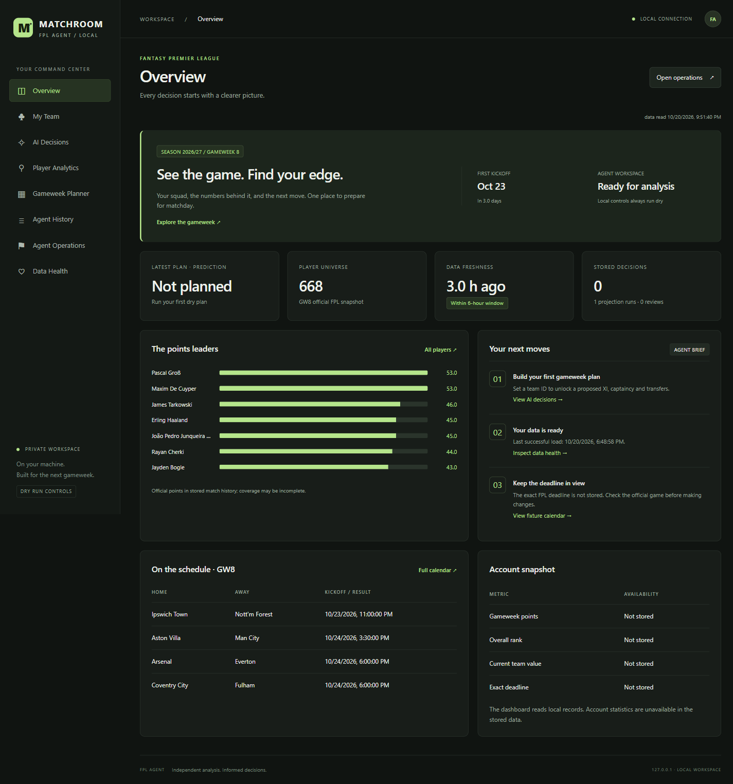

# fpl-ai-agent

[](https://github.com/OPEXAI-GG/fpl-ai-agent/actions/workflows/ci.yml)


A Fantasy Premier League (FPL) planning agent. Each gameweek it simulates how every player scores
(minutes, goals, assists, clean sheets, saves, defensive contributions, bonus, cards), plans
transfers and chips over an eight-gameweek horizon, picks the starting XI and captain, checks the
plan against safety rails and reports what it would do.

**Who it is for:** FPL managers comfortable with a command line, and developers interested in
football modelling and optimisation.

**Dry-run by default.** Out of the box nothing logs in to FPL and nothing touches your team. You read
the report and make the moves yourself.



## Try it safely

Needs Python 3.12 or newer and [uv](https://docs.astral.sh/uv/).

```bash
uv sync --frozen                                 # install the locked dependencies
uv run fpl-agent status                          # confirm the mode
uv run fpl-agent db-update --points              # public FPL data into data_cache/football.duckdb
uv run fpl-agent plan --entry <your-team-id> --force
```

What to expect:

* `status` prints `Mode: DRY - the agent only reports; it never logs in to FPL or changes your team.`
  and lists which optional keys are unset.
* `db-update --points` loads the first-run FPL data when the public feeds respond.
* `plan` reads your squad from FPL's public endpoints (no login), projects, plans, applies the rails
  and prints a report. It can still stop, or print a diagnostic instead of a recommendation, when
  data is missing, stale or fails a safety rail. Exit code 0 = report produced (or skipped),
  2 = error, 3 = blocked by a rail.
* Without `--force`, `plan` only acts when the next deadline is 45 minutes to 26 hours away;
  otherwise it reports "outside the action window" and stops.
* Your team id is the number in `fantasy.premierleague.com/entry/<id>/event/<n>`.

For a browser view, run `uv run fpl-agent dashboard` and open http://127.0.0.1:8765
([dashboard guide](docs/dashboard.md)).

## Learn more

| Topic | Where |
|---|---|
| How it works: data, models, planner, rails | [docs/architecture.md](docs/architecture.md) |
| Every command, the GitHub Actions workflows and the test levels | [docs/cli.md](docs/cli.md) |
| Scoring rules for 2026/27 (versioned YAML) | [rules/2026_27.yaml](rules/2026_27.yaml) |
| Keys, secrets and live mode | [docs/configuration.md](docs/configuration.md) |
| Local dashboard and its safety limits | [docs/dashboard.md](docs/dashboard.md) |
| Discord slash commands (`/ask`, `/plan`, `/latest`, `/explain`, `/status`) | [docs/discord-bot.md](docs/discord-bot.md) |
| Injury and availability policy | [docs/football-intelligence.md](docs/football-intelligence.md) |

## Safety

* `AGENT_MODE` is `dry` unless set to `live`. In dry mode no credentials are read and no
  authenticated request is made; the scheduled plan workflow also defaults to `dry`.
* `AGENT_ENABLED=false` is a kill switch: every run becomes a no-op.
* Rails block or hold a plan on stale data, hit caps, doubtful players, chip misuse, budget or squad
  errors, and changes you made by hand ([architecture](docs/architecture.md)).
* Keys come only from environment variables or GitHub secrets and are never printed.
* The dashboard listens on 127.0.0.1 only and its actions are dry-only.

## Project status

Version 0.1.0, pre-release. It does not promise accuracy, a rank or production readiness.

| Area | State |
|---|---|
| Data pipeline, projections, planner, rails, dry-run reports, gameweek review and lessons | Implemented and tested in CI |
| Local dashboard, Discord bot | Implemented; dry-only actions |
| Odds blending, AI scout (news text) | Optional; each skips cleanly without its key |
| Live execution on a real FPL team | **Experimental.** Tested against mock servers only, never on a real account ([details](docs/configuration.md#live-mode-experimental)) |

### Data limitations

* FotMob is an unofficial feed. It is checked against a contract on every call and by a daily canary;
  if it changes, the source is skipped and the others carry on.
* The published database is not yet validated evidence. At the last check (28 Oct 2026) it had no
  2026/27 gameweeks eligible for validated back-tests (GWs 6–8 reconstructed, 1–5 unavailable), and
  FotMob detail was linked for 83% of FPL minutes
  ([verification notes](docs/research/database-production-verification.md)).
* Odds use only what The Odds API free tier serves; without a key the model runs on results and xG.
* Price changes are not modelled; money in the bank has a small flat value.
* The scout covers availability only: no transfer rumours or tactical claims.

## Development

```bash
uv sync --frozen
uv run ruff check . && uv run ruff format --check .
uv run pytest -q                # offline, on recorded responses
```

Source is in `src/fpl_agent/` (`data/`, `db/`, `model/`, `solver/`, `execution/`, `dashboard/`), tests
in `tests/`, the Discord bot in `discord/`, data release scripts in `scripts/`. The archive scripts and
their tests need Linux with `zstd`; elsewhere those tests are skipped and CI runs them.

## Contributing

Open a pull request against `master`. CI must pass: ruff lint and format, the full test suite with an
85% coverage gate, the CLI smoke test, the Discord bot tests and the dashboard browser tests. Changes
that touch `src/fpl_agent/execution/`, settings or the plan workflow need a review of the dry-run
guarantees before merge. The repository has no license file yet.
